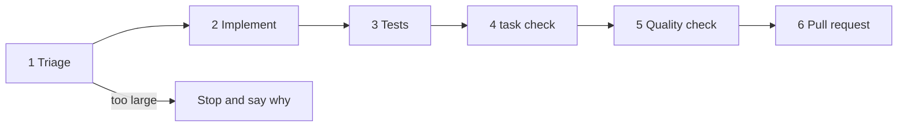

# Issue work

This is the repository's default workflow (a focused branch and a pull request
to `main`, [AGENTS.md](../../../AGENTS.md)) applied to one Issue. SDD features
go through [issue-handoff](../issue-handoff/SKILL.md) instead.

## Steps

1. **Triage.** Read the Issue, its comments and the code it names. Stop and
   tell the maintainer which way to go, without a branch, when any holds:

   | Condition | Where it goes |
   | --- | --- |
   | The Issue has the `spec` or `task` label, or is a native child of a `spec` Issue | `issue-handoff` |
   | What the user gets is not stated, or two readings give different behaviour | `issue-spec`, or a question to the maintainer |
   | The change adds a screen, an API endpoint, a migration or a dependency direction in `ARCHITECTURE.md` | `issue-spec` for an SDD feature |
   | The Issue is a tracking or discussion Issue with no change to make | Nothing; say so |

   Otherwise write the behaviour the change must have in two or three lines.
   For a bug, that is the steps, the expected and the actual result; reproduce
   it before changing anything.
2. **Implement.** Create a branch from the latest `main`. Delegate the
   production change to the `subissue-implementer` worker when the host
   provides it, with the Issue, the behaviour from step 1 and a write scope;
   it does not write tests in this workflow. A change of a few lines is made
   locally.
3. **Tests.** Delegate to the `test-writer` worker when the host provides it,
   with the Issue, the behaviour from step 1, the diff and the same write
   scope; otherwise follow [test-writing](../test-writing/SKILL.md) locally.
   Inspect what it returns: a level table row without a reason sends the work
   back.
4. **Repository checks.** Run the pre-push checks from `AGENTS.md`
   (`task check`, `task check-docs`). Update the documents the change makes
   stale and hand them to `doc-translator`.
5. **Quality check.** Delegate to the `quality-checker` worker when the host
   provides it, with the base branch and the level table; otherwise run
   [quality-check](../quality-check/SKILL.md) locally. Fix every finding and
   repeat from step 4. When the maintainer asked for self-review, run
   [self-review](../self-review/SKILL.md) after this step.
6. **Pull request.** Push and open a pull request to `main` that fills
   [the PR template](../../../.github/pull_request_template.md), with
   `Closes #<Issue>`, the level table under `テスト` and the output of
   `task test-cost -- -measure`. Then drive the pull request until its checks
   pass.

One run takes one Issue to one pull request. When the maintainer hands over
several Issues, run them one after another, each on its own branch.
