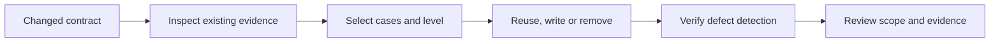

# Write tests

Use this skill before choosing test cases, including tests added without a
separate user request. It applies to ordinary changes, SDD and review fixes.
It does not start SDD, expand the task, or require approval for routine test choices.

Read [testing.md](../../../docs/design-docs/testing.md) first. For waits or
concurrency, also read [testing-time.md](../../../docs/design-docs/testing-time.md);
for Web tests, read [web-testing.md](../../../docs/design-docs/web-testing.md).
These documents own the rules; this skill applies them to the current change.

The workflow selects evidence before writing a test.

## Select cases

Before editing tests, identify the changed behaviour from the request, contract
or bug, and inspect the relevant implementation and existing tests.

Record a compact case selection in the working response; in SDD planning, put
the feature-specific choices in the unit's existing acceptance evidence instead.
Use one entry per distinct behaviour, not per table row or input variation.

| Field | Evidence to record |
| --- | --- |
| Behaviour and defect | What observable result would be wrong without the rule or fix |
| Existing coverage | The test already proving it, or the gap that needs a case |
| Level and dependencies | The lowest level that detects the defect, and why any real dependency is needed |
| Fixture and synchronization | The minimal cases or actual boundary, and the state or virtual time the test observes |
| Decision and assertion | Reuse, add, revise or remove, with the result or effect to assert |

Reuse sufficient coverage; a change does not automatically need a new test.
Remove duplicate or out-of-scope cases instead of moving them to an integration
suite. Load measurements need a requested performance objective; a large unit
fixture is not a reason to create a benchmark. Resolve routine fixture and fake
choices locally; escalate only a conflict with the requested behaviour or an
approved architectural decision through the owning workflow.

## Write and verify

Implement the selected cases within the authorized scope, applying the linked
policy rather than copying neighbouring tests' setup.

1. Use existing seams and minimal helpers; extract a hidden rule when necessary
   and retain a focused check that its production caller uses it.
2. Assert the observable contract, including dependency arguments and required
   effects where they are the boundary under test. Expected values come from
   the contract, not a copy of the implementation's algorithm.
3. Run the affected tests. For a bug fix, show that the regression case fails
   without the fix when practicable; otherwise state the limitation. For
   cancellation or synchronization changes, temporarily disable the behaviour
   and confirm failure as required by the policy. Never commit the mutation.
4. After a push, read Codecov's coverage report on the PR. Each changed line
   it lists as uncovered needs a selected case, or the report names it with
   the reason it stays uncovered.
5. Run the checks required by the owning workflow and `AGENTS.md`. A delegated
   worker runs its focused checks and leaves full validation and push to its
   parent; this skill grants no branch, push or merge authority.

## Review and report

Review the changed tests against the selected cases before calling the work done.
Review mode performs this check on an existing diff without adding tests merely
to fill the selection table.

| Check | Required evidence |
| --- | --- |
| Detection | Assertions distinguish the intended behaviour from the named defect |
| Cost | Each real dependency, input size and repetition serves the tested boundary |
| Waiting | Success observes state or virtual time without waiting out a wall-clock timeout |
| Scope | Removed integration coverage is identified separately from isolated unit coverage |
| Wiring | Extracted rules have a caller check, not only helper tests |

Fix mismatches inside the task's scope, then run the affected checks again.
Report selected levels, reused or removed coverage, checks and their results,
and any unverified boundary in the existing PR validation section or worker
return. Do not create a separate test-plan file or a new approval checkpoint.
