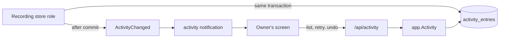
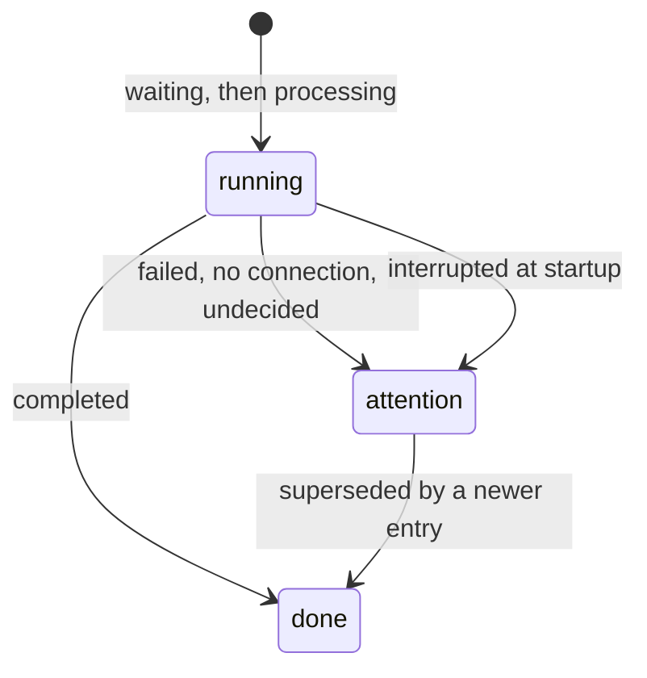

# Activity log

VVMDM keeps a persistent log of the processes it runs on a video or a pair
and of the owner's tag and version operations, one activity entry per run and
subject, and lists it to the owner newest first. The entries and their rules
are [`internal/domain/activity_entry.go`](../../internal/domain/activity_entry.go),
the table and the list are
[`internal/store/activity.go`](../../internal/store/activity.go), and retry
and undo are dispatched by
[`internal/app/activity_log.go`](../../internal/app/activity_log.go). The
reasons for each rule are in
[055 research](../../specs/055-activity/research.md); the schema is
[055 data-model](../../specs/055-activity/data-model.md). An activity entry is
not the scan activity, the in-memory line of what an import runs now
([R-1](../../specs/055-activity/research.md#r-1-a-persistent-activity-log-named-apart-from-the-scan-activity)).

The diagram shows where an entry is written and how the owner reads it.

## An entry is written in the transaction of its change

A store role that runs, finishes or decides something recorded writes or
updates its entry through one package-private helper inside its own
transaction, and the commit publishes `ActivityChanged`. The entry and the
change it records therefore always agree, and no role calls another role's
methods
([R-2](../../specs/055-activity/research.md#r-2-an-entry-is-written-in-the-transaction-of-the-change-it-records)).
`ActivityStore` only lists, reads one entry and recovers at startup.

The table is user data: it is never rebuilt or pruned and names its subject by
content key with the label as written, so an entry outlives its video
([R-10](../../specs/055-activity/research.md#r-10-the-subject-is-a-content-key-with-a-label-kept-at-write-time)).

## Status, reason and outcome

An entry is `running` or `attention` with a reason, or `done` with an outcome.
Writing an entry closes the older `attention` entries of the same kind and
subject as `done`/`superseded`, so the attention count is the problems still
open; a `version_judgement` keeps one entry per pair and is never closed this
way
([R-4](../../specs/055-activity/research.md#r-4-three-statuses-with-a-reason-and-a-newer-run-closes-an-older-problem)).

An `import` entry is `running` while any of its jobs is pending (`waiting`
until one is claimed), `attention`/`failed` when a stage gave up, else
`done`/`completed` (`ImportActivityState`).

## Startup marks claimed entries interrupted

Before the workers start, every `running` entry with reason `processing`
becomes `attention`/`interrupted`; a `waiting` entry was never started and
stays as it is ([process-lifecycle.md](process-lifecycle.md)).

## The list pages by id and counts in the same read

`GET /api/activity` returns entries by id descending with an opaque cursor, so
entries written while the owner scrolls do not shift the next page
([R-9](../../specs/055-activity/research.md#r-9-keyset-paging-by-id-newest-first-filtered-by-status)).
The page, the status counts and the feature counts come from one read-only
snapshot.

| Filter | Status counts | Feature counts |
| --- | --- | --- |
| `status` | Ignored | Applied |
| `feature` | Applied | Ignored |
| `decider`, `since`, `q` | Applied | Applied |

`q` matches the subject's labels without case. An `undo` entry carries the
feature of the entry it undid. The contract is
[055 screen-api.md](../../specs/055-activity/contracts/screen-api.md).

## Retry and undo are dispatched by kind

`app.Activity` answers retry only for an entry that offers it
(`attention` with reason `failed` or `interrupted`, of a retryable kind) and
undo only for an automatic decision not yet undone, then hands the entry to the
use case registered for its kind. A kind with nothing registered answers
`409 activity_not_retryable` or `409 activity_not_undoable`; no kind is
registered yet.

## The screen refreshes on an activity notification

`ActivityChanged` becomes an `activity` event with no payload on
`/api/events`, sent to owner streams only and coalesced per connection like
`candidates`
([R-8](../../specs/055-activity/research.md#r-8-the-screen-refreshes-on-an-activity-notification)).

| Rejected | Why |
| --- | --- |
| Entries in the notification payload | Every other notification is re-read state; a payload would need its own ordering and paging |
| An event-bus subscriber that writes entries | A crash after commit would lose the entry, and events carry no decider or probability |
