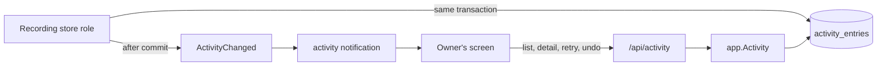
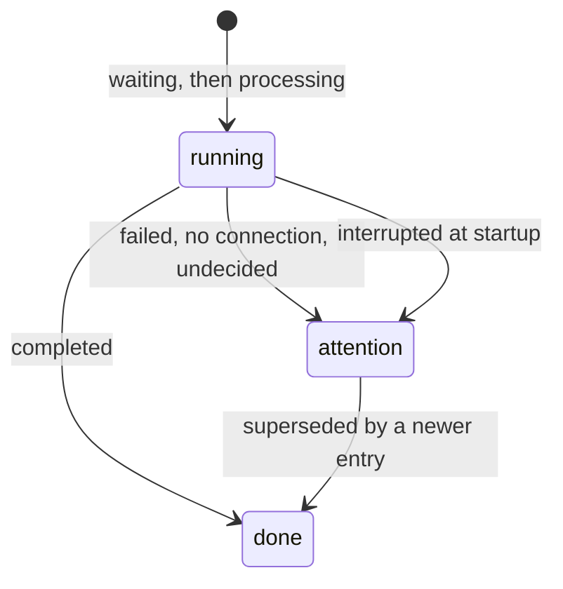

# Activity log

VVMDM keeps a persistent log of the processes it runs on a video or a pair
and of the owner's tag and version operations, one activity entry per run and
subject, and lists it to the owner newest first. The entries and their rules
are [`internal/domain/activity_entry.go`](../../internal/domain/activity_entry.go),
the table and the list are
[`internal/store/activity.go`](../../internal/store/activity.go), and retry
and undo are dispatched by
[`internal/app/activity_log.go`](../../internal/app/activity_log.go). An activity entry is
not the scan activity, the in-memory line of what an import runs now.

The diagram shows where an entry is written and how the owner reads it.

## An entry is written in the transaction of its change

A store role that runs, finishes or decides something recorded writes or
updates its entry through one package-private helper inside its own
transaction, and the commit publishes `ActivityChanged`. The entry and the
change it records therefore always agree, and no role calls another role's
methods.
`ActivityStore` only lists, reads one entry or its detail and recovers at startup.

The table is user data: it is never rebuilt or pruned and names its subject by
content key with the label as written, so an entry outlives its video.

## Status, reason and outcome

An entry is `running` or `attention` with a reason, or `done` with an outcome.
Writing an entry closes the older `attention` entries of the same kind and
subject as `done`/`superseded`, so the attention count is the problems still
open; a `version_judgement` keeps one entry per pair and is never closed this
way.

## Imports and failed scans

A video's import is one `import` entry for its five ingest stages.
Each job row keeps the id of the entry it belongs to
([`internal/store/activity_import.go`](../../internal/store/activity_import.go)).

| Event                                                                                                   | Entry                                                                                        |
| ------------------------------------------------------------------------------------------------------- | -------------------------------------------------------------------------------------------- |
| A job is queued for a video with a pending job whose entry is `running`                                 | The job joins that entry                                                                     |
| A job is queued for a video with no such entry                                                          | A new `running`/`waiting` entry, with the decider of whoever queued it                       |
| A job is claimed and its entry is not `running` (interrupted at startup, or queued before this feature) | A new entry by `rule`, which takes every pending job of the video and supersedes the old one |
| A job of the entry finishes or fails                                                                    | The entry is rolled up again                                                                 |
| The video is deleted, or its last pending job is dropped because the video lost its registered location | The entry closes as `done`/`gone`                                                            |

The roll-up (`ImportActivityState`) is `running` while any of the entry's jobs
is pending (`waiting` until one is claimed), `attention`/`failed` when a stage
gave up, with that stage in `stage` and its message in `detail`, else
`done`/`completed`. A finished entry never returns to `running`, so a rescan,
a re-probe or a retry that queues jobs again opens a new entry. A scan queues
all the jobs a video needs in one transaction, so a stage that finishes in
between cannot close the entry before the later stages join it. The progress
of a `processing` entry counts the stages done across all the video's jobs,
since a retry's entry holds only the jobs it queued again.

The decider is the one who started the run.

| Run                                                        | Decider |
| ---------------------------------------------------------- | ------- |
| Manual scan, re-probe, retry from the activity log         | `owner` |
| Watch scan, startup resume, a claim that opens a new entry | `rule`  |

The ingest queue port (`scanner.Queue`) takes the decider, and `app.Scans`
passes it from the scan's start.

Settling an `import` entry also rewrites its stage rows
(`activity_entry_stages`), one per stage the entry holds a job for, with the
stage's state (`waiting`, `processing`, `done`, `failed`) and its last error
message. A stage the entry never held has no row, which is how "not part of
this run" differs from "waiting". When the entry closes as `gone`, its
unfinished rows become `gone`. The rows carry no video foreign key, so the
breakdown stays readable after the video is deleted.

A scan writes a `scan` entry only when it ends `failed` for a reason other
than `interrupted`; its subject is the scan id and its label the scan's
origin. The next scan that ends `done` closes every open `scan` entry as
`superseded`. A scan closed as `interrupted` at startup writes nothing, since
startup resumes it.

## A pipeline groups one import run

A `pipeline` entry (feature `import`, subject the video) groups one video's
import run with the follow-up processes that run starts. The code is
[`internal/store/activity_pipelines.go`](../../internal/store/activity_pipelines.go)
and the roll-up `PipelineState` in
[`internal/domain/activity_pipeline.go`](../../internal/domain/activity_pipeline.go).
Members are linked by `activity_pipeline_members`, so one entry can belong to
more than one pipeline. A pipeline has no stage, detail, probability or undo
keys, its decider is its first member's, it is never a member itself, and it
is never retried, undone or superseded.

| New entry                                                                                                                                           | Pipeline                                                                                    |
| --------------------------------------------------------------------------------------------------------------------------------------------------- | ------------------------------------------------------------------------------------------- |
| A new `import` entry: scan, watch scan, re-probe, a move written as `done`                                                                          | Opens a new pipeline as its first member; a scan's pipeline records the scan in `scan_id`   |
| An entry that continues earlier ones: a retry from the activity log, or a new `import` entry that takes over the pending jobs of an interrupted one | Joins every pipeline of the entries it continues (`recordContinuedActivity`) and opens none |
| A follow-up process started by an `import` entry's stage result                                                                                     | Joins every pipeline of the finishing job's `import` entry (`joinJobPipelines`)             |
| Anything the owner starts outside an import                                                                                                         | None: the entry stays standalone                                                            |

Entries written before pipelines existed belong to none, and the migration
infers no grouping for them. A continuation or follow-up of such an entry
therefore joins nothing.

Every write of a member's state re-rolls its pipelines in the same transaction,
through the helpers that write entry states, and the pipeline row stores the
result. Writing an entry that supersedes another records it in the older
entry's `superseded_by`. The roll-up reads the members that are not replaced,
a member being replaced when its `superseded_by` is a member of the same
pipeline, such as a failed `import` entry and its retry.

| Members                                                              | Pipeline                                                                |
| -------------------------------------------------------------------- | ----------------------------------------------------------------------- |
| Any `running`                                                        | `running`, reason `processing` when any is `processing`, else `waiting` |
| None `running`, any `attention`                                      | `attention` with the reason of the oldest such member                   |
| All `done`, the `import` member `gone`                               | `done`/`gone`                                                           |
| All `done`, the `import` member superseded from outside the pipeline | `done`/`superseded`                                                     |
| All `done` otherwise                                                 | `done`/`completed`                                                      |

A later, separately started run opens its own pipeline, so a finished
pipeline returns to `running` only through its own members. A new follow-up
process decides whether it runs and writes its entry in the transaction of the
stage result that starts it, then calls `joinJobPipelines` with the finishing
job; a process that does not run writes nothing, so its pipeline never waits
for it. Startup recovery marks members interrupted and re-rolls their
pipelines instead of marking a pipeline directly. The activity list shows a
pipeline in place of its members
([the list](#the-list-pages-by-id-and-counts-in-the-same-read)).

## Owner operations write a done entry per video

An owner operation that changes a video's tags or version bundle, removes a
media folder, or fetches or applies work information writes `done` entries
decided by `owner` in the operation's transaction.

| Operation                                                                                     | Entries                                                                                                                                   |
| --------------------------------------------------------------------------------------------- | ----------------------------------------------------------------------------------------------------------------------------------------- |
| Bundle (video page, Duplicates, drag-organize)                                                | One `bundle` per member of the new bundle                                                                                                 |
| Make representative, remove from versions                                                     | One for the video                                                                                                                         |
| "Different videos"                                                                            | One `dismiss` for the pair                                                                                                                |
| Attach or detach a tag (video page, library selection, turning a group into a tag, `/api/v1`) | One per video and tag whose manual tag row changed; `detail` is the tag name                                                              |
| Keep or reject a suggested tag                                                                | One `tag_keep` or `tag_reject`; `detail` is the tag name                                                                                  |
| Apply fetched work information                                                                | One `work_info_apply`; its tags write no tag entries                                                                                      |
| Fetch work information                                                                        | One `work_info_fetch` per plugin run, `done`/`failed` with the plugin's message (else the failure code) when the run fails, never retried |
| Remove a media folder                                                                         | One `media_folder_remove` for the folder path; `detail` is the number of videos it took out of the library                                |
| Drag-organize undo                                                                            | One `organize_undo` per video whose bundle it restored                                                                                    |

A tag is attached to a user key, so a bundle's entry names its representative.
The video entries of one operation are written by one statement, and the
external API's video and tag pairs are found inside SQLite, so a
20000-video selection costs no extra statements. Owner entries are never
`attention`, so they close nothing.

## Startup marks claimed entries interrupted

Before the workers start, every `running` entry with reason `processing`
becomes `attention`/`interrupted`; a `waiting` entry was never started and
stays as it is ([process-lifecycle.md](process-lifecycle.md)).

## The list pages by id and counts in the same read

`GET /api/activity` lists **top-level entries**: pipelines and the entries that
belong to no pipeline. A member is not listed on its own; it is a summary
inside each of its pipelines, so a pair entry in two pipelines appears under
both. Entries come by id descending with an opaque cursor, so entries written
while the owner scrolls, members joining a listed pipeline included, do not
shift the next page. The page, the status counts and the feature counts come
from one read-only snapshot
([`internal/store/activity_pipeline_reads.go`](../../internal/store/activity_pipeline_reads.go)).

| Filter                  | Matches a top-level entry when                                                           | Status counts | Feature counts |
| ----------------------- | ---------------------------------------------------------------------------------------- | ------------- | -------------- |
| `status`                | The entry itself has it; a pipeline's status is its roll-up                              | Ignored       | Applied        |
| `feature`               | The entry, or one member of a pipeline, satisfies every given filter other than `status` | Applied       | Ignored        |
| `decider`, `since`, `q` | As `feature`                                                                             | Applied       | Applied        |

One filter builder (`activityFilter`) serves the page and both counts, so the
counts are the number of entries the list shows. A pipeline counts once per
status and once under each feature that it or a matching member has: the count
under a feature is the length of the list with only that feature selected.

A member summary carries what the card's result phrase reads, not `detail` or
`tags`: an `auto_tag` member's tag count, an `import` member's stage states,
whether a member of the same pipeline replaced it, and `matched`. With
`feature`, `decider`, `since` or `q`, `matched` marks the members that satisfy
all of them; with `status` alone, the members with that status; without a
filter it is absent. The screen uses it to point at the member that brought
the pipeline into the list.

`q` matches the subject's labels without case. An `undo` entry carries the
feature of the entry it undid. The contract is
[the screen API schema](../../api/openapi.yaml).

`GET /api/activity/{id}` reads one entry of any kind with what the list leaves
out: a pipeline's members as full entries in join order, replaced members
included; for a member, the pipelines it belongs to, newest first; for an
`import` entry, its stage rows with their messages, or `stagesRecorded: false`
for an entry written before stage rows existed. It is owner-only like the rest
of the log, and resolves videos for the owner.

## Retry and undo are dispatched by kind

`app.Activity` answers retry only for an entry that offers it
(`attention` with reason `failed` or `interrupted`, of a retryable kind) and
undo only for an automatic decision not yet undone, then hands the entry to the
use case registered for its kind. A kind with nothing registered answers
`409 activity_not_retryable` or `409 activity_not_undoable`.

| Kind       | Retry                                                                                                                                                                                                                                                                                                                                                  | Undo                                                                                                                 |
| ---------- | ------------------------------------------------------------------------------------------------------------------------------------------------------------------------------------------------------------------------------------------------------------------------------------------------------------------------------------------------------ | -------------------------------------------------------------------------------------------------------------------- |
| `import`   | `IngestStore.RetryImport` queues the video's failed stages again, as a re-probe does, and the jobs still waiting after an interruption; the owner's new entry supersedes the old one. It reads the entry again in its transaction, so a second retry of the same entry, a video that is gone, or nothing to queue answers `409 activity_not_retryable` | —                                                                                                                    |
| `scan`     | `Scans.RetryActivity` starts a manual scan of every media folder; `409 scan_in_progress` while a scan runs                                                                                                                                                                                                                                             | —                                                                                                                    |
| `auto_tag` | `AutoTagger` queues the video again; `409 auto_tagging_off` while the feature is off                                                                                                                                                                                                                                                                   | One tag at a time, in one `ActivityStore` transaction ([auto-tagging.md](auto-tagging.md#activity-entries-and-undo)) |

## The screen refreshes on an activity notification

`ActivityChanged` becomes an `activity` event with no payload on
`/api/events`, sent to owner streams only and coalesced per connection like
`candidates`.

On the Web client, the Activity screen (`web/src/activity`) refetches the
counts and every page it has loaded on that event and on a reconnect, and
replaces the cards in place; one refetch runs at a time, and a notification
during it or during the first page's load asks for one more. The shell's
sidebar entry and the screen's footer read the whole log's `counts` from a
request with no filter (`web/src/api/useActivityTotals.ts`), so `running`
there includes queued entries. The filters live in the page URL (`status`, `feature`, `decider`,
`period`, `q`); `period` is turned into `since` when the first page or a
refetch starts, and the next pages keep that `since`.
A card's `Retry`, `Undo` and `Undo tags…` send their request without a
confirmation (`web/src/activity/useActivityOperations.ts`) and, on success,
start the same refetch without waiting for the notification. A failure leaves
the card as it was and shows a toast.

A pipeline is one card (`web/src/activity/ActivityPipelineCard.tsx`) whose
members are rows inside it, replaced members left to the detail page. The
card says, without being expanded, which member is processing or needs
attention and how many members are done; `Retry` and `Undo` sit on the
member rows only. A card starts expanded while the pipeline is processing or
while a filter matched one of its members, and follows its state on each
refetch until the owner presses its button; that choice then holds while the
page stays open and is not kept in the URL. The title of every card and
member row opens that entry's detail, and the video opens only from `Open`.

| Rejected                                    | Why                                                                                         |
| ------------------------------------------- | ------------------------------------------------------------------------------------------- |
| Entries in the notification payload         | Every other notification is re-read state; a payload would need its own ordering and paging |
| An event-bus subscriber that writes entries | A crash after commit would lose the entry, and events carry no decider or probability       |
