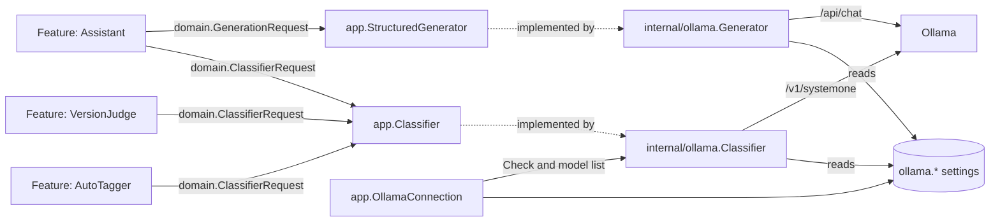

# AI layer: classifier port and providers

VVMDM's features reach a model only through two task-agnostic ports,
`app.Classifier` for yes/no decisions and `app.StructuredGenerator` for one
structured value, and the provider behind each is an adapter chosen in
`cmd/mdm`. A feature does not know which provider answers, where it runs, or
how many questions it accepts per call; a provider does not know which feature
asks or what the questions mean.

## Port

The port is a request of facts, images and yes/no questions, answered with a
probability per question. It is defined in
[`internal/domain/classifier.go`](../../internal/domain/classifier.go) and
[`internal/app/classifier.go`](../../internal/app/classifier.go).

| Value | Holds |
| --- | --- |
| `ClassifierInput.Facts` | Named text clues, such as `title`, `file_name` and `folder` |
| `ClassifierInput.Images` | JPEG images, shown in order |
| `ClassifierQuestion` | A key unique in the request, and the question text in English |
| Result | A probability from 0 to 1 per answered key; unanswered keys are absent |

A request has no limit on the number of questions. The feature builds the
facts and the question wording, and turns probabilities into decisions.

| Feature | Request | Document |
| --- | --- | --- |
| Auto-tagging | One question per candidate tag; the thumbnail, 8 frames and the facts `title`, `file_name`, `folder` | [auto-tagging.md](auto-tagging.md) |
| Duplicate judging | One question; up to 4 images of frame A beside frame B and no facts; sent only once the Ollama connection is saved | [duplicate-judging.md](duplicate-judging.md) |
| Assistant review runs | One question per candidate set; as facts, the two names with their synonyms or aliases and 3 titles each, or up to 10 titles and their folders of a work; no images | [assistant.md](assistant.md#review-runs-judge-candidate-sets-for-the-owner) |

## Generation port

The generation port takes a prompt and a JSON schema and returns one JSON
value that satisfies the schema
([`internal/app/generator.go`](../../internal/app/generator.go),
[`internal/domain/generation.go`](../../internal/domain/generation.go)). The
assistant is its one feature; it validates the value against its own schema
again, since a provider may not enforce every keyword
([assistant.md](assistant.md#one-structured-answer-per-turn)).

Failures wrap one domain cause each, so a feature maps them without reading
messages.

| Cause | When |
| --- | --- |
| `ErrOllamaUnreachable` | The endpoint cannot be reached |
| `ErrNotOllama` | The reply is not Ollama's |
| `ErrOllamaModel` | No generation model is saved, or Ollama answers an `error` (a missing model, for one) |
| `ErrOllamaTimeout` | No answer within the time limit |
| `ErrGenerationUnreadable` | The answer is not JSON |

| Rejected | Why |
| --- | --- |
| A text answer on the classifier port | The classifier answers yes/no questions with probabilities; a plan is one structured value, and the two calls' models and limits differ |
| The name `app.Generator` | `internal/app` already uses it for ingest's probe and thumbnail port |

## Ollama provider

[`internal/ollama`](../../internal/ollama) implements the classifier port
with Ollama's decision API (`POST /v1/systemone`) and a Clef model, and the
generation port with Ollama's chat API (`POST /api/chat`) and a chat model the
owner chooses. It owns everything specific to that provider:

| Concern | Rule |
| --- | --- |
| Connection | Reads the saved URL and models (`ollama.endpoint`, `ollama.model`, `ollama.generation_model`) on every call, so a change takes effect without a restart |
| Wire format, decisions | Facts become the `state` object, images are base64 `images`, every question is a `noul` question |
| Wire format, generation | One user message, the schema in `format`, `stream: false`; Ollama's grammar holds the answer to the schema for any chat model from 0.5.0 on |
| Batches | 16 questions per decision call, all with the same input; answers are merged. A generation call is never split or retried |
| Time | Each call times out after 10 minutes; the model stays loaded for 10 minutes after it (`keep_alive`) |
| Errors | Only the `error` text of an Ollama JSON reply is passed on; any other body is dropped |

The decision model cannot chat and a chat model cannot answer the decision
API, so the two models are separate settings.

Ollama accepts 64 questions per request, but 64 questions and a thumbnail make
about 7,400 input tokens, and Clef-flash on a 15 GB CPU machine was killed for
lack of memory. 16 questions make about 2,000 tokens with the thumbnail alone.
The images are processed again for every batch, so time per request grows with
the number of questions. On a 4-core CPU without a GPU, Clef-flash took about
100 s per thumbnail with 9 questions; the published GPU latency is under 0.2 s.

`app.OllamaConnection` saves the URL and the model and runs the connection
test, under Settings, Ollama (`/api/settings/ollama`, `/api/settings/ollama/check`).
It is separate from any feature's settings, so the connection can be set and
tested while every feature that uses it is off. The server never sends a request
to a URL from a request body; otherwise a request could make the server fetch
any reachable address and show the reply.

Testing is split by what it proves, so each failure names its cause and the
connection test does not depend on what the model is used for.

| Test | Proves | Requests | Time |
| --- | --- | --- | --- |
| Connection (Settings, Connections, Ollama) | Ollama runs at the URL, and has the decision model and, when one is saved, the generation model (a name without a tag means `:latest`) | `GET /api/version`, `GET /api/tags` | Seconds; no model is loaded |
| Judging (Settings, Auto-tagging, "Test judging") | The classifier port answers a question with a probability | One question through `app.Classifier` | Up to minutes, as it loads the model |

The connection test reports one of: Ollama cannot be reached, the server is not
Ollama, the decision model is missing, or the generation model is missing
(`reason: generation_model_missing`). The judging test belongs to the feature
that uses the port, so it works with whatever provider is behind it.

The two model fields are pickers filled from `GET /api/settings/ollama/models`,
which lists the names at the saved endpoint with the same two requests and
answers `409 ollama_unreachable` (`connection` or `not_ollama`) when it cannot;
a picker also saves a typed name that is not listed. `GET
/api/assistant/readiness` answers whether a generation call can be made from
the saved settings alone (`ollama_not_saved`, `generation_model_unset`),
without a request to Ollama.

| Setting | Default |
| --- | --- |
| Ollama URL | `http://127.0.0.1:11434` |
| Decision model | `clef-flash` (`clef` is 27B and more accurate) |
| Generation model | None; the assistant is unavailable until the owner saves one. `PUT` with an empty string clears it, and omitting it keeps the saved value |

## Image-edit provider

[`internal/comfyui`](../../internal/comfyui) is the provider for image edits.
One adapter serves both a self-hosted ComfyUI and Comfy Cloud, and keeps the
differences between them inside the package.
`internal/app` declares the interfaces it uses, and `cmd/mdm` passes the
adapter in; depguard keeps `internal/app` from importing it.

`app.ComfyUIConnection` saves the connection and runs the connection test,
under `/api/settings/comfyui` and `/api/settings/comfyui/check`. It is separate
from the thumbnail feature that uses the provider, as `app.OllamaConnection`
is separate from auto-tagging.

| Setting | Holds | Used by |
| --- | --- | --- |
| `comfyui.provider` | `self_hosted` or `cloud`; absent until the owner saves | Both |
| `comfyui.url` | The base URL, normalized as `ollama.endpoint` is | Self-hosted |
| `comfyui.api_key` | The Comfy Cloud API key | Comfy Cloud |
| `comfyui.model` | The model the edit runs: `flux2_klein_4b` or `qwen_image_edit_2511`; absent means `flux2_klein_4b` | Both |

Each provider keeps its own value when the owner switches to the other, so
switching back does not ask for the URL or the key again.

Each model has its own pair of bundled workflows, one without and one with
`vv:reference`, and both pairs fill the same `vv:*` nodes. Only the
instruction's input differs: `text` on FLUX.2 [klein]'s `CLIPTextEncode`,
`prompt` on Qwen-Image-Edit's `TextEncodeQwenImageEditPlus`. A run takes the
pair of the model saved when it starts.

| Model | Strength | Model files | Time per edit on Comfy Cloud |
| --- | --- | --- | --- |
| FLUX.2 [klein] 4B fp8 (default) | Removes captions most reliably | About 12 GB | 8–16 s  |
| Qwen-Image-Edit-2511 fp8mixed, Lightning 4-step LoRA | Takes the colours and mood of a reference image | About 31 GB | About 23 s, including uploads |

The Qwen-Image-Edit time was measured with one synthetic frame, and a
self-hosted ComfyUI needs a 24 GB GPU for it. The model's known weaknesses come
from the POC: it misread a Japanese instruction once, and
mosaicked a screen in the frame. The owner chooses the model in
Settings, so the default stays the one that is best at the main case.

The API key is write-only. `GET` answers `apiKeySet` and never the key, with
`Cache-Control: no-store`. A `PUT` without `apiKey` keeps the saved key, and an
empty string clears it. The key is stored as plain text: an encryption key
would sit in the same data folder, so encrypting would protect nothing from a
reader of the database.

| Connection test | Request | Unavailable when |
| --- | --- | --- |
| Self-hosted | `GET /system_stats` at the saved URL | The URL cannot be reached, or the reply is not ComfyUI's system information |
| Comfy Cloud | `GET https://cloud.comfy.org/api/jobs?limit=1` with `X-API-Key` | Comfy Cloud cannot be reached, or answers `401` or `403` to the key |

Once the provider answers, the test reads `GET /object_info` and checks the
saved model's two workflows vv bundles in
[`internal/comfyui/workflows`](../../internal/comfyui/workflows): every
`class_type` they use must exist, and every model file a loader node names must
be among that loader's options. The check answers unavailable with a `missing`
list: each model file with its folder under `models` and its download page,
then each missing node type, whose remedy is to update ComfyUI.
The embedded files are the source of truth for the workflows; the steps for an
owner are in
[comfyui-thumbnails.md](../how-to/comfyui-thumbnails.md).
`GET /api/thumbnail-edits/readiness` answers whether a connection is saved,
which is what the video page needs to enable the edit; it does not run the
test.

The test also reports when nothing is saved. Each cause has its own message,
and no message carries the body of the reply. The test does not follow
redirects, so the key is never sent to another host. As with Ollama, the server
sends requests only to the saved connection, never to a URL from a request
body.

## Adding a provider

A new provider is a new adapter package that implements
`Classify(ctx, domain.ClassifierRequest)` or
`Generate(ctx, domain.GenerationRequest)`, reads its own settings, and splits
requests to its own limits. `cmd/mdm` passes it to the features in place of
`internal/ollama`; no feature changes. depguard keeps `internal/app` from
importing a provider package ([.golangci.yml](../../.golangci.yml)).

| Rejected | Why |
| --- | --- |
| The feature passes the URL and model with each request | Every feature would read the provider's settings, and changing provider would change every feature |
| The feature splits questions to the provider's limit | The limit comes from one provider's memory use, and another provider's limit differs |
| Ollama settings and the connection test inside the auto-tagging use case | A second feature using the classifier would depend on auto-tagging |
| Test the connection by judging one question | It takes minutes while the model loads, a load timeout reads as a connection failure, and a model that cannot judge (a general chat model) always fails |
