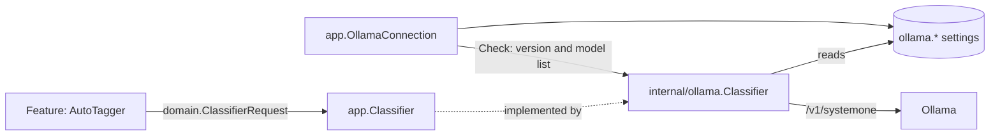

# AI layer: classifier port and providers

VVMDM's features reach a decision model only through one task-agnostic port,
`app.Classifier`, and the provider behind it is an adapter chosen in
`cmd/mdm`. A feature does not know which provider answers, where it runs, or
how many questions it accepts per call; a provider does not know which feature
asks or what the questions mean.

## Port

The port is a request of facts, images and yes/no questions, answered with a
probability per question. It is defined in
[`internal/domain/classifier.go`](../../internal/domain/classifier.go) and
[`internal/app/classifier.go`](../../internal/app/classifier.go).

| Value | Holds |
| --- | --- |
| `ClassifierInput.Facts` | Named text clues, such as `title`, `file_name` and `folder` |
| `ClassifierInput.Images` | JPEG images, shown in order |
| `ClassifierQuestion` | A key unique in the request, and the question text in English |
| Result | A probability from 0 to 1 per answered key; unanswered keys are absent |

A request has no limit on the number of questions. The feature builds the
facts and the question wording, and turns probabilities into decisions; for
auto-tagging that is [auto-tagging.md](auto-tagging.md).

## Ollama provider

[`internal/ollama`](../../internal/ollama) implements the port with Ollama's
decision API (`POST /v1/systemone`) and a Clef model. It owns everything
specific to that provider:

| Concern | Rule |
| --- | --- |
| Connection | Reads the saved URL and model (`ollama.endpoint`, `ollama.model`) on every call, so a change takes effect without a restart |
| Wire format | Facts become the `state` object, images are base64 `images`, every question is a `noul` question |
| Batches | 16 questions per call, all with the same input; answers are merged |
| Time | Each call times out after 10 minutes; the model stays loaded for 10 minutes after it (`keep_alive`) |
| Errors | Only the `error` text of an Ollama JSON reply is passed on; any other body is dropped |

Ollama accepts 64 questions per request, but 64 questions and a thumbnail make
about 7,400 input tokens, and Clef-flash on a 15 GB CPU machine was killed for
lack of memory. 16 questions make about 2,000 tokens with the thumbnail alone.
The images are processed again for every batch, so time per request grows with
the number of questions. On a 4-core CPU without a GPU, Clef-flash took about
100 s per thumbnail with 9 questions; the published GPU latency is under 0.2 s.

`app.OllamaConnection` saves the URL and the model and runs the connection
test, under Settings, Ollama (`/api/settings/ollama`, `/api/settings/ollama/check`).
It is separate from any feature's settings, so the connection can be set and
tested while every feature that uses it is off. The server never sends a request
to a URL from a request body; otherwise a request could make the server fetch
any reachable address and show the reply.

Testing is split by what it proves, so each failure names its cause and the
connection test does not depend on what the model is used for.

| Test | Proves | Requests | Time |
| --- | --- | --- | --- |
| Connection (Settings, Ollama) | Ollama runs at the URL, and has the model (a name without a tag means `:latest`) | `GET /api/version`, `GET /api/tags` | Seconds; the model is not loaded |
| Judging (Settings, Auto-tagging, "Test judging") | The classifier port answers a question with a probability | One question through `app.Classifier` | Up to minutes, as it loads the model |

The connection test reports one of: Ollama cannot be reached, the server is not
Ollama, or the model is missing. The judging test belongs to the feature that
uses the port, so it works with whatever provider is behind it.

| Setting | Default |
| --- | --- |
| Ollama URL | `http://127.0.0.1:11434` |
| Model | `clef-flash` (`clef` is 27B and more accurate) |

## Workers AI through a relay

To try auto-tagging where Ollama cannot run, the development tool
`scripts/clefrelay` listens on Ollama's address and forwards the Ollama
provider's requests to Clef on Cloudflare Workers AI
([workers-ai-relay.md](../how-to/workers-ai-relay.md)); VVMDM has no Workers AI
provider and ships no relay. The relay tiles five or more images into one grid
because Workers AI accepts four, and on 12 test videos with 36 expected tags
one 3×3 grid of the nine images missed 5 tags with clef-flash, against 6 for
the thumbnail and three frames and 19 for the thumbnail alone. Every request
succeeded, in about 2 s and 5,800 input tokens per video.

| Difference | Ollama | Workers AI | Relay |
| --- | --- | --- | --- |
| Connection test | `GET /api/version`, `GET /api/tags` | None | Answers both itself, listing `clef` and `clef-flash` |
| URL | `{URL}/v1/systemone` | `/accounts/{id}/ai/run/@cf/cloudflare/{model}` | Picks the URL from `model` |
| Authentication | None | Bearer token | Adds `CLOUDFLARE_API_TOKEN` when set |
| Images | Raw base64 | Data URL or `{content_type, base64}`, at most 4 | Tiles 5 or more images into one grid |
| `keep_alive` | Accepted | Rejected (422) | Drops it |
| Reply | `{"answers"}` or `{"error"}` | Wrapped in `{"result"}`; errors in `{"errors":[{"message"}]}` | Unwraps both |

## Adding a provider

A new provider is a new adapter package that implements
`Classify(ctx, domain.ClassifierRequest)`, reads its own settings, and splits
requests to its own limits. `cmd/mdm` passes it to the features in place of
`internal/ollama`; no feature changes. depguard keeps `internal/app` from
importing a provider package ([.golangci.yml](../../.golangci.yml)).

| Rejected | Why |
| --- | --- |
| The feature passes the URL and model with each request | Every feature would read the provider's settings, and changing provider would change every feature |
| The feature splits questions to the provider's limit | The limit comes from one provider's memory use, and another provider's limit differs |
| Ollama settings and the connection test inside the auto-tagging use case | A second feature using the classifier would depend on auto-tagging |
| Test the connection by judging one question | It takes minutes while the model loads, a load timeout reads as a connection failure, and a model that cannot judge (a general chat model) always fails |
