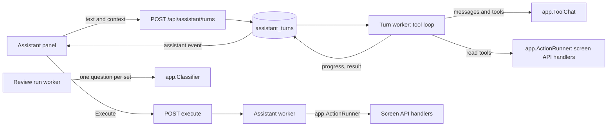
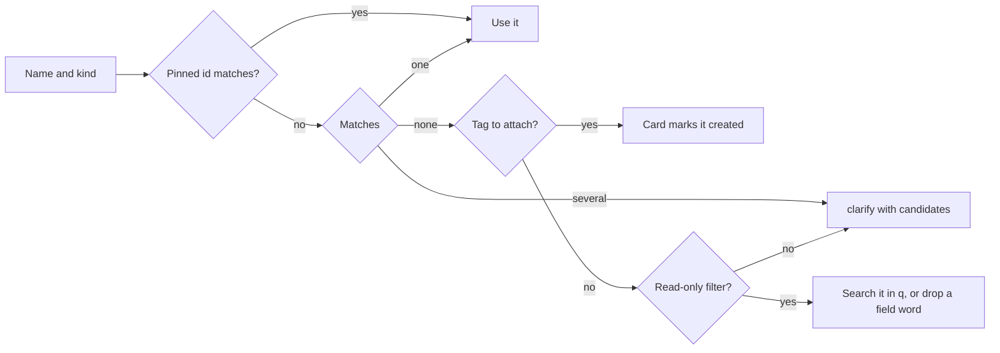
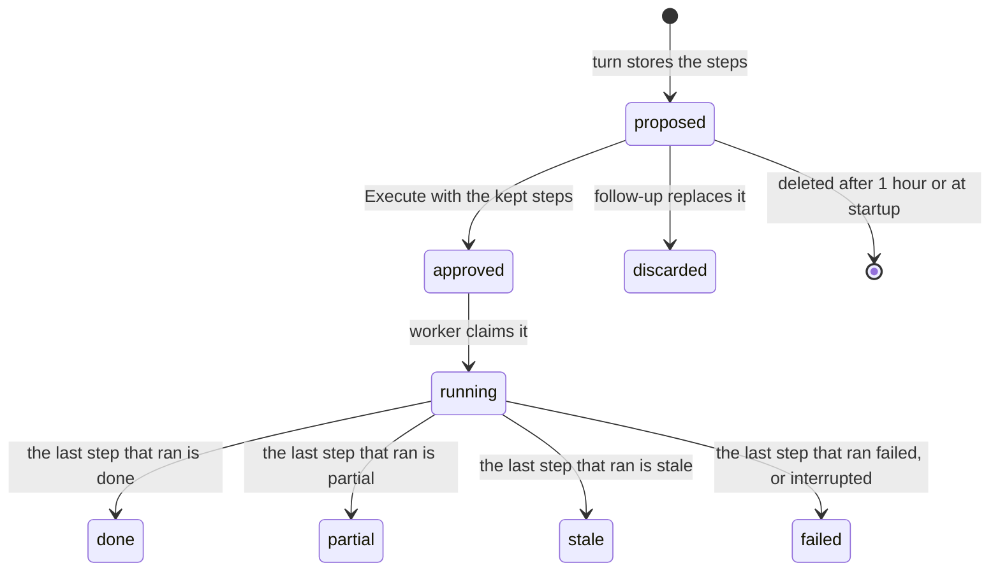

# In-app assistant

The assistant runs one request from the owner as a server-side job: a loop
over the owner's Ollama chat model in which the model calls the app's own
operations as tools until it answers. It carries out a write only after the
owner approves the card that shows it. The use case is `app.Assistant`
([`internal/app/assistant*.go`](../../internal/app)), its rules are in
[`internal/domain/assistant*.go`](../../internal/domain), its rows are
`AssistantStore` ([`internal/store/assistant*.go`](../../internal/store)), and
the screens are [`web/src/assistant`](../../web/src/assistant). The contract is
the `/api/assistant/*` operations of
[the screen API schema](../../api/openapi.yaml).

The diagram shows one request from the panel to its effect.



## A turn is a tool loop

The loop sends the messages and the offered tools to `app.ToolChat`, runs the
tool calls the model returns in order, appends each result as a `tool`
message, and repeats until the model answers with text and no tool call
([`assistant_loop.go`](../../internal/app/assistant_loop.go)). The model
always sees `find_tools` and the core reads (`listVideos`, `getVideo`,
`listTags`, `listPeople`, `listOrganizations`). `find_tools` searches every
other tool of [the registry](#the-tool-registry-classifies-every-operation)
by words over its name, summary and description, answers up to 15 with their
kind and, for an excluded one, the reason and page, for every match, and adds
the best read and write tools to the later calls of the same turn while their
schemas fit a quarter of the prompt, since every loaded schema is sent again
on each call. A call to a read or
write tool of the registry that is not offered yet runs and loads it as well,
since models often call a tool they know by name without searching first. The
system message names the screen's route and, for a page that shows one item,
its kind, id and name, so the first read needs no guessed id. The built-in tools
are also always offered
([`assistant_core_tools.go`](../../internal/app/assistant_core_tools.go)):

| Tool | What it does |
| --- | --- |
| `screen_context` | Answers the route and the entity it shows, the selected videos (id and title, with the count), the selected groups and smart folders (each with the count), and the library filter with the names its ids point at |
| `app_help` | Searches the page table in `internal/domain` (route, title and what the page is for, in the screens' own labels) and the operations' summaries by the query's English words, and answers the pages and operations that match; an excluded operation carries its reason and page. A query that matches nothing answers every page title, so the model can search again |
| `show_in_library` | Resolves the shipped filter fields as a filter that only reads, answers the conditions with the names and the number of matching videos, and sets the turn's `filter` directive |
| `open_page` | Resolves the shipped navigation fields and sets the turn's `navigate` directive |
| `start_review` | Starts a review run of `tags`, `people` or `works`, or finds the one running, and puts its id on the progress item for the panel's review row |

The diagram shows one round.

```mermaid
flowchart LR
  call[Model call] --> reply{Tool calls?}
  reply -->|no| empty{Text?}
  empty -->|empty once| call
  empty -->|empty twice| model[Stopped: model]
  empty -->|yes| ground[Grounding check]
  ground -->|pass| done[Turn done with the answer]
  ground -->|fail once| call
  ground -->|fail twice| unchecked[Turn done with the answer and its unchecked items]
  reply -->|yes| repeat{Same calls as the last reply?}
  repeat -->|yes| stop[Stopped: step_limit]
  repeat -->|no| each[Run each call, record progress]
  each --> stale{Second round in a row that learned nothing?}
  stale -->|yes| stop
  stale -->|no| call
```

| Rule | Why |
| --- | --- |
| A turn has no count or time limit: it ends when the model answers, when a reply repeats the previous reply's calls exactly, after two rounds in a row that learned nothing, or when the owner presses `Stop` (`stopAssistantTurn`), which cancels its context; once the model has answered, `Stop` is refused while the proposal is stored, so a stopped turn never leaves a proposal | A fixed budget cut off requests a model could finish; an exact repeat, whose results the model still holds, is the loop a limit was meant to catch |
| A round learned nothing when each of its calls repeats an earlier call of the turn (name and arguments), or, except for image and write tools, answers a result equal to an earlier one ([`assistant_loop_stale.go`](../../internal/app/assistant_loop_stale.go)) | Small models cycle through reads, such as `listVideos` and `listTags` in turn or `listVideos` with arguments that change nothing, which never repeats the previous reply and kept the GPU busy until the owner pressed `Stop`; one such round is allowed because a call may rightly fetch a result the context fitting dropped |
| A read runs at once through the owner's handler, behind the same peer forwarding as the screens, so a remote id reads the peer's entity; its result, like a built-in tool's, comes back as the whole JSON | Only the context fitting below cuts it, by the context the model runs with |
| Before each model call, the oldest tool results before the latest round are replaced by a note to call the tool again until the messages, tools and images fit the context Ollama ran the model with, as the last reply reported it, less a quarter for the reply; past that whole earlier rounds give way, oldest first, to one note, and then the latest round's longest results are cut, each with a note of its full size, counting three bytes a token for messages, four for tool schemas and 1,500 tokens an image | Ollama drops the oldest messages of a prompt past the context, the request among them, and some chat templates then fail; the reserve leaves room for a reasoning model's thinking; the latest round stays because a model whose fresh results vanish calls the same tools again |
| Arguments are checked against the tool's schema before anything runs; an invalid call, an unknown tool, an excluded operation and a failed read come back to the model as an error result and count as tool calls | The model can correct the call, and nothing runs from invalid input |
| A tool reaches the model under a name with each `.` written `__` (`updateVideoTags__add`), and a call's name is turned back before anything runs; progress items, steps and excluded operations keep the tool's own name | Providers accept only function names matching `^[a-zA-Z0-9_-]{1,64}$`, and Workers AI's Mistral refuses the whole request over one dotted name |
| A reply with neither text nor tool calls gets one correction round that asks for text or a tool call; a second one stops the turn as `model` | Some models leave the call in their reasoning, and an empty reply is no answer |
| A write call becomes one step of the turn's proposal and runs nothing ([Write calls become steps](#write-calls-become-steps)) | A write never runs before the owner approves it |
| The turn carries the last `show_in_library` or `open_page` as its directive, which the panel applies without confirmation | Showing and moving change nothing (requirement 13) |
| A name a directive tool cannot settle comes back to the model as an error result with the candidates, not as the turn's clarification | The model can call again with a candidate's name or ask the owner; a turn's clarification belongs to the write steps it would drop |
| Built-in arguments that are `null` or an empty string are dropped, and `"true"`, `"false"` and numbers written as strings are read as the boolean or integer the schema asks for, before the schema check | Chat models write them for an argument they mean to leave out, or quote scalars |
| A directive's or review run's result ends with a note to answer now | Small models otherwise call the same directive again until the step limit |
| Each tool call adds a progress item (`tool`, `kind`, the names its id arguments point at, `error`) composed by the server, committed as the call starts | The panel shows what is running from facts only, never from model text |
| The system message carries the rules, today's date, the screen as names and counts, and on a follow-up the previous request and its proposal's steps; the request, the screen and the tool results are marked as data | A follow-up needs only the previous request and proposal, and titles from files or plugins can carry instructions |
| The model answers in the request's language | The panel's own labels follow the app's language |

The grounding check reads the answer before the turn ends
([`assistant_grounding.go`](../../internal/domain/assistant_grounding.go)):
every number of two or more digits (after width folding), and every tag,
person or organization name of 3 or more characters that the answer mentions,
must appear in this turn's tool results, the request, the screen or today's
date. The answer mentions a name when its folded search key occurs as a token:
the character just before the match is not of the same script as the match's
first character, and the character just after is not of the same script as its
last. The scripts are katakana (with the long-vowel mark ー), hiragana, kanji,
and letters and digits together, so the tag `ライブ` is not mentioned in
`ライブラリ` but is in `ライブの動画`, and "live" is not mentioned in
"lively". A name written in hiragana and followed by a particle therefore goes
unchecked; the rule prefers that to stopping ordinary answers. The first
failure goes back to the model as one correction round that lists the
unsupported items; after a second failure the turn ends `done` with the answer
and the unsupported items as `unchecked`, which the panel shows under it for
the owner to judge. A turn whose model looked at
images with `view_images` skips the check: what it saw is in no text result.

| Ending | Turn | Kept |
| --- | --- | --- |
| Text that passes the grounding check | `done` with the answer | The progress and the proposal |
| A reply repeats the previous reply's calls exactly, or a second round in a row learned nothing | `stopped`, `step_limit` | The progress |
| The owner pressed `Stop` | `stopped`, `cancelled` | The progress; no proposal |
| The model's request timed out | `stopped`, `timeout` | The progress |
| Ollama not reached, or not Ollama | `stopped`, `connection` | The progress |
| The model is missing or answers an `error` | `stopped`, `model`, with Ollama's error as `detail` | The progress |
| Two replies with neither text nor tool calls | `stopped`, `no_answer`, with the last reply's `done_reason`, token counts and reasoning length as `detail` | The progress |
| A write call whose name needs the owner's choice | `clarify` with the name and its candidates | The progress; no proposal |
| Two answers that fail the grounding check, in a turn that did not look at images | `done` with the answer and its `unchecked` items | The progress and the proposal |
| An answer after the model asked for an excluded operation and ran nothing but `find_tools`, `app_help` and `screen_context` | `stopped`, `model`, with `excluded` (operation, reason, page) in place of the answer | The progress |
| The server stopped during the turn | `interrupted` at the next start | The progress |

| Rejected | Why |
| --- | --- |
| One structured-output call per request with a schema of outcome kinds | The owner's requests combine reads, judging and writes that no fixed set of outcomes covers |
| Every tool on every call | About 240 schemas need far more than the context holds |
| A citation format the model fills | Small models do not fill citation fields reliably; the check needs only data the server already has |
| Proposing the steps gathered before a limit | A stopped request proposes nothing |
| Any excluded tool among `find_tools`' answers as the request's operation | A search for `playlists` also finds `createApiToken`; only a call by name, or a `find_tools` whose first match outscores the rest, asks for it |

## Turns are server-side jobs

`POST /api/assistant/turns` stores an `assistant_turns` row in `running` and
answers `202` with it; the turn worker (`app.Assistant.RunTurns`) runs its
loop, and every progress item, the status and the result are committed to the
row, each commit followed by `AssistantChanged`. The panel re-reads
`GET /api/assistant/turns/{id}` on the `assistant` event, and
`GET /api/assistant/turns?active=true` lists the running turn and the turns
finished within the last hour, so closing the panel or reloading the page
loses nothing. The transcript stays in memory for the turn.

| Rule | Enforced in |
| --- | --- |
| One running turn at a time; a second request answers `409 assistant_busy` with the running turn's id | A partial unique index on `status`, and the create transaction |
| A turn moves from `running` to `done`, `clarify`, `stopped` or `interrupted` once | A guarded `UPDATE` |
| A turn running at startup becomes `interrupted` | `Assistant.Recover` |
| A turn finished more than 24 hours ago is deleted; reading it answers `404` | The turn worker |
| Readiness false answers `409 assistant_not_ready` before anything is stored | The handler |

## The server resolves names, targets and counts

Every name a request resolves is resolved by the server with the stored search keys
(width, case and kana folded), tag synonyms and person and organization
aliases (`AssistantVocabulary`); one match is used, several answer `clarify`
with the candidates, and none answers `clarify` with the entities whose names
contain the name (`コスプレ` offers `コスプレ衣装` and `コスプレ衣裳`), with two
exceptions. A tag to attach is marked created on the card. A tag, person or
organization in a filter that only reads joins the filter's free text `q` as a literal search term, quoted when
the search grammar would otherwise read it as an operator or several words, so
one loose name does not fail a read. The name is dropped when it is a field
word such as `tags`, or when `q` already requires it as a positive term. A
name is trimmed, and a tag name is tried again without a trailing tag word
(`ライブタグ`), since models copy both from the request, unless an earlier step
of the turn creates the whole name. A name carries the
kind the model inferred, and `any` tries person, organization and tag, so a name
found under two kinds is a clarification. A read-only filter also drops a
duration bound of `0` and a day that is not a date, which a model writes for a
member the request does not set; a change's target keeps them, so the
validation asks instead of widening the target.

The diagram shows the rule for one name.



| No match for a name in | Answer | Why |
| --- | --- | --- |
| A filter that only reads | Search it as text in `q` | A local model often puts a topic or a field name where a tag goes; a wider read costs nothing and the owner sees the result |
| A change's target, its arguments, or a smart folder rule | `clarify` | Guessing would change or save something the owner did not name |

The panel sends the route, the selected videos, groups and smart folders, the
library filter and the ids chosen in a clarification (`pinned`); the model
sees names and counts, never ids.

| Word in the request | Target |
| --- | --- |
| `これ`, `選んだもの` (`selection`) | The selected videos and smart folders, or the open video; a filter on it narrows them, which is how `長いのは除いて` keeps the previous target, and the 20,000-video limit applies to the narrowed videos, not to the filter's library-wide match |
| `ここ` (`current`) | The open video, smart folder, person, organization or tag, or the library filter; a filter on it narrows them |
| A name (`named`) | The entities the row's target kind resolves |
| A filter (`filter`) | Every video matching it, counted by the server |

Favorites act on a selected or open group or smart folder itself, as the
library's favorite action does: the folder is not expanded to its videos, and
a selected group's members are not favorited with it.

A target over 20,000 videos answers `400 too_many_videos`, as the bulk
operations do. A clarification choice is sent again as the same request with
the chosen id pinned; a pinned id wins only when it is among the candidates the
name finds, so a chosen alias does not ask the same question again.

## The tool registry classifies every operation

Every owner operation of the screen API is exactly one of a read tool, a
write tool, or an exclusion with a reason and the page to use instead. The
registry has three sources, and only `internal/httpapi` reads the spec data:

| Source | Holds |
| --- | --- |
| `internal/httpapi/gen/assistant_tools.gen.json`, written by `task generate` ([`tools/assistanttools`](../../tools/assistanttools)) from `api/openapi.yaml` and embedded by `internal/httpapi` | Each operation's method, path, summary, description, whether it needs a session, whether it answers JSON, an image or a stream, whether its response reaches a credential, its arguments as one JSON Schema (path and query parameters by name, the body as `body`, every `$ref` inlined), the body's media type (JSON, or `multipart/form-data` whose text fields the runner sends as parts; file parts are left out), and the entity kind of each id in its path and body |
| [`assistant_tools.go`](../../internal/domain/assistant_tools.go) and [`assistant_catalog.go`](../../internal/domain/assistant_catalog.go) in `internal/domain` | The classification, the write rows, the exclusions with their reasons and pages, and the table of the app's pages (route, title, purpose) |
| `httpapi.ActionRunner.Tools()` | The tools built from both, which `internal/app` receives without reading the spec |

The classification follows these rules
(`domain.ClassifyAssistantOperation`):

| Kind | Operations |
| --- | --- |
| Excluded | The listed exclusions and `/api/assistant/*`; each answers its reason and page |
| Write | Every operation a catalog row calls |
| Read | Every other `GET`, and the `POST`s that write nothing (`tagImpact`, `summarizeVideoTags`, `searchWorkInfo`, `fetchWorkInfo`, the connection checks, …) |

A test in [`assistantcheck`](../../internal/domain/assistantcheck) reads the
generated file and fails when an owner operation is in no list or in two,
when a listed operation is missing from the spec, when a read answers a
credential or a stream, or when a schema row's id has no kind a card can
label. A new screen operation is therefore a decision, not an accident.

Write rows come in three kinds:

| Kind | Arguments | Examples |
| --- | --- | --- |
| Name-based | A target and named arguments that plan builders resolve to ids | `updateVideoTags.add`, `mergeTag`, `applyWorkInfoFetch` |
| Schema | The operation's own path parameters and body, ids included; the runner checks the body against the schema before the call | `moveFaceAppearances`, `undoActivity`, `setVideoDetails` |
| Composite | A target and named arguments; the row runs its stages in order and calls its cleanup when a stage fails | `editVideoThumbnail`: `startThumbnailEdit`, `runThumbnailEdit`, `applyThumbnailEdit`, then `cancelThumbnailEdit` or `discardThumbnailEdit` |

An id's entity kind comes from its path parameter's name in
`components/parameters` (`PersonId` names a person) or from `x-vv-entity` on
the parameter or property, which wins. Body ids need the annotation, since
body `$ref`s are inlined: `FaceAppearanceMoveRequest.targetId` is a
`person`, and its `appearanceIds` items are `faceAppearance`s. An annotation on
an object names the kind of that object's own `id`, which lets the shared
`CreditIdRef` name a person in one place and an organization in another.

Credentials stay away from the model in two ways. The spec marks a response
property that may hold one with `x-vv-secret: true`
(`PluginProxySettings.url`, which may carry `user:pass@`), and the generator
also flags `format: password` and string properties named `password`,
`secret`, `token`, `apiKey` or `credential`; such an operation must be
excluded. The runner then replaces the userinfo of every URL in a read result
with `***`, which covers saved URLs the marks miss.

The runner calls every operation in process as the owner. A read's arguments
are checked against its schema before the call, and an operation that is not
a read is refused before any call. An image operation answers a reference,
`{ "image": "<operationId>?<parameters>", "contentType": ... }`, which
`ActionRunner.Image` reads back as bytes, so a tool result holds no bytes and
no URL.

| Excluded | Page | Why |
| --- | --- | --- |
| The account, sign-in and API tokens; plugin upload, approval and settings; network and proxy settings; media folders; watch history deletion; the face runtime download; onboarding | Their settings page, History, or Welcome | The feature's requirement keeps them on their own pages |
| `getPluginProxySettings` | Settings, Network | Its URL may hold the proxy's user and password |
| Pairing with another node and the peer's own calls (`applyPeerVocabulary`, `rankPeerRelated`, …) | Settings, Pairing | Pairing is a trust decision made with the other node's code; the peer's calls carry its credential ([peer-library.md](peer-library.md)) |
| `deleteVideo`, `clearPeople` | The video page; Settings, Danger zone | An irreversible delete stays on its page |
| `uploadThumbnailImage`, `uploadPersonImage`, `startThumbnailEditFromImage` | The video or person page | The server holds no such file; the fetch-apply rows cover plugin images |
| Drag operations (`organize*`) | Library | They take drag tokens; the group, bundle and playlist rows make the same changes |
| `openVideoFile`, video and event streams, subtitles, the transcode start, `getHealth` | The video page | Loopback-only, or a stream rather than data |
| `/api/assistant/*` | | The assistant does not call itself |

A name-based row whose request cannot be built from names alone is not
offered by `find_tools`, and a call to it answers an error result: rows
addressed by an item id within a playlist or group, per-video work codes, a
virtual video's content version, a version candidate pair and a smart folder
change.

## Write calls become steps

Each write call of a turn is resolved into one step, and the turn's steps
become one proposal when the turn ends `done`
([`assistant_loop_write.go`](../../internal/app/assistant_loop_write.go)). The
tool result tells the model the step's number and what it proposes, and that
nothing has changed. A follow-up turn that builds a proposal discards the
pending proposal of the turn it follows.

| Row kind | Tool arguments | Step |
| --- | --- | --- |
| Name-based | `target` (when the row has one) and the row's arguments, each with one shared description (`domain.AssistantRowParameters`) | The shipped plan builder resolves the names; a name item may be `{ name, id }`, and the id wins only among the entities the name finds |
| Schema | The operation's own schema; `ActionRunner.WriteCall` validates the arguments and splits them into path, query and body | Each path and body id is labeled by the kind the registry records: a path id names the target, a body id the change under its field, and a list of ids shows its first entity and its count; the other body fields show as values, and so does the whole top-level field a nested id sits in, so the card covers the exact body. A path video id is kept by its user key and filled with that key's current id at execution, like a name-based video target |
| Composite | As a name-based row | `editVideoThumbnail`: the worker runs its stages, polls the session until the run ends, and cancels and discards the session when a stage fails |

| Rule | Why |
| --- | --- |
| A name that matches several entities, or none for a row that does not create it, ends the turn as `clarify` with the name and its candidates and drops every step; the owner's choice comes back as a follow-up with the id pinned | The owner chooses, not the model |
| A missing or unusable target or argument, an id that names nothing, and invalid schema arguments come back to the model as an error result | The model can fix the call itself |
| A name that an earlier create step of the turn makes resolves to that step: the step carries `createdBy`, a tag input goes by name, and an id in a path parameter or a top-level body field is filled from that step's response (`stepIds`); a nested id is refused | The entity has no id when the card is shown |
| A fetch-apply row (`applyWorkInfoFetch`, `applyPersonPluginFetch`) takes the `fetchId` of a fetch read in the same turn and the field names; the card lists each field with its fetched value | The owner approves the values, not a fetch id |
| A call identical to an earlier step of the turn is answered as that step | Models repeat a call after its result |
| A blank name comes back to the model as an error result, never as `clarify` | A clarification about an empty name asks the owner nothing they can answer |

| Rejected | Why |
| --- | --- |
| Returning an ambiguous name to the model to pick | The model would choose for the owner |
| A step per tool call as its own proposal | One request is one card |

### The peer's videos

A paired node's video carries its remote id (`domain.PeerIDOffset` and up), and
this node's library holds no user key for it
([peer-library.md](peer-library.md)). A write row whose catalog entry has
`RemoteVideos` also targets such a video; any other video row refuses it
([`assistant_remote.go`](../../internal/app/assistant_remote.go)).

| Rule | Why |
| --- | --- |
| The rows that take the peer's videos are the bulk edits that split a selection between the nodes (`updateVideoTags`, `applyVideoEdits`, `applyVideoCodeEdits`, `updateVideoVisibility`) and the single-video rows whose operations `remoteBoundary` forwards or answers for a remote video (`setVideoDisplayName`, `setVideoWorkInfo`, `setVideoDetails`, `setVideoThumbnailPosition`, `confirmVideoTag`, `rejectVideoTag`, `applyWorkInfoFetch`); a test holds the single-video rows to `remoteVideoOperations` | The assistant edits the peer's videos wherever the screens do |
| Any other row answers the model `… is not available for a video of the other VVMDM` as the call's error result | The model tells the owner instead of the turn ending in an empty clarification |
| The peer's video is resolved by its remote id: the open or selected video, a `{ name, id }` item with a remote id, or a title that matches a remote video the screen shows or selects. The server reads its title through `ActionRunner`, which forwards the read; a read that fails is the call's error result. A title that several of those videos share, with no id or clarification pinning one, ends the turn `clarify` with them as candidates, as the title search does | The title search reads this node's library only, and the order of the selection must not pick the video |
| The plan keeps the video by the key `peer:<remote id>`, and the worker sends that id at execution without the stale check's presence test | The peer answers a video it no longer has with the forwarded call's error |
| A bulk edit's 2xx answer whose `remote.failedVideoIds` is not empty counts those videos as failed and the rest of the batch as applied, and ends the step as a failed batch does, with the error code `remote_failed` and the peer's `reason` | The screen API reports the peer's part inside a successful answer, so the status code alone would show a video left public as made private |

## Images reach Clef or the model

Two built-in tools take the image references that image reads answer, and the
model chooses between them
([`assistant_images.go`](../../internal/app/assistant_images.go)). Both are
sent on every model call: `clef` whenever the Clef wire is configured, and
`view_images` only while the generation model has `vision`.

| Tool | Arguments | What the server does | Result |
| --- | --- | --- | --- |
| `clef` | Clef's own request: `state` (facts as strings), `images` (references) and `questions` (`{ type: "noul", instructions }` keyed by the model's keys) | Replaces each reference with the bytes of its in-process read and sends the rest unchanged through `app.ClefWire`, which adds the decision model and `keep_alive` | The endpoint's JSON answer (`answers`, each with `noul`), or the error text |
| `view_images` | `images` (references) | Reads each image, keeps one within 1,024 px on its long side as it is and re-encodes a larger one as a scaled JPEG, and attaches them to one `user` message after the round's tool results, marked as data | `{ "attached": n }` |

| Rule | Why |
| --- | --- |
| Every reference is read before anything is sent; one that cannot be read is the tool's error result, and nothing is sent | The model built the request and decides what to do without that image |
| Neither tool has a limit of its own; the turn's loop rules apply | The owner asked for no invented constraints |
| An argument written as a JSON string of its object or array is read as that value | `llama3.3:70b` writes nested arguments that way |
| More images than the endpoint takes are tiled into one grid by the adapter ([ai-layer.md](ai-layer.md#ollama-provider)) | One request answers one set of images; splitting it would change what Clef judges together |
| The progress item of either tool carries the number of images it sends | Judging images takes minutes on a CPU |
| A turn that received an answer from `clef` ends with `judged` set, which marks its answer as the judge's | A probability is a model's opinion, not stored data |
| The images go on a `user` message, not on the `tool` message | Ollama reads images on chat messages, and not every model template carries them on a tool message |

| Rejected | Why |
| --- | --- |
| A judging tool with its own subjects, questions and caps | The owner asked for Clef's native input, so the model can ask what it needs |
| Vision required, or never used | A multimodal model sees images directly, while text-only tool models stay supported through `clef` |

## A write is a proposal the worker executes

A proposal is a `proposed` row holding ordered steps, one per write, as the
card shows them. Each step holds a resolved plan: the targets with the labels
the card showed, the videos by user key, the request template of the
operation, the names to create, the names an earlier step creates
(`createdBy`) and, for a merge, the impact. Execute names the steps the owner
kept; the others become `skipped`, and the proposal moves to `approved` in one
`UPDATE ... WHERE status = 'proposed'`. One worker goroutine executes approved
rows oldest first, running the kept steps in card order by calling the screen
API handler of each step's row in process as the owner (`app.ActionRunner`,
implemented by `httpapi.ActionRunner`)
([`assistant_step.go`](../../internal/domain/assistant_step.go)).

The diagram shows a proposal's states.



A step moves from `pending` to `skipped` at approval, or to `running` and then
`done`, `partial`, `stale` or `failed`. When a step ends `stale` or with a
failed batch, the kept steps after it become `notRun`, and the proposal takes
the status of that step.

| Rule | Why |
| --- | --- |
| A second Execute answers `409 proposal_not_pending` with the row | Two tabs can show the same card |
| A kept step that names what an unticked step creates refuses Execute with `409 step_needs_skipped` and the step's index | The step would call with an id that never exists |
| Before a step's first call the worker re-reads that step's labels and videos; a renamed or deleted entity, or a video gone, ends the step `stale` with no call. A name the step creates, and an entity an earlier kept step acts on, are not checked | The owner approved what the card showed, not what the ids hold now; an earlier step that renames or merges what a later one names is expected |
| A step that uses an earlier step's creation takes the `id` of that step's response before it calls (`stepIds`) | The created entity has no id when the card is shown |
| Video targets run in batches of 500 user keys, one call per batch, with the step's counts written after each; a failed batch ends the step `partial`, or `failed` when nothing applied, and stops the run | Progress for a large selection, and a failed batch leaves the earlier ones applied with both counts shown |
| Operations whose catalog row acts on a version (`makeRepresentativeVersion`, `unbundleVideo`) hold content keys and resolve to that version | A user key names the bundle, so it would act on another version |
| A merge step carries `impact.videos`, the distinct videos carrying a source tag or credited to a source person or organization | `targets.count` of a merge is its one destination |
| An approved row survives a restart and runs; a `running` row becomes `failed` with `interrupted`, its running step `failed` and the later kept steps `notRun` | The operations have no undo, so a half-run batch is not repeated |
| The runner is registered after the HTTP server is built (`UseRunner`) | The server is built with the assistant, so the runner exists only after it |

| Rejected | Why |
| --- | --- |
| Executing inside the execute request | The run continues when the page is left, and a restart marks it like other workers |
| One store role per operation called from `internal/app` | 74 operations already have their validation, events and activity entries as handlers; `/mcp` calls its mux the same way |
| Rolling back applied batches or steps | The operations have no undo |
| Checking every step's labels before the first step | An earlier step changing what a later step names is expected, and a change made elsewhere during the run is caught at the step it affects |

## Review runs judge candidate sets for the owner

A request to tidy up tags, people or works starts a review run of one kind; a finder lists
candidate sets from the store, the run asks `app.Classifier` one yes/no
question per set with facts only, and the review list
(`/assistant/reviews/:id`) shows the sets at 0.5 or more, most probable first,
for the owner to adopt or reject together
([`assistant_review.go`](../../internal/domain/assistant_review.go)).

| Kind | Candidate set | Adoption |
| --- | --- | --- |
| `tags` | Two of the 2,000 most used tags whose folded names or synonyms are equal or near: distance 1 when the longer has 4 or 5 characters, 2 when it has 6 or more, none when the shorter has under 4 | `mergeTag` into the tag on more videos |
| `people` | Two people with an equal folded name or alias, or the same link URL | `mergePeople` into the person with more credits |
| `works` | Ungrouped videos sharing a work code, or titles that differ only in a trailing number or part marker | `createGroup` named by the common title |

| Rule | Why |
| --- | --- |
| Judging uses the classifier port, not the generation model | A yes/no with a probability is what that port answers, and the threshold is shown in the list |
| A set below 0.5 is dropped, and nothing is adopted without the owner | The owner decides every merge |
| A rejected set is remembered by kind and member ids, and later runs skip it | The next `タグを整理して` would list the same pair |
| One running run per kind; a second request answers the running one | Its candidates would repeat the first's |
| Each adopted set is one approved proposal of one step executed by the assistant worker | Two adopted pairs are two merges with different destinations, and one path writes progress and activity |
| A set whose member was deleted or merged is left out when the list is read | The members carry no foreign key to the candidate |
| The display counts and the destination are read when the list is read | The data can change between judging and adoption |

The name distance widens to 2 for longer names because a 6-character pair such
as `selfie` and `selfy` differs by 2. A run interrupted by a restart is
`interrupted`; the run API carries no failure reason, so the list says that the
review stopped.

## Activity and events

Every approved proposal is one `assistant_run` activity entry, written in the
transactions that change the proposal
([activity.md](activity.md#an-assistant-run-is-one-entry-per-approved-proposal)).
`AssistantChanged` is published after every committed change of a turn, a
proposal or a review run and reaches owner streams as the payload-free `assistant` event;
the panel and the review list re-read what they show on it.

## The screens

The panel is mounted at the app root, above the routes, so it opens from the
top bar and from the playback screen's header band, for the owner only; it is
the design system's `SidePanel` ([design-system.md](design-system.md)). The
thread lives in a root store and follows each running turn on the `assistant`
event. Opening the panel reads readiness, the active turns and the active
proposals, and adds the turns the thread lacks in the order they started, so
a close, a route change or a reload loses nothing less than an hour old.
`Clear thread` stores its time on the device, and turns started before it are
not rebuilt; active proposals no turn in the thread holds are listed under
`Recent runs`.

| Part of an exchange | What the panel shows |
| --- | --- |
| Tool calls | One `text-xs` muted line per progress item, the labels' names in `foreground`, `n of m` with a `Progress` on the running item, a failed item's `error` (the tool, its arguments and the reason) on a muted line under it, and a running line with the elapsed time and `Stop`; folded to `Show n tool calls` once the turn answers or asks, open when it stopped |
| Answer | The model's text as plain text: line breaks kept, `- ` and `1. ` lines as lists, `**` dropped; `Judged by Clef` above it when `judged`; the `unchecked` items in a `warning` line under it; under it the progress labels the answer names as a token (the grounding check's rule), as links, at most 20. The panel draws no count of its own |
| Directive | Applied without confirmation only when the turn ends in the tab that sent it while that tab is on the same path; otherwise `Show in the library` or `Open` |
| `start_review` | The run's progress and `Open the review list` |
| Proposal | The card under the reply; a turn that ends replaces a pending card. A card of two or more steps draws one block per step with a checkbox, marks a name an earlier step creates with `Created by step n` (`Needs step n` while that step is unticked, which keeps `Execute` disabled), edges an irreversible step in `warning` and turns `Execute` `destructive` while one is ticked, and sends the ticked indexes. After `Execute` each checkbox gives way to the step's state, and the card ends with `Done · k steps` or `Stopped at step n`. Every change field is shown, an object or a list of objects as text, so the card covers the exact body |
| `clarify` | The question and one button per candidate |
| Stop | A `warning` line for `step_limit`, `timeout`, `cancelled`, `no_answer`, `ungrounded` (turns stored before) and `interrupted`; the `destructive` alert with `Open Connections` for `connection` and `model`; a stop's `detail` under its text; for an excluded operation, the sentence and a link to its page |
| `409 assistant_busy` | A warning under the request, and the running turn the body names joins the thread |
| `404` on a read | `This request is no longer kept.` in place of the reply |

The trigger shows its dot while a turn, a run or a review is working, and
says `Assistant · waiting for you` when a turn ended on a card or a question
while the panel was closed.

The duration, added-date and watch-state conditions a filter sets are library
conditions like any other ([library-ui.md](library-ui.md)).

## Testing the loop

A real model's choices vary from run to run, so the automated tests pin what
the loop does with a given reply rather than what a model replies.

| Level | Model | What it shows |
| --- | --- | --- |
| Application tests in `internal/app` | A scripted fake `app.ToolChat` that lists the replies (tool calls, then text) and checks the messages and tools it receives | The loop's limits, grounding, write steps and stop reasons |
| Browser e2e ([`assistant.e2e.ts`](../../web/e2e/assistant.e2e.ts)) | A stub Ollama that answers `/api/show` with `tools` and, for each fixed request, a scripted sequence of tool calls and a final text | The turn job, progress, the step card, Execute and the activity entry through the real server |
| By hand ([running-vv.md](../how-to/running-vv.md#assistant)) | A tool-calling model on Ollama or through `scripts/clefrelay` | That a real model combines the tools for the owner's requests |

| Rejected | Why |
| --- | --- |
| Recorded real model output in tests | It pins one model's wording, and the loop's contract is what it does with a reply |
| A CI job with a real model | CI has no model; the relay keeps the check possible without a GPU |
