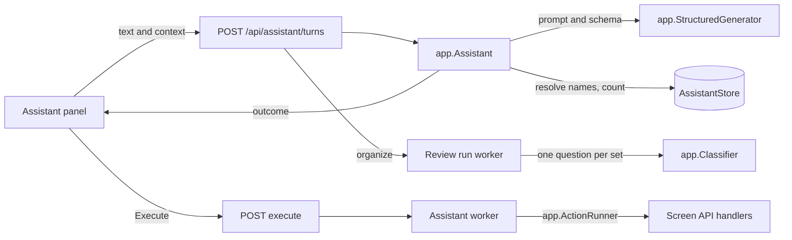
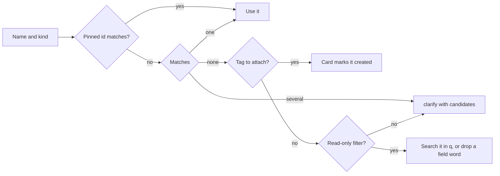
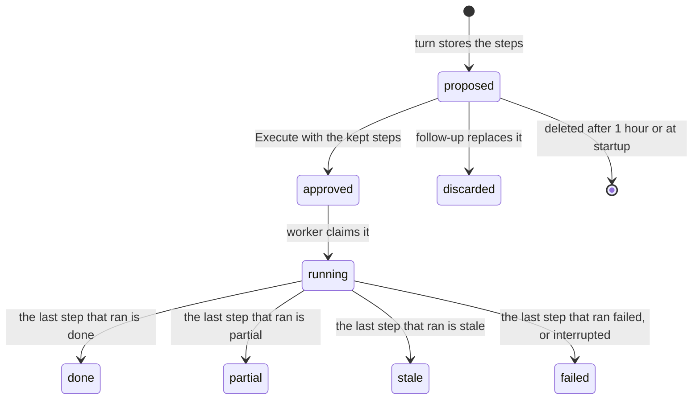

# In-app assistant

The assistant turns one request from the owner into one typed outcome through
the owner's Ollama, and carries out a write only after the owner approves the
card that shows it. The use case is `app.Assistant`
([`internal/app/assistant*.go`](../../internal/app)), its rules are in
[`internal/domain/assistant*.go`](../../internal/domain), its rows are
`AssistantStore` ([`internal/store/assistant*.go`](../../internal/store)), and
the screens are [`web/src/assistant`](../../web/src/assistant). The contract is
the `/api/assistant/*` operations of
[the screen API schema](../../api/openapi.yaml).

The diagram shows one request from the panel to its effect.

## One structured answer per turn

A turn is one call to the generation port whose JSON schema is the union of
the outcome kinds, so the model answers `filter`, `navigate`, `answer`,
`action`, `organize`, `clarify` or `unsupported` and nothing else
([`assistant_outcome.go`](../../internal/domain/assistant_outcome.go)). The
model writes no sentence the owner reads: the screen composes every sentence
from the typed outcome and the server's counts, so a count is never restated
by the model, and text from file names or plugins that carries instructions
has no way to reach the owner.

The schema is built once from the outcome types with `jsonschema-go`, every
object has `additionalProperties: false`, and the operation ids are an enum of
the catalog. An answer the schema rejects, or that lacks the member its kind
reads, is the outcome `unreadable` and changes nothing; the call is not
retried, since a second call doubles a wait of minutes on a CPU host. A member
of another kind beside the right one is dropped, and a `filter` beside an
`answer` without one is the answer's filter: models of every size write both,
and a dropped member changes nothing, since every change is a confirmed
proposal.

The prompt carries the outcome's members by kind, today's date, one line per
operation the turn can build, the screen context by names, the previous
outcome on a follow-up with the request its proposal came from, and the
request (at most 500 characters). The members are described because Ollama
enforces the schema as a grammar without showing it to the model: without
them, models of every size wrote an `action` member under `answer` and
`navigate` outcomes. The request, the context and the previous outcome sit
inside `<request>`, `<context>`, `<previous-request>` and `<previous>` marks
that the instructions call data. The library's vocabulary stays out of the
prompt: a library holds thousands of tags and people, and each thousand names
adds minutes to a turn on a CPU. A prompt change is checked by hand against
real models, through `scripts/clefrelay` when no local Ollama is at hand
([running-vv.md](../how-to/running-vv.md#assistant)).

| Failure | Answer | Stored |
| --- | --- | --- |
| Readiness false (`ollama_not_saved`, `generation_model_unset`, `generation_model_without_tools`) | `409 assistant_not_ready` | Nothing |
| Ollama not reached, or not Ollama | `503 assistant_unavailable`, reason `connection` | Nothing |
| The model is missing or answers an `error` | `503`, reason `model` | Nothing |
| No answer within 10 minutes | `503`, reason `timeout` | Nothing |
| JSON the schema rejects | Outcome `unreadable` | Nothing |

| Rejected | Why |
| --- | --- |
| Ollama tool calling (`tools`) | It depends on each model's template and lets the model answer in prose; `format` is enforced by Ollama's grammar for any chat model |
| The model writes the HTTP request | A free request reaches operations the catalog excludes |
| The model phrases the reply | A phrased reply can restate a number wrongly or relay instructions from titles |
| A SQL or filter language for questions | The four typed questions (`count`, `appearances`, `recent`, `list`) use the reads the screens use, so the count equals the page's |

## The server resolves names, targets and counts

Every name in an outcome is resolved by the server with the stored search keys
(width, case and kana folded), tag synonyms and person and organization
aliases (`AssistantVocabulary`); one match is used, several answer `clarify`
with the candidates, and none answers `clarify` with the entities whose names
contain the name (`コスプレ` offers `コスプレ衣装` and `コスプレ衣裳`), with two
exceptions. A tag to attach is marked created on the card. A tag, person or
organization in the filter of a `filter` outcome or a `count` or `list`
question joins the filter's free text `q` as a literal search term, quoted when
the search grammar would otherwise read it as an operator or several words, so
one loose name does not fail a read. The name is dropped when it is a field
word such as `tags`, or when `q` already requires it as a positive term. A
name is trimmed, and a tag name is tried again without a trailing tag word
(`ライブタグ`), since models copy both from the request. A name carries the
kind the model inferred, and `any` tries person, organization and tag, so a name
found under two kinds is a clarification. A read-only filter also drops a
duration bound of `0` and a day that is not a date, which a model writes for a
member the request does not set; a change's target keeps them, so the
validation asks instead of widening the target.

The diagram shows the rule for one name.

| No match for a name in | Answer | Why |
| --- | --- | --- |
| A read-only filter (`filter`, `count`, `list`) | Search it as text in `q` | A local model often puts a topic or a field name where a tag goes; a wider read costs nothing and the owner sees the result |
| A change's target, its arguments, or a smart folder rule | `clarify` | Guessing would change or save something the owner did not name |

The prompt also tells the model that a topic such as `カラオケ関連` goes into
`q` unless the owner calls it a tag.

The panel sends the route, the selected videos, groups and smart folders, the
library filter and the ids chosen in a clarification (`pinned`); the model
sees names and counts, never ids.

| Word in the request | Target |
| --- | --- |
| `これ`, `選んだもの` (`selection`) | The selected videos and smart folders, or the open video; a filter on it narrows them, which is how `長いのは除いて` keeps the previous target, and the 20,000-video limit applies to the narrowed videos, not to the filter's library-wide match |
| `ここ` (`current`) | The open video, smart folder, person, organization or tag, or the library filter; a filter on it narrows them |
| A name (`named`) | The entities the row's target kind resolves |
| A filter (`filter`) | Every video matching it, counted by the server |

Favorites act on a selected or open group or smart folder itself, as the
library's favorite action does: the folder is not expanded to its videos, and
a selected group's members are not favorited with it.

A target over 20,000 videos answers `400 too_many_videos`, as the bulk
operations do. A clarification choice is sent again as the same request with
the chosen id pinned; a pinned id wins only when it is among the candidates the
name finds, so a chosen alias does not ask the same question again.

## The catalog is the allow-list

`domain.AssistantCatalog` holds one row per operation and variant the
assistant may propose, each with its target kind, the arguments it reads,
whether video targets run in batches, and whether the card marks it
irreversible ([`assistant_catalog.go`](../../internal/domain/assistant_catalog.go)).
A test in [`assistantcheck`](../../internal/domain/assistantcheck) fails when an
owner write operation of `api/openapi.yaml` is in neither the catalog nor the
exclusion list, so a new screen operation is a decision, not an accident.

A row whose request the turn cannot build from names alone is left out of the
prompt and answered `unsupported`: rows addressed by an item id within a
playlist or group, per-video work codes, a virtual video's content version, a
version candidate pair, and a smart folder change. Excluded operations have no
row, so the schema does not let the model name them.

| Excluded | Why |
| --- | --- |
| The account, API tokens, plugins and their approval, network and proxy settings, media folders, watch history deletion, the face runtime download, onboarding | The feature's requirement keeps them on their own pages |
| `deleteVideo`, `clearPeople` | An irreversible delete stays on its page, with the video's `contentVersion` check or the danger zone |
| Images, thumbnail edit sessions, plugin fetches, face appearances, drag operations | The input is a file, a drag token, or a choice made by looking at images or candidates |
| `retryActivity`, `undoActivity`, `putVideoProgress`, `openVideoFile`, `setVideoDetails` | They act on an entry chosen in the log, belong to the player or the server PC, or are covered by two catalog rows |
| Reads and tests sent as `POST` (`tagImpact`, `checkOllama`, …), and `/api/assistant/*` | They write nothing, or are the assistant itself |
| Pairing with another node (`pairPeer`, `confirmPeerCertificate`, `revokePeerGrant`, …) and the peer's own calls (`applyPeerVocabulary`, `matchPeerCredits`, `applyPeerFetchedWorkInfo`, `applyPeerFetchedPerson`) | Pairing and its withdrawal are trust decisions made with the other node's code and certificate fingerprint on the Pairing page; the peer's calls carry its credential and never come from the screens ([peer-library.md](peer-library.md)) |

## A write is a proposal the worker executes

A proposal is a `proposed` row holding ordered steps, one per write, as the
card shows them. Each step holds a resolved plan: the targets with the labels
the card showed, the videos by user key, the request template of the
operation, the names to create, the names an earlier step creates
(`createdBy`) and, for a merge, the impact. Execute names the steps the owner
kept; the others become `skipped`, and the proposal moves to `approved` in one
`UPDATE ... WHERE status = 'proposed'`. One worker goroutine executes approved
rows oldest first, running the kept steps in card order by calling the screen
API handler of each step's row in process as the owner (`app.ActionRunner`,
implemented by `httpapi.ActionRunner`)
([`assistant_step.go`](../../internal/domain/assistant_step.go)).

The diagram shows a proposal's states.

A step moves from `pending` to `skipped` at approval, or to `running` and then
`done`, `partial`, `stale` or `failed`. When a step ends `stale` or with a
failed batch, the kept steps after it become `notRun`, and the proposal takes
the status of that step.

| Rule | Why |
| --- | --- |
| A second Execute answers `409 proposal_not_pending` with the row | Two tabs can show the same card |
| A kept step that names what an unticked step creates refuses Execute with `409 step_needs_skipped` and the step's index | The step would call with an id that never exists |
| Before a step's first call the worker re-reads that step's labels and videos; a renamed or deleted entity, or a video gone, ends the step `stale` with no call. A name the step creates, and an entity an earlier kept step acts on, are not checked | The owner approved what the card showed, not what the ids hold now; an earlier step that renames or merges what a later one names is expected |
| A step that uses an earlier step's creation takes the `id` of that step's response before it calls (`stepIds`) | The created entity has no id when the card is shown |
| Video targets run in batches of 500 user keys, one call per batch, with the step's counts written after each; a failed batch ends the step `partial`, or `failed` when nothing applied, and stops the run | Progress for a large selection, and a failed batch leaves the earlier ones applied with both counts shown |
| Operations whose catalog row acts on a version (`makeRepresentativeVersion`, `unbundleVideo`) hold content keys and resolve to that version | A user key names the bundle, so it would act on another version |
| A merge step carries `impact.videos`, the distinct videos carrying a source tag or credited to a source person or organization | `targets.count` of a merge is its one destination |
| An approved row survives a restart and runs; a `running` row becomes `failed` with `interrupted`, its running step `failed` and the later kept steps `notRun` | The operations have no undo, so a half-run batch is not repeated |
| The runner is registered after the HTTP server is built (`UseRunner`) | The server is built with the assistant, so the runner exists only after it |

| Rejected | Why |
| --- | --- |
| Executing inside the execute request | The run continues when the page is left, and a restart marks it like other workers |
| One store role per operation called from `internal/app` | 74 operations already have their validation, events and activity entries as handlers; `/mcp` calls its mux the same way |
| Rolling back applied batches or steps | The operations have no undo |
| Checking every step's labels before the first step | An earlier step changing what a later step names is expected, and a change made elsewhere during the run is caught at the step it affects |

## Review runs judge candidate sets for the owner

An `organize` outcome starts a review run of one kind; a finder lists
candidate sets from the store, the run asks `app.Classifier` one yes/no
question per set with facts only, and the review list
(`/assistant/reviews/:id`) shows the sets at 0.5 or more, most probable first,
for the owner to adopt or reject together
([`assistant_review.go`](../../internal/domain/assistant_review.go)).

| Kind | Candidate set | Adoption |
| --- | --- | --- |
| `tags` | Two of the 2,000 most used tags whose folded names or synonyms are equal or near: distance 1 when the longer has 4 or 5 characters, 2 when it has 6 or more, none when the shorter has under 4 | `mergeTag` into the tag on more videos |
| `people` | Two people with an equal folded name or alias, or the same link URL | `mergePeople` into the person with more credits |
| `works` | Ungrouped videos sharing a work code, or titles that differ only in a trailing number or part marker | `createGroup` named by the common title |

| Rule | Why |
| --- | --- |
| Judging uses the classifier port, not the generation model | A yes/no with a probability is what that port answers, and the threshold is shown in the list |
| A set below 0.5 is dropped, and nothing is adopted without the owner | The owner decides every merge |
| A rejected set is remembered by kind and member ids, and later runs skip it | The next `タグを整理して` would list the same pair |
| One running run per kind; a second request answers the running one | Its candidates would repeat the first's |
| Each adopted set is one approved proposal of one step executed by the assistant worker | Two adopted pairs are two merges with different destinations, and one path writes progress and activity |
| A set whose member was deleted or merged is left out when the list is read | The members carry no foreign key to the candidate |
| The display counts and the destination are read when the list is read | The data can change between judging and adoption |

The name distance widens to 2 for longer names because a 6-character pair such
as `selfie` and `selfy` differs by 2. A run interrupted by a restart is
`interrupted`; the run API carries no failure reason, so the list says that the
review stopped.

## Activity and events

Every approved proposal is one `assistant_run` activity entry, written in the
transactions that change the proposal
([activity.md](activity.md#an-assistant-run-is-one-entry-per-approved-proposal)).
`AssistantChanged` is published after every committed change of a proposal or
a review run and reaches owner streams as the payload-free `assistant` event;
the panel and the review list re-read what they show on it.

## The screens

The panel is mounted at the app root, above the routes, so it opens from the
top bar and from the playback screen's header band, for the owner only; it is
the design system's `SidePanel` ([design-system.md](design-system.md)). The
thread and the request in flight live in a root store, so closing the panel or
changing the route keeps them, and a reload loses them; the runs that matter
are in the store and are listed under `Recent runs` when the panel opens.

| Outcome | The thread |
| --- | --- |
| `filter` | Opens the library URL with the conditions, and offers `Save as smart folder…` |
| `navigate` | Opens the page |
| `answer` | The number from the server, with a link to the list it came from |
| `proposal` | The card: the operation, the count, the targets, the change, created names and the irreversible mark, with `Execute` as the one primary button; a follow-up replaces a pending card |
| `review` | The run's progress and `Open the review list` |
| `clarify` | One button per candidate |

The duration, added-date and watch-state conditions a filter sets are library
conditions like any other ([library-ui.md](library-ui.md)).
