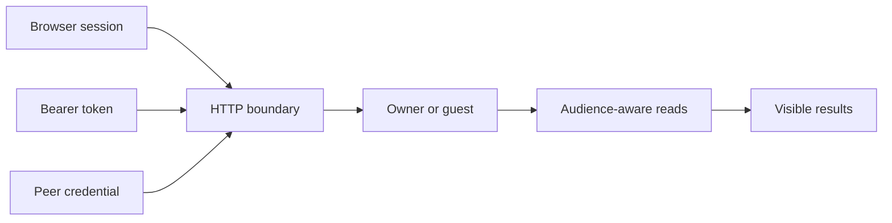

# Authentication and visibility

VVMDM has one owner account and a guest audience. Authentication selects an
audience at the HTTP boundary; storage filters every read before returning
videos, locations or folders.

The diagram shows the three authentication mechanisms and the shared
visibility boundary.

## Account and credentials

Initial setup creates the account and its first session in one transaction,
so concurrent setup requests cannot create two owners. Passwords use Argon2id
with PHC encoding. Credential changes sign out every existing session,
preventing an old password from retaining access. API tokens survive the
change: each is an independent secret that does not derive from the password,
so the owner revokes a leaked token on its own instead of losing every
integration with each password change.

The owner changes the username or password in Settings after re-entering the
current password, which shares the sign-in throttle. One transaction applies
the change only while the requesting session is still current, then replaces
it with a new session, so a concurrent host-side reset wins and the browser
that made the change stays signed in. The host-side `mdm account` commands
remain for a lost password.

The application owns setup and login throttling; `internal/password` owns
hashing, and `internal/store` owns the account, sessions and tokens.

## Visibility at the data boundary

`domain.Audience` defaults to guest. Each read receives the audience, and
hidden videos return the same `404` as missing videos. Filtering before
pagination and aggregation keeps hidden entries out of counts, groups,
related results and subsequent pages, as well as individual video reads.

Public flags belong to persistent content identities rather than rebuildable
video rows. A rescan does not change the owner's publication choices.

## Browser and external API

The screen API uses session cookies. The external API and MCP use bearer
tokens and the same application and storage operations. The operation-level
security declarations in [the screen API schema](../../api/openapi.yaml) are
checked against the HTTP route classification. External operations are
defined in [the external schema](../../api/external-v1.yaml); token setup and
examples are in [the external API guide](../how-to/external-api.md).

## Paired VVMDM

The VVMDM that reads this one authenticates with `Authorization: VV-Peer
<secret>`, a third credential beside the session and the bearer token
([peer-library.md](peer-library.md#pairing-and-the-peer-credential)). The
boundary hashes the secret and compares it with the stored hash of the peer
grant, and classifies the request as the owner, or as a guest when
`X-VV-Peer-Audience: guest` is present, so the read node applies the
viewer's audience to its own reads.

| Case | Response |
| --- | --- |
| Unknown secret, or no grant: the reading VVMDM was never granted access, or its access was withdrawn | `401` with reason `peer_unknown` |
| Valid secret on an operation the peer table does not allow | `403` with reason `peer_not_allowed` |
| Peer credential on `/api/v1` or `/mcp` | `401`; it is not a bearer token |

A peer request sets no cookie and skips the same-origin check. The secret is
not bound to the account's credentials, so a password or username change
keeps the pairing while it signs out every session.
