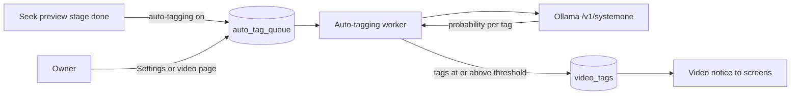
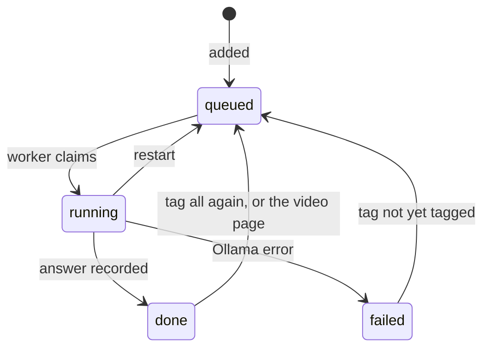

# Auto-tagging with a Clef classifier in Ollama

VVMDM asks a decision model running in Ollama (Cloudflare's Clef or
Clef-flash) which existing tags fit a video, and adds the tags whose
probability reaches a threshold. The use case is
[`internal/app/auto_tag.go`](../../internal/app/auto_tag.go), the queue is
[`internal/store/auto_tags.go`](../../internal/store/auto_tags.go), and the
Ollama client is [`internal/clef`](../../internal/clef).

The diagram shows how a video reaches the classifier and how its tags come
back.

## Classifier request

Each existing tag becomes one yes/no (`noul`) question, and a video is sent as
its library thumbnail, 8 frames spread across the whole video, and a JSON
state with its title, file name and folder.

The thumbnail shows one scene, so a video whose scenes differ would only be
judged on that one; the frames let the classifier see the rest. They are cut
from the seek preview sheet the import already made, so no ffmpeg work is
added, and at 320 px or less each frame costs fewer input tokens than the
thumbnail.

| Input | Source | When missing |
| --- | --- | --- |
| Images | The library thumbnail (640 px), then 8 frames at the middle of 8 equal parts of the seek preview | The images that can be read; text only when none can |
| `title` | The display name, else the file title | Never missing |
| `file_name`, `folder` | The representative location's path | Never missing |

Clef scores every question in one non-autoregressive pass and returns a
probability per question. A request carries 16 tags, and a library with more
tags is sent in batches of 16 with the same images. The question asks whether
the tag appears in or applies to any part of the video, names its synonyms,
and says the images come from across the video; tentative tags are not asked
about.

The wording decides whether frames help. On a 30 s video of a cat, a rocket
and a cup of coffee, with the thumbnail showing the cat:

| Images and question | cat | coffee | rocket | Unrelated tags |
| --- | --- | --- | --- | --- |
| Thumbnail, "appears in any part" | 0.96 | 0.01 | 0.00 | 0.02 or less |
| Thumbnail and 8 frames, "describes this video" | 0.60 | 0.61 | 0.17 | 0.01 or less |
| Thumbnail and 8 frames, "appears in any part" | 0.93 | 0.85 | 0.70 | 0.00 |

Asking whether a tag describes the video makes the model weigh the whole
video, so a tag that fits one scene falls below the threshold.

Ollama accepts 64 questions per request, but 64 questions and a thumbnail make
about 7,400 input tokens, and Clef-flash on a 15 GB CPU machine was killed for
lack of memory. 16 questions make about 2,000 tokens with the thumbnail alone.
The images are processed again for every batch, so time per video grows with
the number of tags. On a 4-core CPU without a GPU, Clef-flash took about 100 s
per thumbnail with 9 tags; the published GPU latency is under 0.2 s.

| Rejected | Why |
| --- | --- |
| The thumbnail alone | It shows one scene, so tags for the rest of the video are missed |
| The whole 9 × 9 seek preview sheet as one image | Up to 2,880 px wide, it costs several times the tokens of 8 frames |

## Tags it adds

A tag is added when its probability is at least the threshold (0.8 by
default), as an ordinary tag on the video; no tag is created.

Added tags are indistinguishable from tags the owner added, so the existing
tag screens remove or merge them. The default threshold leans towards missing
a tag rather than adding a wrong one: in a trial on 14 images, the one wrong
tag had a probability between 0.5 and 0.8.

| Rejected | Why |
| --- | --- |
| Create tags from the model's suggestions | Clef only scores options it is given; it does not generate names |
| Mark added tags as tentative | Tentative is a state of a newly created tag, and these tags already exist |

## Queue and when a video is judged

Each video's content key has one row in `auto_tag_queue`, and the row stays
`done` after judging so that automatic judging never repeats on that video.

| Trigger | Queues |
| --- | --- |
| Seek preview stage finishes, "Tag new videos automatically" on | Videos with no row |
| Settings, "Tag videos not yet tagged" | Videos with no row or a `failed` row |
| Settings, "Tag all videos again" | Every video not `running` |
| Video page, "Suggest tags" | That video, unless `running` |

Keeping `done` rows means a tag the owner removed is not added back by the
next import of the same content. One worker judges one video at a time, so a
slow CPU-only Ollama is not given parallel requests it cannot serve.

## Failures

A failed request marks the row `failed` with Ollama's message and the worker
moves on; nothing retries it until the owner queues it again.

Ollama being stopped makes every queued video fail within seconds instead of
blocking the queue, and the Settings page shows the count and the last
message. A row still `running` at shutdown goes back to `queued` at the next
startup.

## Settings

The owner sets the Ollama URL, the model, the threshold and automatic
judging under Settings, Auto-tagging; "Save and test connection" saves the
form and sends one question to the saved URL.

The server only sends requests to the saved URL, never to one in a request
body, and passes on only the error text of an Ollama JSON reply. Otherwise a
request could make the server fetch any reachable address and show the reply.

| Setting | Default |
| --- | --- |
| Tag new videos automatically | Off |
| Ollama URL | `http://127.0.0.1:11434` |
| Model | `clef-flash` (`clef` is 27B and more accurate) |
| Minimum probability | 0.8 |
