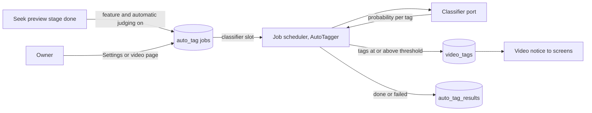
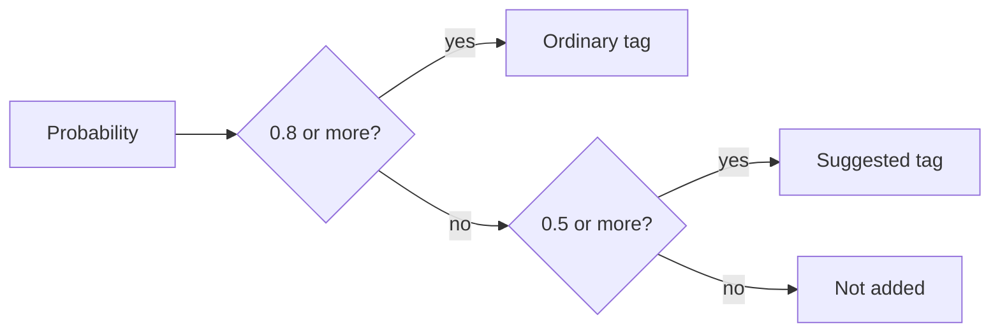
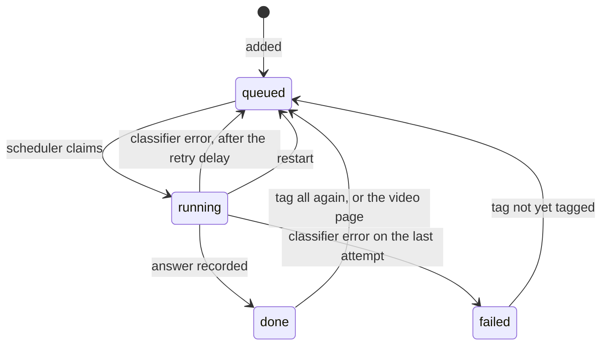

# Auto-tagging with a decision model

VVMDM asks a decision model which existing tags fit a video, and adds the tags
whose probability reaches a threshold. The use case is
[`internal/app/auto_tag.go`](../../internal/app/auto_tag.go). Each video to
judge is an `auto_tag` job that the [job scheduler](job-scheduling.md) runs,
and the outcome is kept per content key by
[`internal/store/auto_tags.go`](../../internal/store/auto_tags.go). The model
is reached through the classifier port, whose provider today is Cloudflare's
Clef or Clef-flash in Ollama ([ai-layer.md](ai-layer.md)); auto-tagging does
not know the provider.

The diagram shows how a video reaches the classifier and how its tags come
back.

## Classifier request

Each candidate tag becomes one yes/no question, and a video is sent as its
library thumbnail, 7 frames spread across the whole video, and the facts
`title`, `file_name` and `folder`. All questions for a video go in one request
to the port, which splits them as its provider needs.

The thumbnail shows one scene, so a video whose scenes differ would only be
judged on that one; the frames let the classifier see the rest. They are cut
from the seek preview sheet the import already made, so no ffmpeg work is
added, and at 320 px or less each frame costs fewer input tokens than the
thumbnail. Ollama refuses a request with more than 8 images (`400 too many
images, the maximum is 8`), so the frames are 7 and the request carries 8
images with the thumbnail.

| Input | Source | When missing |
| --- | --- | --- |
| Images | The library thumbnail (640 px), then 7 frames at the middle of 7 equal parts of the seek preview | The images that can be read; text only when none can |
| `title` | The display name, else the file title | Never missing |
| `file_name` | The representative location's file name | Never missing |
| `folder` | The representative location's folder relative to its media folder, with `/` separators (`trips/kyoto` for `/mnt/nas/videos/trips/kyoto/bamboo.mp4` in the media folder `/mnt/nas/videos`) | Empty for a video directly in the media folder |

The candidates are the tags whose answer could still change the video's tags.
Asking about the rest costs time on every request and cannot change the
result.

| Tag | Asked |
| --- | --- |
| Not on the video | Yes |
| Suggested (unconfirmed) on the video | Yes; a later answer at or above "Probability to add" confirms it |
| Already on the video as an ordinary tag | No |
| Rejected for the video | No |
| Tentative tag (a tag state, not a suggestion) | No |

A version bundle's members share their tags, so attachments and rejections
are those of the bundle.

The question asks whether the tag appears in or applies to any part of the
video, names its synonyms, and says the images come from across the video.

The wording decides whether frames help. On a 30 s video of a cat, a rocket
and a cup of coffee, with the thumbnail showing the cat (measured with 8
frames, before Ollama capped a request at 8 images):

| Images and question | cat | coffee | rocket | Unrelated tags |
| --- | --- | --- | --- | --- |
| Thumbnail, "appears in any part" | 0.96 | 0.01 | 0.00 | 0.02 or less |
| Thumbnail and 8 frames, "describes this video" | 0.60 | 0.61 | 0.17 | 0.01 or less |
| Thumbnail and 8 frames, "appears in any part" | 0.93 | 0.85 | 0.70 | 0.00 |

Asking whether a tag describes the video makes the model weigh the whole
video, so a tag that fits one scene falls below the threshold.

Time per video grows with the number of candidates; the Ollama provider's
batches and measured times are in [ai-layer.md](ai-layer.md#ollama-provider).

| Rejected | Why |
| --- | --- |
| The thumbnail alone | It shows one scene, so tags for the rest of the video are missed |
| The whole 9 × 9 seek preview sheet as one image | Up to 2,880 px wide, it costs several times the tokens of 7 frames |
| The absolute folder path | The part above the media folder says nothing about the video, differs between machines and operating systems, and would reach a remote Ollama host |
| Ask about every tag on every video | Tags already on the video or rejected for it cannot change, and each one adds time |

## Tags it adds

The probability decides how a tag is attached: at or above "Probability to
add" (0.8 by default) as an ordinary tag, between "Probability to suggest"
(0.5 by default) and that as a suggested (unconfirmed) tag, and below it not
at all. No tag is created.

A suggested tag shows the tentative mark on cards and the video page, and the
video page offers keep and reject in place of remove. Keeping it, adding the
same tag by hand, or a later judgement at or above "Probability to add" turns
it into an ordinary tag. Rejecting it removes it and records the tag for that
video in `auto_tag_rejections`, so auto-tagging never adds it to that video
again; adding it by hand still works. Setting both probabilities to the same
value turns suggestions off.

The middle band exists because the classifier's probabilities near the
threshold are not reliable either way: in the trials, the one wrong tag and
one right tag (the rocket in a three-scene video, 0.70) both fell between 0.5
and 0.8. Suggested tags count in tag filters like ordinary ones, the same way
tentative tags do.

| Rejected | Why |
| --- | --- |
| Create tags from the model's suggestions | Clef only scores options it is given; it does not generate names |
| Mark the tag itself as tentative | Tentative is a state of a tag across all videos, and a suggestion is about one video |
| One threshold | Tags near it are either dropped or added unchecked |

## Queue and when a video is judged

A video to judge is an `auto_tag` row in `jobs`, keyed by its content key in
`subject_key`. The job ends with the answer, and `auto_tag_results` keeps
`done` or `failed` per content key, so that automatic judging never repeats on
that video after the job is gone. A content key's state is its unfinished
job's state, otherwise its result's, otherwise none.

| Trigger | Queues |
| --- | --- |
| Seek preview stage finishes for good (done, or failed with no retry left), "Tag new videos automatically" on | That video, if it has no state |
| Seek preview stage of a forced job (a [force rescan](force-rescan.md#tagging-and-face-analysis-run-again)) finishes for good | That video, unless `running`, as "Tag all videos again" does; "Tag new videos automatically" is not needed |
| Settings, "Tag videos not yet tagged" | Videos with no state or a `failed` result |
| Settings, "Tag all videos again" | Every video not `running` |
| Video page, "Suggest tags" | That video, unless `running` |
| Onboarding, picking interests | Every video not `running`, as "Tag all videos again" does |

The import trigger is queued in the same transaction that records the seek
preview stage's final result, and its `auto_tag` entry joins the pipeline of
that job's `import` entry
([activity.md](activity.md#a-pipeline-groups-one-import-run)); a forced job's
trigger does the same. The import
pipeline therefore stays `running` until tagging finishes, and does not wait
when the trigger queues nothing. The `VideoIngestChanged` subscriber only wakes
the scheduler. A retry from the activity log and a claim that reopens an
interrupted entry join the pipelines of the entry they continue; the other
triggers are started by the owner and write standalone entries.

The job's [priority class](job-scheduling.md#owner-requests-are-claimed-first)
follows who asked:

| Trigger | Class |
| --- | --- |
| The video page, a retry from the activity log | Owner (0); a request on an already queued job moves that job to the owner class and ends its retry wait |
| A forced job's seek stage | The forced job's class, the owner's for a force rescan |
| Import, Settings, onboarding | Import (1), so a bulk request never holds back the owner's request on one video |

Every trigger requires "Use auto-tagging" to be on; while it is off the
Settings run buttons and the video page button are hidden, and the API refuses
to queue with `409 auto_tagging_off`. Picking interests is the exception: it
still makes the interests' tags and smart folders, queues nothing and answers
`queued: 0`.

Picking interests queues every video, not only those without a state,
because a video judged before an interest's tag existed was never asked about
that tag ([Home library and setup](home.md)).

Keeping `done` results means a tag the owner removed is not added back by the
next import of the same content. An `auto_tag` job demands the scheduler's one
classifier slot and no read or CPU slot, since it sends generated thumbnails
and seek frames, never the source file. One video is therefore judged at a
time, so a slow CPU-only provider is not given parallel requests it cannot
serve, while imports keep every read slot.

A job whose content key no longer has a registered video is dropped when it is
claimed, and its entry closes as `completed`.

## Failures

A failed request goes back to the scheduler, which retries the job with the
default [retry rule](job-scheduling.md#a-failed-job-retries-after-a-growing-delay):
30 s after the first attempt and 2 min after the second, and `failed` with the
provider's message after the third. Each claim counts as one attempt.

Ollama being stopped makes every queued video fail within seconds instead of
blocking the queue, and each waits out its delay before it asks again. The
Settings page shows the count of `failed` results and the last message. A job
still `running` at shutdown goes back to `queued` at the next startup, and that
claim counts as an attempt.

## Activity entries and undo

Each run of a video is one `auto_tag` activity entry
([activity.md](activity.md)). Queuing writes it `running`/`waiting` and the
job keeps its id; the claim makes it `processing`, and the answer makes it
`done`/`completed`. A failed request that will be retried returns it to
`running`/`waiting` with the provider's message, and the last failed attempt
makes it `attention`/`failed`. A job whose entry is no longer `running` when
it is claimed, after a restart, opens a new entry, which closes the
interrupted one as `superseded`. The queuing, the claim, the answer and the
failure each write the entry in the transaction that changes the job.

| Run started by | Decider until it finishes | Decider after the answer |
| --- | --- | --- |
| Import, "Tag new videos automatically" | `rule` | `ai` |
| Force rescan | `owner` | `ai` |
| Settings or the video page | `owner` | `ai` |

A run with no candidate tag never asks the classifier and keeps the decider
that started it. The entry lists each tag the run wrote, with the probability,
whether it was suggested and the user key it was written at, in
`activity_entry_tags`; a tag the run left unchanged is not listed. Retry from the Activity screen queues the video again as
the owner's request, and answers `409 auto_tagging_off` while the feature is
off.

Undo is one tag at a time, in one `ActivityStore` transaction:

1. Look in the log for an owner `tag_attach`, `tag_detach`, `tag_keep` or
   `tag_reject` entry with the same `tag_id` whose touched content keys
   include the video (every member, when the tag was changed on a bundle) and
   whose id is greater than the `auto_tag` entry's `decided_mark`, the
   greatest entry id when the run wrote its result. One means the owner
   decided the tag again after the run, and nothing is deleted; a rename of
   the tag or a new representative in between does not hide it.
2. Otherwise delete the `video_tags` rows that descend from the row the run
   wrote: the recorded user key and every key bundling or unbundling copied
   the row to (`activity_entry_tag_keys`), while a suggested tag is still
   suggested. A bundle's row is shared, so the tag leaves every member. When
   the video's current key is not among them, another member's row won at
   bundling (the owner tagged the representative by hand, say); that row
   stays and the undo is `already_reverted`.
3. Record the tag for the video in `auto_tag_rejections` in either case, so
   "Tag all videos again" never asks about it or adds it.
4. Write the owner's `undo` entry, `done`/`completed` when the row was
   deleted and `done`/`already_reverted` when the owner had already removed,
   re-attached or kept the tag, which then stays as the owner left it.

The owner's change is read from entry ids, not from `video_tags.created_at`,
so a tag the owner removes and attaches again by hand within the same second
as the run is still the owner's.

## Settings

The Auto-tagging section of Settings (`/api/settings/auto-tagging`) holds
whether the feature is used, automatic judging after import, the two
probabilities and the queue counts. The provider's connection is a separate
section and resource ([ai-layer.md](ai-layer.md#ollama-provider)). "Test
judging" (`POST /api/auto-tagging/check`) asks the classifier port one
question, whether the feature is on or off, to show that the provider can
judge.

Auto-tagging is optional and off by default. While "Use auto-tagging" is off:

- the `auto_tag` kind is [paused](job-scheduling.md#a-feature-that-is-off-pauses-its-kinds):
  the scheduler claims no queued job and never contacts the provider, and the
  jobs wait with their attempts until the feature is turned on again, which
  wakes the scheduler;

- nothing is queued, by import, Settings or the video page;
- the video page has no "Suggest tags" button;
- suggested tags already added can still be kept or rejected.

| Setting | Default |
| --- | --- |
| Use auto-tagging | Off |
| Tag new videos automatically | Off (has no effect while the feature is off) |
| Probability to add | 0.8 |
| Probability to suggest | 0.5 (the same value as "Probability to add" turns suggestions off) |

| Rejected | Why |
| --- | --- |
| One form for the connection and the feature switch | Testing or changing the connection would mean editing the feature's settings, and turning the feature off would look like losing the connection |
