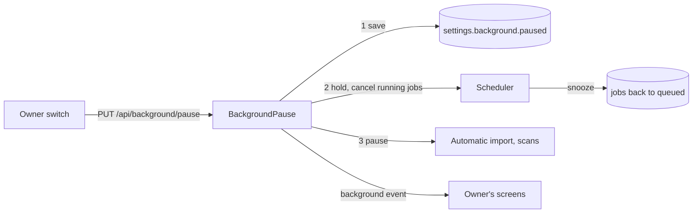
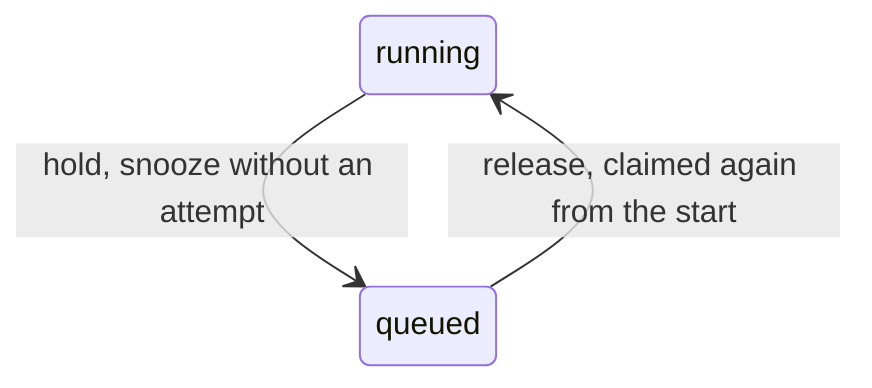
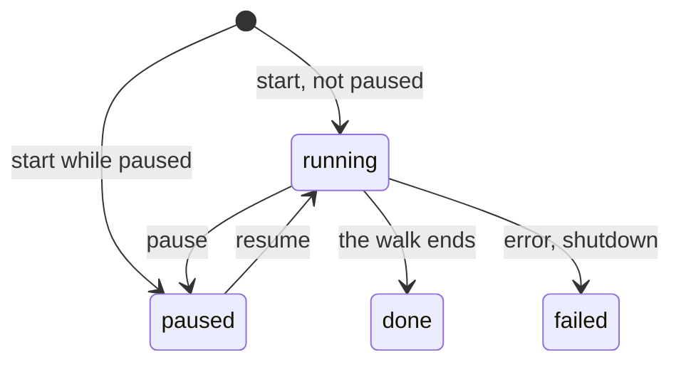

# Background pause: one owner switch over scans and jobs

The owner stops every scan and scheduled job with one switch and resumes them
when they choose ([`app.BackgroundPause`](../../internal/app/background_pause.go)). The
switch is the setting `settings.background.paused`, so a restart or a crash
keeps it; an absent key is not paused. Streaming, live transcoding, the
editing frame, link fetches and image search never pass through the scheduler
and are not paused.

The diagram shows what a pause request does, in order.

A resume saves `false` and reverses steps 3 and 2. Automatic import and the
scans take the pause through `app.PausableWork`; the scans stop as described
in [Scans](#scans), and automatic import is not wired yet. The status is
`GET /api/background`; both operations are owner-only, and the `background`
event of `/api/events` tells the owner's screens to read it again.

## Pause state

`BackgroundPause` applies one request at a time, and the last one decides the
state; a request for the current state changes nothing and answers the status.
A pause answers once the setting is saved and the running jobs are cancelled,
without waiting for the jobs to return.

| Decision | Rejected | Why |
| --- | --- | --- |
| Save the setting before stopping anything | Stop first, then save | A crash between the two would restart unpaused with work the owner stopped |
| Hold the scheduler before automatic import and the scan | Hold the scheduler last | Stopping the scan waits for the file it reads, and the scheduler must not start jobs during that wait |
| Apply requests one at a time; the last decides | Refuse a request while another is applied | Two tabs or a fast double press must end in the last state without an error |
| Answer without waiting for cancelled jobs to return | Wait for every job | A read from a share that stopped answering does not return on cancellation |
| The request's cancellation does not stop an apply that has begun | Apply under the request's context | A closed tab would leave the work half paused |

The desktop close prompt does not count queued jobs as busy while paused
([windows-app.md](windows-app.md#closing-second-launch-and-sign-out)): they
wait for the resume, so closing interrupts nothing they do. The hardware
encoder checks and the face runtime's model download are not paused; neither
reads a media file.

## Jobs

`Scheduler.Hold` stops granting and cancels each running job's own context
with the cause `domain.ErrJobPaused`; `Scheduler.Release` grants again and
wakes the scheduler ([job-scheduling.md](job-scheduling.md#a-pause-holds-every-kind)).

The diagram shows what happens to a job a hold stops.

| Decision | Rejected | Why |
| --- | --- | --- |
| The hold is a state inside the scheduler, checked where a job is granted | Report every kind as paused before a round | A round already running would grant a job after the running ones were cancelled |
| A stopped job is recorded as a snooze: queued, due at once, the claim not counted | Leave it `running` for startup recovery | Recovery counts an attempt, so a preview paused three times would fail |
| Same | Let running jobs finish | One encode takes minutes |
| Same | Suspend the ffmpeg process | Windows has no documented call to suspend another process |
| A scheduler started while the setting is on starts held | Hold after the first round | Startup recovery has requeued the jobs, and the first round would grant them |
| Kinds a feature that is off holds back stay paused after a release | Release everything | They run when the feature is turned on |
| Startup still queues the backfill jobs while paused | Skip them until a resume | One insert per kind; skipping would need a second trigger at resume |

Requests that queue a job (a retry, a re-probe, `Suggest tags`, `Judge again`,
`Tag all videos again`) are accepted while paused and wait as queued jobs. A
stage cancelled mid-run leaves no partial output: its temporary files under
`.tmp` are removed when the stage returns
([`internal/artifacts`](../../internal/artifacts)).

## Scans

A pause cancels a running manual scan or force rescan with the cause
`domain.ErrScanPaused`. It stops at the next file, removes nothing and closes
in the scan state `paused`; a resume sets the same row back to `running` and
runs the scanner for it with the row's scope, video set, issues and `forced`
marks ([`app.Scans`](../../internal/app/scans.go)). A watch scan is left to
automatic import.

The diagram shows the states of a scan row around a pause.

A row becomes `paused` only from `running`, or when a manual scan or force
rescan is created while the setting is on; the store reads the setting in the
transaction that creates the row. At most one row is `paused`, and it is the
latest scan, because a `paused` row answers the next start as a running one
does. Only that row is reopened, and only while no scan runs. These rules are
in [`internal/domain`](../../internal/domain/scan_pause.go).

| Decision | Rejected | Why |
| --- | --- | --- |
| Close the stopped scan as `paused` | Keep it `running` and block the scanner at a gate | Media folder changes are refused while a scan runs, and they must take effect during a pause; a blocked goroutine also does not survive a restart |
| Same | Close it `failed` and resume it as an interrupted scan | Every reader of `failed` would need an exception so that a pause is not shown as a failure |
| Reopen the same row | Start a new scan as a restart does | Each toggle would end one scan and start another, so the indicator's per-scan dismissal and the result notice would fire on every toggle |
| The reopened row keeps `completed` as the base of the resumed pass's `total` and `completed`; `failed` is the pass's own | Let the pass overwrite the counters | The pass skips the files read before the pause, so 4 of 10 read before it and 6 after would end at 6 of 6 |
| Same | Keep `failed` as a base too | A failed file is not indexed, so the pass reads it again and would count it twice |
| Reopening deletes the scan-sourced issues its scope covers and keeps stage issues and those carried from outside the scope | Keep every issue | A file repaired during the pause would keep its issue; the pass reports again each file that still fails |
| The reopened pass lists the directories again and skips a file whose size and modification time match the index; in force mode also the content key of an unchanged file whose video is already `forced` | Store a walk position | Directory order is not stable across a change, and the size and time check already identifies what was read |
| `Scan library` during a pause creates the row as `paused`; a second request answers it, and a force rescan is refused with `409 scan_in_progress` | Queue any number of requests | The one-scan rule already says which request wins |
| A `paused` scan does not block media folder changes; on resume a manual scan reads the folders registered then, and a `folder` rescan whose folder is gone or moved fails | Refuse folder changes during a pause | Folder changes must take effect during a pause |
| The screen API's `Scan.state` gains `paused`; the external API reports it as `running` | A new external status | The external contract is versioned, and its `running` already means that work remains |

A start whose store read the setting just before a pause saved it starts its
run already cancelled with `ErrScanPaused`, so it closes as `paused` at once.
While paused, startup resumes no scan; the resume reopens the paused scan, or
resumes the interrupted scan when there is none
([process lifecycle](process-lifecycle.md#recovery-after-an-interrupted-run)).
No activity entry changes while a scan is `paused`: its entry is written only
when the scan fails, and its queued jobs keep their `waiting` import entries.
`Scan status` shows a `paused` scan as `Waiting for resume`, keeps its counts
without animating the bar, and blocks both starts with the reason that a scan
waits for the resume ([library-ui.md](library-ui.md#scan-entry-and-progress)).
