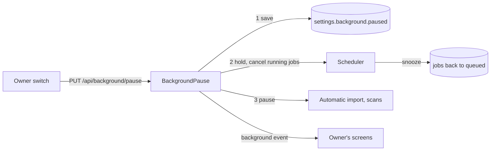
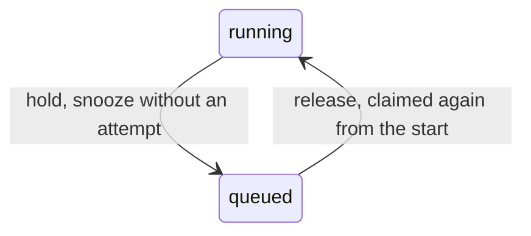

# Background pause: one owner switch over scans and jobs

The owner stops every scheduled job with one switch and resumes it when they
choose ([`app.BackgroundPause`](../../internal/app/background_pause.go)). The
switch is the setting `settings.background.paused`, so a restart or a crash
keeps it; an absent key is not paused. Streaming, live transcoding, the
editing frame, link fetches and image search never pass through the scheduler
and are not paused.

The diagram shows what a pause request does, in order.

A resume saves `false` and reverses steps 3 and 2. Automatic import and the
scans take the pause through `app.PausableWork`; today the scans only stop
counting queued jobs as busy, and automatic import is not wired. The status is
`GET /api/background`; both operations are owner-only, and the `background`
event of `/api/events` tells the owner's screens to read it again.

## Pause state

`BackgroundPause` applies one request at a time, and the last one decides the
state; a request for the current state changes nothing and answers the status.
A pause answers once the setting is saved and the running jobs are cancelled,
without waiting for the jobs to return.

| Decision | Rejected | Why |
| --- | --- | --- |
| Save the setting before stopping anything | Stop first, then save | A crash between the two would restart unpaused with work the owner stopped |
| Hold the scheduler before automatic import and the scan | Hold the scheduler last | Stopping the scan waits for the file it reads, and the scheduler must not start jobs during that wait |
| Apply requests one at a time; the last decides | Refuse a request while another is applied | Two tabs or a fast double press must end in the last state without an error |
| Answer without waiting for cancelled jobs to return | Wait for every job | A read from a share that stopped answering does not return on cancellation |
| The request's cancellation does not stop an apply that has begun | Apply under the request's context | A closed tab would leave the work half paused |

The desktop close prompt does not count queued jobs as busy while paused
([windows-app.md](windows-app.md#closing-second-launch-and-sign-out)): they
wait for the resume, so closing interrupts nothing they do. The hardware
encoder checks and the face runtime's model download are not paused; neither
reads a media file.

## Jobs

`Scheduler.Hold` stops granting and cancels each running job's own context
with the cause `domain.ErrJobPaused`; `Scheduler.Release` grants again and
wakes the scheduler ([job-scheduling.md](job-scheduling.md#a-pause-holds-every-kind)).

The diagram shows what happens to a job a hold stops.

| Decision | Rejected | Why |
| --- | --- | --- |
| The hold is a state inside the scheduler, checked where a job is granted | Report every kind as paused before a round | A round already running would grant a job after the running ones were cancelled |
| A stopped job is recorded as a snooze: queued, due at once, the claim not counted | Leave it `running` for startup recovery | Recovery counts an attempt, so a preview paused three times would fail |
| Same | Let running jobs finish | One encode takes minutes |
| Same | Suspend the ffmpeg process | Windows has no documented call to suspend another process |
| A scheduler started while the setting is on starts held | Hold after the first round | Startup recovery has requeued the jobs, and the first round would grant them |
| Kinds a feature that is off holds back stay paused after a release | Release everything | They run when the feature is turned on |
| Startup still queues the backfill jobs while paused | Skip them until a resume | One insert per kind; skipping would need a second trigger at resume |

Requests that queue a job (a retry, a re-probe, `Suggest tags`, `Judge again`,
`Tag all videos again`) are accepted while paused and wait as queued jobs. A
stage cancelled mid-run leaves no partial output: its temporary files under
`.tmp` are removed when the stage returns
([`internal/artifacts`](../../internal/artifacts)).
