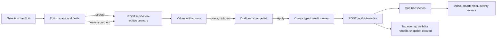

# Bulk editing: the editor over a selection

- Status: adopted
- Scope: the `Edit` action of the list selection bar, the editor it opens, and
  the `/api/video-edits` operations behind it

`Edit` on the selection bar opens one full-screen editor that shows what the
selected videos carry and applies every change in one request. It holds the
tags, the people and organizations of each role, the three work dates and the
visibility; favorites, playlists, groups, bundles and deletion stay on the bar
([library-ui.md, Selection bar](library-ui.md#selection-bar)). The code is in
[`web/src/library/bulkEdit/`](../../web/src/library/bulkEdit) and
[`bulk_video_edits.go`](../../internal/store/bulk_video_edits.go).

The diagram shows one edit from opening to the refreshed list.

## The editor shows the selection's values, not modes

Each field lists the values the selected videos have, with how many of them
carry each (`Travel 2/5`); pressing a value steps through adding it to every
video, removing it from every video, and leaving it as it is. A value picked
with the field's picker is added to every video. The footer lists the changes
the draft makes, with the number of videos each changes, above
`Apply to N videos`.

Add is offered only while some videos lack the value and Remove only while
some can lose it, so every step changes something. A tag that some videos
carry only through their folder names counts towards the value but cannot be
removed, as with the single tag actions.

| Rejected | Why |
| --- | --- |
| A mode per field (Add, Remove, Replace) with an empty input | The owner cannot see what the videos already have, so Remove and Replace are chosen blind |
| Replace as a mode | Removing every present value and adding the new ones expresses it, and the change list shows the result |

## The stage lists the targets and leaves out the pressed ones

The editor is an `EditorDialog`: the stage holds the selected cards (videos,
groups with their member count, smart folders) and the aside holds the fields
([patterns.md, Editor dialog](../../web/registry/rules/patterns.md#editor-dialog)).
Pressing a card leaves it out: the summary is read again for the remaining
targets and the request no longer sends them. The list page and its selection
stay mounted under the dialog, so closing returns to the same scroll position
and selection.

A group stands for its member videos and a smart folder for its current members,
which the server resolves at request time as for the other bulk actions; the
client never expands a folder. Counts are per user-data key, so the versions of
a bundle count as one video.

| Rejected | Why |
| --- | --- |
| A page of its own (`FormPage`) | Leaving the list drops its selection and loaded pages; the editor needs both on return |
| A `FormDialog` | At 42rem it cannot show the targets beside the fields, and nine fields scroll inside it |

## One request applies every part atomically

`POST /api/video-edits` applies the tag, credit, date and visibility parts in
one transaction: a missing tag or credit, a role over its limit on any video or
an invalid date writes nothing, and the editor keeps the draft and shows the
reason. A credit name typed in the editor is created before the request and
reused when Apply is retried, so a failure never leaves duplicates. The
transaction records the same activity and publishes the same events as the
single tag, visibility and work-info writes, and videos made private stop their
guest streams as `PUT /api/video-visibility` does.

After the response the client updates loaded cards through the shared tag
overlay, refreshes the visibility of the explicit videos, clears list snapshots
and re-reads the selected smart-folder cards. A removed tag that is an active
filter makes the page clear the selection and reload.

| Rejected | Why |
| --- | --- |
| One request per field from the client | A failure halfway leaves part of the edit applied, and the toast cannot say what happened |
| Codes, descriptions, links and external IDs in the editor | They belong to one video; setting one value on many videos is not an edit anyone makes |
