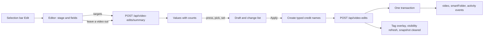
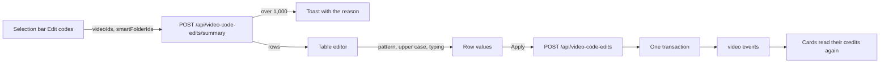

# Bulk editing: the editor over a selection

- Status: adopted
- Scope: the `Edit` and `Edit codes` actions of the list selection bar, the
  editors they open, and the `/api/video-edits` and `/api/video-code-edits`
  operations behind them

`Edit` on the selection bar opens one full-screen editor that shows what the
selected videos carry and applies every change in one request. It holds the
tags, the people and organizations of each role, the three work dates and the
visibility; favorites, playlists, groups, bundles and deletion stay on the bar
([library-ui.md, Selection bar](library-ui.md#selection-bar)). The code is in
[`web/src/library/bulkEdit/`](../../web/src/library/bulkEdit) and
[`bulk_video_edits.go`](../../internal/store/bulk_video_edits.go).

The diagram shows one edit from opening to the refreshed list.

## The editor shows the selection's values, not modes

Each field lists the values the selected videos have, with how many of them
carry each (`Travel 2/5`); pressing a value steps through adding it to every
video, removing it from every video, and leaving it as it is. A value picked
with the field's picker is added to every video. The aside lists the changes
the draft makes, with the number of videos each changes, and
`Apply to N videos` sends them.

Add is offered only while some videos lack the value and Remove only while
some can lose it, so every step changes something. A tag that some videos
carry only through their folder names counts towards the value but cannot be
removed, as with the single tag actions.

| Rejected | Why |
| --- | --- |
| A mode per field (Add, Remove, Replace) with an empty input | The owner cannot see what the videos already have, so Remove and Replace are chosen blind |
| Replace as a mode | Removing every present value and adding the new ones expresses it, and the change list shows the result |

## The fields fill the screen and the targets sit in a narrow column

The editor is a `FormPageDialog`, a `FormPage` over the list
([patterns.md, Form page](../../web/registry/rules/patterns.md#form-page)). Tags
and people fill the first panel, organizations, dates and visibility the
second, and the `Apply to N videos` button stays in the header band. The aside
lists the selected cards as small rows (videos, groups with their member count,
smart folders) above the change list; pressing a row leaves it out, the summary
is read again for the remaining targets and the request no longer sends them.
The list page and its selection stay mounted under the dialog, so closing
returns to the same scroll position and selection.

A field with many values draws the 24 that most videos carry, offers a filter
and `Show all`, and always keeps a value that has a choice, so a large library
does not push the other fields out of reach.

A group stands for its member videos and a smart folder for its current members,
which the server resolves at request time as for the other bulk actions; the
client never expands a folder. Counts are per user-data key, so the versions of
a bundle count as one video.

| Rejected | Why |
| --- | --- |
| An `EditorDialog` with the targets as large cards on the stage | The cards took most of the screen and the fields were squeezed into the aside, so tags and people pushed the other fields far down |
| A page of its own (`FormPage` route) | Leaving the list drops its selection and loaded pages; the editor needs both on return |
| A `FormDialog` | At 42rem nine fields with chips scroll inside it |

## One request applies every part atomically

`POST /api/video-edits` applies the tag, credit, date and visibility parts in
one transaction: a missing tag or credit, a role over its limit on any video or
an invalid date writes nothing, and the editor keeps the draft and shows the
reason. A credit name typed in the editor is created before the request and
reused when Apply is retried, so a failure never leaves duplicates. The
transaction records the same activity and publishes the same events as the
single tag, visibility and work-info writes, and videos made private stop their
guest streams as `PUT /api/video-visibility` does.

After the response the client updates loaded cards through the shared tag
overlay, refreshes the visibility of the explicit videos, clears list snapshots
and re-reads the selected smart-folder cards. A removed tag that is an active
filter makes the page clear the selection and reload.

| Rejected | Why |
| --- | --- |
| One request per field from the client | A failure halfway leaves part of the edit applied, and the toast cannot say what happened |
| Descriptions, links and external IDs in the editor | They belong to one video; setting one value on many videos is not an edit anyone makes |

## Codes are edited in a table, one value per video

`Edit codes` on the selection bar opens a second editor, a table with one row
per selected video, because a code differs per video and the `Edit` editor
sets one value on all of them. A row without a code shows its file name
without the extension as a suggestion; a regular expression, a replacement and
an upper-case option shape the suggestions, and `Apply to N videos` writes
every suggested or changed row's code in one transaction. The client is in
[`web/src/library/codeEdit/`](../../web/src/library/codeEdit) and the store
in [`video_code_edits.go`](../../internal/store/video_code_edits.go).

The diagram shows one edit from the bar to the refreshed cards.

The summary resolves the selection on the server into one row per user-data
key, shown as the bundle's representative, with the key's current code. The
bar reads it before opening the editor, so a selection over 1,000 distinct
videos (counted before bundling, smart folders resolved) gets a toast and no
dialog ([library-ui.md, Selection bar](library-ui.md#selection-bar)).

A row is in one of four states. Only a suggested row follows the pattern and
the upper-case option; a row the owner typed in leaves their reach until
`Restore`. An empty value is never sent, so this editor never clears a code.

| Row | Value | Written on Apply |
| --- | --- | --- |
| Existing | The current code | No |
| Suggested | The file name through the pattern, then upper case | Yes, when not empty |
| Blank (virtual video) | Empty | No |
| Edited | What the owner typed, trimmed | Yes, when not empty and different from the current code |

The pattern is a JavaScript `RegExp` (`u` flag) run in the browser: an empty
replacement takes group 1, else the whole match; a replacement uses `$1`
references. A name the pattern does not match keeps its suggestion, and an
invalid pattern shows its error and keeps the last valid values. Upper case is
locale independent. Values over 100 code points are cut, and the input shows
the cut value Apply sends; equal values on two rows are marked and still
written.

The editor is a `FormPageDialog` whose aside holds the pattern, the
replacement, the upper-case option and the counts, so they stay in view while
a long table scrolls; its single panel is the table, one row per key with the
thumbnail, the title, the file name, the code input and the marks, so the
source and the result sit side by side. Below `md` the table drops the
thumbnail and file name columns and shows the file name under the title and
the marks under the input, so the two remaining cells still put the file name
beside its code. A state mark (`Suggested`,
`Changed`) means Apply writes the row, so the marked rows add up to the number
on `Apply to N videos`; the warnings (`Duplicate`, `Cut to 100`) are badges
in the same column. A suggested value is muted until the owner types in it,
and an edited row has `Restore` to return it to the suggestion or the code.

Each item carries the row's `contentVersion`. A missing or merged video
answers `404 video_not_found` and a reused ID `409 content_changed`; either
writes nothing, and the editor keeps every value and marks the row the error's
`field` names. The code itself is not versioned: the last write wins. After
`200` the editor closes with a toast, the selection stays, list snapshots are
cleared and the selected smart-folder cards are re-read; the written cards
read their credits again on their `video` events. Like the single work-info
write, the edit records no activity entry.

| Rejected | Why |
| --- | --- |
| A `codes` part in `POST /api/video-edits` | That request sets one value on every target and counts values; this one carries a value per video and has its own limit |
| One row per video of a bundle | The code belongs to the user-data key, so two rows would write the same code twice |
| Opening the editor in a loading state, as `Edit` does | An over-limit selection would open an empty dialog |
| Evaluating the pattern on the server | A preview per keystroke would be a request per keystroke, and Go's RE2 lacks look-around |
| Skipping missing videos, as `POST /api/video-edits` does | The owner may have typed that row's value by hand; dropping it would lose it silently |
| Virtualized rows | The cap is 1,000 fixed-height rows; a virtualizer breaks Tab order and the browser's find |
| The pattern controls above the table | At 1,000 rows they scroll away, so changing the pattern after reading a far row means scrolling back |
| A state mark on every row | When most rows are suggestions, a column of identical badges says nothing; a mark only where Apply writes is checkable against the button |
