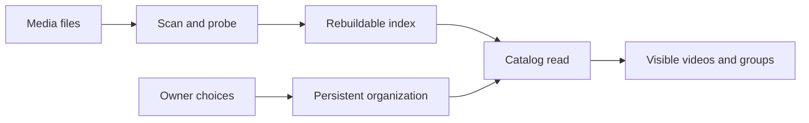

# Catalog organization and persistent identity

The catalog separates a rebuildable file index from the owner's persistent
organization. User choices use content keys or their own entity ids, so
rebuilding the index does not erase them.

The diagram shows the two kinds of data joining at an audience-aware read.

## Identity and recovery

Content identity survives a file move or rename. Locations describe where
the indexed content can be played; they do not own tags, favorites, watch
history, display overrides or work information. Folder-derived groups use a
stable folder identity. Manual groups, playlists, people and organizations
have ids of their own.

A virtual video is a library entry with no file. It is user data in
`virtual_videos`, whose id gives it the user key `virtual:<id>`; the prefix
cannot collide with a content key or a bundle key. A `videos` row with that
content key and no location projects it into the index, so per-video
operations and the user-data tables serve it unchanged. The orphan sweep after
a scan keeps that row, and startup recreates it when it is missing. Deleting a
virtual video removes its row, its projection and the user data under its key
in one transaction.

Saving and deleting a virtual video carry the `contentVersion` the screen
read, which is its whole user key. `videos.id` is a rowid that SQLite can
reuse after a delete, so a stale screen gets `404` or `409 content_changed`
instead of writing into another video, and nothing is recreated. A save to a
file video that carries a virtual video's version is such a stale screen and
also answers `409 content_changed`. A virtual
video never joins a version bundle, because a bundle chooses a file to play;
every bundle operation answers `409 virtual_video` for one.

Merging a virtual video into a file video moves its user data to the file
video's user key, the bundle key when the file video is bundled, and deletes
the virtual video in one transaction. The merge reuses the succession helpers
that move tags and playlist and group items, and applies these rules.

| Data | Rule |
| --- | --- |
| Tags, people, organizations, external ids | Union; a tag confirmed on either side stays confirmed |
| Favorite | Favorite when either is |
| Playlist items | Re-keyed in place; where a playlist holds both, the file video's item stays |
| Description | The file video's, then a blank line and the virtual video's |
| Links | The file video's, then the virtual video's not already present |
| Code and each date | The file video's when present, otherwise the virtual video's |
| Title, thumbnail, public flag | The file video's |

The public flag is not carried, so a merge never publishes a file the owner
did not publish. A combined description over the work-information limit or
more than 20 links rejects the merge and changes nothing, so the owner
shortens one side instead of losing text. A merge has no undo, which would
keep the virtual key alive as a bundle keeps absorbed keys.

| Read | Value for a virtual video |
| --- | --- |
| Added, created and modified sort | Its creation time |
| Title sort and search | Its own title and search keys; search scans them instead of the location FTS index |
| Duration and size sort | Unknown, so it sorts last |
| Duration range and playable-only filters | Excluded |
| Folder reads, external API, MCP | Absent, because they read locations |

Database migrations define the schema. The recovery distinction is documented
in [Data and recovery](../how-to/running-vv.md#data-and-recovery), and startup
rebuilds are described in [process lifecycle](process-lifecycle.md).

## Ways to organize videos

| Mechanism | Meaning |
| --- | --- |
| Version bundle | Different files representing the same video, with one representative in catalog results |
| Group | A folder-derived or manually arranged collection of videos and groups |
| Playlist | An ordered playback sequence |
| Smart folder | A saved condition evaluated against the current catalog |
| Tag and tag kind | A reusable label and its classification |
| Work information | Video facts linked to persistent people and organizations |
| Favorite and watch history | Owner choices and playback history retained across scans |

Folder browsing and automatic membership use the database, not a fresh walk
of the filesystem. Smart-folder membership follows its condition; it is not
a copied set of video ids. Version detection and the choice to bundle files
are separate decisions ([duplicate judging](duplicate-judging.md)).

## Search and visibility

Stored search and sort keys give locations and tag names consistent matching
and ordering. Startup refreshes keys whose normalization version changed.
All catalog reads apply the audience before counting or paging; a guest
cannot discover hidden videos through a collection or a search. A file video
is visible through a visible location; a virtual video is visible to the
owner, and to a guest only while it is public. A guest reads the description
and links of a visible video's work information; its other fields stay
owner-only.

Screen operations and field definitions live in
[the screen API schema](../../api/openapi.yaml). External tag operations,
including tentative tags and rejected names, are documented in
[the external API guide](../how-to/external-api.md). Layout and controls follow
[the design system](design-system.md) and [library UI](library-ui.md).
