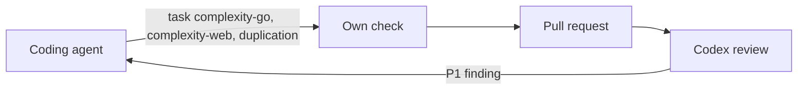

# Complexity and duplication

A change keeps each function it adds or makes more complex at complexity 25 or
less and shares code instead of copying it; [AGENTS.md](../../AGENTS.md) tells
the coding agent to check this and the Codex review to raise a breach.

The diagram shows where the rule acts on a change.

## The limits

A function over 25 is one that splitting makes clearer, and a copied block is
one that sharing keeps in step.

| Limit | Measured by | Checked with |
| --- | --- | --- |
| A Go function's complexity is at most 25 | gocyclo | `task complexity-go`; `reports/quality/complexity-go/gocyclo.txt` lists the most complex function first |
| A Web function's complexity is at most 25, a `switch` counting as 1 | ESLint `complexity`, `variant: "modified"` | `npx eslint --rule 'complexity: [error, {max: 25, variant: modified}]' <files>` in `web/` |
| Code is shared, not copied | jscpd | `task duplication`; `reports/quality/duplication/jscpd-report.json` names both places of each clone |

Go adds 1 for every `if err != nil`, so a plain function that reads the
database passes 15; the `modified` variant keeps a mapping with many `case`s
from counting as complex. Tests and generated code are outside the limits, and
code that a change only moves is not new.

## The rules guide the agent and the review and do not fail CI

The coding agent and the Codex review read the limits in `AGENTS.md`; no check
in CI fails on them. Existing code holds 5 Go functions and 9 Web files over 25
and 5 Web clones, and a lint rule would have to list them as exceptions, wait
until all are fixed, or filter its findings to the changed lines. Judging the
change itself also tells a moved function from a new one and catches an
existing function that grows past the limit.

## The review raises a breach as P1

The `Review guidelines` section of `AGENTS.md` makes a breach a P1 finding,
because the Codex review on GitHub posts only P0 and P1 findings. The agents
that drive a pull request verify each review finding and fix a real one, so a
breach in an agent's change is fixed before it merges; a pull request merged
by hand is not stopped.

| Rejected | Why |
| --- | --- |
| Failing lint with the existing violations listed by name | The 9 Web files had to be excluded whole, so new code in them went unchecked, and the list had no owner |
| Fixing every existing violation before adding a lint rule | The refactoring costs more than the rule is worth while the agents already follow the limits |
| Failing lint only on changed lines (reviewdog, `new-from-merge-base`) | A complexity finding sits on the function's first line, so a function that grows inside is missed, moved code fails on old violations, and it adds a tool |
| Mutation testing on the changed lines | Mutants that no test can tell apart, such as a slice capacity, would have no way out |
| A threshold of 15 | Go's error checks put routine database functions over it |
