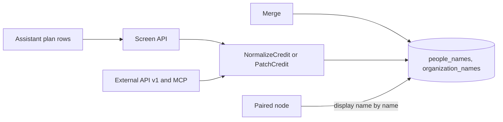
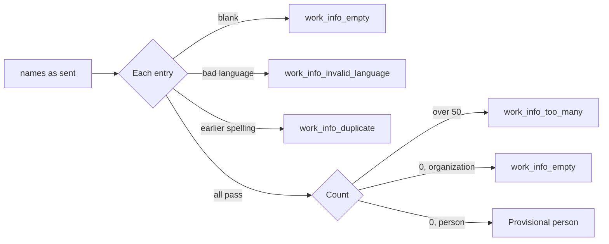
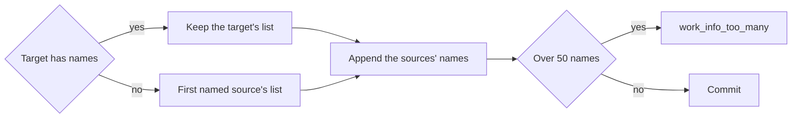

# Names of people and organizations

A person or an organization keeps its names as one ordered list whose first
entry is the display name. The list rule lives in
[`credit.go`](../../internal/domain/credit.go) and the storage in
[`credits.go`](../../internal/store/credits.go).

The diagram shows where a write's names are checked and stored.

## The names are one ordered list

Each name row has a `position`: 0 is the display name and the rest are dense
and in the owner's order; any row may carry a BCP 47 `language`. `Credit.Name`
is read from position 0 and `Credit.Names` holds the whole list.

A display name is a name like the others, so one column and one rule serve
every entry, and the owner, not a sort, decides the order.

| Rejected | Why |
| --- | --- |
| A `canonical` flag beside `position` | Two facts that can disagree; every write would keep them in step |
| A separate order table | A join for an integer the row holds, and a merge would write two tables |
| Natural order for the entries after the first | The owner decides the order |
| Callers reading `Names[0]` with no `Name` | Every reader of a display name would branch on an empty list |

## One rule validates the whole list

A write runs one rule over the list it sends; the error fields are the
entry's path.

A long spelling is `work_info_too_long` and a control character
`work_info_control_characters` at `names[i].name`; a duplicate is reported at
the later entry and compares the trimmed spelling exactly, as the rows' primary
key does. The limit is 50 names with the display name, counted only when a
request carries `names`, so a list migrated with 51 rows survives a profile or
`name` patch until the owner sends the list.

| Rejected | Why |
| --- | --- |
| Drop blank entries | A dropped first entry would silently make the next one the display name |
| Folded comparison of duplicates | Two spellings that fold to one name are two rows today and stay matchable |

## A person without names is provisional

Face recognition finds people before anyone knows their names, so a person may
have no name rows. Such a person is provisional: `Person`, `CreditRef` and
`WorkPerson` carry `provisional: true`, `name` is `""` and `names` is `[]`.
The flag is read from the missing position-0 row by every person query, never
stored. An organization's empty list is refused.

| Operation | Effect on a provisional person |
| --- | --- |
| `GET /api/people?provisional=…` | `true` keeps only provisional people, `false` only named ones; an organization list answers `400 invalid_request` |
| Natural-name order | Provisional people come after every named person, by ID; the other sorts break ties the same way |
| `PATCH` with `name`, or `names` with entries | The person becomes an ordinary person in the same write |
| `PATCH` with `names: []` | A named person becomes provisional |
| Merge into a provisional target | The target takes the first named source's list first ([A merge appends the sources' names](#a-merge-appends-the-sources-names)) |

The name order keeps one keyset cursor by prefixing each listed sort key with
`0` for a named person and making it `1` for a provisional one.

| Rejected | Why |
| --- | --- |
| A `provisional` column | Two facts that can disagree |
| A stored placeholder name such as `Unknown 12` | It cannot follow the screen's language, it matches name searches, and a merge keeps it as a name |

## Requests send names, or name to respell the display name

`Person` and `Organization` return `name` and `names` in both APIs; creation
takes `names`, and an update takes `names` (the whole list) or `name` (the
display name's spelling, keeping its language and the other entries), not both
([`openapi.yaml`](../../api/openapi.yaml), [`external-v1.yaml`](../../api/external-v1.yaml)).

The organizations row rename, the video editor's naming of an unnamed person,
the paired node's by-name rename and the assistant's `newName` know only the
new spelling, so a whole list they read earlier would drop names changed in
between.

| Body | Result |
| --- | --- |
| `name` and `names` | `400 invalid_request` |
| `name` equal to another entry | `work_info_duplicate` at `name`; the entry is not moved, since a rename is also the peer's by-name write |
| `aliases`, or `name` on create | `400 invalid_request`, an unknown property |

The assistant's `createPerson` and `createOrganization` take `names`, a string
list whose first entry is the display name; the update rows take `names` to
replace the list and `newName` to send `name`, and a row with both sends only
`names` with its first entry respelled.

## A merge appends the sources' names

The merged list is the target's list followed by each source's list in
`sourceIds` order, each spelling once, positions continuing; over 50 names, or
over 20 external IDs, nothing changes and the answer is `work_info_too_many`.

One statement over the ordered rows is one rule, so a provisional target needs
no separate naming step and the merge keeps its fixed statement count.

## Migration 98 numbered the stored names

The canonical row became position 0 and the aliases followed in the order the
screens listed them, through the Go collation `vv_alias_order`
([`alias_order.go`](../../internal/store/alias_order.go)), which compares as
the natural name order with ties by spelling.

`sort_key` is width- and kana-folded, so ordering by it would have moved a
full-width `Ｂ` before `C`; the screens showed it after.

## Paired nodes share the display name only

A rename of the display name reaches every read VVMDM by name, whether the
request sends `name` or a `names` list with a new first entry; the other
entries stay with each node
([peer-library.md, Vocabulary by name](peer-library.md#vocabulary-by-name)).
