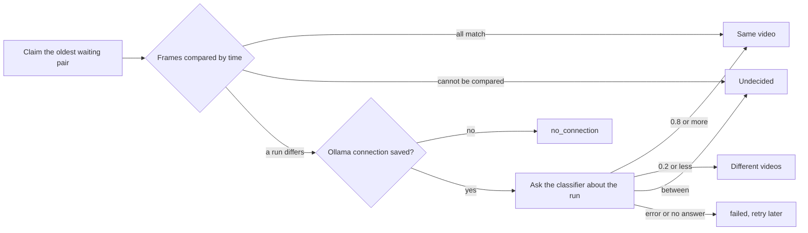

# Judging possible duplicates automatically

VVMDM judges each possible duplicate, one pair at a time, first from the two
stored fingerprints and only then, for a section where the frames differ, by
asking the classifier port. The worker is
[`internal/app/version_judge.go`](../../internal/app/version_judge.go), the
frame rule is
[`internal/domain/version_frames.go`](../../internal/domain/version_frames.go),
and the queue and the results are
[`internal/store/version_judgements.go`](../../internal/store/version_judgements.go).
The reasons for each rule are in
[054 research](../../specs/054-auto-dup/research.md).

The diagram shows one candidate from the claim to its result.

## The frame rule decides first

Frames are paired by time and flat frames are skipped, as the candidate check
pairs them, and a pair differs when its distance is over 12
(`FingerprintMatchMaxDistance`). The median the candidate check uses hides a
replaced section; the per-frame list shows it
([R-1](../../specs/054-auto-dup/research.md#r-1-the-fingerprints-decide-first-the-model-is-asked-only-when-a-section-differs)).

| Frames | Result | Frames shown to the model |
| --- | --- | --- |
| At most 5% differ, never two in a row | Same video, no request | None |
| Two or more in a row differ | Ask the model | The longest run (the earlier one on a tie) |
| Over 5% differ, none in a row | Ask the model | All differing frames |
| Fewer than 3 comparable pairs, or different fingerprint versions | Undecided, left to the owner | None |

More than 4 frames are spread across the run, so a request carries at most 4
images.

## The model sees the frames, not the names

Each image is frame A on the left and the paired frame B on the right, cut
from the two seek previews by
[`internal/artifacts`](../../internal/artifacts/seek_frames.go), with B scaled
to A's frame size. The request carries no facts: no file name, folder or
duration
([R-2](../../specs/054-auto-dup/research.md#r-2-the-model-sees-the-frames-where-the-two-files-differ),
[R-11](../../specs/054-auto-dup/research.md#r-11-the-request-carries-no-file-names)).
The question and the thresholds 0.8 and 0.2 are fixed in
`internal/domain`
([R-3](../../specs/054-auto-dup/research.md#r-3-the-question-wording-and-two-fixed-thresholds)).

| Rejected | Why |
| --- | --- |
| Frames from the media files with ffmpeg | Only a scan reads the media folders' files |
| A reply without the question's key as probability 0 | It would dismiss a pair the model never judged |

## The worker runs only while it is on

One goroutine, like `AutoTagger`, claims one pair at a time while
`version_judging.enabled` is true, and sleeps otherwise.

| Wakes on | Why |
| --- | --- |
| Startup | Pairs found while the server was stopped |
| `ProcessingChanged` | A finished fingerprint job may have written a candidate |
| `VersionCandidatesChanged` | Removing a version lists its pairs again |
| Saving the setting | Turning it on judges every waiting pair |
| Saving the Ollama connection | `no_connection` pairs return to waiting |
| A retry or undo from the activity log | A retried pair is claimable now |
| The earliest `retry_at` of a failed pair | Retries need nothing from the owner ([R-5](../../specs/054-auto-dup/research.md#r-5-a-failed-judgement-retries-on-a-backoff-that-never-ends)) |

The worker asks the store whether an `ollama.endpoint` row exists before a
request, so a pair is never sent to the default address the owner never set
([R-13](../../specs/054-auto-dup/research.md#r-13-the-model-is-asked-only-once-the-owner-has-saved-a-connection)).
Each pair's frame-rule outcome, frame counts, verdict and probability go to
the log under `component=duplicate-judging`.

## Each pair keeps one activity entry

Every judgeable candidate has one `version_judgement` entry in the activity
log ([activity.md](activity.md)), opened when the candidate appears while
judging is on, or when judging is turned on. The candidate row's
`activity_id` points to it, and its status follows the row's `judgement`, so
the same entry turns from `no_connection` or `failed` into the result
([055 R-4](../../specs/055-activity/research.md#r-4-three-statuses-with-a-reason-and-a-newer-run-closes-an-older-problem)).
The code is
[`internal/store/activity_judgements.go`](../../internal/store/activity_judgements.go).

| Candidate row | Entry |
| --- | --- |
| Waiting, or returned to waiting (connection saved, judging turned off mid-judgement, retry) | `running`/`waiting` |
| Claimed, including an entry left `interrupted` by a restart | `running`/`processing` |
| `undecided`, `failed` (with its retry time), `no_connection` | `attention` with that reason |
| Bundled or dismissed by the judgement | `done`/`same` or `done`/`different` |
| Rebuilt for one of its keys | Attached again to the pair's open entry, found by its two keys |
| Bundled or dismissed by the owner | `done`/`decided_by_owner` |
| Restored by undoing the drag-organize bundle that closed it | The same entry reopens with the row's state |
| Its key's content changed at the same path | Kept open until the succession is decided: re-keyed when it carries over, `done`/`gone` when it does not |
| A key left the library | `done`/`gone` |
| Swept into one bundle by another pair's automatic bundle, or dropped by a rebuild while both keys stay in the library | `done`/`superseded` |

The decider is `ai` with the probability when the model's answer decided, and
`rule` otherwise
([055 R-5](../../specs/055-activity/research.md#r-5-the-decider-is-who-made-the-recorded-decision-else-who-started-the-run)).
An automatic bundle keeps the joined side's member keys and its former
representative in `undo_keys`, the side whose representative did not become
the bundle's.

## Undo of an automatic decision is held

The owner undoes an automatic `same` or `different` from the activity log in
one `ActivityStore` transaction that re-reads the state first
([055 R-7](../../specs/055-activity/research.md#r-7-undo-restores-the-state-and-always-records-the-exclusion)).
When the state has changed, nothing else changes and the `undo` entry says
`already_reverted`. Whether the owner changed it since is read from the log,
not from the rows' timestamps: entry ids are monotonic, so an owner entry on
the same subject with an id greater than the undone entry's means the owner
decided again, even within the same second. For `same`, a joined member with
a later owner `bundle`, `unbundle` or `organize_undo` entry no longer counts
as part of the automatic bundle and the undo leaves it where the owner put
it; when no member is left to split, the undo is `already_reverted`. For
`different`, the dismissal row does not say who wrote it, so a later owner
`dismiss` entry on the same pair means the owner decided the pair again, and
the undo keeps the dismissal.

| Undone | State change | Keeps the worker from deciding it again |
| --- | --- | --- |
| `same` | The joined side leaves the bundle as `Unbundle` removes one video; a side of two or more leaves as one bundle with its former representative and a copy of the merged bundle's user data | `video_version_unbundles`, only for pairs across the two sides |
| `different` | The dismissal is deleted and both keys' candidates are rebuilt, so the pair is listed on Duplicates again | `video_version_judging_holds` |

The claim skips a held pair as it skips an unbundled one, and a content change
at the same path re-keys both tables and every key the entries hold, finished
entries included, so an undo after the change still finds the bundle member
or the tag under the new key.
