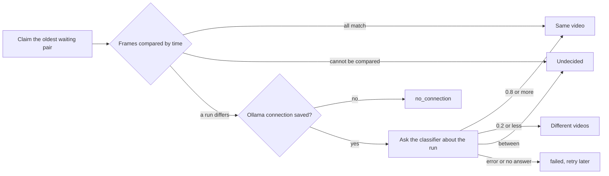

# Judging possible duplicates automatically

VVMDM judges each possible duplicate, one pair at a time, first from the two
stored fingerprints and only then, for a section where the frames differ, by
asking the classifier port. The worker is
[`internal/app/version_judge.go`](../../internal/app/version_judge.go), the
frame rule is
[`internal/domain/version_frames.go`](../../internal/domain/version_frames.go),
and the queue and the results are
[`internal/store/version_judgements.go`](../../internal/store/version_judgements.go).

The diagram shows one candidate from the claim to its result.

## The frame rule decides first

Frames are paired by time and flat frames are skipped, as the candidate check
pairs them, and a pair differs when its distance is over 12
(`FingerprintMatchMaxDistance`). The median the candidate check uses hides a
replaced section; the per-frame list shows it.

| Frames | Result | Frames shown to the model |
| --- | --- | --- |
| At most 5% differ, never two in a row | Same video, no request | None |
| Two or more in a row differ | Ask the model | The longest run (the earlier one on a tie) |
| Over 5% differ, none in a row | Ask the model | All differing frames |
| Fewer than 3 comparable pairs, or different fingerprint versions | Undecided, left to the owner | None |

More than 4 frames are spread across the run, so a request carries at most 4
images.

## The model sees the frames, not the names

Each image is frame A on the left and the paired frame B on the right, cut
from the two seek previews by
[`internal/artifacts`](../../internal/artifacts/seek_frames.go), with B scaled
to A's frame size. The request carries no facts: no file name, folder or
duration.
The question and the thresholds 0.8 and 0.2 are fixed in
`internal/domain`.

| Rejected | Why |
| --- | --- |
| Frames from the media files with ffmpeg | Decoding both files costs far more than cutting the frames from the two seek previews, which already hold them at the paired times |
| A reply without the question's key as probability 0 | It would dismiss a pair the model never judged |

## The owner sees why

Each judgement stores its frame rule result on the pair's activity entry, in
`activity_entries.evidence` as JSON of `domain.VersionJudgeEvidence`, so the
reason survives the candidate row that bundling or dismissal removes. The
Duplicates screen reads it through `GET /api/version-candidates`, which also
returns each pair's judgement state, and the activity entry's `Why` section
reads it from the entry. A waiting pair that the claim skips for a
`video_version_unbundles` or `video_version_judging_holds` row is listed as
`held`, so the screen says it is left to the owner instead of waiting forever.

| Field | Shown to the owner as |
| --- | --- |
| `rule`, `compared`, `differing` | How many frames were compared by time and how many differ |
| `longestRun`, `runStartMs`, `runEndMs` | The section that differs throughout, on the left video's timeline |
| `versionMismatch` | Incomparable because the fingerprints come from different fingerprint versions |
| `conflict` | A same verdict left undecided because a side is already marked different from the other |
| `frames` | The frame pairs shown to the classifier, with their times on both videos |

`GET /api/activity/{id}/judgement-frames/{index}` cuts the indexed pair from
the two current seek previews, as the request to the classifier did, instead
of storing the images: the evidence is a few hundred bytes per pair, and a
stored copy would outlive the seek preview it came from. A content change at
the same path removes `frames` from the pair entries of the old key before
re-keying them, since the frame indexes point into the old content's seek
preview; the counts and the sentences stay.
The screen states the thresholds next to the probability, so a 55% answer
reads as between the 20% and 80% that would decide.

## The owner can judge a pair again

`POST /api/version-candidates/rejudge` returns an `undecided`, `failed` or
`no_connection` pair to waiting with its attempt count reset, its entry to
`running`/`waiting` and its evidence cleared, and wakes the worker
([`internal/app/version_judge_review.go`](../../internal/app/version_judge_review.go)).
It covers the results that leave a pair on Duplicates: an owner who changed
the model or its connection, or rescanned a file, has no other way to ask
again about an undecided pair, which the claim never takes on its own.

| Refused | Why |
| --- | --- |
| Judging turned off (`409 version_judging_off`) | Nothing would claim the pair |
| A waiting or running pair (`409 version_not_rejudgeable`) | It is about to be judged already |
| A bundled or dismissed pair | It has left Duplicates; a force rescan judges automatic decisions again, as described below |

## The worker runs only while it is on

One goroutine, like `AutoTagger`, claims one pair at a time while
`version_judging.enabled` is true, and sleeps otherwise.

| Wakes on | Why |
| --- | --- |
| Startup | Pairs found while the server was stopped |
| `ProcessingChanged` | A finished fingerprint job may have written a candidate |
| `VersionCandidatesChanged` | Removing a version lists its pairs again |
| Saving the setting | Turning it on judges every waiting pair |
| Saving the Ollama connection | `no_connection` pairs return to waiting |
| A retry or undo from the activity log | A retried pair is claimable now |
| `Judge again` on Duplicates | A pair returned to waiting is claimable now |
| The earliest `retry_at` of a failed pair | Retries need nothing from the owner  |

The worker asks the store whether an `ollama.endpoint` row exists before a
request, so a pair is never sent to the default address the owner never set.
Each pair's frame-rule outcome, frame counts, verdict and probability go to
the log under `component=duplicate-judging`.

## Each pair keeps one activity entry

Every judgeable candidate has one `version_judgement` entry in the activity
log ([activity.md](activity.md)), opened when the candidate appears while
judging is on, or when judging is turned on. The candidate row's
`activity_id` points to it, and its status follows the row's `judgement`, so
the same entry turns from `no_connection` or `failed` into the result.
The code is
[`internal/store/activity_judgements.go`](../../internal/store/activity_judgements.go).

| Candidate row | Entry |
| --- | --- |
| Waiting, or returned to waiting (connection saved, judging turned off mid-judgement, retry) | `running`/`waiting` |
| Claimed, including an entry left `interrupted` by a restart | `running`/`processing` |
| `undecided`, `failed` (with its retry time), `no_connection` | `attention` with that reason |
| Bundled or dismissed by the judgement | `done`/`same` or `done`/`different` |
| Rebuilt for one of its keys | Attached again to the pair's open entry, found by its two keys |
| Bundled or dismissed by the owner | `done`/`decided_by_owner` |
| Restored by undoing the drag-organize bundle that closed it | The same entry reopens with the row's state |
| Its key's content changed at the same path | Kept open until the succession is decided: re-keyed when it carries over, `done`/`gone` when it does not |
| A key left the library | `done`/`gone` |
| Swept into one bundle by another pair's automatic bundle, or dropped by a rebuild while both keys stay in the library | `done`/`superseded` |

The decider is `ai` with the probability when the model's answer decided, and
`rule` otherwise.
An automatic bundle keeps the joined side's member keys and its former
representative in `undo_keys`, the side whose representative did not become
the bundle's.

A pair entry that a fingerprint result opens joins the import pipelines of
that run ([activity.md](activity.md#a-pipeline-groups-one-import-run)), so
the owner reaches it from either video's import.

| Pipeline | Joined |
| --- | --- |
| Every pipeline of the finishing fingerprint job's `import` entry | Always |
| The other video's newest pipeline | When it is not `done`, or when the same scan opened it and the triggering pipeline |
| An earlier, finished pipeline of either video from another scan or a re-probe | Never, so a later run does not reopen a past import |

Only a new entry joins. An entry that a rebuild attaches again, or that a
retry returns to waiting, keeps the pipelines it has, which return to
`running` with it. Judging turned off opens no entry, so no pipeline waits for
one; an entry that turning judging on opens later belongs to no pipeline.

## Undo of an automatic decision is held

The owner undoes an automatic `same` or `different` from the activity log in
one `ActivityStore` transaction that re-reads the state first.
When the state has changed, nothing else changes and the `undo` entry says
`already_reverted`. Whether the owner changed it since is read from the log,
not from the rows' timestamps: entry ids are monotonic, so an owner entry on
the same subject with an id greater than the undone entry's `decided_mark`
(the greatest entry id when the judgement wrote its result) means the owner
decided again after the result, even within the same second; an owner change
made while the pair waited or was being judged does not count. For `same`, a joined member with
a later owner `bundle`, `unbundle` or `organize_undo` entry no longer counts
as part of the automatic bundle and the undo leaves it where the owner put
it; when no member is left to split, the undo is `already_reverted`. A
`bundle` entry is written only for members whose membership changed, so the
owner adding a video to the automatic bundle does not hold its undo. For
`different`, the dismissal row does not say who wrote it, so a later owner
`dismiss` entry on the same pair means the owner decided the pair again, and
the undo keeps the dismissal.

| Undone | State change | Keeps the worker from deciding it again |
| --- | --- | --- |
| `same` | The joined side leaves the bundle as `Unbundle` removes one video; a side of two or more leaves as one bundle with its former representative and a copy of the merged bundle's user data | `video_version_unbundles`, only for pairs across the two sides |
| `different` | The dismissal is deleted and both keys' candidates are rebuilt, so the pair is listed on Duplicates again | `video_version_judging_holds` |

The claim skips a held pair as it skips an unbundled one, and a content change
at the same path re-keys both tables and every key the entries hold, finished
entries included, so an undo after the change still finds the bundle member
or the tag under the new key.

## Judging again after a force rescan

A forced fingerprint job
([`internal/store/version_rejudge.go`](../../internal/store/version_rejudge.go))
lists its key's automatically decided pairs as candidates again, in the
transaction that stores the fingerprint. A pair is listed when its latest
`version_judgement` decision is a `done` `same` or `different` entry by `rule`
or `ai`, not undone, and still in force under the undo rules above: the
owner has not unbundled, held or decided the pair again since the entry's
`decided_mark`. An owner's own bundle or dismissal has no automatic entry, so
it is never listed. With judging off nothing is listed, since there is no
automatic judgement to redo; an unforced fingerprint lists nothing either.

The listed row carries `rejudge_of`, the id of that entry. The claim takes it
although the pair is bundled or dismissed, and still skips a pair with a
`video_version_unbundles` or `video_version_judging_holds` row. The prior
decision stays in force until the verdict, and the verdict gets a new entry,
so a bundle never dissolves while the pair waits or the model is unreachable.

| Verdict | Prior `same` (bundled) | Prior `different` (dismissed) |
| --- | --- | --- |
| `same` | Nothing changes; the entry takes over the prior's undo keys | The dismissal is deleted, then the pair is bundled; a conflict restores the dismissal and the entry is `undecided` |
| `different` | The pair is dismissed and the joined side leaves as the undo splits it | Nothing changes |
| `undecided`, `failed`, `no_connection` | The bundle stays; the entry shows the reason | The dismissal stays; the entry shows the reason |

The row is removed once the verdict is applied, so a `failed` or
`no_connection` result is not retried; the next force rescan judges the pair
again. The split for `different` writes no `video_version_unbundles` row. That
row protects an owner's `Unbundle` from automatic bundling, and the claim
skips pairs that have it, so writing it here would keep every later force
rescan from judging the pair; the dismissal already keeps the pair apart.
When the owner changes the pair after it was listed, the prior is no longer
in force when the verdict arrives: the row is removed, nothing changes and
the entry closes as `superseded`. Bundling and succession prune ordinary
candidates of bundled or dismissed pairs but keep listed rows, which are
bundled or dismissed by definition. A split rebuilds the leaving keys'
candidates the same way: a listed row stays while its pair is still bundled or
dismissed, and one whose pair the split separated returns as an ordinary
candidate. For the same reason, an automatic bundle
does not close the entry of a listed pair among its members as `superseded`;
that entry closes with its own verdict. A pair whose two keys are both rescanned
is listed again by each fingerprint, and the later listing replaces the
earlier row, so the judgement sees both new fingerprints.

A `same` or `different` verdict replaces the prior entry: only the latest
`same` or `different` entry of a pair offers the undo
([`internal/store/activity.go`](../../internal/store/activity.go)). Otherwise
undoing the prior would split or un-dismiss a pair that the new verdict
confirmed, leaving the new entry's undo `already_reverted`.
