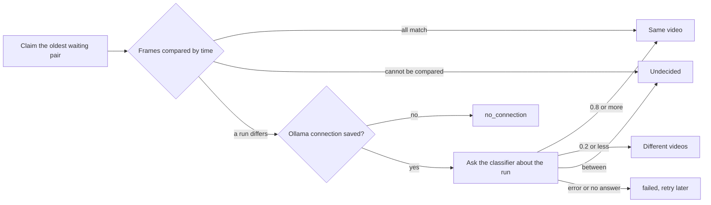

# Judging possible duplicates automatically

VVMDM judges each possible duplicate, one pair at a time, first from the two
stored fingerprints and only then, for a section where the frames differ, by
asking the classifier port. The worker is
[`internal/app/version_judge.go`](../../internal/app/version_judge.go), the
frame rule is
[`internal/domain/version_frames.go`](../../internal/domain/version_frames.go),
and the queue and the results are
[`internal/store/version_judgements.go`](../../internal/store/version_judgements.go).
The reasons for each rule are in
[054 research](../../specs/054-auto-dup/research.md).

The diagram shows one candidate from the claim to its result.

## The frame rule decides first

Frames are paired by time and flat frames are skipped, as the candidate check
pairs them, and a pair differs when its distance is over 12
(`FingerprintMatchMaxDistance`). The median the candidate check uses hides a
replaced section; the per-frame list shows it
([R-1](../../specs/054-auto-dup/research.md#r-1-the-fingerprints-decide-first-the-model-is-asked-only-when-a-section-differs)).

| Frames | Result | Frames shown to the model |
| --- | --- | --- |
| At most 5% differ, never two in a row | Same video, no request | None |
| Two or more in a row differ | Ask the model | The longest run (the earlier one on a tie) |
| Over 5% differ, none in a row | Ask the model | All differing frames |
| Fewer than 3 comparable pairs, or different fingerprint versions | Undecided, left to the owner | None |

More than 4 frames are spread across the run, so a request carries at most 4
images.

## The model sees the frames, not the names

Each image is frame A on the left and the paired frame B on the right, cut
from the two seek previews by
[`internal/artifacts`](../../internal/artifacts/seek_frames.go), with B scaled
to A's frame size. The request carries no facts: no file name, folder or
duration
([R-2](../../specs/054-auto-dup/research.md#r-2-the-model-sees-the-frames-where-the-two-files-differ),
[R-11](../../specs/054-auto-dup/research.md#r-11-the-request-carries-no-file-names)).
The question and the thresholds 0.8 and 0.2 are fixed in
`internal/domain`
([R-3](../../specs/054-auto-dup/research.md#r-3-the-question-wording-and-two-fixed-thresholds)).

| Rejected | Why |
| --- | --- |
| Frames from the media files with ffmpeg | Only a scan reads the media folders' files |
| A reply without the question's key as probability 0 | It would dismiss a pair the model never judged |

## The worker runs only while it is on

One goroutine, like `AutoTagger`, claims one pair at a time while
`version_judging.enabled` is true, and sleeps otherwise.

| Wakes on | Why |
| --- | --- |
| Startup | Pairs found while the server was stopped |
| `ProcessingChanged` | A finished fingerprint job may have written a candidate |
| `VersionCandidatesChanged` | Removing a version lists its pairs again |
| Saving the setting | Turning it on judges every waiting pair |
| Saving the Ollama connection | `no_connection` pairs return to waiting |
| The earliest `retry_at` of a failed pair | Retries need nothing from the owner ([R-5](../../specs/054-auto-dup/research.md#r-5-a-failed-judgement-retries-on-a-backoff-that-never-ends)) |

The worker asks the store whether an `ollama.endpoint` row exists before a
request, so a pair is never sent to the default address the owner never set
([R-13](../../specs/054-auto-dup/research.md#r-13-the-model-is-asked-only-once-the-owner-has-saved-a-connection)).
Each pair's frame-rule outcome, frame counts, verdict and probability go to
the log under `component=duplicate-judging`.
