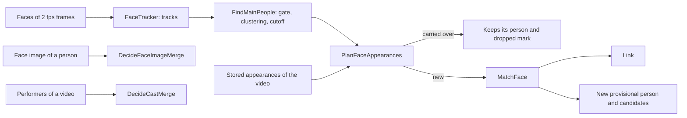
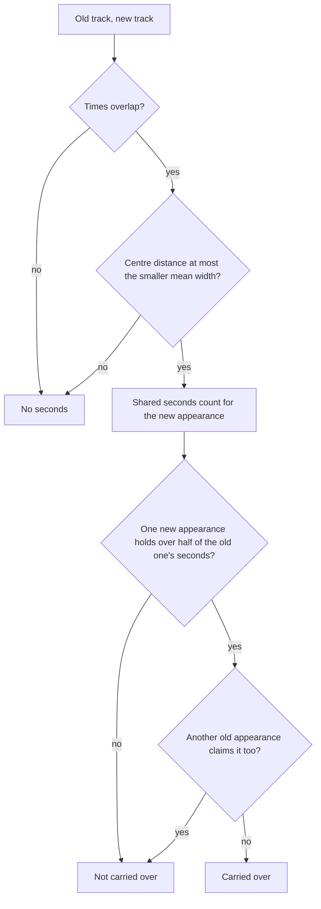

# Face recognition

vv finds the main people of each video by face and matches them to the people
in the library; the rules are pure functions in
[`internal/domain`](../../internal/domain/face_main_people.go).

The diagram shows how one video's faces become links, candidates and merges.

## Main people are found per video with the POC's constants

A video's main people are clusters of its face tracks with at least 8 seconds
of good faces in at least 2 tracks
([`face_main_people.go`](../../internal/domain/face_main_people.go)).

The constants were measured together in the face POC on 12 real videos, where
20 of 22 main people held one person only; they are code, not settings, because
the quality gate and the cutoff only work as a pair.

| Step | Rule |
| --- | --- |
| Sampling | 2 frames per second, fitted into 1280 × 1280 |
| Tracking | Faces under 48 px are skipped; a face continues the open track it is most similar to above `Track` when the boxes overlap (IoU over 0.05), or above `TrackFar` when they do not; a track closes after 2 missed frames and is kept with 3 or more faces |
| Quality gate | A good face is 64 px wide or more, scores 0.85 or more, and has its nose within 0.5 ± 0.22 of the way between the eyes |
| Track vector | The normalized mean of the good faces; a track with fewer than 2 good faces has none and is not clustered |
| Clustering | Average linkage over the track vectors, joining while the mean similarity reaches `Cluster` |
| Cutoff | Good seconds (good faces ÷ 2) at least 8, tracks at least 2 |

Each track keeps its start, end, mean centre and mean width, and a main person
keeps its best good face (largest box times score) for its crop.

| Rejected | Why |
| --- | --- |
| Clustering the whole library together | Every import would re-cluster every video, and person ids could change |

## Each recognizer has its own thresholds

Similarity thresholds are constants in the recognizer table
([`face_recognizer.go`](../../internal/domain/face_recognizer.go)), because
SFace and ArcFace vectors spread differently and the owner has no data to set
them.

| Threshold | Use | SFace int8 | ArcFace r50 |
| --- | --- | --- | --- |
| `Track` | Continue a track, boxes overlapping | 0.45 | 0.288 |
| `TrackFar` | Continue a track, boxes apart | 0.6 | 0.614 |
| `Cluster` | Join clusters of tracks | 0.45 | 0.288 |
| `Candidate` | Offer a pair to the owner | 0.363 | 0.205 |
| `Link` | Link a main person to a person | 0.45 | 0.288 |
| `Merge` | Merge a provisional person on a face image | 0.55 | 0.545 |

The SFace values are the upstream same-person threshold and the POC's. The
ArcFace values give the same error rates as SFace on LFW (13,233 images of
5,749 people), measured with the POC's protocol on vectors from the same
detection and alignment:

- **Late linking** (`Candidate`, `Link`, `Merge`): 70% of the people with two
  or more images are registered with one random image each; every other image
  is named by its most similar registered person when the similarity reaches
  the threshold. A correct naming is a registered person's image given their
  own name; a false naming is an unregistered person's image given any name.
  Rates are the mean of 5 random draws.
- **Pairs** (`Track`, `TrackFar`, `Cluster`): the share of all pairs of images
  of two different people at or above the threshold.

The measured rates, with the 4,950 registered and 7,107 unregistered images
of a draw and the 87,307,271 pairs of different people:

| Threshold | SFace int8: value, rate | ArcFace r50: value, rate |
| --- | --- | --- |
| `Candidate` | 0.363: 98.3% correct, 61.6% false | 0.205: 99.8% correct, 61.3% false |
| `Link` | 0.45: 96.0% correct, 3.43% false | 0.288: 99.7% correct, 3.42% false |
| `Merge` | 0.55: 83.9% correct, 0.17% false | 0.545: 90.4% correct, 0.17% false |
| `Track`, `Cluster` | 0.45: 4,482 pairs (0.0051%) | 0.288: 4,442 pairs |
| `TrackFar` | 0.6: 88 pairs (0.0001%) | 0.614: 87 pairs |

At equal false rates ArcFace names more people correctly, most of all at
`Merge`. An unregistered image named at `Candidate` is why that threshold only
offers a pair and never links.

## A main person is matched against every vector of a person

A person's vectors are the centroids of their appearances and the vector of
their face image, and a main person's similarity to them is the highest cosine
among those
([`MatchFace`](../../internal/domain/face_match.go)).

| Highest similarity | Result |
| --- | --- |
| `Link` or more | Linked to the most similar person |
| `Candidate` up to `Link` | A new provisional person, offered with each such person as a candidate |
| Below `Candidate` | A new provisional person |

An appearance the owner dropped (by removing or undoing its link, or deleting
its person) is not a vector of its person. The face POC found one actor across
films with different hair; an averaged vector per person would blur those
looks.

## A re-analysis carries appearances over by track time and position

A re-analysed video keeps each stored appearance by passing it to the one new
appearance holding more than half of its matched track seconds
([`CarryOverFaceAppearances`](../../internal/domain/face_match.go)); a
carried-over appearance keeps its person and dropped mark and is not matched by
vector again.

The detector is the same for every recognizer, so a recognizer switch finds the
same faces at the same times and places, while vectors of two recognizers
cannot be compared. Position separates people on screen together, and the
smaller width keeps a small face beside a large one from claiming the large
one's track. A new appearance nothing is carried over to is matched by vector.

| Rejected | Why |
| --- | --- |
| Time overlap alone | Two people on screen together overlap each other's spans, so their people could swap |
| Matching the carried-over centroid again | After a switch the other videos' vectors still belong to the old recognizer, and links the owner kept would move |
| A fixed fraction of the frame as the distance | A close-up and a wide shot need different distances; the face width scales with the shot |

## A face image merges only one provisional person

When a named person's face image reaches `Merge` with exactly one provisional
person, that person is merged into them; two or more at `Merge`, and every
provisional person from `Candidate` up, are candidates
([`DecideFaceImageMerge`](../../internal/domain/face_match.go)). A provisional
person's own face merges nobody, so provisional people never merge into each
other on their own.

## The cast rule merges only one-to-one pairs

When exactly one performer of a video has no face linked in it and exactly one
provisional person is linked to it by face, the provisional person is merged
into that performer, unless the performer is provisional too or the owner
dismissed the pair
([`DecideCastMerge`](../../internal/domain/face_match.go)).

The performer has no face to compare with, so the rule relies on the
one-to-one pairing; in the POC, five candidates from a cast list named 0.5% of
unknown faces wrongly at 0.363, and one candidate is stricter still.
