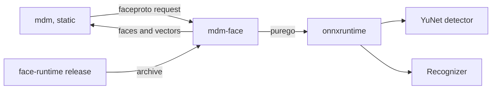
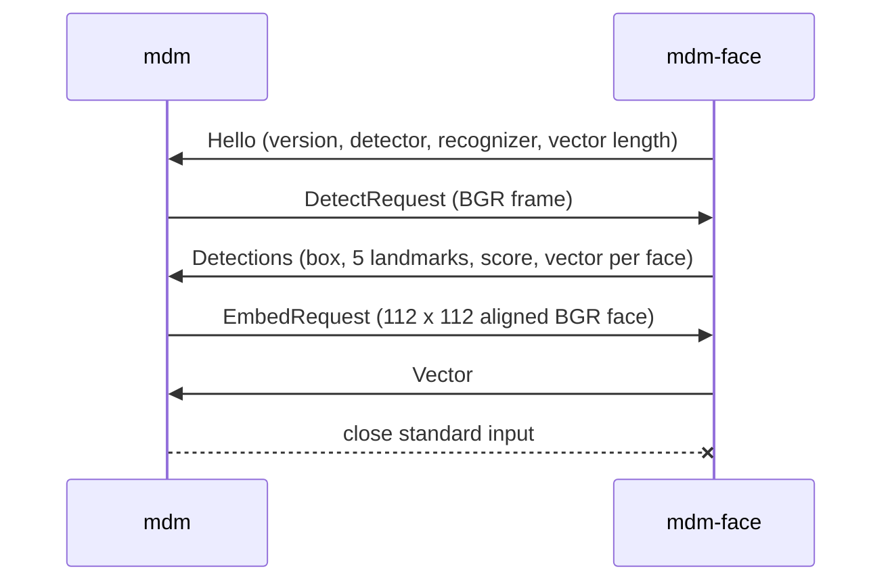
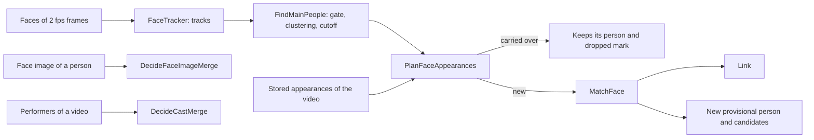
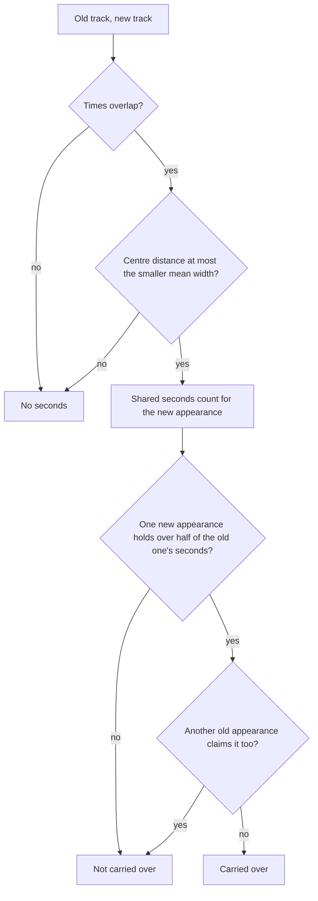

# Face recognition

vv finds the main people of each video by face and matches them to the
people in the library. Faces are detected and embedded by a helper process,
`mdm-face` ([`cmd/mdm-face`](../../cmd/mdm-face)), that runs onnxruntime
outside `mdm` and arrives in a face runtime archive that vv publishes; the
rules that turn its faces into people are pure functions in
[`internal/domain`](../../internal/domain/face_main_people.go).

The diagram shows the parts that carry a frame to its face vectors.

## Inference runs in a helper process

`mdm` never loads native code: inference runs in `mdm-face`, which loads
onnxruntime through `purego` ([`internal/faceinfer`](../../internal/faceinfer)),
and only `cmd/mdm-face` may import `purego` or `internal/faceinfer` (the
`only-the-face-helper-loads-native-code` rule in
[`.golangci.yml`](../../.golangci.yml)).

A `purego` binary asks for glibc's dynamic loader (`/lib64/ld-linux-x86-64.so.2`)
in an `INTERP` program header, and such a binary does not start in the
`alpine:3.24` image, so `mdm` inside it would fail for every Docker user. The
helper's own crashes in native code end the helper, not the server.
`task static-binary-check` builds the Linux `mdm` for `amd64` and `arm64` and
fails when either has an `INTERP` header; CI runs it on every pull request.

| Rejected | Why |
| --- | --- |
| `purego` inside `mdm` | `mdm` no longer starts on Alpine |
| A glibc base image | Every user's image changes for an optional feature |
| Inference in pure Go | The convolutions would have to be written and kept equal to onnxruntime |

## The helper protocol

`mdm` and the helper exchange length-prefixed binary messages on the helper's
standard input and output ([`internal/faceproto`](../../internal/faceproto)),
and the helper holds no rule about which faces matter.

The sequence shows one helper's life.

| Message | Rule |
| --- | --- |
| `Hello` | The helper's first message; a different `Version` is an error on read, so a stale archive is reported instead of misread |
| `Error` | Replaces `Hello` when the models do not load, and answers a request that failed; the helper keeps serving after a failed request |
| `Detections` | Every face YuNet keeps (score 0.6, non-maximum suppression at IoU 0.3), each with its vector; tracking and the quality gate stay in `mdm` |

Each message is a little-endian `uint32` length, a kind byte and its payload,
at most 64 MiB. The helper exits when its input closes.

## Two recognizers share one detector

YuNet 2023mar detects faces for every recognizer; the recognizer is SFace
2021dec int8 (`sface_int8`) or ArcFace r50 from InsightFace `buffalo_l`
(`arcface_r50`).

| Recognizer | Input | Vector |
| --- | --- | --- |
| `sface_int8` | Planar RGB, 0..255 | 128 |
| `arcface_r50` | Planar RGB, (v − 127.5) / 127.5 | 512 |

Both take the same five-point alignment to a 112 × 112 template, so a switch
never changes which faces are found. The recognizer's input and output names
are read from the model, because exports of one model name them differently.
The frame path aligns without rounding to bytes, as the measured proof of
concept did: on LFW the Go SFace int8 pipeline reached 99.82% accuracy against
OpenCV's 99.86% with SFace fp32.

## The face runtime archive

CI builds one archive per platform from
[`scripts/build/face_runtime.go`](../../scripts/build/face_runtime.go)
(`go run ./scripts/build -face-runtime <platform>`), and the
[face-runtime workflow](../../.github/workflows/face-runtime.yml) publishes
them as a `face-runtime-v<N>` GitHub Release when the maintainer pushes that
tag.

| Archive | Contents |
| --- | --- |
| `face-runtime-linux-amd64.tar.gz`, `face-runtime-linux-arm64.tar.gz` | `mdm-face`; `lib/` with Microsoft's onnxruntime 1.22.0 and the loader, `libc`, `libm`, `libdl`, `libpthread`, `librt`, `libstdc++` and `libgcc_s` of a pinned `debian:trixie` image; their licenses |
| `face-runtime-windows-amd64.zip` | `mdm-face.exe`, `onnxruntime.dll`, its license |

On Linux the helper starts as `lib/ld-linux-*.so --library-path lib mdm-face`,
so it runs under the bundled glibc on any host, Alpine included. Each pull
request that changes the helper builds the three archives, and the Linux jobs
start each helper in `alpine:3.24` through that loader on one photo and expect
one face with a 128-value vector. A separate tag keeps nightly and tagged vv
builds on the same archive, which changes only with onnxruntime or the
protocol.

| Rejected | Why |
| --- | --- |
| The runtime in the image and the Windows zip | About 26 MB for every user, including those who never turn the feature on |
| onnxruntime and Debian packages fetched by `mdm` | `mdm-face` still has to come from vv, and unpacking `.deb` files adds a format the server needs nowhere else |
| A runtime per vv release | Nightly and development builds would have nothing to download |

## From faces to people

`mdm` turns the helper's faces into people with the rules below, one video at
a time. The diagram shows how one video's faces become links, candidates and merges.

## Main people are found per video with the POC's constants

A video's main people are clusters of its face tracks with at least 8 seconds
of good faces in at least 2 tracks
([`face_main_people.go`](../../internal/domain/face_main_people.go)).

The constants were measured together in the face POC on 12 real videos, where
20 of 22 main people held one person only; they are code, not settings, because
the quality gate and the cutoff only work as a pair.

| Step | Rule |
| --- | --- |
| Sampling | 2 frames per second, fitted into 1280 × 1280 |
| Tracking | Faces under 48 px are skipped; a face continues the open track it is most similar to above `Track` when the boxes overlap (IoU over 0.05), or above `TrackFar` when they do not, and the most similar face and track pairs of a frame are joined first; a track closes after 2 missed frames and is kept with 3 or more faces |
| Quality gate | A good face is 64 px wide or more, scores 0.85 or more, and has its nose within 0.5 ± 0.22 of the way between the eyes |
| Track vector | The normalized mean of the good faces; a track with fewer than 2 good faces has none and is not clustered |
| Clustering | Average linkage over the track vectors, joining while the mean similarity reaches `Cluster` |
| Cutoff | Good seconds (good faces ÷ 2) at least 8, tracks at least 2 |

Each track keeps its start, end, mean centre and mean width, and a main person
keeps its best good face (largest box times score) for its crop.

| Rejected | Why |
| --- | --- |
| Clustering the whole library together | Every import would re-cluster every video, and person ids could change |

## Each recognizer has its own thresholds

Similarity thresholds are constants in the recognizer table
([`face_recognizer.go`](../../internal/domain/face_recognizer.go)), because
SFace and ArcFace vectors spread differently and the owner has no data to set
them.

| Threshold | Use | SFace int8 | ArcFace r50 |
| --- | --- | --- | --- |
| `Track` | Continue a track, boxes overlapping | 0.45 | 0.288 |
| `TrackFar` | Continue a track, boxes apart | 0.6 | 0.614 |
| `Cluster` | Join clusters of tracks | 0.45 | 0.288 |
| `Candidate` | Offer a pair to the owner | 0.363 | 0.205 |
| `Link` | Link a main person to a person | 0.45 | 0.288 |
| `Merge` | Merge a provisional person on a face image | 0.55 | 0.545 |

The SFace values are the upstream same-person threshold and the POC's. The
ArcFace values give the same error rates as SFace on LFW (13,233 images of
5,749 people), measured with the POC's protocol on vectors from the same
detection and alignment:

- **Late linking** (`Candidate`, `Link`, `Merge`): 70% of the people with two
  or more images are registered with one random image each; every other image
  is named by its most similar registered person when the similarity reaches
  the threshold. A correct naming is a registered person's image given their
  own name; a false naming is an unregistered person's image given any name.
  Rates are the mean of 5 random draws.
- **Pairs** (`Track`, `TrackFar`, `Cluster`): the share of all pairs of images
  of two different people at or above the threshold.

The measured rates, with the 4,950 registered and 7,107 unregistered images
of a draw and the 87,307,271 pairs of different people:

| Threshold | SFace int8: value, rate | ArcFace r50: value, rate |
| --- | --- | --- |
| `Candidate` | 0.363: 98.3% correct, 61.6% false | 0.205: 99.8% correct, 61.3% false |
| `Link` | 0.45: 96.0% correct, 3.43% false | 0.288: 99.7% correct, 3.42% false |
| `Merge` | 0.55: 83.9% correct, 0.17% false | 0.545: 90.4% correct, 0.17% false |
| `Track`, `Cluster` | 0.45: 4,482 pairs (0.0051%) | 0.288: 4,442 pairs |
| `TrackFar` | 0.6: 88 pairs (0.0001%) | 0.614: 87 pairs |

At equal false rates ArcFace names more people correctly, most of all at
`Merge`. An unregistered image named at `Candidate` is why that threshold only
offers a pair and never links.

## A main person is matched against every vector of a person

A person's vectors are the centroids of their appearances and the vector of
their face image, and a main person's similarity to them is the highest cosine
among those
([`MatchFace`](../../internal/domain/face_match.go)).

| Highest similarity | Result |
| --- | --- |
| `Link` or more | Linked to the most similar person |
| `Candidate` up to `Link` | A new provisional person, offered with each such person as a candidate |
| Below `Candidate` | A new provisional person |

An appearance the owner dropped (by removing or undoing its link, or deleting
its person) is not a vector of its person. The face POC found one actor across
films with different hair; an averaged vector per person would blur those
looks.

## A re-analysis carries appearances over by track time and position

A re-analysed video keeps each stored appearance by passing it to the one new
appearance holding more than half of its matched track seconds
([`CarryOverFaceAppearances`](../../internal/domain/face_match.go)); a
carried-over appearance keeps its person and dropped mark and is not matched by
vector again.

The detector is the same for every recognizer, so a recognizer switch finds the
same faces at the same times and places, while vectors of two recognizers
cannot be compared. Position separates people on screen together, and the
smaller width keeps a small face beside a large one from claiming the large
one's track. A new appearance nothing is carried over to is matched by vector.

| Rejected | Why |
| --- | --- |
| Time overlap alone | Two people on screen together overlap each other's spans, so their people could swap |
| Matching the carried-over centroid again | After a switch the other videos' vectors still belong to the old recognizer, and links the owner kept would move |
| A fixed fraction of the frame as the distance | A close-up and a wide shot need different distances; the face width scales with the shot |

## A face image merges only one provisional person

When a named person's face image reaches `Merge` with exactly one provisional
person, that person is merged into them; two or more at `Merge`, and every
provisional person from `Candidate` up, are candidates
([`DecideFaceImageMerge`](../../internal/domain/face_match.go)). A provisional
person's own face merges nobody, so provisional people never merge into each
other on their own.

## The cast rule merges only one-to-one pairs

When exactly one performer of a video has no face linked in it and exactly one
provisional person is linked to it by face, the provisional person is merged
into that performer, unless the performer is provisional too or the owner
dismissed the pair
([`DecideCastMerge`](../../internal/domain/face_match.go)).

The performer has no face to compare with, so the rule relies on the
one-to-one pairing; in the POC, five candidates from a cast list named 0.5% of
unknown faces wrongly at 0.363, and one candidate is stricter still.

## One video's result is stored in one transaction

`FaceStore.Store` writes a video's analysis in one transaction
([`faces.go`](../../internal/store/faces.go)): it re-reads the stored
appearances and every person's vectors, applies `PlanFaceAppearances`, and
writes what the plan decides. Reading the people inside the transaction means a
person deleted during the analysis is never linked.

| Plan for a main person | What is written |
| --- | --- |
| Carried over | The row keeps its id, person, dropped mark and crop, and takes the new tracks, counts, recognizer and centroid; a row whose person was deleted keeps a null centroid |
| Linked to a person | A new appearance and a `performer` row at the video's user key |
| New | A provisional person (a `people` row without names) whose face is the crop, its candidate pairs, a new appearance and a `performer` row |

A stored appearance nothing is carried over to is deleted. The completed
`face_analysis` entry lists each link it made in
`activity_entry_face_links`, with `created_person` set when the run created the
person. Appearances are keyed by content key, so a content key that no video
has any more keeps its rows, and a returning file keeps its links.

| Rejected | Why |
| --- | --- |
| Matching in the worker, then writing | A person deleted or merged between the read and the write would be linked |
| Keeping crops only on appearances | The people grid, the cast chips and the candidates show `person_images`, so a provisional person would show no face |

## The face queue mirrors the auto-tagging queue

`face_queue` holds one row per content key in the states `queued`, `running`,
`done` and `failed`, and shares its queueing, claiming, failure and recovery
code with `auto_tag_queue`
([`content_queue.go`](../../internal/store/content_queue.go)). While
`face.enabled` is `true`, the transaction that records the seek stage's final
result queues a video with no row, and its `face_analysis` entry joins the
import pipeline as `auto_tag` does
([activity.md](activity.md#a-pipeline-groups-one-import-run)).

A recognizer switch increases the `face.generation` setting. `Store` compares
the generation the analysis started under with the current one in its
transaction and refuses an older one with `ErrFaceGenerationChanged`, writing
nothing, so a vector of the old recognizer is never stored beside the new
ones. A result for a row that is no longer `running` writes nothing either.

## Face data follows its person

Writes to people and credits move or drop face rows in their own transaction
([`face_people.go`](../../internal/store/face_people.go)).

| Write | Face rows |
| --- | --- |
| Deleting a person | Their appearances become dropped and lose centroid and crop, keeping only their tracks; the face image, its vector and the candidate pairs go with the person |
| Merging people | The sources' appearances and candidate pairs move to the target, and a pair that would join the target to itself is deleted; a pair the target already has, in either orientation, keeps the target's row, so each pair of people stays one row; a target that takes a source's face also takes that face's current vector |
| A work-information write that removes a performer | The video's appearances of that person become dropped |
| A work-information write that removes a credit from a merge target | The credit's row of each `face_merge` not yet undone is marked `owner_changed` |

The kept tracks are what let a re-analysis carry a dropped appearance over, so
a deleted face is not recreated and a removed link is not made again.

## An automatic link is undone from the activity log

`FaceStore.UndoFaceLinks` undoes one link of a `face_analysis` entry, or every
link not yet undone, in one transaction
([`face_link_undo.go`](../../internal/store/face_link_undo.go)). A link points
at its appearance, so it follows a merge and a re-analysis that carried the
appearance over; when a re-analysis deleted the appearance, the link's own
person is used.

| State of the link | Undo |
| --- | --- |
| Appearance not dropped, or gone | Drops the appearance, removes the person's `performer` row at the video's current user key unless another appearance of the video not dropped still links the person, and deletes the provisional person the run created when it is still provisional and credited nowhere |
| Appearance dropped | Nothing: the owner removed the performer, undid the link or deleted the person since, and a performer added again afterwards stays |

Each undone link records the owner's `undo` entry in
`activity_entry_face_links.undone_by`; the entry is `already_reverted` when no
link changed anything. Undo removes the performer row even when the owner had
credited that person before the analysis, because a credit's origin is read from
the appearances linked to it, not from the row.

| Rejected | Why |
| --- | --- |
| Detecting the owner's change from activity entries, as auto-tag undo does | Credit edits write no activity entry; the dropped mark that every removal writes is the record |
| Deriving `undone` from the undo entries | An undo entry names no link, and the undo of every link writes one entry for several |

## An automatic merge can be undone

`FaceStore.MergeProvisional` merges a provisional person into another person
as an ordinary merge and records a `face_merge` entry in the same transaction
([`face_merges.go`](../../internal/store/face_merges.go)). The entry's subject
is the target person, and it keeps what the merge moved.

| Record | Contents |
| --- | --- |
| `activity_entry_person_merges` | The source and target ids, and a JSON snapshot: the source's row, profile, favorite, face and vector, appearance ids, candidate pairs and the smart folders whose rule named it; the target's profile before and after, and the favorite and face revision the merge gave it |
| `activity_entry_merge_credits` | Each credit the source had, by user key and role, with `target_had` when the target already had it |

Undo re-creates the source under its old id, which SQLite's `AUTOINCREMENT`
never hands out again, so links to the person page work again. It then moves
back only what the owner has not changed since.

| What the merge moved | Undo |
| --- | --- |
| A credit the target did not have | Moves back to the source in place, unless marked `owner_changed` |
| A credit the target already had | Stays on the target; the source gets its own row after the role's others, unless marked |
| A profile field, the favorite or the face the target took | Taken back only while the target still holds the value the merge gave it |
| Appearances and candidate pairs | Back to the source; the target's copy of a moved pair goes unless the owner decided it since |
| A smart folder rule's person | Back to the source while the rule still names the target |

Editing a video's credits writes no activity entry, so the owner's later
changes cannot be read from entry ids as auto-tag undo reads them. Instead every
work-information write (the details editor, the library selection, plugin
apply and `/api/v1`) marks, in its transaction, the recorded credits it removes
from the target, so a credit the owner removed and added again is the owner's
and stays. A name the owner gives the target is never touched. Undo of an entry
whose target was deleted, or whose source id exists again, records
`already_reverted` and changes nothing.

| Rejected | Why |
| --- | --- |
| Keep merged sources as hidden rows | Every read of people and credits would have to skip them |
| Compare the credits at undo | A credit the owner removed and added again looks unchanged |
| Make the owner's merges undoable too | Only automatic decisions are undone from the activity log, and owner merges write no entry |

## Face entries on the activity screen

Both kinds belong to the `face_recognition` feature of the activity filter. A
`face_merge` entry's subject is the merge target as a `person` subject, whose
item carries `personId` from the subject key, so the card and the detail page
open `/people/:id`; its result names the source as `Unnamed person`, since a
merged source is always provisional. A `face_analysis` entry lists its
`faceLinks` in the list, in the detail and in an import pipeline's member
summaries, so a pipeline's member reads the same names as its own card
(`web/src/activity/activityEntry.ts`).

A card with one link not undone shows `Undo` with that link's `appearanceId`;
with several, `Undo links…` opens a menu of the people and `All links`, which
sends no `appearanceId`. The detail page's `People` section lists every link
with its own undo, and strikes through an undone one. An undo of one named
link keeps the person's name as its `detail`, read as `Undid the link to
{name}`; the undo of an unnamed person's link or of every link reads
`Undid Face analysis`.

## The owner settles a candidate pair

A pair in `face_candidates` is stored once as `(provisional_id, person_id)`,
and the people API names it by its two people in either order
([`face_candidates.go`](../../internal/store/face_candidates.go)).
`GET /api/people/{id}/face-candidates` lists the open pairs a person takes part
in as the other person of each, highest similarity first.

| Action | Effect |
| --- | --- |
| Confirm | The ordinary merge of the pair's person without a canonical name into the other, in one transaction with the pair lookup; it records no `face_merge` entry, since the owner made it |
| Dismiss | Sets `dismissed`; a later result that offers the same pair updates only its similarity, so the pair stays hidden |

When both people have a name, or neither has, confirm merges the stored
provisional side: a name given after the pair was offered does not reverse
it. Without an open pair, both actions answer `404 face_candidate_not_found`.
