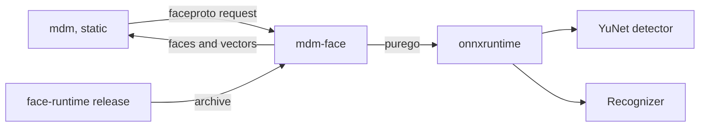
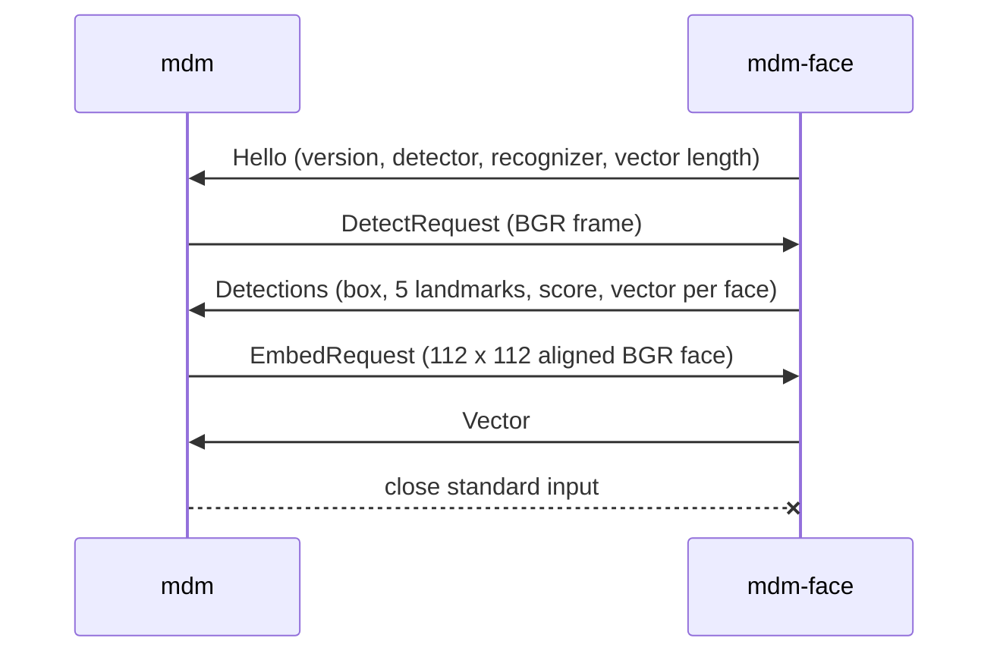

# Face recognition

Faces are detected and embedded by a helper process, `mdm-face`
([`cmd/mdm-face`](../../cmd/mdm-face)), that runs onnxruntime outside `mdm`
and arrives in a face runtime archive that vv publishes.

The diagram shows the parts that carry a frame to its face vectors.

## Inference runs in a helper process

`mdm` never loads native code: inference runs in `mdm-face`, which loads
onnxruntime through `purego` ([`internal/faceinfer`](../../internal/faceinfer)),
and only `cmd/mdm-face` may import `purego` or `internal/faceinfer` (the
`only-the-face-helper-loads-native-code` rule in
[`.golangci.yml`](../../.golangci.yml)).

A `purego` binary asks for glibc's dynamic loader (`/lib64/ld-linux-x86-64.so.2`)
in an `INTERP` program header, and such a binary does not start in the
`alpine:3.24` image, so `mdm` inside it would fail for every Docker user. The
helper's own crashes in native code end the helper, not the server.
`task static-binary-check` builds the Linux `mdm` for `amd64` and `arm64` and
fails when either has an `INTERP` header; CI runs it on every pull request.

| Rejected | Why |
| --- | --- |
| `purego` inside `mdm` | `mdm` no longer starts on Alpine |
| A glibc base image | Every user's image changes for an optional feature |
| Inference in pure Go | The convolutions would have to be written and kept equal to onnxruntime |

## The helper protocol

`mdm` and the helper exchange length-prefixed binary messages on the helper's
standard input and output ([`internal/faceproto`](../../internal/faceproto)),
and the helper holds no rule about which faces matter.

The sequence shows one helper's life.

| Message | Rule |
| --- | --- |
| `Hello` | The helper's first message; a different `Version` is an error on read, so a stale archive is reported instead of misread |
| `Error` | Replaces `Hello` when the models do not load, and answers a request that failed; the helper keeps serving after a failed request |
| `Detections` | Every face YuNet keeps (score 0.6, non-maximum suppression at IoU 0.3), each with its vector; tracking and the quality gate stay in `mdm` |

Each message is a little-endian `uint32` length, a kind byte and its payload,
at most 64 MiB. The helper exits when its input closes.

## Two recognizers share one detector

YuNet 2023mar detects faces for every recognizer; the recognizer is SFace
2021dec int8 (`sface_int8`) or ArcFace r50 from InsightFace `buffalo_l`
(`arcface_r50`).

| Recognizer | Input | Vector |
| --- | --- | --- |
| `sface_int8` | Planar RGB, 0..255 | 128 |
| `arcface_r50` | Planar RGB, (v − 127.5) / 127.5 | 512 |

Both take the same five-point alignment to a 112 × 112 template, so a switch
never changes which faces are found. The recognizer's input and output names
are read from the model, because exports of one model name them differently.
The frame path aligns without rounding to bytes, as the measured proof of
concept did: on LFW the Go SFace int8 pipeline reached 99.82% accuracy against
OpenCV's 99.86% with SFace fp32.

## The face runtime archive

CI builds one archive per platform from
[`scripts/build/face_runtime.go`](../../scripts/build/face_runtime.go)
(`go run ./scripts/build -face-runtime <platform>`), and the
[face-runtime workflow](../../.github/workflows/face-runtime.yml) publishes
them as a `face-runtime-v<N>` GitHub Release when the maintainer pushes that
tag.

| Archive | Contents |
| --- | --- |
| `face-runtime-linux-amd64.tar.gz`, `face-runtime-linux-arm64.tar.gz` | `mdm-face`; `lib/` with Microsoft's onnxruntime 1.22.0 and the loader, `libc`, `libm`, `libdl`, `libpthread`, `librt`, `libstdc++` and `libgcc_s` of a pinned `debian:trixie` image; their licenses |
| `face-runtime-windows-amd64.zip` | `mdm-face.exe`, `onnxruntime.dll`, its license |

On Linux the helper starts as `lib/ld-linux-*.so --library-path lib mdm-face`,
so it runs under the bundled glibc on any host, Alpine included. Each pull
request that changes the helper builds the three archives, and the Linux jobs
start each helper in `alpine:3.24` through that loader on one photo and expect
one face with a 128-value vector. A separate tag keeps nightly and tagged vv
builds on the same archive, which changes only with onnxruntime or the
protocol.

| Rejected | Why |
| --- | --- |
| The runtime in the image and the Windows zip | About 26 MB for every user, including those who never turn the feature on |
| onnxruntime and Debian packages fetched by `mdm` | `mdm-face` still has to come from vv, and unpacking `.deb` files adds a format the server needs nowhere else |
| A runtime per vv release | Nightly and development builds would have nothing to download |
