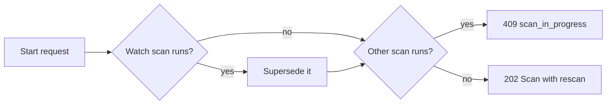

# Force rescan

A force rescan reads the library, one media folder or one video again and
rebuilds the metadata, thumbnail, seek sprite, hover preview and fingerprint of
every video it reaches, even when the file is unchanged
([`internal/app/scans.go`](../../internal/app/scans.go),
[`internal/scanner/rescan.go`](../../internal/scanner/rescan.go)).

The diagram shows the path from the owner's request to the rebuilt artifacts.

## A force rescan is a manual scan with a scope

The rescan is a `scans` row of origin `manual` that records its scope, and the
scanner runs in force mode for it. The row gives the rescan the manual scan's
progress, issue list, activity and one-running-scan rule; a separate origin
would change every check that treats it as manual.

| Scope | Reads | Removes missing locations | Issues of the previous scan |
| --- | --- | --- | --- |
| `library` | Every media folder | Everywhere, as a manual scan | Cleared |
| `folder` | That media folder's tree | Under that folder only | Kept outside the folder |
| `video` | The video's registered locations | Nothing | Kept except that video's |

A `video` scope whose file is missing or unreadable records the issue a manual
scan would and keeps the video.

## Starting one

`POST /api/scans/rescan` supersedes a running watch scan, as `Scan library`
does, and refuses a running manual scan or force rescan with `409
scan_in_progress` ([`api/openapi.yaml`](../../api/openapi.yaml), `startRescan`).
A `folder` or `video` rescan reads only part of the library, so the watcher
queues the superseded batch again and keeps a lost-events problem
([folder watching](folder-watching.md)).

Unlike `Scan library`, which answers the running scan, the rescan refuses it:
returning a scan of another scope would tell the owner a rescan started that
did not. Every `Scan` response and SSE `scan` event of a force rescan carries
`rescan` with its scope, so the screen can name it.

## Force travels on the job

The force pass queues `probe`, `thumbnail` and `seek_thumbnail` jobs with
`jobs.force` for every video it reaches; a forced `probe` result queues a
forced `preview`, and a forced `seek_thumbnail` result a forced `fingerprint`.
A forced job regenerates whatever the video's stage state is, and the stage
states stay as they are until the job records its result, so the screen keeps
the old thumbnail and preview while the new ones are built.

| Rejected | Why |
| --- | --- |
| Reset the stage states to `pending` | The screen sends a thumbnail URL only for a `done` state, so every card would lose its thumbnail during the rescan |
| Queue jobs without a scan row for the `video` scope | A missing file would need a second way to be reported, and a running manual scan would not refuse it |

A forced `seek_thumbnail` stage queues neither auto-tagging nor face analysis:
the owner re-runs tagging with `Tag all videos again`
([auto-tagging](auto-tagging.md)).

## An unchanged file is read again

In force mode the scanner recomputes the content key of a file whose size and
modification time are unchanged, because a replaced file with the same size and
time would otherwise keep stale artifacts. A file that differs takes the
ordinary path first; then every video the walk reaches is forced once per scan
and marked `forced` in the scan's video set.

## Resume after a restart

Startup resumes an interrupted force rescan like an interrupted manual scan
([process lifecycle](process-lifecycle.md)): the new scan keeps the scope and
the `forced` marks, so the walk skips the videos the interrupted run already
queued. A `folder` rescan whose media folder now points elsewhere fails instead
of reading the new tree.
