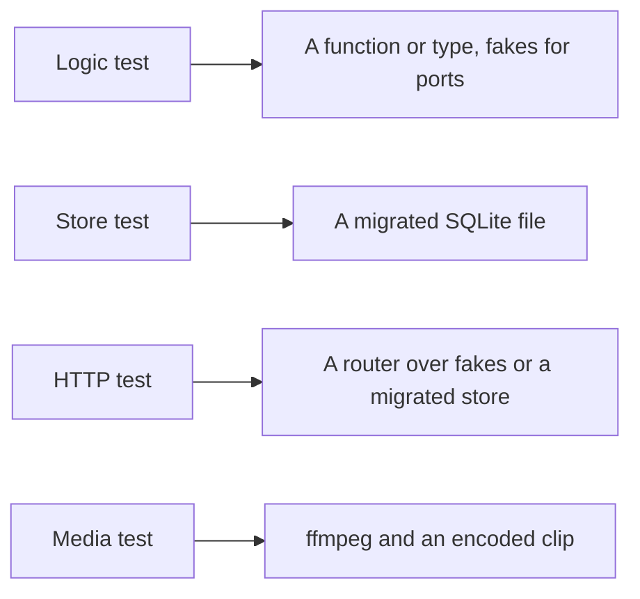
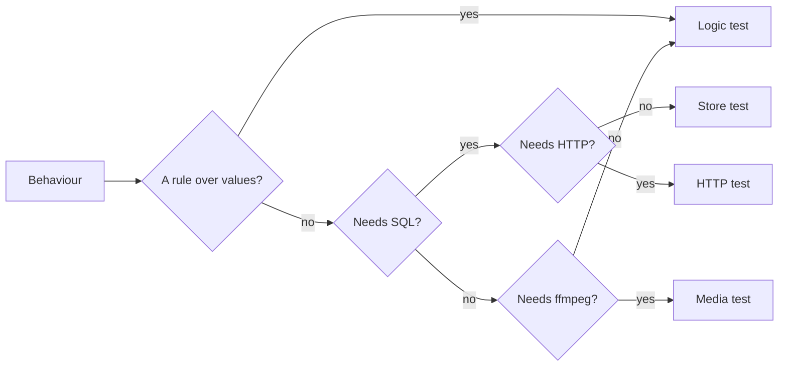

# Go test levels

A behaviour of the Go server is tested at the lowest level that fails when the
behaviour breaks, because the tests of one package run one after another and
the slowest package sets the length of the `go test` CI group (`task test-go`).

The diagram shows the four levels and what each one sets up.

## Test levels

Each level proves a different kind of behaviour, at a different cost per test.

| Level | Proves | Sets up | Cost per test |
| --- | --- | --- | --- |
| Logic test | A rule in `internal/domain`, `internal/app` with fake ports, or any other pure function | Nothing | 0.01 s |
| Store test | A query, a write, a migration or a store invariant | `migratedDB` in `internal/store`: a new file that runs every migration | 0.23 s, of which 0.14 s is the migrations |
| HTTP test | The HTTP contract: status, body shape, authentication, the order of calls into a port | `newTestServer` in `internal/httpapi` with fake ports, or `newAuthEnvWith` over a migrated store | 0.01 s with fakes; 0.20 s over a store |
| Media test | What only ffmpeg shows: probing, transcoding, sprites, previews | ffmpeg and a clip the test encodes | 1 s to 28 s |

The costs are the medians of one `go test -count=1 ./...` run on four cores.
`internal/store` (580 tests), `internal/httpapi` (500) and `internal/media`
(139) each take two to three minutes; every other package takes under two
seconds.

## Choosing the level

Pick the first level in the diagram whose test fails when the behaviour breaks.

A rule that only a store or HTTP test can reach is a sign the rule lives in the
query or the handler; it moves to a function in `internal/domain` or
`internal/app` with logic tests, and the store or HTTP test keeps one case that
shows the rule is used. This is the Go form of
[Rules out of pages](web-testing.md#rules-out-of-pages).

| Behaviour | Level |
| --- | --- |
| Two fingerprints within the match distance are the same video | Logic |
| A queued job moves to running when claimed | Store |
| A guest gets 403 from a write endpoint | HTTP |
| A tag name already used is rejected with the catalog's reason | Logic, plus one HTTP case for the status |
| A seek sprite keeps the portrait aspect of a rotated clip | Media |

## Fixtures per test

An HTTP test runs over fake ports unless the contract it proves depends on what
the store returns; the fake costs nothing to set up, the store 0.14 s of
migrations. One top-level store or HTTP test opens one database, and its cases
are subtests over that database when they only read. A case that writes gets
its own top-level test or resets the rows it touched.

## Media clips

A media test encodes the shortest and smallest clip that shows the behaviour,
and a clip two tests need is encoded once per package. The four slowest tests
take 92 s together, more than half of `internal/media`, and three of them
encode clips of 60 to 410 seconds.

## Waiting

A test waits on a channel, a callback or a fake clock, not on `time.Sleep`. A
sleep long enough to pass on a loaded CI runner is idle time on every other run,
and one too short fails on the loaded runner.

## Checking the cost of a change

`task test-cost` lists the tests a branch adds, with their level and their
measured duration
([development.md](../how-to/development.md#validate-changes)). A pull request
that adds a store, HTTP or media test, or a Web page or E2E test, states for
each one why the level below it would not fail.

| Rejected | Why |
| --- | --- |
| A time budget per test that fails CI | Durations vary with the runner's load; the level and the reason for it are what a reviewer can judge |
| `t.Parallel` in store and HTTP tests | Many tests share environment variables, package variables or files; the packages already run in parallel with each other ([`.golangci.yml`](../../.golangci.yml)) |
| An in-memory SQLite database for store tests | The store opens two connections with different locking modes over one file; an in-memory database would test a different setup |
| Skipping media tests on pull requests | A broken encoder path would reach `main`; the clips are cut down instead |
