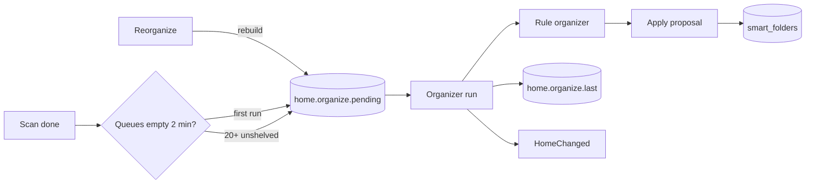
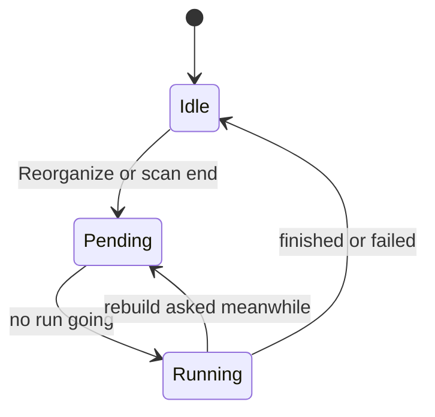
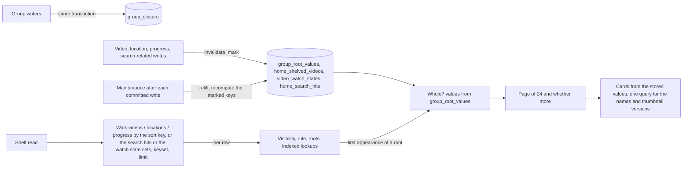

# Home shelves and the rule organizer

The home is a list of shelves, and each shelf is a smart folder with a home
position; the rule organizer adds shelves for well-used tags, people and
organizations without AI. The organizer is
[`internal/app/home_organizer.go`](../../internal/app/home_organizer.go), its
choice of shelves is
[`internal/domain/home_rules.go`](../../internal/domain/home_rules.go), and
the apply transaction is [`internal/store/home.go`](../../internal/store/home.go).
The decisions behind this document are in the
[057 research](../../specs/057-home/research.md).

The diagram shows what starts a run and what a run reads and writes.

## Shelves from tags, people and organizations

The rule organizer proposes one shelf per tag, person or organization on at
least 5 shown videos, named after it, at most 24 in a run
([R-2](../../specs/057-home/research.md#r-2-the-rule-organizer-makes-shelves-from-tags-people-and-organizations)).
Five videos keep a shelf from being one card, and a tentative tag is left out
because it is the auto-tagger's guess, not a tag the owner accepted.

| Source | Shelf rule | Order |
| --- | --- | --- |
| Tag with a kind | `{"tags": [id]}` | First, by kind id, then by video count |
| Tag without a kind | `{"tags": [id]}` | Second, by video count |
| Person | `{"person": id}` | Third, by video count |
| Organization | `{"organization": id}` | Last, by video count |

A count is the number of videos the shelf's rule would show the owner, so a
tag counts both tags added by hand and tags from folder names.

## Rebuild and extend

A rebuild proposes from every shown video and replaces the organizer's
shelves; an extend proposes only from unshelved videos and only adds
([R-8](../../specs/057-home/research.md#r-8-a-rebuild-replaces-the-organizers-folders-in-one-transaction-an-extend-only-adds)).
Neither run changes a shelf the owner added, moved or kept, or a shelf
onboarding made from a picked interest, because both have `owner_kept` 1.

| Run | Started by | Proposes from |
| --- | --- | --- |
| `rebuild` | `Reorganize` (`POST /api/home/organize`), or the first scan when no run has finished | Every shown video |
| `extend` | A scan that ends when 20 or more shown videos are unshelved | Unshelved videos only |

## One run at a time

At most one run waits, in the setting `home.organize.pending`, and a rebuild
absorbs a waiting extend
([R-9](../../specs/057-home/research.md#r-9-one-run-at-a-time-queued-in-settings-triggered-by-events)).
The setting keeps the waiting run across a restart, and a run stopped by
shutdown stays in it, so the next start runs it again.

The diagram shows the organizer's states.

A finished run writes `home.organize.last` with its outcome (`done`,
`failed`, or `unchanged` when the proposal changed nothing) and the numbers
of shelves added and removed. Each change of state publishes `HomeChanged`,
so open screens read the home again.

A storage error does not drop a run. When the organizer cannot read the
waiting run at startup, or cannot write `home.organize.last` after a run, it
reads `home.organize.pending` again at each queue poll (10 seconds) and runs
what it finds, so a run whose result was not recorded runs again. The setting
is cleared only after the result is written.

## Waiting for the queues after a scan

A scan-triggered run waits until the job queue and the auto-tag queue have
both stayed empty for 2 minutes after a scan ends as `done`
([R-10](../../specs/057-home/research.md#r-10-an-extend-runs-when-20-or-more-shown-videos-are-unshelved)).
New videos get their tags from auto-tagging after the scan, so an earlier run
would count every new video as unshelved before it had a tag. A failed or
cancelled scan starts nothing.

A check of the queues that fails counts as not empty, so the 2 minutes start
again after the next successful check. When the decision or the queueing
after the 2 minutes fails, the organizer keeps waiting for that scan and
tries again at the next poll.

| Rejected | Why |
| --- | --- |
| A kind in the `jobs` table | `jobs` rows belong to one video and its location |
| A timer every few hours | Requirement 8 ties adding shelves to the end of a scan |
| A share of the library for the extend threshold | At 20,000 videos it waits for 2,000 unshelved videos |

## The owner's fixed shelves

After the folder shelves, the owner's home lists continue watching, recently
added, unshelved and recommended; a guest gets only recently added and
unshelved, because the watch history is the owner's only
([R-13](../../specs/057-home/research.md#r-13-four-fixed-shelves-two-of-them-the-owners-only)).

- **Continue watching** is the library's `watch=inProgress` list sorted by
  the latest play, read by [`internal/store/home_reads.go`](../../internal/store/home_reads.go).
  Its held items are dropped on every saved playback position, because a play
  that keeps a video in progress changes the order without any notice.
- **Recommended** is listed only when a seed exists: up to 10 videos played
  most in the last 90 days and up to 10 latest favorites
  ([`internal/store/home_recommend.go`](../../internal/store/home_recommend.go)).
  [`internal/app/home.go`](../../internal/app/home.go) ranks the shown videos
  that are neither a seed nor completed by their highest closeness to any
  seed, with the related videos' `RelatedScorer`, keeps the first 24, and
  holds that order for 10 minutes. Scoring 20,000 videos against 20 seeds
  takes seconds on one core, so the candidates are scored in parallel, and a
  shelf read computes the ranking alongside the store's read of the other
  shelves.

| Rejected | Why |
| --- | --- |
| The sum of closeness to all seeds | Videos near one large cluster of seeds fill the whole shelf |
| Ranking on every read | One pass reads every video's clues, which does not fit the home's 1 second |
| Continue watching held until the next notice | Playing a video in progress publishes nothing, so the shelf would keep the old order for 10 minutes |

## Reading the shelves

`GET /api/home/shelves` returns the first 24 items of up to 8 shelves, and
each shelf shows the items the library would show for its rule: videos, and a
group card for every group whose shown videos all match
([R-12](../../specs/057-home/research.md#r-12-the-home-lists-shelf-summaries-shelf-items-are-read-on-screen),
[R-14](../../specs/057-home/research.md#r-14-pressing-a-shelf-card-plays)).
The library's own query rebuilds the shown videos and the group descendants
for every shelf and builds every item row before it takes the first page, so
at 20,000 videos eight shelves took 2.3 to 3.0 s. The shelf read in
[`internal/store/home_shelf_read.go`](../../internal/store/home_shelf_read.go)
and [`home_shelf_top.go`](../../internal/store/home_shelf_top.go) touches no
table as a whole: it walks the base table of the shelf's sort key by index
and looks up everything else per walked row.

| Table | Rows | Maintained by |
| --- | --- | --- |
| `group_closure` | One per (group, descendant video item), with the play-order key | Every writer that changes groups rebuilds it in its transaction ([`group_closure.go`](../../internal/store/group_closure.go)); triggers on `groups` and `group_items` set a dirty flag, and the maintenance after the next committed write rebuilds the closure when it is set; a shelf read does not read the flag |
| `group_root_values` | One per (group, viewer): the card values and, per sort key, the descendant with the largest value | Triggers on video, location, progress, public, folder and bundle writes delete the affected rows; the maintenance after the next committed write refills them |
| `home_shelved_videos` | One per video on some folder shelf whose rule does not depend on the clock | Triggers mark a video's key (or flag every key when a shelf, tag or folder changes); the maintenance recomputes the marked keys, found by index |
| `video_watch_states` | One per video key: its watch state | The same marks; recomputed with the shelved marks |
| `home_search_hits` | One per (search expression of a folder shelf, matching video) | Triggers on the tables a search reads set one flag; the maintenance reruns the shelves' full-text queries when it is set, so a probe or progress write never does |

A shelf walks `videos` by `added_at`, `video_locations` by `mtime` or the
created date, or `playback_progress` by `updated_at`, in keyset batches, and
checks each walked row through indexed lookups: shown to the viewer, matching
the rule, and which groups hold it (`group_closure` by key). A walked video is
a video item when it is in no group or in a group that is not whole; a group
card appears at the member with the largest value once every shown descendant
matches (`(rule) is not true` finds the non-matching ones, so an unknown
length counts as a non-match), so whole groups are decided only for the roots
that appear, and the members of a group already decided are skipped in SQL.
The walk stops after one more than a page, reading the ties of the last value
so they sort as the library sorts them. `total` counts up to 25; the screen
reads only whether it is 0. The unshelved shelf is an indexed `not exists`
against `home_shelved_videos`
([R-11](../../specs/057-home/research.md#r-11-unshelved-means-matching-no-home-shelf-computed-on-read))
plus, per walked row, the rules of the shelves that depend on the clock
(added within N days), which the persisted set leaves out; only while marks
are pending does it test every folder shelf's rule per walked row. A search
shelf starts from its persisted hits (`home_search_hits`), and a shelf whose
rule is a watch state alone starts from the groups with that state
(`group_root_values.watch_state`) and the ungrouped videos with that state
(`video_watch_states`), instead of walking the whole sort index. The read
never writes: the maintenance runs after every committed write
([`home_index_maintenance.go`](../../internal/store/home_index_maintenance.go)).
A read that still finds a group's values missing aggregates that group's
descendants itself, and one that finds search hits pending runs the search's
full-text query once; it reads `group_closure` as it is, whatever its dirty
flag.
The sorts whose card value is not one member's (total length and size, the
group's own title and favorite time, shuffle) read the matched videos and
assemble the items instead. The group cards of a page are built from the
stored values alone
([`home_group_cards.go`](../../internal/store/home_group_cards.go)): counts,
sums, dates, watch state, the open video and the preview thumbnails come from
`group_root_values`, and one query reads the groups' names and the chosen
videos' thumbnail versions, so the shelf item (`HomeShelfItem`) carries a
card without member ids and member tags while the library item keeps them. A
test checks that every shelf returns exactly the library read's first page
and card values, for every sort, both viewers, nested and overlapping groups
and bundled videos. The shelf cache
([R-12](../../specs/057-home/research.md#r-12-the-home-lists-shelf-summaries-shelf-items-are-read-on-screen))
stays for repeated opens of the home within ten minutes; it is no longer what
keeps the read inside its budget.

| Rejected | Why |
| --- | --- |
| The library items query per shelf | Rebuilds the shown videos and the group descendants per shelf, builds every item row, and joins unindexed `with` tables through automatic indexes; 2.3 to 3.0 s for eight shelves |
| Indexed temporary tables over every shown video, built once per read | Still a pass over the library per read; 0.9 to 1.0 s for eight shelves |
| Group structure in memory across reads | A read would rebuild it after a change; the writers maintain the persisted table instead |
| An exact `total` | A count of every item is a full pass over the matched videos; the screen reads only whether it is 0 |
