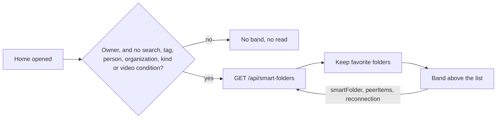
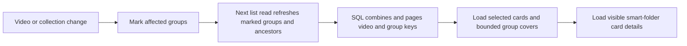

# Home library

Home is a single library list of videos and groups, with the owner's favorite
smart folders in a band above it. There is no Add to home/Remove from home
action. Existing smart folders, rules and videos are retained.

`/` uses the library's existing filtering and sorting, and its list holds no
smart folders. Former `/library` bookmarks redirect to `/`, preserving query and
hash.

## Favorite smart folder band

The band holds every smart folder the owner favorited, at any depth, in the
natural-name order of `GET /api/smart-folders`. The home reads that list in
full and keeps the folders with `favorite`; the list is unpaginated, so the band
needs no cursor and never counts toward the library's `limit` or `total`, and
many favorites never fill the list's first page.

The band is read and drawn only for the owner while the criteria list smart
folders: `Favorites only`, the sort and the zoom keep it, and any other filter
or a search removes it. Guests get neither the read nor the band. With no
favorite folder the band is not drawn and the list starts at the top of the
body. The whole list is read again on every `smartFolder` event, which a
favorite change raises for every folder, on every `peerItems` event, since the
list merges each connected link's folders, and on reconnection; the band is
rewritten in place, never from the event's ids. While the first read is pending
nothing is drawn, because the band may turn out absent; a failed read shows its
heading and link over an `ErrorState` with Retry.

The band is a `Shelf` in the row layout: the heading `Favorite smart folders`,
the count, a `ghost` link to `/smart-folders`, one line of the library's smart
folder cards that scrolls sideways, then a `Separator`. The cards are `card-0`
wide at every zoom and in both the grid and the list view, without the tag row
or the condition chips, so the band is one card high however many folders are
favorites. A card behaves as the library's: up to four video covers, then a
More sheet when videos remain; moving the mouse across the artwork brings a
cover forward, and clicking opens that video with autoplay, the current return
URL and collection playback context. More, the title, a resting card, touch and
keyboard activation open the folder page. The card values come from the lazy
card-values request. The band's folders lead the list in display order for the
page's selection, so Shift ranges run from a band card into the list, a drawn
box selects the band cards it overlaps but not the part of the row scrolled out
of view, and a drag over a band card shows `Can't drop here`.

## Collection information and paging

Migration 63 stores each group's visible member IDs, playback order, count,
size, duration, timestamps and watch state. Owner and guest rows are separate:
private videos cannot affect guest counts, ordering or covers. Smart folders
keep no stored values (migration 81).

Writes mark only the groups they can affect, through database triggers: a
change to a video, its locations, its visibility, its playback progress or its
version bundle marks the groups whose items name its user key, and a change to
a group or its items marks that group; a media folder change marks every group.
The library list and group reads refresh the marked groups and their ancestors
in one write transaction before they read, one reader at a time, so every
change committed before the request is reflected and the work of many writes,
such as an import's job results, is done once. A write that commits during that
read is reflected by the next request. Startup fills existing collections after
rebuilding search and folder indexes. Unchanged list requests do not rebuild
collection values.

`GET /api/library` combines video keys with stored group values in SQL, applies
the common sort and cursor, and selects `limit + 1` keys. Only keys retained
for the requested page are hydrated. The unfiltered path uses stored group
counts without traversing descendants or aggregating members. Search and
member filters still match videos in SQL to decide whether a group is wholly
matched or should appear as individual videos.

The library lists no smart folders, for any audience or filter; the home's band
reads them from `GET /api/smart-folders` instead
([Favorite smart folder band](#favorite-smart-folder-band)). Guests see no
smart folders in the folder list or the card values; a folder page opened by
its URL checks that folder alone.

Selected group cards read their saved values, member IDs for existing selection
actions, a union of member tags, and at most four cover videos. They do not load
every member's video details or versions. Smart folder card details keep the
lazy batch request, which reads at most one search folder per statement because
SQLite rejects two search expressions in one as nested too deep. Counts and
filter matching can still scan database rows, and member-ID/tag payloads depend
on the selected groups' size. Paging does not imply constant database work.

## Initial setup

Onboarding at `/welcome` uses `StepsPage` outside the shell. Its stages are
`folders`, `scan`, `interests` and `done`, stored as `onboarding.step` in `settings`
so another device can resume. With no saved stage, an existing media folder
means `done`; otherwise the stage is `folders`. Each step can be skipped.
The owner gate reads the stage before rendering routes and refreshes on the
owner-only `onboarding` event. Guests are not redirected; a failed stage read
leaves the owner's routes accessible.

Picking interests reuses tags by name or synonym, creates missing tags and
assigns `Genre` to untyped tags. In the same transaction it creates ordinary
root smart folders for their tag rules, reusing existing root folders with the
same rules. There is no shelf registration, ordering or organizer ownership.
When auto-tagging is enabled, picking interests queues the library again so the
classifier can consider the new tags. This happens only on the explicit setup
action. Settings' Library page provides Start setup.

The API contract is [openapi.yaml](../../api/openapi.yaml).

## Removing the old shelf implementation

The shelf API, cache, indexing and update handlers, organizer, system-generated
shelves, UI pattern and examples are removed. Migration 62 drops their tables,
indexes, triggers and the `home_position` and `owner_kept` columns. Ordinary
smart folders, videos, playback progress, watch history and favorites remain.
No background shelf maintenance runs after the migration.

Earlier development databases used migration numbers 56–58 for Home before
main assigned 56 and 57 to other changes. Startup recognizes that exact legacy
schema and repairs the migration history transactionally before applying the
remaining migrations, including the shelf cleanup. This one-time upgrade path
prevents the reported `group_closure already exists` startup failure. Historical
SQL migrations remain to support upgrades; they expose no runtime shelf API.
