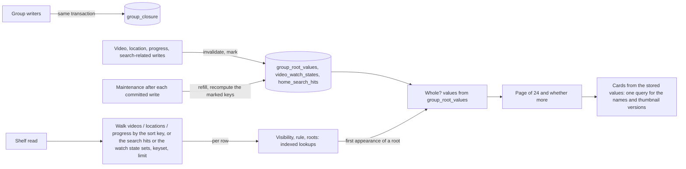

# Home library

Home is a single library list containing videos, groups and smart-folder cards.
There is no separate shelf section and no Add to home/Remove from home action.
Existing smart folders, rules and videos are retained.

## Home and onboarding

`/` uses the library's existing filtering and sorting. Root smart folders appear
among the other items when unfiltered; favorite-only listings include favorite
folders at any depth. Folder cards follow the same sort order as other items,
using their matching-video aggregates. No card is pinned to the top.

In grid view a smart folder spans two existing columns, or one when only one
column fits. Its name opens the folder page; up to two video thumbnail links
open those videos with autoplay, the current return URL and smart-folder
playback context. The existing card-values request supplies thumbnails and
titles; no separate home/shelf read runs. List view retains the compact folder
row. Former `/library` bookmarks redirect to `/`, preserving query and hash.

Onboarding at `/welcome` uses `StepsPage` outside the shell. Its stages are
`folders`, `scan`, `interests` and `done`, stored as `onboarding.step` in `settings`
so another device can resume. With no saved stage, an existing media folder
means `done`; otherwise the stage is `folders`. Each step can be skipped.
The owner gate reads the stage before rendering routes and refreshes on the
`home` event. Guests are not redirected; a failed stage read leaves the
owner's routes accessible.

Picking interests reuses a tag by name or synonym, or creates one with its
synonyms, assigns `Genre` when it has no kind, and creates an owner-kept
smart-folder shelf for its rule. These changes share a transaction. When
auto-tagging is enabled, every video is queued again so the classifier can
consider the new tags; otherwise picking interests still creates the shelves.

Settings' `Library` page keeps `Start setup`, which saves `folders` and opens
`/welcome`. Shelf-specific APIs and stored ordering remain compatible with
existing clients, but the Web screen no longer reads or edits that ordering.

The `home` server event carries an empty object to owners and guests. Readers
reload the onboarding stage. Legacy shelf API consumers can refresh their reads.
The API contract is [openapi.yaml](../../api/openapi.yaml).

## Upgrading development databases

The home feature used migration numbers 56–58 before merging main, which
assigned 56 to keyframe spacing and 57 to location timestamps. Home uses
58–61. Goose records numbers rather than filenames, so a database from the
old feature branch otherwise skips main's changes and tries to create
`group_closure` again at version 59.

Before applying pending migrations, startup recognizes the old home schema
at versions 56–58 by its home column, closure/watch tables, missing keyframe
table and timestamp column, and contiguous applied migration history. It
renumbers only those home history rows and applies main's two missing SQL
migrations in one transaction. A failure rolls back both schema and history;
the next startup can retry. Normal main databases follow the usual migration
path, and an ambiguous legacy schema or history stops without being repaired.
Library entries, shelves, playback positions, watch history and favorites
remain in place; no database reset or rescan is needed. Migration 61 consolidates
the search and watch index state and retains only the triggers those indexes need.

## Reading the shelves

`GET /api/home/shelves` returns the first 24 items of up to 8 shelves, and
each shelf shows the items the library would show for its rule: videos, and a
group card for every group whose shown videos all match.
The library's own query rebuilds the shown videos and the group descendants
for every shelf and builds every item row before it takes the first page, so
at 20,000 videos eight shelves took 2.3 to 3.0 s. The shelf read in
[`internal/store/home_shelf_read.go`](../../internal/store/home_shelf_read.go)
and [`home_shelf_top.go`](../../internal/store/home_shelf_top.go) touches no
table as a whole: it walks the base table of the shelf's sort key by index
and looks up everything else per walked row.

| Table | Rows | Maintained by |
| --- | --- | --- |
| `group_closure` | One per (group, descendant video item), with the play-order key | Every writer that changes groups rebuilds it in its transaction ([`group_closure.go`](../../internal/store/group_closure.go)); triggers on `groups` and `group_items` set a dirty flag, and the maintenance after the next committed write rebuilds the closure when it is set; a shelf read does not read the flag |
| `group_root_values` | One per (group, viewer): the card values and, per sort key, the descendant with the largest value | Triggers on video, location, progress, public, folder and bundle writes delete the affected rows; the maintenance after the next committed write refills them |
| `video_watch_states` | One per video key: its watch state | Video and playback changes mark keys; maintenance recomputes their watch state |
| `home_search_hits` | One per (search expression of a folder shelf, matching video) | Triggers on the tables a search reads set one flag; the maintenance reruns the shelves' full-text queries when it is set, so a probe or progress write never does |

A shelf walks `videos` by `added_at`, `video_locations` by `mtime` or the
created date, or `playback_progress` by `updated_at`, in keyset batches, and
checks each walked row through indexed lookups: shown to the viewer, matching
the rule, and which groups hold it (`group_closure` by key). A walked video is
a video item when it is in no group or in a group that is not whole; a group
card appears at the member with the largest value once every shown descendant
matches (`(rule) is not true` finds the non-matching ones, so an unknown
length counts as a non-match), so whole groups are decided only for the roots
that appear, and the members of a group already decided are skipped in SQL.
The walk stops after one more than a page, reading the ties of the last value
so they sort as the library sorts them. `total` counts up to 25; the screen
reads only whether it is 0. A search
shelf starts from its persisted hits (`home_search_hits`), and a shelf whose
rule is a watch state alone starts from the groups with that state
(`group_root_values.watch_state`) and the ungrouped videos with that state
(`video_watch_states`), instead of walking the whole sort index. The read
never writes: the maintenance runs after every committed write
([`home_index_maintenance.go`](../../internal/store/home_index_maintenance.go)).
A read that still finds a group's values missing aggregates that group's
descendants itself, and one that finds search hits pending runs the search's
full-text query once; it reads `group_closure` as it is, whatever its dirty
flag.
The sorts whose card value is not one member's (total length and size, the
group's own title and favorite time, shuffle) read the matched videos and
assemble the items instead. The group cards of a page are built from the
stored values alone
([`home_group_cards.go`](../../internal/store/home_group_cards.go)): counts,
sums, dates, watch state, the open video and the preview thumbnails come from
`group_root_values`, and one query reads the groups' names and the chosen
videos' thumbnail versions, so the shelf item (`HomeShelfItem`) carries a
card without member ids and member tags while the library item keeps them. A
test checks that every shelf returns exactly the library read's first page
and card values, for every sort, both viewers, nested and overlapping groups
and bundled videos. The shelf cache
stays for repeated opens of the home within ten minutes; it is no longer what
keeps the read inside its budget.

| Rejected | Why |
| --- | --- |
| The library items query per shelf | Rebuilds the shown videos and the group descendants per shelf, builds every item row, and joins unindexed `with` tables through automatic indexes; 2.3 to 3.0 s for eight shelves |
| Indexed temporary tables over every shown video, built once per read | Still a pass over the library per read; 0.9 to 1.0 s for eight shelves |
| Group structure in memory across reads | A read would rebuild it after a change; the writers maintain the persisted table instead |
| An exact `total` | A count of every item is a full pass over the matched videos; the screen reads only whether it is 0 |
