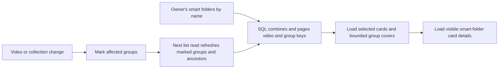

# Home library

Home is a single library list containing videos, groups and smart-folder cards.
There is no separate shelf section and no Add to home/Remove from home action.
Existing smart folders, rules and videos are retained.

`/` uses the library's existing filtering and sorting. Root smart folders appear
among the other items when unfiltered; favorite-only listings include favorite
folders at any depth. Folder cards follow the same sort order as other items,
using their matching-video aggregates. No card is pinned to the top.

In grid view smart folders use the same one-column card and stacked thumbnails
as groups. Up to four video covers appear, followed by a More sheet when videos
remain. Moving the mouse across the artwork brings a cover forward; clicking
opens that video with autoplay, the current return URL and collection playback
context. More, the title, a resting card, touch and keyboard activation open the
collection page. Selection mode disables cover promotion and direct playback.
The existing card-values request supplies thumbnails and titles; no separate
home/shelf read runs. List view retains the compact folder row. Former
`/library` bookmarks redirect to `/`, preserving query and hash.

## Collection information and paging

Migration 63 stores each group's visible member IDs, playback order, count,
size, duration, timestamps and watch state. Owner and guest rows are separate:
private videos cannot affect guest counts, ordering or covers. Smart folders
keep no stored values (migration 81).

Writes mark only the groups they can affect, through database triggers: a
change to a video, its locations, its visibility, its playback progress or its
version bundle marks the groups whose items name its user key, and a change to
a group or its items marks that group; a media folder change marks every group.
The library list and group reads refresh the marked groups and their ancestors
in one write transaction before they read, one reader at a time, so every
change committed before the request is reflected and the work of many writes,
such as an import's job results, is done once. A write that commits during that
read is reflected by the next request. Startup fills existing collections after
rebuilding search and folder indexes. Unchanged list requests do not rebuild
collection values.

`GET /api/library` combines video keys with stored group values in SQL, applies
the common sort and cursor, and selects `limit + 1` keys. Only keys retained
for the requested page are hydrated. The unfiltered path uses stored group
counts without traversing descendants or aggregating members. Search and
member filters still match videos in SQL to decide whether a group is wholly
matched or should appear as individual videos.

In the owner's unfiltered library, smart folders lead: the top-level folders,
or every favorited folder in favorites-only mode, by name and then ID, ahead of
the sorted items and within the same page limit. A cursor inside them names the
last folder shown. Listing them evaluates no folder rule; ordering folders by
their matching videos' values would evaluate every rule against the library on
each request. Guests see no smart folders in the library, the folder list or
the card values; a folder page opened by its URL checks that folder alone.

Selected group cards read their saved values, member IDs for existing selection
actions, a union of member tags, and at most four cover videos. They do not load
every member's video details or versions. Smart folder card details keep the
lazy batch request, which reads at most one search folder per statement because
SQLite rejects two search expressions in one as nested too deep. Counts and
filter matching can still scan database rows, and member-ID/tag payloads depend
on the selected groups' size. Paging does not imply constant database work.

## Initial setup

Onboarding at `/welcome` uses `StepsPage` outside the shell. Its stages are
`folders`, `scan`, `interests` and `done`, stored as `onboarding.step` in `settings`
so another device can resume. With no saved stage, an existing media folder
means `done`; otherwise the stage is `folders`. Each step can be skipped.
The owner gate reads the stage before rendering routes and refreshes on the
owner-only `onboarding` event. Guests are not redirected; a failed stage read
leaves the owner's routes accessible.

Picking interests reuses tags by name or synonym, creates missing tags and
assigns `Genre` to untyped tags. In the same transaction it creates ordinary
root smart folders for their tag rules, reusing existing root folders with the
same rules. There is no shelf registration, ordering or organizer ownership.
When auto-tagging is enabled, picking interests queues the library again so the
classifier can consider the new tags. This happens only on the explicit setup
action. Settings' Library page provides Start setup.

The API contract is [openapi.yaml](../../api/openapi.yaml).

## Removing the old shelf implementation

The shelf API, cache, indexing and update handlers, organizer, system-generated
shelves, UI pattern and examples are removed. Migration 62 drops their tables,
indexes, triggers and the `home_position` and `owner_kept` columns. Ordinary
smart folders, videos, playback progress, watch history and favorites remain.
No background shelf maintenance runs after the migration.

Earlier development databases used migration numbers 56–58 for Home before
main assigned 56 and 57 to other changes. Startup recognizes that exact legacy
schema and repairs the migration history transactionally before applying the
remaining migrations, including the shelf cleanup. This one-time upgrade path
prevents the reported `group_closure already exists` startup failure. Historical
SQL migrations remain to support upgrades; they expose no runtime shelf API.
