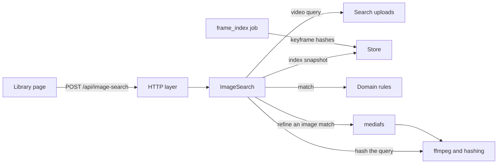
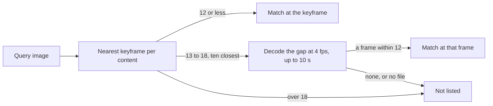
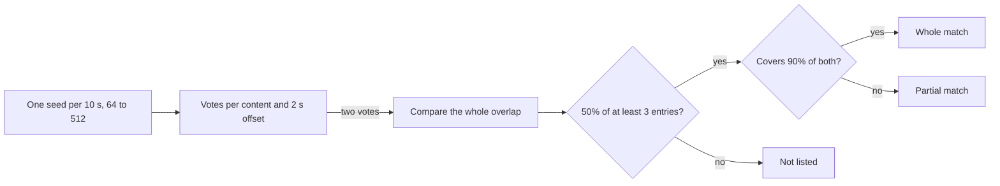
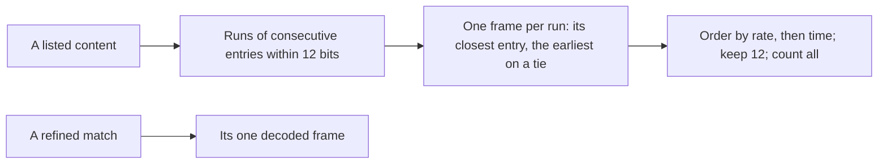

# Image search: finding footage by an image or video

Image search lists the owner's videos that contain the footage of one uploaded
image or video, with a match rate and the matched frame or section. The index
is built by the `frame_index` job, the rules are pure functions in
[`internal/domain/image_search.go`](../../internal/domain/image_search.go), and
the request runs in `ImageSearch` ([`internal/app`](../../internal/app/image_search.go)).

The diagram shows the parts a search touches and what each one reads.

## Search index

Every video content with a file has one `video_search_index` row: the time
and hash of each keyframe, at least 1 s apart and at most 20,000, hashed by
the fingerprint's rule (black bands trimmed, 32×32 luma, `domain.HashFrame`),
with flat frames left out.

The 81-frame fingerprint used for duplicates is up to 1/81 of a video apart
(44 s in an hour), so a screenshot of an arbitrary moment rarely has a frame of
its scene there. Keyframes are read in one sequential pass with
`-skip_frame nokey`, which costs one read per file instead of a full decode.
The index is versioned apart from the fingerprint, so changing one never
rereads every file for the other ([job-scheduling.md](job-scheduling.md#each-kind-declares-a-demand)).

| Rejected | Why |
| --- | --- |
| Reuse the fingerprint | Its frames are too far apart for an arbitrary screenshot |
| Decode every frame and keep one per second | Minutes of CPU per hour of 1080p H.264, days over a library |
| Seek to each keyframe from the packet index | One random read per keyframe; a sequential pass reads less on spinning disks |

The row holds 12 bytes per kept keyframe in time order (a 4-byte time in
milliseconds, then the 8-byte hash), and entries are at least
`max(1 s, duration / 20,000)` apart. A row of another `SearchIndexVersion`
counts as missing for the search, the unindexed count and `queue_frame_index`.
A current-version blob that does not decode counts as missing for the search
and the unindexed count only: `queue_frame_index` checks the version, not the
blob, so it does not rebuild that row.

| Decision | Rejected | Why |
| --- | --- | --- |
| At most 20,000 entries, at least 1 s apart | Every keyframe | A file with a keyframe every few frames would grow the index without adding scenes; 20,000 covers 5.5 hours at 1 s |
| Leave flat frames out when building | Store them with a flag, as the fingerprint does | Nothing searches for a flat frame, and a flat query is refused before matching |
| `frame_index` is a backfill job outside import tracking, queued by the probe result and by `queue_frame_index` at startup | An import stage, or a setting that turns it on | An import would wait for a whole-file read, and a switch would leave the search empty until the owner finds it |
| A content change queues it again; a forced rescan of the same content does not | Rebuild on every forced rescan | The index is a function of the content |
| `releaseContentIndex` deletes the row with the content's fingerprint | A sweep of orphan rows | The release already runs in the transaction that removes the last reference |

## Image queries

An image matches a content at its nearest indexed keyframe when the hashes
differ in at most 12 of 63 bits (`FingerprintMatchMaxDistance`), and the match
rate is `(63 − distance) / 63`.

Two unrelated hashes are within 12 bits once in 2.7 million comparisons but
within 18 once in 2,200, which over millions of entries would list thousands of
unrelated videos. A single image has one frame, so a share of matching frames
would make every match 100%. PNG, JPEG and still WebP are decoded in memory
with the thumbnail upload's decoder and limits; any other file is read as a
video.

A screenshot taken several seconds after a keyframe in a moving shot misses
that keyframe by more than 12 bits. A content whose nearest keyframe is 13 to
18 bits away is refined: for the ten closest such contents, the search opens
the file through `internal/mediafs` and decodes from that keyframe to the next
index entry, at most 10 s, at 4 frames a second, hashed as the index is. The
nearest frame within 12 bits is the match, at that frame's time, so playback
starts at the scene the query shows; with none, the content is not listed. The
search tries the content's locations in turn until one opens and decodes; when
none does, the content is left out without failing the search. A failure to
read the media folders or the index fails the search.

| Rejected | Why |
| --- | --- |
| List only keyframe matches | A screenshot between keyframes of a moving shot would not find its video |
| Refine every near miss | Each refinement opens a file; ten bound a search to ten short decodes |
| The keyframe's time for a refined match | Playback would start up to 10 s before the scene asked for |

## Video queries

A video query is sampled once a second, at most 10,800 frames, and the index's
keyframes are compared with the query frame nearest them under one time
offset.

With the query sampled once a second, every indexed keyframe has a query frame
within 0.5 s whatever the two files' keyframe positions. Seeds keep a search
to seconds where comparing every query frame with every entry takes minutes.
Seed k is taken 7k mod 10 tenths into its 10 s: seeds exactly 10 s apart all
fall the same way between the keyframes of a file encoded at a fixed keyframe
interval, and in a moving shot none of them would vote. Any ten seeds in a row
take every tenth once, so in a query of 640 s the 18 seeds inside a 3-minute
video put at least two on its keyframes when those are 2, 3, 4, 5 or 6 s
apart; a hash of the seed's number spreads them only on average and could
leave one. Of the verified offsets, one that reaches the
rate wins over one with more matching entries that does not. The query's
duration is its video stream's, so a longer audio track counts toward neither
the 3-hour limit nor the whole-or-part rule.
Each entry stands for the span up to the next one, so a whole re-encode whose
keyframes are 8 s apart still covers the whole video; playback starts at the
first matching entry.

| Rejected | Why |
| --- | --- |
| The versions rule (at most 5% of frames differ) | A partial copy with a logo or subtitles differs in more frames and is still the same footage |
| Equal durations for a whole match | A re-encode trims or pads a few seconds at the ends |

## Results

Version bundle members collapse to the listed representative, which carries
the best member's match; the match names the member it was found in, and
playback opens that member at the match position. Groups are not collapsed.
Results are ordered by match rate, then matched section length, then the newer
video, at most 50, and come with the count of listed file videos, bundle
members included, that have no current index.

Versions can be shifted by seconds, so the position belongs to the member that
matched. The search reads the index under the owner's audience, so videos in
switched-off media folders are neither searched nor counted. The matched frame
is shown with the existing `GET /api/videos/{id}/frame`. Its `maxEdge` caps the
long side (64 to 2048 px, never enlarged), so a small picture does not load a
full-size PNG; a separate thumbnail endpoint would repeat the position check,
the audience lookup and the file read.

Each image match also carries the matched frames of the video it was found in,
and each match a match-rate band; the rules are in
[`internal/domain/image_search_results.go`](../../internal/domain/image_search_results.go).
Neither changes which videos are listed, their rate, position or order.

- **Frames.** Inside a listed content, every run of consecutive index entries
  within 12 bits of the query gives one frame: its closest entry, the earliest
  on a tie. Frames are ordered by rate, then the earlier time, so the first is
  the match itself; a match carries at most 12 and counts all it found. A
  refined match has only its refined frame, and a video query's match has none.
- **Bands.** `strong` holds 90 to 100% and `similar` the rates under it down to
  the listing floor of the query's kind: 81% for an image, from
  `FingerprintMatchMaxDistance`, and 50% for a video. A match is in the band of
  its rate rounded to a whole percent, halves up, as the screen shows it. The
  answer lists every band of the query's kind, with rows or without.

| Decision | Rejected | Why |
| --- | --- | --- |
| Frames only in a content the search already lists | Listing a content because several weaker frames add up | That would change which videos a search lists |
| One frame per run of entries | Every matching entry | A held shot with a keyframe every second would fill the row with one picture and push the shot's other appearances past the limit |
| Same | Frames a fixed number of seconds apart | The spacing would be a number with no measurement behind it; a run needs none |
| At most 12 frames, with the count found | No limit | 50 rows of a looping video would carry thousands of frames |
| A bundle's row has the frames of the member that matched best | Frames of every member | A frame's time is on one member's timeline, and playback opens that member |
| No frames for a video query | The section's matching entries as frames | A video match's rate is a share of entries and a frame's rate a hash distance: two measures under one percent |
| The band on the rounded rate | The unrounded rate | A row shown as 90% could sit under `81–89%` |
| Floors derived from the listing rules, and 90 one constant (`ImageSearchStrongMinPercent`) | Floors written again as numbers | A changed listing rule would leave a band no row reaches, or rows under no band |

The split at 90% presents rates the search already produces; it is not a claim
about accuracy, and a later accuracy decision may move the constant.

## Uploads leave nothing behind

An image query stays in memory; a video query is written to
`MDM_DATA_DIR/search-uploads/` ([`internal/artifacts`](../../internal/artifacts/search_uploads.go))
and removed when the request ends, whether it succeeded, failed or was
cancelled, and startup empties the directory before the listener opens.

An MP4 with its index at the end cannot be read from a pipe, and in a container
the OS temporary directory is often a small tmpfs. A cancelled request, a
revoked session or a server shutdown stops receiving the file, ends ffmpeg and
the matching, and frees the search for the next request; a cancelled request
writes no response. One search runs at a time and a second request
waits until the first ends or the second is cancelled, because each reads the
whole index and may decode a three-hour video.

| Rejected | Why |
| --- | --- |
| A search job with polling | Nothing may outlive the request, and the screen shows only that the search runs |
| Searches in parallel | The client cancels its previous request before sending the next |
