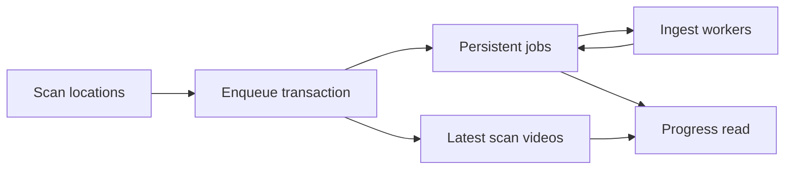

# Import progress and recovery

Import progress counts videos that need preparation in the latest scan,
using persistent job state rather than a second completion counter.

The diagram shows how discovery and preparation meet at the progress read.

## A stable denominator

Enqueuing preparation adds the video to the latest scan's set in the same
transaction. A video is settled when it has no queued or running job left.
Probe results and follow-up preparation are committed together, so a video
does not briefly appear settled between stages. Keeping the set after a
video finishes prevents the denominator from shrinking as work completes.

A new scan replaces the previous scan's set, carrying forward videos with
unfinished jobs. A manual scan starts a fresh issue list; an automatic scan
retains problems outside the directories it rereads, and a force rescan of one
media folder or one video retains those outside its scope. Resuming an
interrupted scan also carries its video set and preparation issues, and a
resumed force rescan keeps its scope. Import finishes when
discovery is closed and the set has no remaining preparation jobs.

## Recovery and reporting

Startup recovers interrupted scans and jobs before normal workers proceed
([process lifecycle](process-lifecycle.md)). The latest scan's issues explain
its problems; the persistent [activity log](activity.md) records runs and
owner operations separately. User-initiated full scans and automatic scans of
changed directories share preparation, while the
[folder watcher](folder-watching.md) observes directory changes only.

The job queue and scan membership live in `internal/store`; application use
cases coordinate them without filesystem traversal in HTTP handlers. The
[screen API schema](../../api/openapi.yaml) defines the progress and issue
responses.
