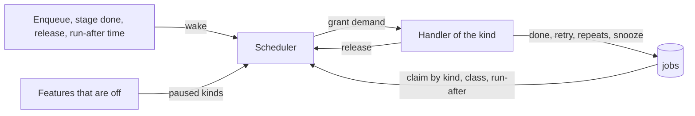
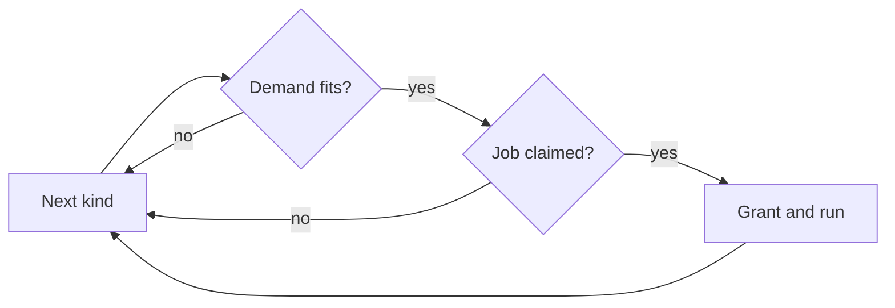

# Job scheduling: one scheduler for every ingest stage

One scheduler in [`internal/jobs`](../../internal/jobs) grants every ingest
job, every auto-tagging job and every duplicate-judging job the resources its
kind declares, from one set
of capacities, and runs it.

The diagram shows what wakes the scheduler and what a grant runs.

## Each kind declares a demand

A job holds a fixed number of slots of each resource while it runs; its kind
declares them in [`domain.JobDemand`](../../internal/domain/job_demand.go). A
read slot is the right to read one source file; a CPU slot is the right to run
one ffmpeg decode or encode; a classifier slot is the right to send one request
to the classifier.

| Kind | Read | CPU | Classifier | Why |
| --- | --- | --- | --- | --- |
| `probe` | 1 | 0 | 0 | ffprobe reads the container header |
| `thumbnail` | 1 | 1 | 0 | ffmpeg decodes frames of the source |
| `seek_thumbnail` | 1 | 1 | 0 | ffmpeg decodes frames of the source |
| `preview` | 1 | 1 | 0 | ffmpeg decodes and encodes the source |
| `fingerprint` | 0 | 1 | 0 | Reads sprite frames from the data directory, not the source |
| `auto_tag` | 0 | 0 | 1 | Sends generated thumbnails and seek frames, never the source ([auto-tagging](auto-tagging.md)) |
| `version_judge` | 0 | 0 | 1 | Compares stored fingerprints and sends frames cut from the seek previews ([duplicate judging](duplicate-judging.md)) |

The demand counts the source reads a job starts; the seek-sprite job's own
parallel extractions are not counted separately yet.

## Capacities

The scheduler grants a job only while the slots in use plus its demand stay
within the capacity ([`domain.JobCapacity`](../../internal/domain/job_demand.go)).

| Resource | Capacity | Why |
| --- | --- | --- |
| Read slots | 4, shared by every disk | Matches the seek-sprite job's parallel reads, so throughput on a solid-state disk does not fall |
| CPU slots | `NumCPU / 4 + 1` | ffmpeg already spreads one decode or encode over several threads, and streaming needs the rest |
| Classifier slots | 1 | A CPU-only provider cannot serve parallel requests |

## A job that does not fit is skipped

The scheduler visits the kinds in turn, claiming one job per kind, and skips a
kind whose demand does not fit instead of waiting for it. A full turn that
grants nothing ends the round. The next round resumes after the last granted
kind, so a freed slot goes to the next kind rather than always to `probe`.

Skipping lets a CPU-only fingerprint run while every read slot is held, and
taking kinds in turn keeps the stages interleaved during a large import, so a
probe backlog does not hold back thumbnails. No job waits forever, because
every demand is at most one slot of each resource.

| Rejected | Why |
| --- | --- |
| One worker per stage | Five stages each read a disk with no shared limit |
| Stop at the first job that does not fit (Go `semaphore.Weighted`) | A busy resource stalls every kind behind it |
| Start every round at the first stage | Each freed read slot goes to the next probe, so thumbnails wait for the probe backlog to empty |

## Owner requests are claimed first

Every job has a priority class. A claim of a kind takes the lowest class
first, then the earliest run-after time, then the oldest row, the order River
and Oban claim in ([`domain.JobPriority`](../../internal/domain/job.go)).

| Class | Value | Work |
| --- | --- | --- |
| Owner request | 0 | A force rescan, a retry from the activity log, a re-probe or "Suggest tags" from the video page, with the stages they queue, and "Judge again" on Duplicates |
| Import | 1 | Everything an import, a scan or an after-import rule queues, and "Tag all videos again" |
| Backfill | 2 | Work that only refreshes stored results; no kind queues it yet |

An owner request over a job that is already queued raises it to class 0 and
ends its retry wait, so the owner never waits behind a delay or a bulk import.
Owner requests touch one video, so they cannot starve the import class.

| Rejected | Why |
| --- | --- |
| Weighted queues (asynq 6:3:1, Sidekiq weighted) | A force rescan would share time with the bulk import it should overtake |

## A failed job retries after a growing delay

A handler's error ends the claim with one of four outcomes
([`JobRetryPolicy.AfterFailure`](../../internal/domain/job_retry.go)).
Attempts count rounds over a video's registered locations, so a failure that
leaves untried locations in the round requeues at once.

| Outcome | Returned for | Effect |
| --- | --- | --- |
| Done | No error | The job is done |
| Retry | Any other error | At the end of a round the job waits 30 s × 4^(round − 1) ± 10%: 30 s after the first round and 2 min after the second. It fails after the third round |
| Repeats | `domain.ErrFailureRepeats` | The job fails when the round ends, without the remaining rounds |
| Snooze | `domain.ErrJobSnoozed` | The job is requeued at once, and the claim does not count as an attempt |

A failure repeats when every retry would reproduce it:

- an extraction slower than its timeout;
- ffmpeg or ffprobe reporting FFmpeg's invalid-data error ("Invalid data found
  when processing input");
- ffprobe output that cannot be parsed (`invalid_metadata`).

An I/O or permission error and an ffprobe timeout may pass, so they retry. The
spread keeps jobs that failed together, such as every file on a disk that
stopped answering, from retrying together.

A kind may override the delay and the attempt limit, as a River or Oban worker
can; an override without a limit retries until the job succeeds or repeats.
`version_judge` keeps its own delays, 10 minutes, 1 hour, 6 hours and then
daily, without a limit ([duplicate judging](duplicate-judging.md#the-work-is-a-job-per-pair)).
Startup recovery requeues a running job without refunding its claim, so an
interrupted run counts as an attempt.

| Rejected | Why |
| --- | --- |
| Retry at once three times | A disk spinning up or a share reconnecting fails all three rounds within seconds |
| Many attempts over hours (River `attempt^4` s, Oban `15 + 2^attempt` s) | With three rounds, a few minutes already cover a transient outage |
| Treat every ffprobe exit error as repeating | ffprobe also exits with an error on `EIO`, `EACCES` or a file removed mid-read |

## A feature that is off pauses its kinds

A kind can be paused: its jobs stay queued and are not claimed, so they keep
their attempts, as River and Oban pause a queue. `internal/app` owns the
paused set. Each feature reports the kinds it holds back
([`app.PausedJobKinds`](../../internal/app/paused_jobs.go)), `cmd/mdm` hands
the collected set to the scheduler, and the scheduler reads it before each
round and skips a paused kind like an empty one.

| Kind | Paused while |
| --- | --- |
| `auto_tag` | "Use auto-tagging" is off |
| `version_judge` | Duplicate judging is off |

Turning a feature back on wakes the scheduler through the feature's existing
settings callback, so its queued jobs are claimed at once.

| Rejected | Why |
| --- | --- |
| Claim the job and fail it while the feature is off | Each claim would spend an attempt, and the jobs would fail before the owner turns the feature on |

## The scheduler sleeps until woken or until a retry is due

Between rounds the scheduler waits on a [`jobs.Loop`](../../ARCHITECTURE.md#queue-workers)
for a wakeup or for the earliest run-after time of a queued job, whichever
comes first; it never polls an empty queue. A committed enqueue, a finished
stage and every release wake it. A claim error waits 5 seconds or for a
wakeup. Grants and releases are logged at debug level with the slots in use.

On shutdown the scheduler stops granting and waits for running jobs to return.
A cancelled job records no outcome, so startup recovery requeues it
([process lifecycle](process-lifecycle.md)).
