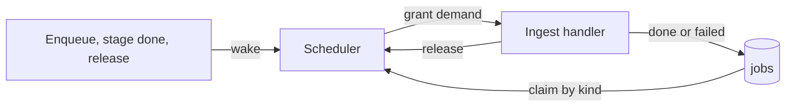
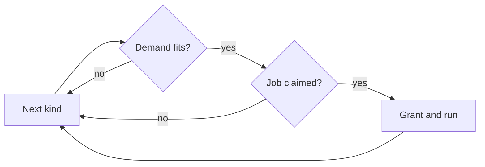

# Job scheduling: one scheduler for every ingest stage

One scheduler in [`internal/jobs`](../../internal/jobs) grants every ingest
job the resources its kind declares, from one set of capacities, and runs it.

The diagram shows what wakes the scheduler and what a grant runs.

## Each kind declares a demand

A job holds a fixed number of slots of each resource while it runs; its kind
declares them in [`domain.JobDemand`](../../internal/domain/job_demand.go). A
read slot is the right to read one source file; a CPU slot is the right to run
one ffmpeg decode or encode.

| Kind | Read | CPU | Why |
| --- | --- | --- | --- |
| `probe` | 1 | 0 | ffprobe reads the container header |
| `thumbnail` | 1 | 1 | ffmpeg decodes frames of the source |
| `seek_thumbnail` | 1 | 1 | ffmpeg decodes frames of the source |
| `preview` | 1 | 1 | ffmpeg decodes and encodes the source |
| `fingerprint` | 0 | 1 | Reads sprite frames from the data directory, not the source |

The demand counts the source reads a job starts; the seek-sprite job's own
parallel extractions are not counted separately yet.

## Capacities

The scheduler grants a job only while the slots in use plus its demand stay
within the capacity ([`domain.JobCapacity`](../../internal/domain/job_demand.go)).

| Resource | Capacity | Why |
| --- | --- | --- |
| Read slots | 4, shared by every disk | Matches the seek-sprite job's parallel reads, so throughput on a solid-state disk does not fall |
| CPU slots | `NumCPU / 4 + 1` | ffmpeg already spreads one decode or encode over several threads, and streaming needs the rest |

## A job that does not fit is skipped

The scheduler visits the kinds in turn, claiming one job per kind, and skips a
kind whose demand does not fit instead of waiting for it. A full turn that
grants nothing ends the round. The next round resumes after the last granted
kind, so a freed slot goes to the next kind rather than always to `probe`.

Skipping lets a CPU-only fingerprint run while every read slot is held, and
taking kinds in turn keeps the stages interleaved during a large import, so a
probe backlog does not hold back thumbnails. No job waits forever, because
every demand is at most one slot of each resource.

| Rejected | Why |
| --- | --- |
| One worker per stage | Five stages each read a disk with no shared limit |
| Stop at the first job that does not fit (Go `semaphore.Weighted`) | A busy resource stalls every kind behind it |
| Start every round at the first stage | Each freed read slot goes to the next probe, so thumbnails wait for the probe backlog to empty |

## The scheduler sleeps until woken

Between rounds the scheduler waits on a [`jobs.Loop`](../../ARCHITECTURE.md#queue-workers)
for a wakeup; it never polls an empty queue. A committed enqueue, a finished
stage and every release wake it. A claim error waits 5 seconds or for a
wakeup. Grants and releases are logged at debug level with the slots in use.

On shutdown the scheduler stops granting and waits for running jobs to return.
A cancelled job records no outcome, so startup recovery requeues it
([process lifecycle](process-lifecycle.md)).
