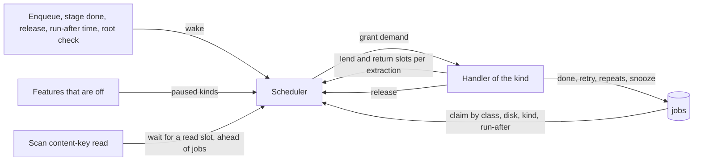
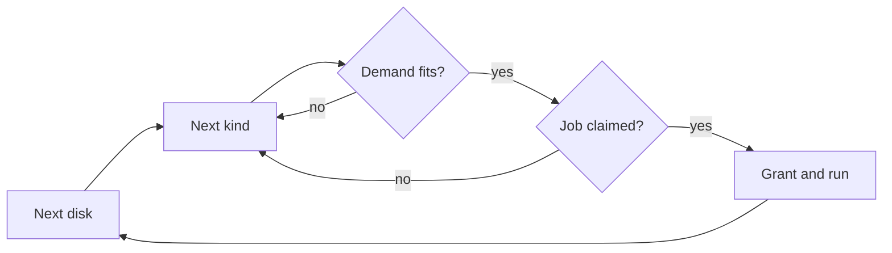

# Job scheduling: one scheduler for every ingest stage

One scheduler in [`internal/jobs`](../../internal/jobs) grants every ingest
job, and every auto-tagging job, the resources its kind declares, from the CPU
slots, the classifier slots and the read slots of the job's disk, and runs it.
A scan's content-key reads take read slots from the same disks.

The diagram shows what wakes the scheduler and what a grant runs.

## Each kind declares a demand

A job holds a fixed number of slots of each resource while it runs; its kind
declares them in [`domain.JobDemand`](../../internal/domain/job_demand.go). A
read slot is the right to read one source file on one disk; a CPU slot is the
right to run one ffmpeg decode or encode; a classifier slot is the right to
send one request to the classifier.

| Kind | Read | CPU | Classifier | Why |
| --- | --- | --- | --- | --- |
| `probe` | 1 | 0 | 0 | ffprobe reads the container header |
| `thumbnail` | 1 | 1 | 0 | ffmpeg decodes frames of the source |
| `seek_thumbnail` | 1, plus one per further extraction | 1, plus one per further extraction | 0 | One ffmpeg per frame, or one read per keyframe |
| `preview` | 1 | 1 | 0 | ffmpeg decodes and encodes the source |
| `fingerprint` | 0 | 1 | 0 | Reads sprite frames from the data directory, not the source |
| `auto_tag` | 0 | 0 | 1 | Sends generated thumbnails and seek frames, never the source ([auto-tagging](auto-tagging.md)) |

A read slot belongs to the disk of the location the claim picks: the next
available registered location in path order after the previous attempt's.

## Capacities

The scheduler grants a job only while the slots in use plus its demand stay
within the capacity.

| Resource | Capacity | Why |
| --- | --- | --- |
| Read slots of one disk | 1 for a rotational or unknown disk, 4 for a solid-state one ([`domain.Disk`](../../internal/domain/job_demand.go)) | Parallel sequential reads make a rotational disk seek; 4 matches the seek-sprite job's former parallelism, so a solid-state disk keeps its throughput |
| CPU slots | `NumCPU / 4 + 1` | ffmpeg already spreads one decode or encode over several threads, and streaming needs the rest |
| Classifier slots | 1 | A CPU-only provider cannot serve parallel requests |

The scheduler resolves a media folder's disk the first time it serves the
folder, and again when it rechecks an unavailable folder; the result lives in
memory only, because a remount or a replaced disk would make a stored value
wrong. Folders on one disk share its read slots.

| Platform | Disk key | Type |
| --- | --- | --- |
| Linux | The folder's `st_dev`, mapped through `/sys/dev/block/<maj>:<min>` to its whole disk | That disk's `queue/rotational` |
| Windows | The physical device number of the folder's volume (`IOCTL_STORAGE_GET_DEVICE_NUMBER`) | The seek penalty (`IOCTL_STORAGE_QUERY_PROPERTY`) |
| Either, when a lookup fails | `st_dev` or the volume alone | Unknown: 1 slot |

Btrfs, ZFS, overlayfs, network shares and Docker Desktop's shared folders have
no whole-disk sysfs entry, so they read with 1 slot. Windows reports no seek
penalty for some virtual disks, which then count as solid-state.

| Rejected | Why |
| --- | --- |
| One read limit shared by every disk | A busy disk takes the slots an idle disk could use |
| An adaptive limit from disk latency or stall time | Oscillates, depends on a baseline, and reads different signals on Linux and Windows |
| An owner setting for the slots | Most owners cannot judge it |

## Disks take turns, and a job that does not fit is skipped

The scheduler serves the classes strictly in order. Within a class it visits
the disks in turn, then one more group for the kinds that read no source file,
and claims one job per visit. Within a disk it visits the kinds in turn,
skipping a kind whose demand does not fit instead of waiting for it. A full
turn over the disks that grants nothing ends the class. The next visit resumes
after the last granted disk and, within a disk, after the last granted kind.

Taking disks in turn lets a folder with a few videos finish while another disk
works through thousands, and lets two disks read at once. Skipping lets a
CPU-only fingerprint run while every read slot is held, and taking kinds in
turn keeps the stages interleaved during a large import, so a probe backlog
does not hold back thumbnails. No job waits forever, because every demand is
at most one slot of each resource. Before a turn, one query lists the kinds
with due jobs and their most urgent class, so an idle queue costs no claims.

| Rejected | Why |
| --- | --- |
| One worker per stage | Five stages each read a disk with no shared limit |
| One queue in age order across disks | A disk with 10,000 queued jobs delays every other disk |
| Weighted fair queuing | There are no weights to express; equal turns suffice |
| Stop at the first job that does not fit (Go `semaphore.Weighted`) | A busy resource stalls every kind behind it |
| Start every round at the first stage | Each freed read slot goes to the next probe, so thumbnails wait for the probe backlog to empty |

## A job that splits its work borrows slots per part

The seek-sprite job runs its first extraction on its own read and CPU slot.
For each further extraction it asks the scheduler, without waiting, for one
more pair on the same disk, runs the extraction in parallel when it gets one,
and returns the pair when the extraction ends. Reading keyframes from the
index borrows one read slot per concurrent read the same way. At most 4 parts
run at once. On a 1-slot disk the job runs one part at a time.

| Rejected | Why |
| --- | --- |
| Take the extra slots at the start and hold them to the end | Idle slots stay held while the job finishes its last parts |
| A fixed demand of 4 or 8 slots | Never fits a 1-slot disk, so the job would be skipped forever |
| A demand of 1 with fixed internal parallelism | Reads 4 to 8 streams while counted as 1 |

## A scan's content-key reads go first

The scan still computes each new or changed file's content key inline, but it
holds a read slot on the disk of the file's media folder for each read
([`Scheduler.AcquireRead`](../../internal/jobs/scheduler.go)). A waiting scan
read takes the next free slot of its disk before any job class, and while it
waits no job takes a read slot on that disk. It never stops a running job, so
on a 1-slot disk the first read waits at most for the running job. While the
scan works through consecutive files of one media folder
([`Scheduler.KeepAhead`](../../internal/jobs/scheduler.go)), the slot a read
returns stays free from jobs until its next read, so on a 1-slot disk jobs wait
until the scan leaves the folder. The scanner reads one file at a time, so on a
4-slot disk jobs keep the other three slots. Unchanged files are not read and
take no slot. A folder whose disk cannot be resolved fails the read instead of
reading without a slot, and a file outside every media folder is not read.
`internal/scanner` declares the interface it calls, and `cmd/mdm` wires the
scheduler to it.

| Rejected | Why |
| --- | --- |
| Defer the content key to a job | A move between scans would no longer be detected by content |
| Stop a running job for the scan | An interrupted encode restarts from the beginning |
| Scan reads take turns with jobs | On a 1-slot disk each read would wait for a whole job, and those jobs need the scan's output |

## An unreadable media folder parks its jobs

A job whose handler fails while its media folder cannot be opened and listed
is snoozed: it is requeued without counting an attempt, and the folder becomes
unavailable. A folder that cannot be read when its disk is resolved becomes
unavailable too, and so does one whose disk does not answer within 5 seconds,
until the answer comes; a share that stops answering would otherwise stall the
grants on every disk. Claims pass over locations under an unavailable folder,
so a video with another readable location is claimed there, and a job stored
only under unavailable folders stays queued. A parked thumbnail does not hold
back seek sprites, which wait only for claimable thumbnails. A snooze of the
claim that started a round undoes the round, so the claim at the next location
starts and counts it. A file missing under a readable folder was deleted, so
its failure is retried as usual.

The scheduler checks unavailable folders again when a scan starts, the folder
watcher reports a change or an unreachable folder, and once a minute while any
folder is unavailable. A folder registered later is resolved when first
served. A healthy library is never polled.

| Rejected | Why |
| --- | --- |
| Zero read slots for the folder's disk | Two folders can share a disk, and one unreadable folder would stop the other |
| Snooze each job for a fixed delay | Every job of an unplugged disk would wake and fail to open its file each delay |
| Recheck only on events | The watcher is off unless automatic import is on, so a remounted disk would wait for the next scan |

## Owner requests are claimed first

Every job has a priority class. A claim of a kind takes the lowest class
first, then the earliest run-after time, then the oldest row, the order River
and Oban claim in ([`domain.JobPriority`](../../internal/domain/job.go)).

| Class | Value | Work |
| --- | --- | --- |
| Owner request | 0 | A force rescan, a retry from the activity log, a re-probe or "Suggest tags" from the video page, with the stages they queue |
| Import | 1 | Everything an import, a scan or an after-import rule queues, and "Tag all videos again" |
| Backfill | 2 | Work that only refreshes stored results; no kind queues it yet |

An owner request over a job that is already queued raises it to class 0 and
ends its retry wait, so the owner never waits behind a delay or a bulk import.
Owner requests touch one video, so they cannot starve the import class.

| Rejected | Why |
| --- | --- |
| Weighted queues (asynq 6:3:1, Sidekiq weighted) | A force rescan would share time with the bulk import it should overtake |

## A failed job retries after a growing delay

A handler's error ends the claim with one of four outcomes
([`JobRetryPolicy.AfterFailure`](../../internal/domain/job_retry.go)).
Attempts count rounds over a video's registered locations, so a failure that
leaves untried locations in the round requeues at once.

| Outcome | Returned for | Effect |
| --- | --- | --- |
| Done | No error | The job is done |
| Retry | Any other error | At the end of a round the job waits 30 s × 4^(round − 1) ± 10%: 30 s after the first round and 2 min after the second. It fails after the third round |
| Repeats | `domain.ErrFailureRepeats` | The job fails when the round ends, without the remaining rounds |
| Snooze | `domain.ErrJobSnoozed` | The job is requeued at once, and the claim does not count as an attempt |

A failure repeats when every retry would reproduce it:

- an extraction slower than its timeout;
- ffmpeg or ffprobe reporting FFmpeg's invalid-data error ("Invalid data found
  when processing input");
- ffprobe output that cannot be parsed (`invalid_metadata`).

An I/O or permission error and an ffprobe timeout may pass, so they retry. The
spread keeps jobs that failed together, such as every file on a disk that
stopped answering, from retrying together.

A kind may override the delay and the attempt limit, as a River or Oban worker
can; an override without a limit retries until the job succeeds or repeats.
Startup recovery requeues a running job without refunding its claim, so an
interrupted run counts as an attempt.

| Rejected | Why |
| --- | --- |
| Retry at once three times | A disk spinning up or a share reconnecting fails all three rounds within seconds |
| Many attempts over hours (River `attempt^4` s, Oban `15 + 2^attempt` s) | With three rounds, a few minutes already cover a transient outage |
| Treat every ffprobe exit error as repeating | ffprobe also exits with an error on `EIO`, `EACCES` or a file removed mid-read |

## A feature that is off pauses its kinds

A kind can be paused: its jobs stay queued and are not claimed, so they keep
their attempts, as River and Oban pause a queue. `internal/app` owns the
paused set. Each feature reports the kinds it holds back
([`app.PausedJobKinds`](../../internal/app/paused_jobs.go)), `cmd/mdm` hands
the collected set to the scheduler, and the scheduler reads it before each
round and skips a paused kind like an empty one.

| Kind | Paused while |
| --- | --- |
| `auto_tag` | "Use auto-tagging" is off |

Turning a feature back on wakes the scheduler through the feature's existing
settings callback, so its queued jobs are claimed at once.

| Rejected | Why |
| --- | --- |
| Claim the job and fail it while the feature is off | Each claim would spend an attempt, and the jobs would fail before the owner turns the feature on |

## The scheduler sleeps until woken or until a retry is due

Between rounds the scheduler waits on a [`jobs.Loop`](../../ARCHITECTURE.md#queue-workers)
for a wakeup, for the earliest run-after time of a queued job, or for the next
recheck of an unavailable folder, whichever comes first; it never polls an
empty queue. A committed enqueue, a finished stage, every release, a returned
lent slot or scan read, and the end of a scan's turn on a disk wake it. A claim
error waits 5 seconds or for a wakeup.
Grants, releases and lent slots are logged at debug level with the disk key
and the slots in use, and each resolved disk with its type and read slots.

On shutdown the scheduler stops granting and waits for running jobs to return.
A cancelled job records no outcome, so startup recovery requeues it
([process lifecycle](process-lifecycle.md)).
