# Library UI: visual rules and list layout

- Status: adopted
- Scope: the visual rules that the screens in `web/` (shell, lists, video page)
  follow, and how compliance with those rules is checked

The screens share one set of visual values in CSS, and tests check what a
machine can check. The values (colours, radii, card widths) live only in
`@theme` in [`web/src/ui/tokens.css`](../../web/src/ui/tokens.css) and the checked
pairs only in [`tokens.test.ts`](../../web/src/theme/tokens.test.ts); they are
not copied here.

The diagram shows where the values live and who checks each part.

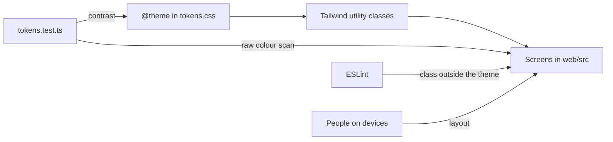

## Visual values in one CSS location, with contrast guaranteed by tests

Screens set visual values only through the utility classes Tailwind generates
from `@theme` (`bg-card`, `text-muted-foreground`, `rounded-md`), and
`tokens.test.ts` checks that every listed text/surface pair reaches a WCAG 2
contrast of at least 4.5.

`@theme` in `tokens.css` starts by resetting Tailwind's default namespaces for
colours, type, weights, spacing, radii, shadows and animations
(`--color-*: initial`, `--spacing: initial` and the rest), then defines only
the design system's steps. Tailwind therefore generates no class outside the
scale, and ESLint's `no-unknown-classes` fails one written in a screen
([design-system.md, Foundations](design-system.md#foundations)).

CSS is the source because it leaves screens no option other than token names.
With the values in one file, the contrast check reads only that file.

The test applies these checks:

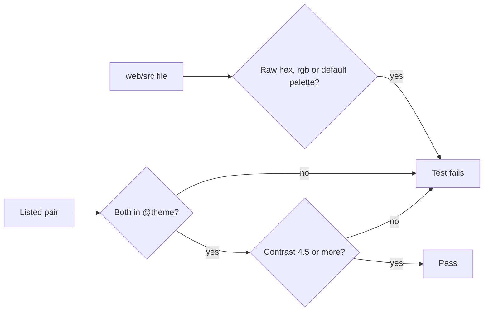

Default palette names are `neutral-*`, `sky-*` and the rest. A colour missing
from the pairs is not checked, so **a new text or surface colour must be added
to the pairs**; the test catches a listed pair missing from CSS, not the
reverse.

Which token plays which role (surfaces, the cyan `primary`, control borders,
focus, the semantic colours and the favorite pink) is set in
[design-system.md, Foundations](design-system.md#foundations). The test covers
body text on surfaces, the main borders and focus.

| Rejected | Why |
| --- | --- |
| Values in TypeScript, CSS generated | Screens use Tailwind class names anyway, so names are duplicated and one more generated file appears |
| axe or Lighthouse in CI | Needs a real browser; beyond contrast it adds findings people review anyway |

## Dark scheme only, without a light/dark switch

`html` declares `color-scheme: dark` and one dark set of values exists, with no
`prefers-color-scheme` branch and no switch.

A switch doubles the sets under contrast checking, and one set would go stale
unseen. Token names describe roles (`background`, `card`, `popover`,
`foreground`, `muted-foreground`, `primary`, `destructive`, `warning`), not
colours (`neutral-850`), so a later light scheme is a second set of values with
no screen changes.

## No virtual scrolling

Lists render every loaded item without a virtual scrolling library; the goal is
immediate response to input, not fewer DOM elements.

The list is a wrapping grid whose cards per row change with screen and card
width, so virtualization would mean computing that count and rebuilding scroll
restoration in virtual coordinates. Pages load 60 items
([`PAGE_SIZE`](../../web/src/api/client.ts)), so the DOM holds only what the
user loaded. **Revisit only after measuring what is slow.**

The tag admin list (`/tags`) is the measured exception: with thousands of tags,
opening, search and scrolling froze, so it draws only the rows near the
viewport (`@tanstack/react-virtual`'s `useWindowVirtualizer`). Neither
reason above applies there: it is one column, and rows arrive 100 at a time
from the server for the current conditions. The document stays the scroll
owner, the list keeps the focused row drawn, and Tab crosses the edge of the
drawn range, so keyboard order reaches every row. The screen is the admin
table page pattern: the header, tabs and toolbar scroll with the page, the
rows are the body of a `DataTable`, and rows outside the drawn range are kept
as empty spacer rows so the columns stay aligned. The page passes the fixed top
bar's height (`--spacing-navbar`) to the virtualizer and to
`scroll-padding-top`, so a focused row never hides under the top bar.
The organizations admin list (`/organizations`) is built the same way from
the same pieces in `web/src/tags/`: pages of 100 read from the server, rows
drawn near the viewport, and local updates after rename, details, merge and
delete. The people list (`/people`) shares the paging but is a grid of face
cards ([people.md](people.md#the-people-grid)).

### The window owns scrolling

The document (the window) scrolls the content; the shell's sidebar and toolbar
are fixed or sticky and own no scroll container.

The list's scroll restoration, zoom anchoring and infinite scroll all read
`window.scrollY` or observe against the viewport, so a scroll container inside
the shell would mean rewriting all three.

## Width breakpoints in CSS, and the sidebar exception

Width variations use Tailwind's default breakpoints in CSS; only the sidebar
reads width in JavaScript ([`use-mobile.ts`](../../web/src/hooks/use-mobile.ts)).

Watching width in JavaScript brings a watcher, a one-frame flicker on the first
render, and a `matchMedia` stub in tests. The sidebar is the exception because
it renders a different component per width (a fixed rail or a `Sheet` drawer)
and keeps the drawer's open state, which CSS cannot express. The notices
([`Toast.tsx`](../../web/src/ui/Toast.tsx)) are the other: Sonner takes its
position as a prop, so list screens read `lg` to move notices from under the
top bar to the bottom centre, above the selection bar. The sidebar's breakpoint equals `sm`:

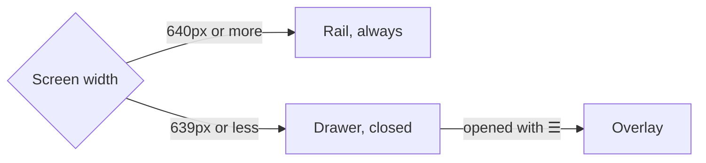

The sidebar does not expand at 640px and wider. The rail already names every
entry, so the expanded state added no destination and only took width from
the grid; with no open/close choice left, ☰ appears below 640px only.

Reduced motion (`prefers-reduced-motion`) is also handled in CSS: the
`motion-reduce:` variant stops decorative transitions, while the final colour
and the target marker still apply, so the result of an action stays visible.

## Layout verified by people, not machines

Machines check contrast, the absence of raw colours and component behaviour;
**people check the layout and its width variations on real devices**.

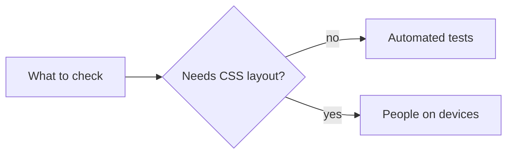

jsdom does not apply CSS, so `position: fixed`, media queries and wrapping are
unresolved, and faking them gives passing tests on a broken screen.

| Rejected | Why |
| --- | --- |
| Visual regression tests | New dependencies, false positives from glyph differences between environments, and every UI change updates reference images |

## List layout

Lists use a dense management-screen layout: a top bar, a filter band and boxed
cards. The library page lays its cards out with
[`Grid.tsx`](../../web/src/videoList/Grid.tsx), and the folder pages with the
registry's card grid
([`card-grid.tsx`](../../web/src/ui/patterns/card-grid.tsx)).

The diagram shows the parts of a list screen.

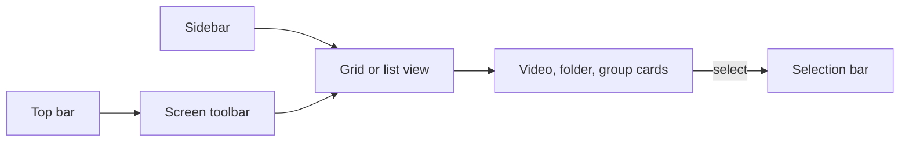

### Shell and toolbar

The top bar ([`TopBar.tsx`](../../web/src/shell/TopBar.tsx)) holds ☰ (below
640px only) and the logo, and no scan control (see
[Scan entry and progress](#scan-entry-and-progress)). The library, the folder
pages and the admin pages (tags, people, organizations) insert their toolbar after them: the design-system
`Toolbar` with
`placement="topBar"`, rendered through
[`TopBarPortal.tsx`](../../web/src/shell/TopBarPortal.tsx), so the toolbar
stays reachable at any scroll position. Folder pages are a design-system `ListPage`: the breadcrumb
is a band stuck under the top bar, so the parent folders stay one click away at
any scroll position. The breadcrumb's last segment names the folder, so the
page's `h1` is for screen readers only and no visible title repeats it
([design-system.md, Page patterns](design-system.md#page-patterns)).
The tags page is an `AdminTablePage`: a centered `max-w-4xl` column whose
header (or, while rows are selected, the selection bar) and tabs stick under
the top bar, and the table's column header sticks right under them. The
organizations page is an `AdminTablePage` with the same header and column
header, without the filter, tabs, checkbox column and selection bar, and a
details dialog (aliases, external IDs and the parent) in place of the synonyms
dialog. The people page is a `ListPage` of face cards with the search, the
favorites filter and the sort in the top bar.
On the library and folder pages, changing the search, a filter, a tag or the
sort order scrolls the page back to the top, so the new list starts from its
first card. Returning from the player still restores the saved position.
Home, folder, group and smart-folder pages keep the same search field in the
top bar, including loading and empty results, at desktop and mobile widths.
They share search, the `Favorites only` filter and sort controls, including
the compact layout on narrow screens. Guests have no filter, so the filter
button is hidden for them, and see only sorts based on public data. Query and
filter changes preserve
the current scope. The controls share IME handling, syntax help and `q` URL
state. The search field searches only on `Enter` and on clearing, never while
the owner types or on blur, so unconfirmed IME text and half-typed words do not
replace the list; the `Enter` that confirms an IME conversion does not search. Changing a query, filter, sort or shuffle seed resets pagination and
scrolls to the top; obsolete responses cannot append to the new results.
Clearing the query restores the current scope without changing saved settings.
Search applies the video search expression before paging direct group items;
child-group cards remain when any visible descendant matches. Group summaries
and playback describe all visible descendants. While any temporary condition or explicit sort is active, drag reordering
is disabled.
Smart-folder pages apply the same video search expression to the videos that
match the saved rules, including ancestor rules, before paging. Search uses
the current viewer's searchable fields and hides child-folder navigation until
cleared. It does not change saved rules, summaries or playback order. Both the
detail and next-page requests carry the same `query`, `favorite`, `sort`
and random `seed`; zero matches return an empty page,
including for a guest who can still access the folder.
Group and smart-folder sorts are temporary URL state. An omitted `sort` uses
the saved order, exposed as `Saved order` in the shared sort menu. Clearing
conditions keeps the chosen sort, as on home and folder pages; choosing
`Saved order` restores group positions or the smart folder's configured sort.
Group filters retain direct items and child cards; favorites apply to each
displayed item, while text search inspects its visible videos. SQL filters and sorts before taking the page. Group item IDs,
full summaries and playback order retain their original meaning.
The sidebar has two states (rail, drawer; see
[Width breakpoints in CSS, and the sidebar exception](#width-breakpoints-in-css-and-the-sidebar-exception)).
The rail is 68px (`sidebar-rail`) wide and shows each entry's icon above a
small label in a 56px (`rail-item`) square, so every entry stays named.
Card width follows the zoom level. Guest rules are in
[authentication.md](authentication.md).

| Part | Owner | Guest |
| --- | --- | --- |
| Sidebar, upper | All entries | `Home`, `Library` and `Folders` only |
| Sidebar, lower | `Settings`, `Sign out` | `Sign in` |
| `Scan library` button and import progress | Shown | Hidden |
| Sort orders | 9 | 7 |
| Filter button | Shown | Hidden |

The toolbar holds search, filters, sort, view (library only) and zoom, in
that Tab order. It never wraps: the search field takes the remaining width,
and each view control moves into the icon-only `View and sort` popover below
the width where it joins the row.

| Width | Toolbar |
| --- | --- |
| `xl` and up | All controls inline |
| `md` to `xl` | Sort inline from `md`, view (library) from `lg`, zoom from `xl`; the rest in `View and sort` |
| Below `md` | Sort orders in `View and sort` as two radio columns row-first (5 rows owner, 4 guest), direction or `Shuffle` under them |
| Below `sm` | One full-width column at any zoom; zoom hidden |

The tags page uses the same row with search, filter and sort; below `md` its
sort moves into the icon-only `Sort` popover.

The count sits in the row above the grid for search results,
and in the section heading for a folder's direct contents.

The sort orders are date added, date modified, date created, title, duration,
file size, recently played, date favorited and random; guests lose the
owner-only recently played and date favorited. Date created sits
with the other dates;
date favorited follows recently played and sorts newest first.

On folder, group and smart-folder pages the filter popover holds only
`Favorites only` (URL `fav=1`). On the library it lists `Tags`, `Person`,
`Organization` and `Favorites only`, in that order:

| Control | Picks | URL |
| --- | --- | --- |
| `Tags` | Tags and tag kinds from one candidate list, kinds marked by their icon; selected ones show as chips in the field | `tag=<id>` per tag (all must match, at most 16); `tagKind=<id>` for one kind, which a newly picked kind replaces |
| `Person` | One person | `person=<id>` |
| `Organization` | One organization | `organization=<id>` |

Applied tags, kinds, people and organizations also show as chips in the
`Filtering by` row, and an id the server or the loaded lists no longer hold
leaves the URL with a toast.
Opening the popover focuses the panel itself, not its first field, so the tag
picker's candidate list stays closed until the owner enters the field.
The popover's fields edit a draft copied from the applied conditions on each
opening; the primary `Apply` button writes the whole draft in one history
entry, and closing without it drops the draft. Chips in the `Filtering by` row
and search suggestions still apply at once.
The filter button counts each applied condition as one filter.
`Clear filters` clears every condition at once, closes the popover and keeps
the sort. A guest URL with
`fav=1`, `tag`, `tagKind`, `person`, `organization` or `sort=favorited*` is
reset to the defaults before the request and the URL is corrected. Parameters
of removed filters (`watch`, `playable`, `versions`, `addedWithin`,
`minDuration`, `maxDuration`) are dropped from the URL.

While the owner types in the library search field, a listbox under it offers
`Search for "<text>"` first, then a few matching people, tags and tag kinds,
and organizations, matched with `foldForMatch`. `Enter` on the first option
keeps the plain text search; choosing another option applies that filter as
the menu does and clears the text.

While any filter applies, the owner's library header carries the `outline`
action `Save as smart folder`, which opens the smart folder dialog with the
filter as its conditions and the current sort, `Random` replaced by date added;
the `Created "{name}"` toast carries `Open` to the new folder's page.
The dialog's conditions are the search text, `Favorites only`, tags and tag
kind, person and organization, the same set as the library filter.

### Scan entry and progress

A scan starts from `Scan library` in the `Scan status` section of the
Settings `Scan` page
([`ScanStatusSection.tsx`](../../web/src/settings/ScanStatusSection.tsx)) or
on the `Scan` step of onboarding at `/welcome`
([Home and onboarding](home.md)),
because scanning is occasional and a permanent button in the top bar repeated
the bottom-right indicator. The button is present in every scan state. It is
disabled while a scan runs (including one started in another tab) and while
no media folder exists, with the reason in a line it references through
`aria-describedby`. A failed start request appears as an alert in the same
section, and the button stays available to try again. The `Scan` action of an
empty folder is a link to `/settings/scan#scan-status` and starts nothing. The
owner's action on an empty library, and on a home with no video, is `Set up
library`: it sets the onboarding step to `folders` and opens `/welcome`
([`useStartSetup.ts`](../../web/src/onboarding/useStartSetup.ts)).

The bottom-right indicator
([`ScanProgressIndicator.tsx`](../../web/src/shell/ScanProgressIndicator.tsx))
shows the latest import summary. The following rules govern its opening,
closing and dismissal.

| Event | Summary popover | Indicator |
| --- | --- | --- |
| Pointer enters the indicator or the summary | Opens | — |
| Focus moves onto the indicator | Opens, unless the summary closed while the indicator kept focus | — |
| Pointer leaves (after 100 ms), `Esc`, a press outside, focus leaves, the indicator is pressed | Closes; focus does not return to the indicator | Pressing goes to `/settings/scan#scan-status` and ends a result notice |
| The hide button (`×`) is pressed, in any state | Closes | Hidden for the rest of that scan and for its result |
| The scan ends (done, partial or failed) | — | Shows the result for 8 seconds, then hides itself |
| The next scan starts | — | Shown again |

The summary's open state changes only on these events. Deriving it from
"hovered or focused" reopened it at once, because Radix returns focus to the
trigger when a popover closes. Every result, partial and failed included,
hides itself after 8 seconds, because `Scan status` keeps it; the timer pauses
only while the summary is open. The `×` is a muted ghost button inside the
indicator's frame, not a second framed button.

The hidden scan's id is kept in `localStorage` (`vv.scan-indicator-dismissed`),
so a reload or another tab keeps it hidden, and a `storage` event hides it in
tabs already open. Hiding a scan that is still starting waits for the new
scan's id. The result of a hidden scan stays readable in `Scan status`.

### Cards

A video card ([`VideoCard.tsx`](../../web/src/videoList/VideoCard.tsx)) shows
the thumbnail, the duration at its bottom right, playback progress along the
bottom edge, the owner's credits on the image and the title. Grid cards carry
no actions: favorite, `Add to playlist` and `Add to group` are in list rows,
the selection bar and the video page.

| Card | Rules |
| --- | --- |
| Video, library and folder pages | Tag row under the title, none without tags  |
| Video, folder search results | Location row under the title |
| Folder (folder page) | Group card's box, artwork, count panel and name, with a Folder mark before the video and folder counts; no checks, actions or tag row |
| Media folder (`/folders`) | Video card's width and border, folder artwork, Folder icon in the title; opens the folder only |
| Group (library only) | Video card's box and size, folder artwork of up to 4 member thumbnails |
| Smart folder (unfiltered library, smart folder page) | Group card's box, artwork, count panel, name and tag row, with a `FolderSearch` mark before the count; the owner's check selects it; no `Add to group`; the owner's heart and `Add to playlist` on its list row send the folder as one item (`smartFolderIds`), and tag and visibility actions reach its member videos |

The owner's video card shows the work's credits on the image as faint text
without a panel ([`CardCredits.tsx`](../../web/src/videoList/CardCredits.tsx)),
read from `cardCredits` in list items and in the detail a list refreshes a
changed item from.

| Credit | Rule |
| --- | --- |
| Product code | Top left; moves right of the selection check while the check shows |
| Performers | Bottom left, the first three faces, then `+N`; hovering a face pops that performer's face and name, and pressing the face or the popped face opens the person page; in selection mode a press selects the card |
| Organization | After the faces, truncated: the first label, otherwise the first maker |
| Guests | Not shown |

Video card behaviour:

| Case | Behaviour |
| --- | --- |
| Tag order | Tags of kinds marked `First on cards` (the Kinds tab of `/tags`) lead, in natural kind-name order; the rest keep natural name order. The seeded genre kind starts marked |
| Tag pressed in the library | Filters by the tag |
| Tag pressed on a folder page or a group page | Opens `/?tag=<id>` |
| Tags that do not fit the row | Collected in `+N`; resting the mouse on it or pressing it opens the hidden tags as wrapping chips inside the viewport, scrolling when they do not fit, with every name in full  |
| Tag from a folder name only | Same size, no fill, dashed border, Folder marker; no × on the video page; cannot be removed by bulk `Edit` |
| Hover preview | One at a time on any screen |
| Zoom changed | Returns to the card that was at the top |

Folder, group and smart folder cards show the name on up to two lines with the
full name in `title`. On `/folders` the owner also sees each media folder's
path, truncated to favour its end, full in `title`. An empty registered root
says to place files there and import.

The library reads `GET /api/library`, which pages mixed video, group and smart-folder
keys using [stored collection information](home.md#collection-information-and-paging);
folder pages and their search results list videos one by one. A group card
shows a panel with the count (`12 videos`) and total duration, a watched-share
bar only while some members are in progress, the group name and the members'
tags. Pressing it opens the group page (`/groups/{id}`), which lists the
group's child groups and videos in their saved order under a sticky trail band.
On that page a child group opens with `?trail` one group longer, and a video
opens with `?group`, so the video page follows that group.
Guests see no watch status, watched count or bar.

Root smart folders stand among the groups and videos of the unfiltered library
(favorites only keeps the favorited ones) and of a smart folder page's child
list. The list carries only each folder's name; a card draws a `Skeleton` count
panel until it scrolls into view, and the cards then on screen are read 60 at a
time through `GET /api/smart-folders/cards`.
A `smartFolder` event reads the named cards again, keeping only the newest
answer per card, and makes the unfiltered library reload its loaded pages, so
a folder created, moved or renamed in another tab appears. A folder left out of
the answer loses its card. A smart folder card cannot be dragged, and dropping
on it shows `Can't drop here`.

Folders, groups and smart folders share one-column cards and the same
collection-link behaviour. A mouse-promoted cover carries no title overlay and
opens that video with autoplay and its group or smart-folder context; a
folder's cover opens the video alone. The artwork shows at most four covers plus a More
sheet if videos remain. More and the title open the collection; leaving the
artwork restores that destination. Touch and keyboard activation also open the
collection. During selection, promotion is disabled and group and smart folder
clicks retain their selection behaviour.

Opening a smart folder leads to `/smart-folders/{id}`:
a trail band of the folder's ancestors, the name, `12 videos · 1:32:10`, and
for the owner one conditions line per folder on the path, then the child
folders by name and the matching videos and groups in the folder's sort, in
the library's grid or list. A video opens with `?smartFolder=<id>`. The owner's
`More` holds `Edit…`, `New child smart folder…` and `Delete…`; saving reloads
the page quietly, and deleting leaves for the parent folder or the library
with a toast. An empty folder shows `EmptyState`, with `Edit conditions…` for
the owner. The page reloads in place on a `smartFolder` event naming it or on
a reconnect, and the selection drops videos and child folders that are no longer
listed. Guests see the page without conditions, `More` or selection.

Ungroup, group a folder's direct videos and turn a group into a tag are not on
the card. They sit in the owner's menu at the right end of a folder page's
`Videos N` heading row
([`FolderGroupingMenu.tsx`](../../web/src/folders/FolderGroupingMenu.tsx)), and
turning into a tag and dissolving also sit in the video page's group actions
([Group members](#group-members)). The folder menu offers "Turn the group into
a tag…" only when the folder has an automatic group, including a registered
folder's own group, and opens the confirmation dialog that every entry point
shares.
After an action the cached library list is discarded and reloads on the next
visit.

### Favorite mark

The owner's favorite mark is one heart that is both mark and toggle, in the
list rows of videos, groups and smart folders and on the video page. Grid
cards carry none, so a card's favorite changes from its row, the selection bar
or the video page.

| Aspect | Rule |
| --- | --- |
| Shape | 20px heart in a 32px hit area, no fill or border behind it |
| On | Filled pink `favorite`, everywhere |
| Off | Outline, shown only on hover or focus (always where hover is impossible) |
| Pressing | Does not open the row's link or select it |
| Filtered to favorites | Item stays until the next fetch |
| Guests | Not shown |

The mark changes only after the server answers:

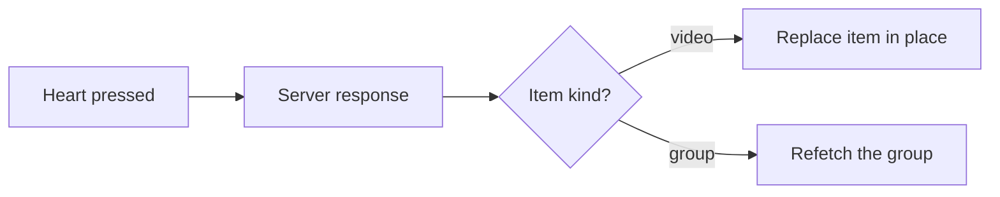

A group is refetched with `GET /api/groups/{id}`.

### List view and selection

List view (library only) shows title, favorite (owner), add to playlist and
add to group (owner, from `sm`; below it the selection bar offers them), watched,
duration, quality, size and date added. A group row uses the
same columns: first member's thumbnail, Folder marker and count under the
title, `3 / 12` watched, total duration and size, empty quality.

Selection is library- and owner-only. Its check shows on hover or focus in the
grid (always where hover is impossible), always faintly in list view, and on
every item during selection. A group's check selects that group; the selection
bar below decides whether an operation sends the group or its selected videos.
A smart folder's check selects the folder as one item. With Shift held, a check
or a selection-mode click gives every item from the previously changed one to
this one, in display order, the same state.

In the owner's grid, a mouse drag of 8px or more that starts outside cards and
controls draws a box and selects the items it overlaps, replacing the selection
or, with Shift, Ctrl or ⌘ held at the press, adding to it. The page scrolls
while the pointer is near its top or bottom edge, Escape restores the selection
from before the drag, and the release does not open the card under it. Touch
and list view keep checks only.

### Selection bar

The selection bar is fixed to the bottom of the screen from the first selected
item, without moving or resizing the toolbar. Action names are never shortened,
so they read on devices without hover; the design-system bar
(`SelectionBar`, at most `max-w-4xl`) wraps to a second line when they do not
fit.

Its items, in order, are clear, `N selected`, `Edit`,
`Favorite`, `Add to playlist`, `New group`, `Add to group`,
`Bundle as versions` (2 or more videos), and, after a separator, `Delete…`.
There is no `Select all`: selection covers only the cards the viewer checks,
directly, as a Shift range or inside a drawn box.
The actions sit at the right end; those that do not fit move to the right end
of the next line.

`Delete…` (`ghost-destructive`) removes the selected collections, never videos.
It is disabled with the reason `Select a group or smart folder` until a group
or a smart folder is selected, and over 20,000 collections with the limit
message. It opens a confirmation that counts the groups to dissolve, whose
videos and child groups stay in the library, and the smart folders to delete
with the folders inside them. Confirming sends one request
(`POST /api/collections/delete`) that dissolves each group as `Dissolve…` does
and deletes each smart folder as `Delete…` in its `More` does, in one
transaction; videos selected alongside stay. The server ignores IDs that no
longer exist and publishes the same `group` and `smartFolder` events as the
single operations, so other tabs refresh as after them. On success a toast
counts what was removed, the selection is cleared and the list reloads in
place: the library refreshes its loaded pages as after other group changes,
and the group and smart-folder pages reload. A failure stays in the dialog,
so the selection is kept. The group page and the smart-folder page offer the
same action for their child groups and child smart folders.

`Edit` opens the bulk editor for the tags, people, organizations, dates and
visibility of the selection ([bulk-editing.md](bulk-editing.md)).

While smart folders are selected, the count names them separately
(`3 videos and 1 smart folder selected`). `Favorite` and `Add to playlist`
send each folder as one item (`smartFolderIds`). `Edit` acts on the
folders' member videos, as it does on a selected group's: the client sends the folder IDs, and the
server resolves each folder's current members at request time with the owner's
view of the smart folder page, its rule plus every ancestor rule and groups
expanded to their videos. A folder whose rule refers to a missing entity has
no members. The client never expands a folder, because a folder can match many
videos, so it checks the 20,000-video limit only on the videos it knows; the
server applies the limit to the distinct resolved videos and rejects the whole
request with `too_many_videos` when they exceed it. The toast counts the videos
the server applied. After these actions and after `Favorite`, the shown cards
of the selected folders read their values again. A smart folder cannot be
placed in a group or bundled, so `New group`, `Add to group` and
`Bundle as versions` are disabled with the reason
`Not available for smart folders`.

The request shapes are in [the screen API schema](../../api/openapi.yaml).

`Favorite` decides per selected group whether to send it as a group:

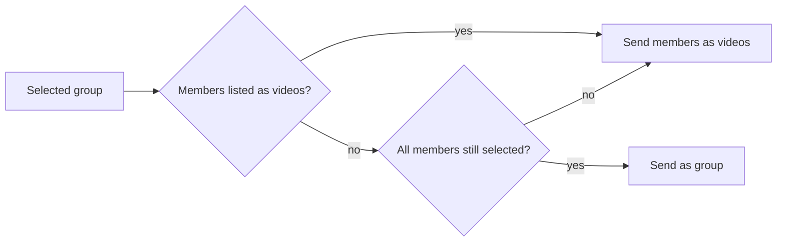

A group is selected through its card's check. Members
appear as video items, or the group gains members, when the list is refetched
with the selection kept, for example after an import.

### Interaction states

Normal, hover, focus-visible, active, selected and disabled are distinct and
consistent across components. Keyboard focus is an outer outline in the accent
colour; the search field draws it on its outer frame, not the inner `input`, to
avoid a double outline.

## Sidebar navigation

Each sidebar item goes to its screen. `Home` opens `/`, which combines the
searchable library list with inline smart-folder cards
([Home library and setup](home.md)). Smart-folder cards follow the list order and use the same one-column stacked
artwork as groups. A promoted cover opens playback; the resting card, title
and More sheet open the collection. Every in-app library filter link (tag, person, organization) uses
`/?<parameter>=<id>`. Old `/library` URLs redirect to `/` with their query and
hash intact.

While the owner's onboarding step is not `done`, every route replaces itself
with `/welcome`, the onboarding page outside the shell, and the owner's
`/welcome` with the step `done` goes to `/`. Guests are never sent there. The
gate ([`OnboardingGate.tsx`](../../web/src/onboarding/OnboardingGate.tsx))
reads the step before it draws a route, reads it again on the owner-only `onboarding` event so
a step changed on another device takes effect, and treats a step it cannot
read as `done`, so a failed read never locks the owner out
([Home library and setup](home.md)).

## Video page layout

The video page (`/videos/:id`) is for watching, so it is less dense than the
lists. Its layout uses the viewing density of
[the design system](design-system.md#page-patterns).

The page is layered over the list with no shell and closes with × or Esc. It
is built on the `DetailPage` skeleton
([Design system, Page patterns](design-system.md#page-patterns)), which fills
the window edge to edge: the header band with a bottom border, then a left
column for watching and a right column for related videos, divided by a border.
The diagram shows its parts.

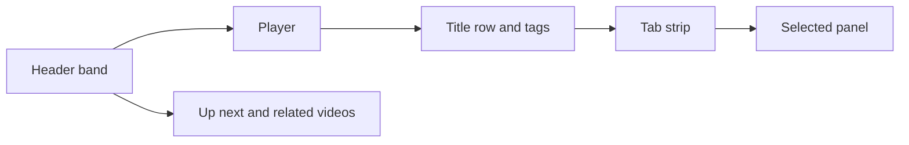

| Part | Rule |
| --- | --- |
| Header band | Logo (home), breadcrumb to the folder, the only × |
| Return target | The list before the page opened, kept through related videos and `Play next` |
| Title row | The title and its pencil, then `Favorite`, `Add to playlist` and `Add to group`, each an icon and its word, `ghost` `sm`; beside the title from `sm`, on a row of their own below it |
| Tags | Right below the title as one unit  |
| Tab strip | Under the tags; the tabs, then the visibility toggle and `Edit details` at its end ([Tabs](#tabs)) |
| Visibility toggle | `Private` or `Public` with a lock or globe icon, a `Button` with `role="switch"`, at the end of the tab strip |
| Right column | Up to three sections, the playlist panel, `Up next` (a group's or smart folder's members) and related videos, all as library-style cards 224px wide: the thumbnail with the name under it, two lines at most. An ordered card carries its number at the thumbnail's top left, and the current one is not a link and shows `ring-2 ring-primary ring-inset` on `bg-accent`. Related videos are ordered by closeness and loaded further as the list scrolls ([Related videos](related-videos.md)) |
| Guests | No title row actions, tags, visibility toggle, `Edit details`, work information or location; the tabs Overview, Versions (with two or more versions) and File & media |

Width variations stay in CSS, as in
[Width breakpoints in CSS, and the sidebar exception](#width-breakpoints-in-css-and-the-sidebar-exception):

| Width | Layout |
| --- | --- |
| `lg` and above | The page keeps the viewport's height and the left column scrolls on its own. The right column is `detail-aside` wide (the card width plus its padding) and reaches the window's right edge, so its scrollbar sits at the edge. The playlist panel, `Up next` and related videos scroll in one container, and each section's heading stays at the top only while its section is in view. The player's height leaves room for one line of the title, so a landscape video fills the column's width. Its width also stops at the video's own display width (never below 60rem) and at 100rem, so a large window does not stretch a small video; when a limit stops it first, the player, title and tabs take the player's width and sit in the middle of the column. The tags, the tab strip and the panel are reached by scrolling the column |
| Below `lg` | Everything stacks and the page scrolls as one under the sticky band. The player runs edge to edge directly under the band; the text below it and the right column's sections keep side padding, and the cards form a grid of two columns from `sm` and three from `md` |
| Below `md` | The breadcrumb shows only its last segment |

The player frame takes its size from the named steps `player-width`,
`player-height` and their `-lg` forms in `tokens.css`, which read the video's
aspect ratio from the frame at run time.

### Tabs

What is under the tags sits behind one strip of `Tabs` `variant="line"`, so
the column shows one kind of information at a time instead of stacking every
kind. The strip's bottom border is the one divider between the title unit and
the panel; panels carry no frame.

| Tab | Listed when | Panel |
| --- | --- | --- |
| Overview | Always | The description (folded to three lines) and the one-line work summary, `KYT-002 · Released 2024-03-15 · 山田 花子, 佐藤 健太`, for the owner; then `Length`, `Resolution`, `Added` and `Last watched` (the progress row's time, owner only) as a `FactList` |
| Work | Owner, and the work has an item other than the description and the performers, or an approved work-info plugin exists | — |
| People | Owner, and the work credits a person; the count is the distinct credited people | `Credits`: the credited people as a face grid, one tile per person with its roles, each a link to the person page. `Seen in this video`, only once face recognition is done and found someone: one row per person with the face, the name (`#1042` when unnamed) and a `SpanBar` of when the person is on screen, scaled to the video's length and absent while the length is unknown. While the player is shown, pressing a block seeks it to the span's start and plays in place; otherwise the blocks are plain. The list is read when the tab opens and again when the video response is replaced |
| Versions | Two or more visible versions; the count is the number of versions | The list, read each time the tab is selected, one row per version with the representative first: a `w-list-thumb` thumbnail, the title (a link that plays that version, plain text for the playing one), a `Representative` badge on the representative, and resolution · container · codec · size · place; the playing row carries `ring-2 ring-primary ring-inset` on `bg-accent`. For the owner, `Make representative` on every row but the representative and `Remove from versions` on every row, as `ghost` `sm` buttons with words; a guest's rows only play. Removing the playing version replaces the page's video with the removed one, which leaves Versions and selects Overview |
| Thumbnail | Owner | — |
| File & media | Always | `Location` (owner only, with a location): the path in a monospace line and `Open file` (only when the file can be opened from this browser), `Copy path` and `Rescan` as `outline` `sm` buttons; `Media`: `Video`, `Audio`, `Subtitles`, `Chapters`, `Container`, `Embedded` and `Broadcast` rows, each only with content; `File`: `Size`, `Added`, `Edited`, `Created` |

One pure rule over the video response and the plugin list decides which tabs
are listed; a strip never holds a disabled tab. The plugin list is read once
per page for the owner, and until it arrives Work is listed only for a work
with items; its arrival adds Work in its place without changing the selection.

The diagram shows what a change of video or a refresh does to the selection.

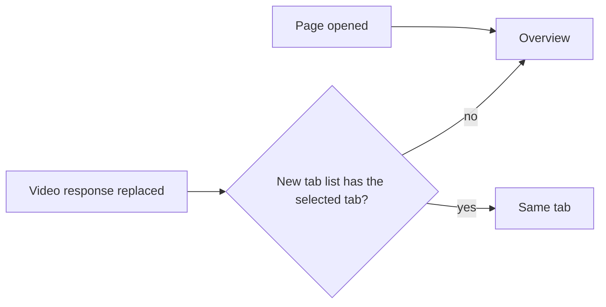

The selected tab is page memory, not part of the address, so a reload opens on
Overview. Only the selected panel is mounted. The thumbnail sends, the
thumbnail preview and the work-info fetch dialog belong to the strip's
container, so they keep running and stay open across a switch.

A section inside a panel has a small muted uppercase heading; facts are a
`FactList` with the term muted and the value in the body colour. Dates show
the date only; the time is in the `title` attribute and in a popover opened by
pressing the date. A failure shows one line with `AlertCircle` at the end of
the panel and clears on the next action. While the probe is pending the
`Media` section says `Reading technical details…`, after a failed probe
`Couldn't read the technical details` in `warning`, and Overview leaves out
`Length` and `Resolution`. No path appears under the title, because the
breadcrumb already shows the location.

| Width | Strip |
| --- | --- |
| `sm` and above | One line: the tabs, then the visibility toggle and `Edit details` at its right end |
| Below `sm` | The two controls on a line of their own above the strip, right-aligned; the tabs scroll sideways inside the strip, so the page never scrolls sideways |

The owner's favorite toggle is the first control after the title
(`FavoriteToggle` `page` form: `Toggle` `sm` with the heart and the word,
`aria-pressed`). On is a small `bg-primary-soft` fill with the pink heart and
the word in the same colour; it is no more prominent than the title.

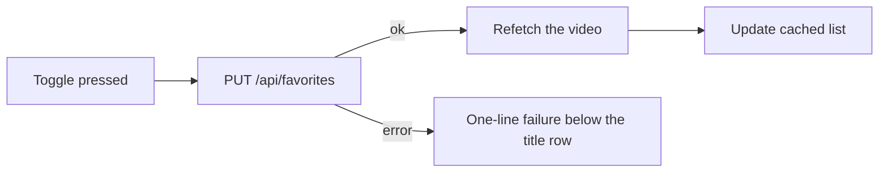

Updating the cached list means the library card has changed on return.

### Information rows

The rows of facts and icon-only actions that sat under the title are replaced
by the [tabs](#tabs) and the labelled actions of the title row and the strip.

### Details editor

`Edit details` (lucide `Clapperboard` and the word, the owner's only, at the
end of the tab strip) is a link to
`/videos/:id/edit`, a full-screen `FormPage` outside the shell and the player
that edits the display name and every work information item together; the
title's pencil stays as the quick way to rename. The band holds `Cancel` and
`Save`; the left column, the skeleton's `aside`, names the video (thumbnail,
file name, duration, size and resolution, folder) and holds
`Back to the video`; `Basics` holds the name, the code and the dates
in a 2×2 grid, the description, links and IDs; `Credits` holds one row per
role with the chips and a `CreditCommand` picker that finds a person or an
organization, or makes a chip marked `New` that `Save` creates first. `Save`
then sends one `PUT /api/videos/{id}/details` and returns to the page with the
response, focusing `Edit details`; a reason with a `field` stays in the editor
under that control. `Cancel`, `Back to the video` and the browser's Back ask
`Discard changes?` when the draft changed. Opened from the page, the editor
starts from the page's video and returns along the history, so the page's `×`
still leads to the list; opened by its URL, it reads the video first, and a
guest is sent to sign in.

### Player states

Loading, import stages, read failure, playback failure, video gone and playback
ended show one at a time from a single container over the player, which decides
the order. Only the "being created" line sits below the player. Layer text
sits on opaque `bg-navbar`, because `tokens.test.ts` cannot check text on the
translucent `bg-overlay`.

The stall warning ([`StallWarning.tsx`](../../web/src/player/StallWarning.tsx),
`role="status"`) is a separate small banner at the player's top left: it
neither stops playback nor blocks controls, so it stays out of the
one-at-a-time container.

| Aspect | Rule |
| --- | --- |
| Stacking | Above the video, below the container and the control bar |
| Input | Passes through to the controls, except its × |
| Hidden while | Playback failure, playback ended, up next, reconnecting or importing shows |
| Loading spinner | Shown together with it during a data wait |
| Dismissed | Not shown again for the same video |
| Actions | None; no quality change |

Rules: [Playback quality, Stall warning](playback-quality.md#stall-warning);
details:
[playback-quality.md](playback-quality.md).

### Playback errors

Playback errors are classified by kind
([`playbackRecovery.ts`](../../web/src/player/playbackRecovery.ts)), checking
the cause when the `video` element's code does not say it:

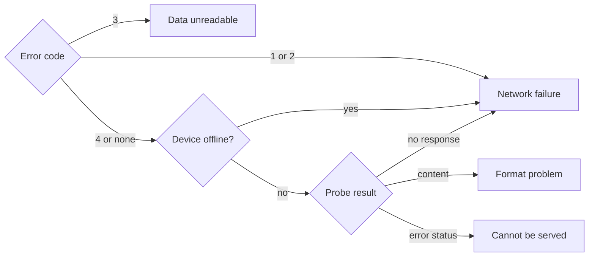

Direct playback probes the first byte of the file. Transcoding probes only
whether `/api/health` answers, because a request to the stream would start a
transcode; any answer counts as a format problem.

A network failure reloads on the current route from where it broke off,
without switching to transcoding:

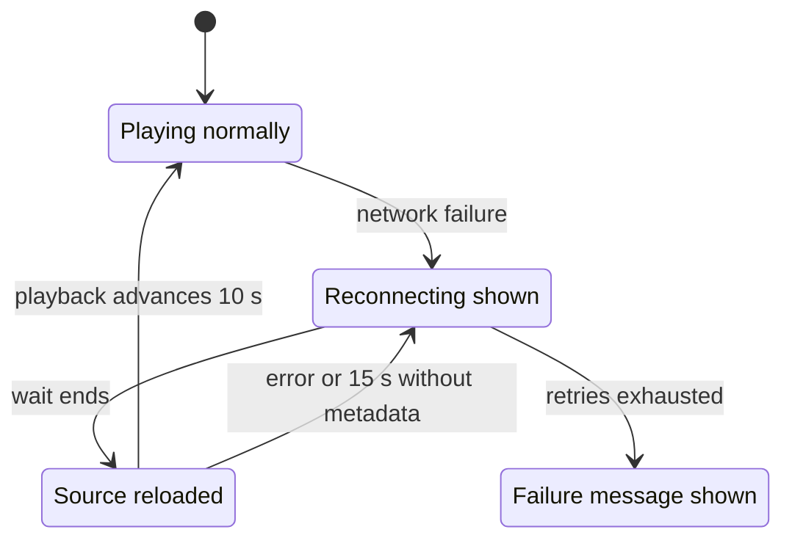

| Rule | Value |
| --- | --- |
| Waits | 1, 2, 4, 8, 15 s (about 30 s in total) |
| Early end of a wait | Device comes back `online`, or the viewer presses play |
| Retry count reset | 10 s of real playback after a reload; seeks and paused changes do not count |
| Pause during a wait | Playback stays paused after the reload |
| Seek during a wait | Becomes the reload position; during a request, applied after metadata |
| Paused state | Answered from the viewer's intent; the play/pause button follows it |
| Switch to transcoding | Once, only from direct playback, only for data-unreadable and format failures |

Viewer input during the wait never reaches the broken source. The final
message says which applies: the server cannot be reached, the data cannot be
read (corrupt), or the video cannot be served (moved, gone, format).

### Control bar

Only control bar parts are video.js components: restart, chapters, quality,
subtitles, playback speed, current time/duration and the transcode indicator. The status
display is React, because a video.js component could not share state with the
rest of the screen.

| Control | Rule |
| --- | --- |
| Right-hand group | Chapters, transcode indicator, quality, subtitles, playback speed, PiP, full screen, in that order |
| Quality | `MenuButton` matching playback speed in box, padding, opening and Esc ([`qualityMenu.ts`](../../web/src/player/qualityMenu.ts)) |
| Quality label | The current quality; for the original, the video's short side |
| Choosing a quality | Replaces the source at the same position without recreating the player |
| Esc in an open menu | Closes only the menu |
| Subtitle button | Next to playback speed; absent for videos without subtitles |
| Subtitle menu | Subtitle names and `Off`; no appearance settings |
| Subtitle choice | Remembered per browser; the next video with the same label starts with it |
| Subtitle position | Raised above the control bar and progress bar while they show |
| Chapters button | A video.js `ChaptersButton` reading a `chapters` text track built from `mediaInfo.chapters`; absent for videos without chapters ([`chapters.ts`](../../web/src/player/chapters.ts)) |
| Chapters menu | `20em` wide; one `{start} {title}` item per chapter in start order, `Chapter {n}` when untitled; the playing chapter is marked; choosing one seeks to its start and keeps playing or paused |
| Chapter marks | A `chapter-mark` (2px) break on the progress bar at each chapter start; no pointer, no label, hidden from screen readers |
| Narrow frame | Under a 40rem player: `3em` boxes and tighter time and indicator padding; under 32rem the transcode indicator folds to its icon, so every button fits at 360px |
| Seek preview title | The title of the chapter under the pointer, above the time; a video with chapters and no sprite shows it in the time pill alone |

Quality: [Playback quality, Switching](playback-quality.md#switching) and
[playback-quality.md](playback-quality.md).
Subtitles use video.js's `vjs-text-track-display`
([sidecar-subtitles.md](sidecar-subtitles.md)). Chapters: the seek preview
title and the menu's mark share one rule for the chapter at a position, the
latest start at or before it whose end is after it.

Keyboard shortcuts work on the whole screen: video.js components stop key
propagation, so keys are caught in the capture phase on `window`, passing
through only keys that operate the focused button or slider. Space, F, M, C
(subtitles), 0 and Esc are handled. Keys pressed inside an open popover or
menu, such as the playlist picker, belong to it: only Esc reaches the page,
and it closes the popover, not the page.

### Group members

A video in a group only gains parts on the same page; a video outside any group
is unchanged.
The group is the one the video was opened from (`?group=<id>`, passed to the
video, related-video and member reads), or else the group with the smallest id
that holds the video directly; a playlist context overrides both.

| Part | Rule |
| --- | --- |
| Above the title | Group name and position in the group, as a link to the group page |
| Related videos column | `Up next` member list and a divider at the top |
| Playback ended | Next-member notice instead of the layer: 5 s, cancellable, Esc cancels |
| Member rows, handles, notice | Keep `?group` on the video they open |
| Group actions (owner) | `Ellipsis` button after the line: `Remove from this group` (only for a direct item), `Turn the group into a tag…`, `Dissolve…`; Esc closes only the menu |
| After an action | Video and related videos read again without `group`; the page stays |
| Previous/next handles | Move within the group |

A video opened from a smart folder (`?smartFolder=<id>`) follows the folder's
play order in the same parts: the reads carry `smartFolder`, the line above the
title has the `FolderSearch` icon and links to `/smart-folders/{id}` with no
actions button after it, and the member rows, handles and notice keep
`?smartFolder`. `?group` wins when both are present, and the page re-reads on
a `smartFolder` event naming the folder. A playlist shows a smart folder item
as one row with the group item's shape and the `FolderSearch` icon, on the
playlist screen and in the panel; its link and every playlist step onto it
carry `smartFolder` from the item or from the step's `smartFolderId`, and a
folder with no video is a row without a link.

`matchMedia` reads the `lg` width only to scroll the current member's row into
view on wide screens; on narrow widths scrolling would move the whole page and
hide the player.

On `pointer: coarse` devices, tapping the video toggles play and pause. video.js
handles taps on the poster before playback; taps on the video tech toggle through
the same player controls as the control bar. The central play button is hidden
with a CSS media condition, keeping the video area clear during touch playback.

## List conditions applied by the server

The server applies every list condition (search, filters, sort, shuffle seed),
and the page never filters the pages it has loaded
([`listCriteria.ts`](../../web/src/videoList/listCriteria.ts) keeps them in the
URL).

The list routes (`GET /api/videos` and `GET /api/library`) take these
conditions, each ANDed with the others:

| Parameter | Keeps | Guest |
| --- | --- | --- |
| `query` | Videos the search expression matches (see below) | Allowed; matches only the title and relative path |
| `tag` | Videos that carry every listed tag | `400 guest_filter_not_allowed` |
| `favorite` | Favorite videos and favorite groups | `400 guest_filter_not_allowed` |
| `person` | Videos linked to that person in any role | `400 guest_filter_not_allowed` |
| `personRole` | With `person`, only videos linked to that person in this role (`GET /api/videos` only) | `400 guest_filter_not_allowed` |
| `organization` | Videos linked to that organization in any role | `400 guest_filter_not_allowed` |
| `tagKind` | Videos with at least one tag of that kind, manual or from the folder | `400 guest_filter_not_allowed` |

`query`, `tag`, `tagKind`, `person` and `organization` apply to each group member, so a
group matched only in part lists its matched members as video items. A
`person` or `organization` id with no entity gives an empty list, and a value
that is not a positive integer is `400 invalid_request`. `personRole` without
`person`, or with a role outside `WorkPersonRole`, is also `400 invalid_request`.

For the owner, a search term matches a video when it appears in the title or
relative path of one of its locations, in a name or synonym of one of its
tags, in its work code, or in a name or alias of a person or organization
linked to its work information. Matching uses the folded form
(`domain.FoldForMatch`), so width, letter case and hiragana or katakana do not
matter. The description, dates, URLs and external IDs are not matched. A guest
search matches only the title and relative path, so names a guest cannot see
do not decide which public videos are returned.

The group destination picker filters names and audience visibility in SQLite,
then reads at most the page limit plus one candidate key. Full group members
are loaded for the returned page, while the extra key determines continuation.
Name matching uses Unicode case folding, preserving the picker's substring
semantics independently of video search syntax.

Only the server knows which videos and groups belong to a folder and match the
filters, so a page that filtered locally would show a different set from
`total`. For the same reason a re-fetched list item never guesses its place:

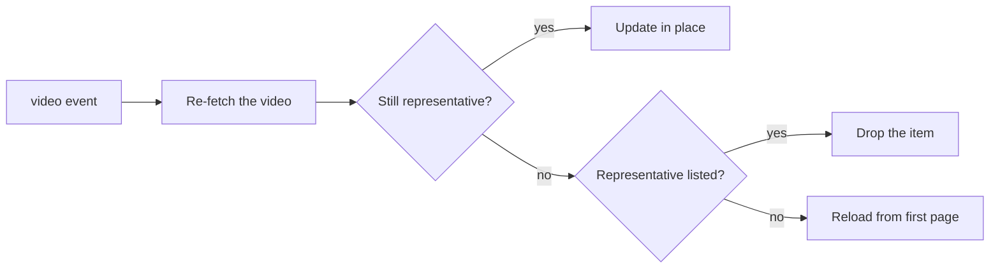

Inserting the representative directly could show a video outside the folder
or filters ([`useItemRefresh.ts`](../../web/src/api/useItemRefresh.ts)).

## Per-device preferences with defaults

Per-device display settings are total functions over `localStorage` that
never throw ([`web/src/preferences/`](../../web/src/preferences)): a missing,
corrupt or unreadable value yields the defaults, and a failed write is ignored.

A preference is a convenience; a bad stored value or blocked storage must not
blank the screen.
