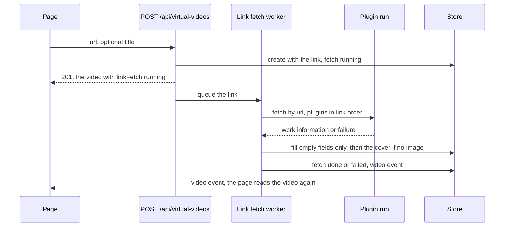
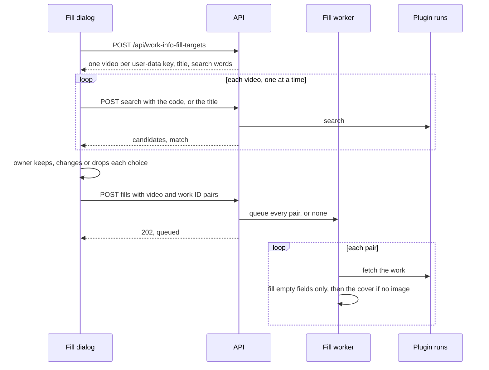

# Link fetches: the bundled plugin, link order and filling from a link

VVMDM reads a video's title, description, date and image from any video link
with its bundled work-info plugin `vv.link`, tries the plugins that declare
domains in an order the owner sets, fills the empty fields of a virtual
video created from a link, and fills a selection's empty fields from the
works the owner confirms. The rules are in
[`link_plugin.go`](../../internal/domain/link_plugin.go), the bundled plugin in
[`link.go`](../../internal/wasmplugin/link.go) and
[`link_page.go`](../../internal/wasmplugin/link_page.go), and the fills in
[`link_fetch.go`](../../internal/app/link_fetch.go) and
[`work_info_fill.go`](../../internal/app/work_info_fill.go). The sandbox and network
rules it shares are in [work-info-plugins.md](work-info-plugins.md).

The diagram shows a virtual video created from a link.

## Work-info plugins declare the domains they fetch by link

A work-info manifest may declare `domains`, under the same rules as a person
plugin's ([person-plugins.md](person-plugins.md#a-link-fetch-is-the-fetch-operation-with-a-url)),
and must then declare `fetch`. Such a plugin accepts `fetch` with a `url` in
place of `id`. The video page's fetch dialog sends the field's text as `link`
when the plugin declares domains and the text is an http or https URL, and the
server answers `400 work_info_link_unsupported` before any run for a link none
of the domains matches. A plugin without domains still receives URL-shaped
text as an opaque `id`.

| Rejected | Why |
| --- | --- |
| A separate `link` operation | A fetch by link compares and applies as a fetch by ID does, so a second operation would copy the fetch path |
| Matching links in the page | The rule would live in Go and in TypeScript; the page only tells a link from other text |

## VVMDM bundles one plugin that reads any link

`vv.link` is a `work_info_plugins` row with `builtin` set: it has no module,
its manifest comes from `domain.LinkPluginManifest`, and its digest is the
constant `builtin:vv.link`. Migration `00080` inserts it approved, because the
owner installed the code with VVMDM. The runtime runs the Go function the
digest names in place of a module, under the same run slot, 30-second deadline,
HTTP limits, address rule, cover fetching and response parsing
([`run.go`](../../internal/wasmplugin/run.go)). Its only domain is
`*`, which matches every http or https link and which no manifest can declare.

The owner revokes its approval to stop it. Deleting it, or uploading a module
named `vv.link`, answers `409 plugin_builtin`.

| Rejected | Why |
| --- | --- |
| A prebuilt `.wasm` file in the repository | A Go-built module is several megabytes, and a toolchain update would change its bytes and its digest |
| Building the module during `task generate` | The generated-file check would fail whenever the Go version changes |
| A plugin the owner downloads separately | The requirement is that it works without one |

### The plugin reads the site's oEmbed answer before the page

Some sites refuse to serve their video pages to programs but answer their
official oEmbed endpoint. For a link under a known provider's domains
(`oembedProviders`: YouTube, Vimeo, Dailymotion, TikTok, Streamable and
niconico), the plugin first asks that endpoint, then reads the page, and keeps
the first value each source gives. A page's own oEmbed discovery link is read
when the page lacks a title or an image.

| Source | Read |
| --- | --- |
| oEmbed | `title`, `description`, `upload_date`, `thumbnail_url`; YouTube's full-size thumbnail goes before the small one it names |
| JSON-LD `VideoObject` | `name`, `description`, `uploadDate` or `datePublished`, `thumbnailUrl` |
| Open Graph | `og:title`, `og:description`, `og:image`, `article:published_time`, `og:video:release_date` |
| Twitter card | `twitter:title`, `twitter:description`, `twitter:image` |
| HTML | `<title>`, `<meta name="description">` |

The page is decoded from its declared character set, relative images resolve
against the final URL, the date is kept as `published`, and the title and the
description are cut to their limits. A link with nothing to read fails the run
with `plugin_failed` and a message naming the site's status, such as
`The site answered 404 Not Found for the link.`

| Rejected | Why |
| --- | --- |
| Downloading the video or running an external tool | Out of scope; the plugin reads metadata only |
| Stripping tracking parameters from the link | Some sites carry the video in a query parameter, and the site ignores the others |

## The owner orders the plugins tried for a link

Every work-info plugin that declares domains has a `link_rank`; the list
returns it as `linkRank`, and `PUT /api/work-info-plugins/link-order` replaces
the whole order. An order that does not name each such plugin once answers
`409 link_order_changed` without writes. A plugin new to the order goes just
before `vv.link`, so a site's own plugin wins over the generic one by default;
a replacement keeps its place, and a replacement without domains leaves the
order.

The settings page lists those plugins first, in order, with their domains and
`Move up` and `Move down` in the row menu.

| Rejected | Why |
| --- | --- |
| A plugin per domain table the owner edits | The plugin already declares its domains, and a second list could name a domain the plugin does not handle |
| Ordering by specificity | The owner could not prefer the generic plugin for a site whose own plugin is worse |

## A virtual video created from a link fills its empty fields

`POST /api/virtual-videos` takes `url`, with or without `title`. The video
stores the link among its links, takes the link as its title when none is
given (`title_from_link`), and starts with `link_fetch` `running`. The
response returns at once; the page shows `Reading the link…` while the video
stays usable.

One worker in `app.WorkInfoPlugins` runs the queued links one at a time, since
the runtime has one run slot. For each link it tries the approved plugins whose
domains match and whose required settings are set, in link order, until one
fetches; then it applies the result as a fill.

A fill writes only what the video has no value for, decided inside the apply's
transaction (`FillEmpty` in
[`work_info_fetch.go`](../../internal/store/work_info_fetch.go)), so an edit
the owner made during the fetch stays:

| Field | Written when |
| --- | --- |
| Title | `title_from_link` is still set: no title was given and none was saved since; for a file video filled from a selection, it has no display name |
| Tags | The video has none |
| A detail field (code, description, a date kind, a role, links, external IDs) | It is empty |
| Cover | The video still has no image, checked under the generation lock every image write takes (`Ingest.FillThumbnailImage`); the first cover of at most 4096×4096 by its header, since no owner chose it and a page could name an image that decodes to hundreds of megabytes |

The fetch then ends `done`, or `failed` with the first plugin's reason, and
the store publishes a video event so open pages read the video again. A failed
fetch leaves the video as created and stays on the page until the owner saves
the details. A video deleted or merged meanwhile has no row, so the outcome is
not written. Startup records a fetch still `running` as interrupted, since its
worker belonged to the previous process.

| Rejected | Why |
| --- | --- |
| Fetching inside the create request | The request would wait up to 30 seconds per plugin, and a failed fetch would look like a failed create |
| A job in the jobs table | Jobs are content work claimed by workers with ffmpeg; one in-memory queue serves a fetch that ends within a minute |
| Overwriting with the fetched values | The owner's typed title or description would be lost to a site's |
| Trying only the first matching plugin | A site plugin that fails, such as one needing a login, would leave the video empty although the generic plugin can read it |

## A selection fills its empty fields after a review

`Fill info…` on the list selection bar
([library-ui.md, Selection bar](library-ui.md#selection-bar)) asks for one
approved work-info plugin that searches and fetches, then shows the works it
finds for each selected video and fills only the ones the owner keeps. The
dialog is in [`web/src/library/fillInfo/`](../../web/src/library/fillInfo)
and the fills in [`work_info_fill.go`](../../internal/app/work_info_fill.go).

The diagram shows one review from the selection bar to the filled videos.

`POST /api/work-info-fill-targets` resolves the selection's smart folders and
returns the first video of each user-data key with its title and its search
words: the key's work code, or the title without one. The dialog runs the
plugin's search for each video in turn, since the runtime has one run slot,
and lists every video as its result arrives.

The search response carries `match`, the candidate the dialog preselects
(`domain.MatchWorkInfoCandidate`): the first whose title or ID equals the
search words once case, width, spaces and punctuation are ignored, or the only
candidate. A video without a match starts as `Don't fill`; the owner can pick
any candidate for it, change a preselected one or drop it. Only titles are
shown, not the values each work would write, so the review needs no fetch and
the owner waits only for the searches.

`POST /api/work-info-plugins/{id}/fills` takes the kept video and work ID
pairs and answers at once with the number queued. Each fill fetches its work
and applies the result as the fill of a link fetch does, through the same
worker, so a fill never waits on another for the run slot; the cards update
from the video events, and each run is recorded as the video's work-info
fetch activity.

The fill writes the empty fields of the
[link fill table](#a-virtual-video-created-from-a-link-fills-its-empty-fields).
A file video's title counts as empty while it has no display name, since its
file title is only a fallback: the fetched title becomes its display name,
decided inside the apply's transaction, and a display name the owner set
stays. The versions of a bundle share one code and one user-data key and are
listed once, through the first version selected.

The plugin is checked before anything is queued: a plugin that is not an
approved work-info plugin declaring `fetch` with its required settings set
answers with the same error as a single fetch, and the dialog offers only
plugins that also search, so `vv.link` is never offered. The queue holds
20,000 fills, one selection at the bulk actions' limit, and takes a request
whole or answers `503 work_info_fills_busy` without queuing any of it. Queued
fills live in memory and end with the process.

| Rejected | Why |
| --- | --- |
| Filling without a review, taking only matching candidates | The owner could not correct a wrong match or rescue a video whose title differs from the site's |
| Showing the values each work would write | Every video would need a fetch before the review, so the owner would wait for twice the runs |
| Fetching by the code as the work's ID | Most sites' IDs are not the work's code, so most fills failed |
| Searching on the server for the whole selection | The request would wait for every search; the dialog shows each result as it arrives and can stop when closed |
| Overwriting the selection's values | The owner's tags and details would be lost to a site's |
| A job in the jobs table | Jobs are content work for ffmpeg workers; the fills share the in-memory worker of link fetches and its single run slot |
