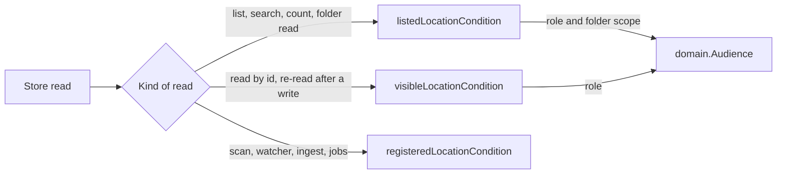
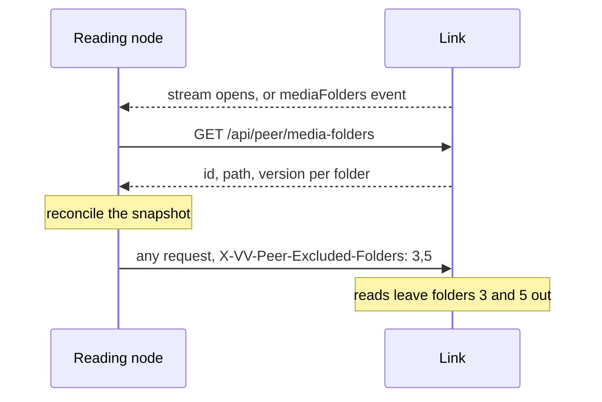

# Media-folder switches

Each media folder has an on/off switch: a switched-off folder's videos, groups
and folder tree leave this node's lists, searches, counts and folder reads,
while scans, watching, ingest and jobs go on as before
([`internal/domain/audience.go`](../../internal/domain/audience.go),
[`internal/store/visibility.go`](../../internal/store/visibility.go)).

The diagram shows which condition a store read takes.

## The folder scope travels in the audience

`domain.Audience` is a role (owner or guest) and a folder scope. The scope is
this node's switches, `media_folders.enabled`, or an explicit list of this
node's folder ids to leave out, never both; the zero value is a guest with the
switches.

`Audience` already reaches every viewer-facing store read, so the scope needed
no new parameter, and the zero value still fails closed. The explicit list is
kept as a canonical string so `Audience` stays comparable.

| Rejected | Why |
| --- | --- |
| A new parameter on every store read | About 130 store sites already take `Audience` |
| A context value read by the store | A read's inputs stay explicit |

## Lists apply the scope, reads by id do not

`listedLocationCondition` adds the scope to `visibleLocationCondition`; every
list, search, count and folder read uses it, including the bundle
representative and group membership. A bundle searched by name matches only
its versions under the scope. A read by id (`getVideo`, a playlist's items,
including a playlist group's members) keeps `visibleLocationCondition` and sets
`Video.FolderOff` when no location of the video is under the scope.

An open video or a playlist entry is not an error when its folder is switched
off, and the store sites that re-read a video after a write go through
`getVideo`, so edits to such a video still succeed.

The root folder list, `GET /api/folders`, leaves out a root outside the scope
for the owner as well, through `Audience.ListsFolder`, so a switched-off root
is not shown as an empty card.

| Rejected | Why |
| --- | --- |
| Scoping `visibleLocationCondition` | An open video would answer `404` and writes to its videos would fail |
| Scoping `registeredLocationCondition` | Scans, watching, ingest and analysis would stop for the folder |

## Counts the screens show take the scope

Tag, person and organization counts, the folder index reads, smart-folder
matches and the library totals read the listed condition with the request's
audience: this node's switches for its own screens, or a peer's explicit list.
Writes that answer an entity with its count, such as a rename, count with the
owner audience and its switches. The folder index itself is built from every
registered location; only its reads apply the scope.

## Stored group values follow the switches

`group_members` and `group_values` are computed with the listed condition for
the owner and guest roles with this node's switches. A switch updates
`media_folders`, whose update trigger marks every group for refresh, so the
next list or group read recomputes them. A library or group-items read whose
scope is an explicit list computes its groups instead of reading the stored
values.

## The watch history leaves out switched-off videos

An entry whose video is visible to the viewer but has no listed location is
left out; an entry without a visible video, such as a removed one, stays as
before. Every history view joins `videos` for this, the unfiltered one too.

## An empty library names the switches

`VideoPage.EmptyReason` and `LibraryPage.EmptyReason` are `all_folders_off`
when the page is empty, folders exist and every one is switched off. A guest
gets the same reason because the guest's library is empty for the same cause.
An explicit scope names no reason, because this node's switches do not apply
to it.

## A switch writes only the switch

`SettingsStore.SetMediaFolderEnabled` changes `enabled` and leaves `path`,
`version` and `updated_at`, so no rescan, ingest or sweep follows and a switch
is allowed during a scan. `domain.MediaFoldersChanged{ViewOnly: true}` is
published after the commit. The owner reaches it through
`PUT /api/media-folders/{id}/enabled`, which answers `404 not_found` for a
missing folder.

## The `mediaFolders` event follows its cause

Every switch, local or of a link's folder, every added, replaced or deleted
folder and every `mediaFolders` a link sends this node send `mediaFolders`, an
empty object, to this node's session and token viewers, guests included,
because their lists change too. A peer-credential stream receives it only for
an added, replaced or deleted folder of this node; the other causes publish
`MediaFoldersChanged{ViewOnly: true}`
([`internal/httpapi/events.go`](../../internal/httpapi/events.go)).

| Rejected | Why |
| --- | --- |
| Sending a switch to the peer credential | A switch never changes what this node answers a peer, so the event would only make the reading node reread |
| Sending a link's `mediaFolders` to the peer credential | Two nodes that read each other would bounce it without end, since an empty event has no ids to tell whose it was |
| A `video` event per video in the folder | A folder holds thousands of videos; lists already reload on one all-folders notice |

## A link's folders keep their switches on the reading node

The reading node keeps a snapshot of each link's media folders with the
owner's switches in `peer_media_folders`, and every request to the link
carries the switched-off ids in `X-VV-Peer-Excluded-Folders`
([`internal/app/pairing_folders.go`](../../internal/app/pairing_folders.go),
[`internal/peer/forward.go`](../../internal/peer/forward.go)).

The diagram shows the snapshot's life.

`domain.ReconcilePeerFolders` drops a row whose id the link no longer lists,
replaces a row whose `path` or `version` differs with its switch on, and adds
new rows on; `PeerStore.ReplacePeerFolders` applies it in one transaction and
stores nothing for a link that was removed meanwhile. The rows are deleted with
their link. Settings reads the snapshot with the link's state through
`GET /api/peer/links/{nodeId}/media-folders`, so an unreachable link's folders
and switches stay visible; a switch writes the snapshot only and never the
link.

The read node's peer boundary turns the header into the request's explicit
folder scope, which leaves its own switches unapplied, and answers
`400 invalid_request` to a malformed value. `GET /api/peer/media-folders`
answers the credential the ids, paths and versions only, and
`GET /api/media-folders`, which carries usage and edits, stays off the peer
allow-list.

| Rejected | Why |
| --- | --- |
| Reading the link's folders when Settings opens | An unreachable link's folders and switches would disappear |
| Keying a switch by the folder id alone | A switch for a deleted or replaced folder would apply to the folder that takes its id |
| A query parameter on every merged and forwarded operation | One header reaches lists, counts and forwarded reads alike, as `X-VV-Peer-Audience` does |
| Storing the reader's switches on the read node | A second copy of the state would need resynchronizing on reconnect |
| Applying the read node's switches as well | A switch is one node's view only |

## The screens name a switched-off folder

The switch is the last control of each row in Settings, `Media folders`, and
stays usable during a scan. A local row keeps `Change`, `Force rescan` and
`Remove` in one actions menu before the switch, so the path keeps the row's
width. Below `sm` the switch takes its own line under the path at the left,
where the page's other settings stack their controls. Open lists, the watch history and its dates
included, reload on `mediaFolders`, and the event discards the saved list a
return to the library or a folder would restore
([`web/src/api/serverEvents.ts`](../../web/src/api/serverEvents.ts)). A guest's
Folders roots page opens no stream, so its roots wait for the next visit. An empty
library with `all_folders_off` and no search or filter tells the owner every
folder is off and links to that page; a guest keeps the sign-in state. A video
with `folderOff` plays as before, with a band before its breadcrumb, whose
crumbs are plain text because the Folders page leaves the folder out. A
playlist row with `folderOff` carries a `Folder off` mark under its title.
