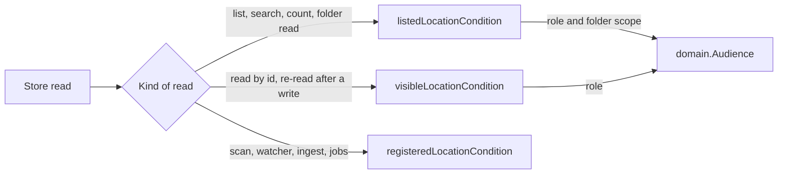

# Media-folder switches

Each media folder has an on/off switch: a switched-off folder's videos, groups
and folder tree leave this node's lists, searches, counts and folder reads,
while scans, watching, ingest and jobs go on as before
([`internal/domain/audience.go`](../../internal/domain/audience.go),
[`internal/store/visibility.go`](../../internal/store/visibility.go)).

The diagram shows which condition a store read takes.

## The folder scope travels in the audience

`domain.Audience` is a role (owner or guest) and a folder scope. The scope is
this node's switches, `media_folders.enabled`, or an explicit list of this
node's folder ids to leave out, never both; the zero value is a guest with the
switches.

`Audience` already reaches every viewer-facing store read, so the scope needed
no new parameter, and the zero value still fails closed. The explicit list is
kept as a canonical string so `Audience` stays comparable.

| Rejected | Why |
| --- | --- |
| A new parameter on every store read | About 130 store sites already take `Audience` |
| A context value read by the store | A read's inputs stay explicit |

## Lists apply the scope, reads by id do not

`listedLocationCondition` adds the scope to `visibleLocationCondition`; every
list, search, count and folder read uses it, including the bundle
representative and group membership. A read by id (`getVideo`, a playlist's
items) keeps `visibleLocationCondition` and sets `Video.FolderOff` when no
location of the video is under the scope.

An open video or a playlist entry is not an error when its folder is switched
off, and the store sites that re-read a video after a write go through
`getVideo`, so edits to such a video still succeed.

| Rejected | Why |
| --- | --- |
| Scoping `visibleLocationCondition` | An open video would answer `404` and writes to its videos would fail |
| Scoping `registeredLocationCondition` | Scans, watching, ingest and analysis would stop for the folder |

## Counts the screens show take the scope

Tag, person and organization counts, the folder index reads, smart-folder
matches and the library totals read the listed condition with the owner
audience and its switches. The folder index itself is built from every
registered location; only its reads apply the scope.

## Stored group values follow the switches

`group_members` and `group_values` are computed with the listed condition for
the owner and guest roles with this node's switches. A switch updates
`media_folders`, whose update trigger marks every group for refresh, so the
next list or group read recomputes them. A library read whose scope is an
explicit list computes its groups instead of reading the stored values.

## The watch history leaves out switched-off videos

An entry whose video is visible to the viewer but has no listed location is
left out; an entry without a visible video, such as a removed one, stays as
before. Every history view joins `videos` for this, the unfiltered one too.

## An empty library names the switches

`VideoPage.EmptyReason` and `LibraryPage.EmptyReason` are `all_folders_off`
when the page is empty, folders exist and every one is switched off. A guest
gets the same reason because the guest's library is empty for the same cause.
An explicit scope names no reason, because this node's switches do not apply
to it.

## A switch writes only the switch

`SettingsStore.SetMediaFolderEnabled` changes `enabled` and leaves `path`,
`version` and `updated_at`, so no rescan, ingest or sweep follows and a switch
is allowed during a scan. `domain.MediaFoldersChanged{Switch: true}` is
published after the commit.
