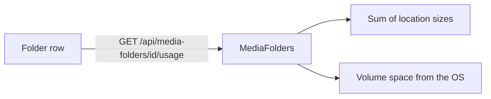

# Media folder usage

Each row of Settings, `Media folders`, shows the free and total space of the
volume holding the folder and the size of the videos indexed below it, so the
owner can see that a disk is running out
([`internal/app/media_folders.go`](../../internal/app/media_folders.go),
[`MediaFolderUsage.tsx`](../../web/src/settings/MediaFolderUsage.tsx)).

The diagram shows how one row's values are read.

## Usage is read per row, on demand

The list loads first and each row then asks for its own usage; nothing reads
the volumes in the background or pushes changes. A slow or unreachable volume
delays only its own row, and the values are as fresh as the moment the
owner opened the page, which is enough to notice a filling disk.

| Rejected | Why |
| --- | --- |
| Usage fields on `GET /api/media-folders` | One unreachable volume would hold up the whole list and every caller of it |
| A periodic disk check with a warning | The owner asked only to see the values when looking, not to be alerted |

## An unreadable volume omits the disk values

The server waits a few seconds for the volume and then answers without `disk`;
the row shows `Disk space unavailable` and its other actions stay usable. The
OS call cannot be cancelled, so a hung network volume keeps one goroutine
until the OS gives up, which the timeout keeps off the request path.

## The sizes are what the OS and the index report

Free space is the space this process's user can still write, as `df` and
Explorer show it, and folders on the same volume show the same values. The
video size sums every indexed file location below the folder, each once, so a
duplicate copy counts again, as it does on the disk; files that are not
indexed videos are not counted.
