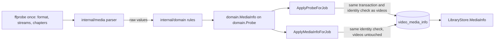

# Media information from the import probe

The import's single `ffprobe` run also reads the video stream's details, every
audio and subtitle track, the embedded tags and the chapters, and stores them
as one versioned JSON row per video in `video_media_info`
([`internal/media/probe_media.go`](../../internal/media/probe_media.go),
[`internal/domain/media_info.go`](../../internal/domain/media_info.go),
[`internal/store/media_info.go`](../../internal/store/media_info.go)).
Background: [research.md](../../specs/056-media-info/research.md).

The diagram shows where each part of the value is read, decided and stored.

## One run reads everything, and a TS file is read longer

`media.Probe` adds `-show_chapters` to the import run, and for a `.ts`,
`.m2ts` or `.mts` file `-analyzeduration 30M -probesize 100M`.

Process start dominates the cost of a probe, so every item comes from the run
that already reads the index values. `ffprobe` stops analysing a TS at 5
seconds or 5 MB by default and misses an audio or caption stream that starts
later in a broadcast recording; an MP4 or MKV lists its streams in the header,
so the longer limits would only slow it down. The request-time probe of live
transcoding keeps the default limits so a transcode does not wait for them.

| Rejected | Why |
| --- | --- |
| A second `ffprobe` per item | A library of 10,000 videos would start 10,000 more processes |
| The longer limits for every container | They change nothing for a container with a header |

## The parser reads, the domain decides

The parser in `internal/media` copies `ffprobe` values per group (video,
tracks, embedded tags, chapters), and pure functions in `internal/domain`
classify and clean them.

| Item | Rule |
| --- | --- |
| HDR kind | Dolby Vision (a `DOVI configuration record` or a `dvh1`, `dvhe`, `dvav`, `dva1`, `dav1` codec tag), else HDR10 (`smpte2084`), else HLG (`arib-std-b67`), else SDR |
| Interlacing | `tt`, `bb`, `tb`, `bt` are interlaced, `progressive` is not; `unknown` is omitted |
| Bit depth | `bits_per_raw_sample`, else the depth in `pix_fmt` (`yuv420p10le` is 10) |
| Strings | Invalid UTF-8 and control characters other than newline removed, trimmed, cut at 2,000 characters; empty is omitted |
| Counts | At most 64 audio tracks, 64 subtitle tracks and 1,000 chapters |
| Recording time | RFC 3339 with or without an offset (Apple's `+0900` included) or `YYYY-MM-DD HH:MM:SS`; an offset is kept, no offset is UTC |
| Location | ISO 6709 in degrees, degrees and minutes, or degrees, minutes and seconds, with an optional altitude; outside ±90 or ±180 is omitted |
| Chapters | Sorted by start; a start at or past the duration is dropped; the end is cut to the duration and to at least the start; overlaps are kept |

A value that does not parse is omitted and never fails the probe; only a
missing duration fails it. A tag value whose JSON type differs from what the
parser expects is skipped rather than failing the whole output. Keeping the
rules out of the parser lets each case be a unit test without a process.

## One versioned row per video

The probe job writes `video_media_info` in the `ApplyProbeForJob`
transaction, under the identity check that guards the `videos` update, and a
row whose `version` differs from `domain.MediaInfoVersion` reads as absent.

A file replaced during the probe therefore leaves no row of the old file, and
deleting the video deletes its row. Nothing else reads the value, so one JSON
row costs one lookup by `video_id`, and a shape change bumps the version
instead of adding a migration. The table is a rebuildable index
([Data and recovery](../how-to/running-vv.md#data-and-recovery)).

| Rejected | Why |
| --- | --- |
| Columns on `videos` | About 30 nullable columns read by every list query |
| Tables per item (streams, chapters, tags) | No query joins or filters on them |

## Videos imported earlier are read again by a `metadata` job

A `metadata` job runs the same `media.Probe` for a video that was probed
before the row existed, and writes only the row through
`ApplyMediaInfoForJob`
([`internal/app/ingest.go`](../../internal/app/ingest.go), `Metadata`).
Migration `00051_metadata_jobs.sql` queues one for every video whose probe is
done and that has a location under a registered folder, and a scan queues one
for a video whose row is missing or below `domain.MediaInfoVersion`
(`IndexedVideo.MediaInfoMissing`). A new import gets none, because its probe
job writes the row.

| Rule | Why |
| --- | --- |
| Claimed only while no `probe` job is queued or running for a video with a registered location (`JobClaimCondition.NoClaimableProbe`) | A new import's stages go first, and the two workers never read the disk at the same time; the `metadata` worker is woken when a probe job leaves `running` |
| The same identity check as the probe job (job location id, version and path, content key, location generation); a failed check writes nothing and completes the job | A file replaced during the run never gets the old file's row; the scan that finds the new file queues it again |
| The index columns, playability and the live-transcode probe are not written | A failure or a changed parser cannot hide playback or the seek preview |
| A failure at the attempt limit keeps the row and records `metadata_failed` only for a video in the latest scan's set | The backfill of an old library is not a scan, so it does not turn the last scan partial; the next scan queues the job again |

A finished job sends the `video` notification, so an open video page refetches
and shows the new information.

| Rejected | Why |
| --- | --- |
| Re-queueing the `probe` job | A probe failure at the limit marks the video `failed`, which hides playback |
| A backfill goroutine at startup | No record of what was tried, and a restart starts over |
