# Media information from the import probe

The import's single `ffprobe` run also reads the video stream's details, every
audio and subtitle track, the container, the embedded tags and the chapters,
and stores them as one versioned JSON row per video in `video_media_info`
([`internal/media/probe_media.go`](../../internal/media/probe_media.go),
[`internal/domain/media_info.go`](../../internal/domain/media_info.go),
[`internal/store/media_info.go`](../../internal/store/media_info.go)).

The diagram shows where each part of the value is read, decided and stored.

```mermaid
flowchart LR
  ffprobe[ffprobe once: format, streams, chapters] --> parser[internal/media parser]
  parser -->|raw values| rules[internal/domain rules]
  rules --> info[domain.MediaInfo on domain.Probe]
  info --> apply[ApplyProbeForJob]
  apply -->|same transaction and identity check as videos| row[(video_media_info)]
  row --> read[LibraryStore.MediaInfo]
  read --> detail["GET /api/videos/{id} mediaInfo"]
```

The items beyond what the video page shows are kept so that versions, wasted
space, audio sync and playback problems can be told apart
([Items for comparing files](#items-for-comparing-files)).

Only the video detail carries the value, for the owner and a guest of a public
video alike; list items, related videos and the owner's `PUT` responses omit
it ([`internal/httpapi/video_media_info.go`](../../internal/httpapi/video_media_info.go)).
The video page draws it as groups under the technical line
([`MediaInfoGroups.tsx`](../../web/src/player/MediaInfoGroups.tsx)).

## One run reads everything, and a TS file is read longer

`media.Probe` adds `-show_chapters` to the import run, and for a `.ts`,
`.m2ts` or `.mts` file `-analyzeduration 30M -probesize 100M`.

Process start dominates the cost of a probe, so every item comes from the run
that already reads the index values. `ffprobe` stops analysing a TS at 5
seconds or 5 MB by default and misses an audio or caption stream that starts
later in a broadcast recording; an MP4 or MKV lists its streams in the header,
so the longer limits would only slow it down. The request-time probe of live
transcoding keeps the default limits so a transcode does not wait for them.

| Rejected | Why |
| --- | --- |
| A second `ffprobe` per item | A library of 10,000 videos would start 10,000 more processes |
| The longer limits for every container | They change nothing for a container with a header |

The one exception is AV1 film grain. AV1 declares it only in the sequence
header, and `ffprobe` reports it only after decoding a frame
(`-analyze_frames`), so for an AV1 file alone `media.Probe` runs a second
`ffprobe` that decodes the first frame of the first video stream
(`-select_streams v:0 -analyze_frames -export_side_data film_grain
-read_intervals %+#1`). A failure, or an `ffprobe` without
`-analyze_frames`, leaves the item unknown.

| Rejected | Why |
| --- | --- |
| `-analyze_frames` in the import run | It decodes frames of every file to answer an AV1-only question |
| Parsing the AV1 sequence header from `-show_data` | The dump also prints every attachment's bytes, a whole font for each Matroska font |

## A TS recording's station and programme come from its SI

After `ffprobe`, `media.Probe` reads the first 32 MiB of a `.ts`, `.m2ts` or
`.mts` file in Go under its own 10-second deadline
([`internal/media/ts_si.go`](../../internal/media/ts_si.go)) and fills
`Broadcast` from the SI tables. `ffprobe` cannot supply these names: it
decodes the DVB character tables, not ARIB STD-B24, and does not parse the
EIT.

| Item | Source |
| --- | --- |
| Packets | 188-byte packets, 192-byte packets with a 4-byte prefix (`.m2ts`) and 204-byte packets, found by repeated sync bytes |
| Station | The service name in the SDT for the PAT's first programme |
| Programme | The EIT present or following event that overlaps the recording, from the TOT or TDT time to that time plus the duration, the longest; a tie goes to the following event ([`domain.SelectBroadcastProgram`](../../internal/domain/media_broadcast.go)) |
| Characters | The ARIB STD-B24 8-bit decoder in [`internal/media/arib`](../../internal/media/arib/arib.go): JIS X 0208 through `golang.org/x/text`, the kana and JIS X 0201 sets, and the additional symbols of rows 85 to 94 from a table of their Unicode 5.2 code points; size, colour and position controls are ignored and an unmapped character is dropped |

Reading stops once the station, both events and a time are found. A read
error or the deadline omits the names and never fails the probe. The names
are decoded only when the original network ID is a Japanese network and the
events are tagged `jpn`, so a DVB recording, or a TS that `ffmpeg` wrote with
its default SDT and no EIT, has no `Broadcast`.

## The parser reads, the domain decides

The parser in `internal/media` copies `ffprobe` values per group (video,
tracks, embedded tags, chapters), and pure functions in `internal/domain`
classify and clean them.

| Item | Rule |
| --- | --- |
| HDR kind | Dolby Vision (a `DOVI configuration record` or a `dvh1`, `dvhe`, `dvav`, `dva1`, `dav1` codec tag), else HDR10 (`smpte2084`), else HLG (`arib-std-b67`), else SDR |
| Interlacing | `tt`, `bb`, `tb`, `bt` are interlaced, `progressive` is not; `unknown` is omitted |
| Bit depth | `bits_per_raw_sample`, else the depth in `pix_fmt` (`yuv420p10le` is 10) |
| Strings | Invalid UTF-8 and control characters other than newline removed, trimmed, cut at 2,000 characters; empty is omitted |
| Counts | At most 64 audio tracks, 64 subtitle tracks and 1,000 chapters |
| Recording time | RFC 3339 with or without an offset (Apple's `+0900` included) or `YYYY-MM-DD HH:MM:SS`; an offset is kept, no offset is UTC |
| Location | ISO 6709 in degrees, degrees and minutes, or degrees, minutes and seconds, with an optional altitude; outside ±90 or ±180 is omitted |
| Chapters | Sorted by start; a start at or past the duration is dropped; the end is cut to the duration and to at least the start; overlaps are kept |

| Chroma subsampling | From `pix_fmt`: `yuv420*`, `nv12`, `p010` are 4:2:0, `yuv422*` 4:2:2, `yuv444*` and RGB 4:4:4, `gray` 4:0:0 |
| Colour range | `tv` is limited, `pc` is full, anything else is omitted |
| Codec tag, vendor | An absent fourcc (`[0][0][0][0]`) is omitted |
| Variable frame rate | Estimated from the header: `avg_frame_rate` differs from `r_frame_rate` by more than 1%; omitted when either is unknown. Only reading every frame's timestamp can tell for certain |
| Mirroring | A negative determinant of the display matrix; a vertical flip is a mirror with a 180° rotation |
| Multiple layers | The `multilayer` disposition, more than one HEVC `view_ids_available`, or an HEVC enhancement-layer configuration |
| Track roles | The dispositions `dub`, `original`, `comment`, `visual_impaired`, `hearing_impaired`, `karaoke`, `lyrics`, `clean_effects`, `captions`, `descriptions` |
| Stream times | `start_time` and `duration` in milliseconds, or Matroska's `DURATION` tag |
| Size breakdown | See [Items for comparing files](#items-for-comparing-files) |
| Encryption | An encryption side data record, a Matroska `enc_key_id` tag or an `encv`/`enca` codec tag |

A value that does not parse is omitted and never fails the probe; only a
missing duration fails it. A tag value whose JSON type differs from what the
parser expects is skipped rather than failing the whole output. Keeping the
rules out of the parser lets each case be a unit test without a process.

## One versioned row per video

The probe job writes `video_media_info` in the `ApplyProbeForJob`
transaction, under the identity check that guards the `videos` update. A row
of a newer `version` than `domain.MediaInfoVersion` reads as absent, and an
older one as what it holds.

A file replaced during the probe therefore leaves no row of the old file, and
deleting the video deletes its row. Nothing else reads the value, so one JSON
row costs one lookup by `video_id`, and a shape change bumps the version
instead of adding a migration. The table is a rebuildable index
([Data and recovery](../how-to/running-vv.md#data-and-recovery)).

| Rejected | Why |
| --- | --- |
| Columns on `videos` | About 30 nullable columns read by every list query |
| Tables per item (streams, chapters, tags) | No query joins or filters on them |

## Items for comparing files

These items are stored for comparisons the page does not draw yet.

| Question | Items |
| --- | --- |
| Does the audio start late or drift? | Each stream's `startMs` and `durationMs`, and the container's `startMs` |
| Is a file large without being better? | The size breakdown, and `bitsPerPixel`: the video bit rate per pixel per frame |
| Why does it not play? | Profile, level, pixel format, colour range, codec tag and codec string, encryption, multiple layers |
| What is the track for? | Track roles and the audio service type |
| What made the file? | Each stream's encoder, handler, vendor, creation time and timecode; the MP4 brands; the embedded encoder and source URL |

The size breakdown sums each kind of stream from Matroska's exact
`NUMBER_OF_BYTES` tag, else its bit rate over its duration (or the file's).
A kind is omitted unless every stream of it is known, and the remainder
(container overhead, attachments, data streams, cover art) only when video,
audio and subtitles all are and their sum does not exceed the file. A guess
is never stored: a Matroska file without statistics tags has no breakdown.

## Videos imported earlier are read again in the background

Bump `domain.MediaInfoVersion` when the parser adds items. A row of an older
version still reads as what it holds, so the page keeps its groups. At each
startup the `queue_media_info` job queues a backfill-class `media_info` job per
probed video without a row of this version
([process lifecycle](process-lifecycle.md#backfills-run-as-jobs-after-the-listener-opens),
[`internal/app/media_info_backfill.go`](../../internal/app/media_info_backfill.go)).
Each job runs the import's `ffprobe` through `media.ProbeMediaInfo` within the
disk's read slots and writes only `video_media_info`; the video's other probe
results and its import jobs are untouched. A video with a probe job queued or
running is left to the import.

`IngestStore.SaveMediaInfoProbe` writes under the job identity check and only
when the file still has the indexed size and modification time, so a file
replaced during the read never stores the old file's values. A read that fails
keeps the stored row and records the file's stamp in
`video_media_info_failures`, and the file is not read again until it changes
or the version is bumped. A bump may add fields but must not change what an
existing field means, since older rows stay readable.

| Rejected | Why |
| --- | --- |
| Reading an older row as absent | Every video would lose its groups until its turn in the re-read |
| Queueing probe jobs | A probe job rewrites playability, thumbnails' inputs and activity, and competes with imports |

Migration `00052_metadata_jobs.sql` stays unchanged because databases already
applied it; `00053_drop_metadata_jobs.sql` deletes the `metadata` jobs and
`metadata_failed` issues that `00052` queued.
