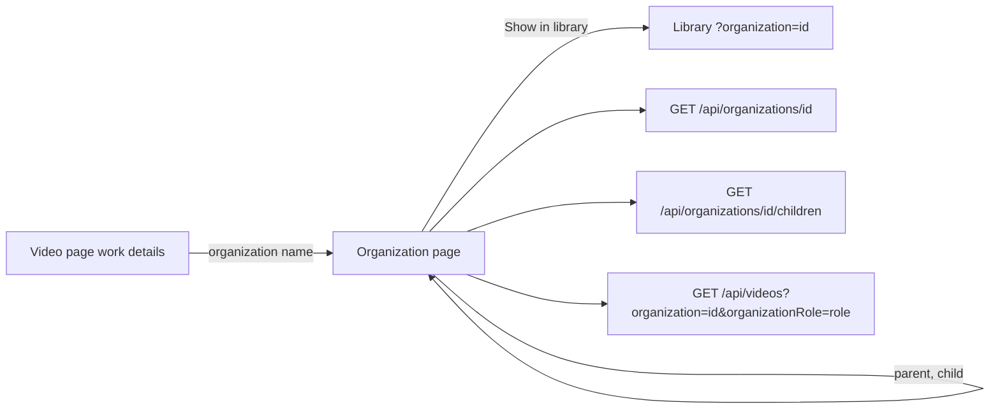

# Organizations: the organization page

Each organization has a page of its own at `/organizations/:id` that leads with
its logo and profile, then its parent and children, then its videos by role.
The page lives in [`web/src/credits/organization/`](../../web/src/credits/organization/);
the profile, logo and favorite it shows are stored as
[people.md](people.md#organizations-share-the-profile-image-and-favorite-shapes)
describes.

The diagram shows what the page reads and where its links go.

## The page is the person page with a logo

`/organizations/:id` is a `ProfilePage`
([design-system.md](design-system.md#page-patterns)) built from the person
page's parts, so an owner who knows `/people/:id` finds each region and action
in the same place. The spread holds the logo (`OrganizationLogo profile`); the
display name, the other names, the bio and the actions (`Edit`,
`Show in library`); and a card with `Founded`, `Dissolved`, `Location`, the
links and the external IDs. An organization without any profile shows
`No profile yet.` with `Edit`. The page is owner-only, as every organization
read is.

The logo is drawn whole in its frame and never cropped, because most logos are
wide wordmarks that a crop leaves unreadable. The identity has no row of key
figures: no number of an organization outranks its dates, which read aligned in
the facts card.

| Rejected | Why |
| --- | --- |
| A side panel beside the organizations list | The details come first, and a page has a URL to return to |
| Copying the person page for organizations | The heading, bio, facts card, shelves and states are the same rules; the page shares them with the person page |

## The family is one shelf of links

The parent and the children form one `Shelf`, `Related organizations`, between
the profile and the videos, whose body is one `FactList`: `Parent organization`
links to the parent's page, and `Child organizations` links to each child in
name order, folding those past 12 behind `+N more`. The children come from
`GET /api/organizations/{id}/children`, read once per page load. A row without
a value is left out, and an organization with neither has no family shelf. A
failed children read shows its reason with `Retry` in its row and keeps the
rest of the page.

| Rejected | Why |
| --- | --- |
| Logo cards for the parent and each child | A card row for one parent pushes the videos down by a card's height |
| A tree of the whole family | The page shows one level up and one down; each link opens the next level |

## Videos are one shelf per role

The videos follow as one `Shelf` per role with videos, `Maker` then `Label`,
each reading `GET /api/videos?organization={id}&organizationRole={role}` in the
library's default order and loading more as its end comes into view, as the
person page's shelves do
([people.md](people.md#the-person-page)). A read without the role decides
the loading, failed and empty blocks for the whole list, so an organization
without videos shows one `No videos yet`. Unlike the person page, a role whose
first read fails keeps its shelf heading and shows the failure with `Retry`,
so a failed role never reads as a role without videos.

| Rejected | Why |
| --- | --- |
| One grid with a role switch | It hides that an organization is both maker and label |
| A link per role to the library | The library has no role filter in its URL; `Show in library` opens every video in any role |

## A missing organization turns the page into its gone state

A `404 organization_not_found` without a `field` on the page's own read or on
the children read means the organization no longer exists, and the whole page
becomes `This organization no longer exists` with `Back to organizations`. The
same answer with a `field` is about another organization named in a request,
and stays that request's failure.

## The video page opens the organization page

In the video page's work details, each organization name is a text link to its
page, named `Open {name}`, in the colours, row height and three-name fold it
had as a library filter link. The library filtered by the organization is one
press further, through `Show in library`.
