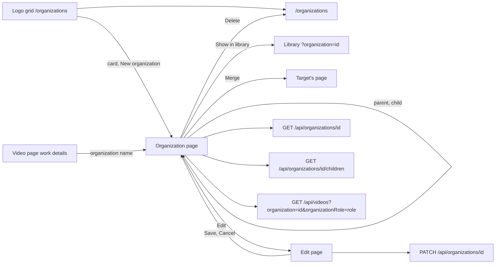

# Organizations: the logo grid, the organization page and the edit page

`/organizations` is a grid of logo cards, in
[`web/src/credits/organizations/`](../../web/src/credits/organizations/). Each
organization has a page of its own at `/organizations/:id` that leads with
its logo and profile, then its parent and children, then its videos by role,
and an edit page at `/organizations/:id/edit`. Both live in [`web/src/credits/organization/`](../../web/src/credits/organization/);
the profile, logo and favorite they show are stored as
[people.md](people.md#organizations-share-the-profile-image-and-favorite-shapes)
describes.

The diagram shows what the pages read and where their links go.

## The list is the people grid with logo cards

`/organizations` is the people grid
([people.md](people.md#the-people-grid)) with a logo in each card's frame: the
search, the sort and `Favorites only` in the top bar, `New organization` in the
header, and the cards read from `GET /api/organizations` 100 at a time, the
next page asked for when the end of the grid comes into view. The sorts are
`Name`, `Video count` and `Date created`. `q`, `sort` and `favorite=true` stay
in the URL, and the sort is also remembered per browser. `New organization`
asks for the name in the people grid's dialog and opens the new organization's
page.

A card is one link to the organization page with the logo frame, the name on
one line and `{n} videos`; the favorite heart over the frame's corner is its
only control. The frame is landscape and draws the logo whole
(`OrganizationLogo card`), because most logos are wide wordmarks. Without a
logo the frame shows the display name on up to three lines: logos are added by
hand, so most cards have none, and one icon on each would not tell them apart.
Other names and the parent are on the organization page, not on the card.

The two grids are one component, `CreditGridPage`, given each kind's fetch,
URL conditions, card and words; the people grid adds its age sorts, its `Name`
filter and the unnamed-people empty state.

| Rejected | Why |
| --- | --- |
| Keeping the admin table with its details dialog | Every action now has a place on the organization page or the edit page, and a card leads with the logo |
| Square cards as dense as the face grid | A wide wordmark in a face-sized square is a few pixels tall |
| Copying the people grid for organizations | The paging, URL conditions, states and creation are the same rules for both kinds |

## The page is the person page with a logo

`/organizations/:id` is a `ProfilePage`
([design-system.md](design-system.md#page-patterns)) built from the person
page's parts, so an owner who knows `/people/:id` finds each region and action
in the same place. The spread holds the logo (`OrganizationLogo profile`); the
display name, the other names, the bio and the actions (`Edit`,
`Show in library`, `More actions`); and a card with `Founded`, `Dissolved`, `Location`, the
links and the external IDs. An organization without any profile shows
`No profile yet.` with `Edit`. The page is owner-only, as every organization
read is.

The logo is drawn whole in its frame and never cropped, because most logos are
wide wordmarks that a crop leaves unreadable. The identity has no row of key
figures: no number of an organization outranks its dates, which read aligned in
the facts card.

| Rejected | Why |
| --- | --- |
| A side panel beside the logo grid | The details come first, and a page has a URL to return to |
| Copying the person page for organizations | The heading, bio, facts card, shelves and states are the same rules; the page shares them with the person page |

## The family is one shelf of links

The parent and the children form one `Shelf`, `Related organizations`, between
the profile and the videos, whose body is one `FactList`: `Parent organization`
links to the parent's page, and `Child organizations` links to each child in
name order, folding those past 12 behind `+N more`. The children come from
`GET /api/organizations/{id}/children`, read once per page load. A row without
a value is left out, and an organization with neither has no family shelf. A
failed children read shows its reason with `Retry` in its row and keeps the
rest of the page.

| Rejected | Why |
| --- | --- |
| Logo cards for the parent and each child | A card row for one parent pushes the videos down by a card's height |
| A tree of the whole family | The page shows one level up and one down; each link opens the next level |

## Videos are one shelf per role

The videos follow as one `Shelf` per role with videos, `Maker` then `Label`,
each reading `GET /api/videos?organization={id}&organizationRole={role}` in the
library's default order and loading more as its end comes into view, as the
person page's shelves do
([people.md](people.md#the-person-page)). A read without the role decides
the loading, failed and empty blocks for the whole list, so an organization
without videos shows one `No videos yet`. Unlike the person page, a role whose
first read fails keeps its shelf heading and shows the failure with `Retry`,
so a failed role never reads as a role without videos.

| Rejected | Why |
| --- | --- |
| One grid with a role switch | It hides that an organization is both maker and label |
| A link per role to the library | The library has no role filter in its URL; `Show in library` opens every video in any role |

## Actions sit where the person page has them

The favorite heart is on the logo's `top-end` corner and the `Change logo`
menu on its `bottom-end` corner, with `Upload an image…` and, while a logo
exists, `Remove logo`; the placeholder itself is an `Add logo` button. An
uploaded image is saved at once by `PUT /api/organizations/{id}/image`, with
no framing step, because the logo is drawn whole; the frame shows it when the
save answers. `Remove logo` asks first. A failed change keeps the previous logo
and shows `Couldn't change the logo: {reason}` under the frame. The response
replaces only the image revision, so a heart pressed meanwhile keeps its state.

`More actions` holds `Merge into another organization…` and, after a
separator, `Delete`. A merge opens the target's page with
`Merged into "{name}"`, and a delete opens `/organizations` with
`Deleted "{name}"`. A missing organization met by any of these actions turns
the page into its gone state. Both dialogs state the video count that
`GET /api/organizations` sums across connected links by name, because a merge
or delete also changes a link's organization of the same name; the page's own
read counts this node only. The list shows a name once with the first node's
id, so a later link's id finds its entry by name. A remote id's merge or delete
leaves this node's organization of the name as it is, so that organization's
own count is taken out. The person page reads `GET /api/people` the same way.

Every action, the logo, the children and the shelves address the route's id,
as the edit page's save does: a remote organization read by its offset id
answers with the id of this node's organization of its name, and that id would
write or read another record than the one shown.

The page shares these parts with the person page instead of copying them: the
`More actions` menu (`CreditMoreMenu`), the merge and delete dialogs with their
navigation (`useCreditMergeDelete`), and the image removal confirmation and
upload refusal (`CreditImageParts`).

| Rejected | Why |
| --- | --- |
| A `Favorite` button in the actions row | Two pages built from the same parts keep the same action in the same place |
| Framing the logo before it is saved, as a face is | The logo is never cropped, so there is nothing to frame |
| Summing the links' counts in `GET /api/organizations/{id}` | The single read stays this node's record, and the list already joins the links |

## A missing organization turns the page into its gone state

A `404 organization_not_found` without a `field` on the page's own read or on
the children read means the organization no longer exists, and the whole page
becomes `This organization no longer exists` with `Back to organizations`. The
same answer with a `field` is about another organization named in a request,
and stays that request's failure.

## The edit page is the person edit page with an organization's fields

`/organizations/:id/edit` is a `FormPage` outside the shell, built and left as
the person edit page is ([people.md](people.md#the-edit-page)): the band with
`Edit "{name}"`, `Cancel` and `Save`, `Discard changes?` when leaving with
changes, the return to the organization page, and the first name input focused
on arrival. The aside shows the logo, the display name and the video count, read
only; the logo is changed on the organization page, where it is saved at once.
The left panel, `Profile`, holds `Founded`, `Dissolved`, `Location`, `About`
and `Links`. The right panel, `Names and parent`, holds the sortable names list,
the external IDs and `Parent organization`, a searchable select with `None`
first and every other organization after it.

`Save` sends one `PATCH /api/organizations/{id}` with only the properties that
differ from the organization as loaded, so a change made elsewhere to another
property survives. The `{id}` is the route's: a remote organization read by
its offset id answers with the id of this node's organization of its name, and
saving there would write the profile the form shows onto another record. Both
edit pages share the record's read, the leaving, the
band and this save in
[`web/src/credits/edit/`](../../web/src/credits/edit/), and the mapping of a
refused field to its input in
[`creditEditFields.ts`](../../web/src/credits/creditEditFields.ts).

A refused field shows its reason under its input with every other input kept.
A parent that would make a cycle (`400 organization_parent_cycle`) and a parent
that no longer exists (`404 organization_not_found` with `field: parentId`)
show under `Parent organization`; only the same `404` without a `field` turns
the edit page into the gone state. When the parent candidates cannot be read,
the select stays disabled on the current parent with the reason under it.

A forwarded edit of a remote organization sends the parent as the peer's id
([peer-library.md](peer-library.md)). The candidates join every node's
organizations by name, so a parent shown with this node's id or another link's
goes to the peer's organization of that name. When the peer has none, this node
answers `404 organization_not_found` with `field: parentId` itself, so the
owner picks another parent instead of seeing the organization as gone. The
parent is resolved before a rename reaches the other links. With a rename, by
`name` or `names`, this node also walks the parent's ancestors on the peer and
answers `400 organization_parent_cycle`, or the `404` above when the peer has
lost the parent, itself, so every refusal leaves every node's name as it was.
An edit that keeps the display name renames nothing, so this node's
organization of that name, which is the same joined entry, does not refuse it
as `409 organization_name_taken`.

| Rejected | Why |
| --- | --- |
| Keeping the details dialog | The person edit page already has the band, the discard check and the return |
| Copying the person edit page | The read, leaving and field-wise patch are the same rules for both kinds |
| Editing the logo on the edit page | A logo upload saves at once and has nothing for `Cancel` to discard; the organization page already offers it |

## The video page opens the organization page

In the video page's work details, each organization name is a text link to its
page, named `Open {name}`, in the colours, row height and three-name fold it
had as a library filter link. The library filtered by the organization is one
press further, through `Show in library`.
