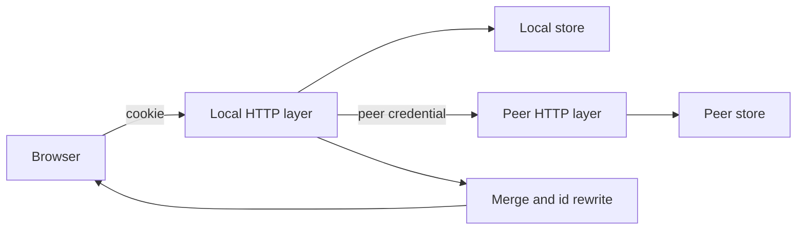
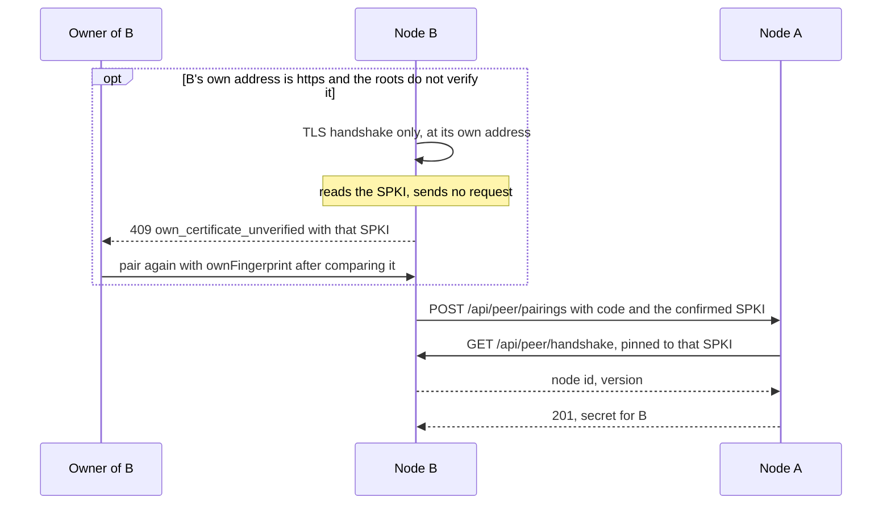
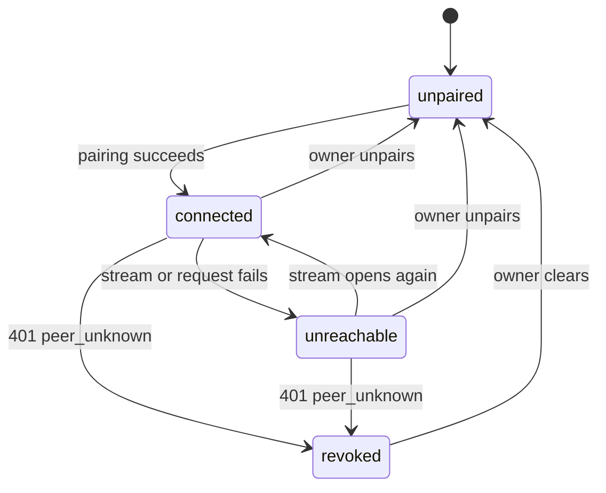
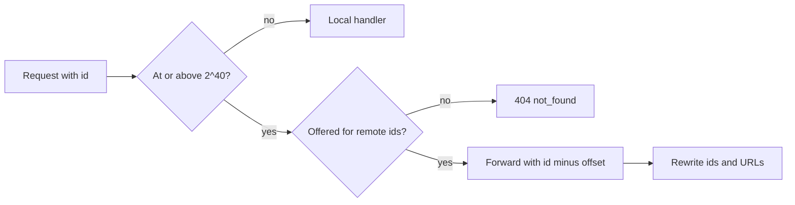

# Paired library: two VVMDMs as one library

A VVMDM paired with one other VVMDM on the LAN (the **peer**) answers its own
screens with the videos, groups and smart folders of both, without copying
anything: it calls the peer's screen API, merges the answer with its own and
returns it in the shapes the screens already read. The pairing use case lives
in `internal/app` (`Pairing`), the HTTP client to the peer in
[`internal/peer`](../../internal/peer), the merge and forwarding in
`internal/httpapi/peer*.go`, and their pure rules in `internal/domain`.

The diagram shows one screen request answered by both nodes.

## Pairing and the peer credential

One pairing action pairs both nodes: node B sends A's pairing code to A, A
calls B back at the address B gave, and each node then holds a secret the
other presents as `Authorization: VV-Peer <secret>` on every request.

### Both nodes behind self-signed HTTPS

The requesting node's owner confirms the certificate of the requester's own
address, and the accepting node pins it, so nothing is confirmed on A. B sits
behind a TLS terminator and cannot read its certificate locally, so it
completes a TLS handshake with the address it announces and closes the
connection without a request. When the system roots do not verify that
certificate, pairing answers `409 own_certificate_unverified` with its SPKI
before A is called, and the page asks the owner to compare it with the
certificate B serves, such as in the browser's certificate viewer for B's
page. Pairing again with `ownFingerprint` equal to the SPKI the address
presents sends it to A as `node.fingerprint`; A pins it for the callback and
stores it as the peer's pin. An `http` address, or a certificate the roots
verify, sends no fingerprint, and A verifies with the roots. B's owner then
confirms A's certificate after `certificate_untrusted`, so both
confirmations happen in turn on B's page.

The owner's comparison is what authenticates B's certificate. B cannot
authenticate it by talking to its own address: an on-path host that
terminates TLS with its own certificate and relays to B answers any request
as B would, node id included, and reads whatever the request carries. A
handshake that sent the pending secret through it would hand that host a
reusable peer credential and make A pin the host's certificate. The probe
therefore sends nothing over the connection, and its SPKI only proposes what
the owner confirms.

| Property | How it holds |
| --- | --- |
| No credential reaches B's own address from B | The probe completes only the TLS handshake; the pending secret travels only to A and back in A's pinned callback |
| A pins only a certificate B's owner confirmed | B sends `node.fingerprint` only when it equals both `ownFingerprint` and the SPKI the address presents now, in the request the code authenticates |
| A failed callback can be repeated | The code stays usable until a pairing succeeds; it still expires after 10 minutes, and success clears it |
| The owner of B can tell which certificate A refused | A's `certificate_untrusted` reaches B's page as `409 peer_unreachable` with the `fingerprint` A saw, which B never offers to trust as A's |
| The accepting node's log names a failed callback | A logs it at warning level with the address and the error |

When B cannot reach its own address, such as behind NAT without
hairpinning, it sends the fingerprint its owner confirmed earlier, or none,
and A verifies with the roots.

| Rejected | Why |
| --- | --- |
| B proving its own address with a pinned handshake | A relaying TLS terminator passes the node-id check and reads the secret the handshake sends |
| A second fingerprint confirmation on A's page | A's owner is not at the screen during a pairing B starts |
| A reading its certificate from local files | A TLS terminator holds the certificate, so the node has no file to read |
| Trusting the callback's certificate on first use | Any host answering at B's address could then pin itself |

The peer reads this node's own `/api/*` operations, so no third contract
drifts from the shapes the screens use. A table in
`internal/httpapi/peer_operations.go` limits the credential to the reads,
media, forwarded edits, operations over a selection, `/api/events` and
`/api/peer/*`; anything else answers `403` with reason `peer_not_allowed`, so
a compromised peer cannot reach media folders, scans, settings, the account
or API tokens. The request's audience is the owner unless
`X-VV-Peer-Audience: guest` lowers it, so the peer filters with the viewer's
audience before paging ([authentication.md](authentication.md)).

| Rule | Reason |
| --- | --- |
| Both nodes run the same release `version`; pairing and every reconnection compare it | The peer reads the screen API, which changes between releases without notice |
| The secret is per direction (`vvp_` plus 32 random bytes), hashed on the receiving node and kept in the `peer` table, not tied to `account_version` | A password change keeps the pairing, while it signs out sessions |
| The pairing code is 8 characters, one per node, valid 10 minutes, cleared by the pairing it completes and kept in memory | A restart ending the code is the wanted behaviour |
| A node has at most one peer; a second pairing answers `409 already_paired` | The owner unpairs first |
| HTTPS verifies with the system roots; on failure the owner confirms the certificate's SPKI fingerprint, which pins it, and the Settings page calls an unpinned certificate untrusted rather than changed | A public certificate rotates every 90 days; a self-signed one is pinned once |
| A forwarded answer keeps its type only for media, subtitles, images, JSON and plain text, and always carries `nosniff` and a sandbox CSP; any other type downloads | The answer is served from this node's origin, where a page from the peer would act with the owner's session |

| Rejected | Why |
| --- | --- |
| A separate peer contract with its own generated client | It would restate about 30 screen operations and drift from them |
| Reusing API tokens | A credential change revokes them |

## Connection state

`app.Pairing` holds the state the Settings page and the notice show, and
publishes a `peer` event on each change; one open `/api/events` stream to the
peer is the liveness signal.

The stream also carries the peer's `video`, `group` and `smartFolder` events,
which arrive here with remote ids so open screens refresh remote items. A
failed stream retries after 5 s, doubling to 60 s, or at once when the peer
presents its credential at the handshake: the node that accepted a pairing
connects before the requesting node has stored it, and that node's first
handshake after storing it wakes the retry. `unreachable` names a
reason (`network`, `version` or `certificate`). Moving from `connected` to
`unreachable`, and into `connected`, logs one info line with the reason and
error; each failed retry logs at debug level. While the peer is not
`connected`, reads skip it without a request and answer with the local part,
so a list never waits 10 s per page for a stopped peer. A `401 peer_unknown`
from the peer, which an unpaired or wiped peer answers alike, first clears the
stored hash of the peer's secret and then moves to `revoked`. The state is in
memory: a start begins `unreachable` until the stream opens, or `revoked` when
the hash is cleared.

## Remote ids

An entity of the peer is addressed by its id plus `2^40`
([`internal/domain/remote_id.go`](../../internal/domain/remote_id.go)), and a
request whose path id carries the offset is forwarded to the peer with the
ids of the answer rewritten.

Every path parameter and generated type is `int64`, and `2^40` stays below
JavaScript's safe integer, so the screens change no route or type. Answers are
decoded into the operation's generated type and rewritten by one table
(`internal/httpapi/peer_rewrite.go`), because only the type says whether an
`id` names a video or a tag. Media operations are proxied as byte streams
with `Range` and the caching headers passed through, since the browser has no
session on the peer.

| Case | Behaviour |
| --- | --- |
| Videos, groups, smart folders, media-folder roots | Always the offset form |
| Tags, tag kinds, people, organizations | The same-named local entity's id, else the offset form |
| `open`, `progress`, favorites, playlists, history, `auto-tag`, `probe`, activity | `404 not_found`; a remote `Video` carries no `progress` or `favorite` |
| Forwarded write | The peer's status, `code` and `reason` |
| Peer lost during a forwarded request | `503` with reason `peer_unreachable`; the peer's write committed or did not |

## Merged lists

The video, library and folder lists merge the local page and the peer's page
in the request's order, and one composite cursor holds a cursor for each side.

A list answered to a peer carries `peerItems`, the cursor after each item and
its sort value, so the merge never decodes the peer's opaque cursor and a
video added between pages shifts nothing. Items compare by the sort value
both nodes compute with the same rule, then by id. `total` is the sum of both
totals.

| Case | Behaviour |
| --- | --- |
| Filter by a local tag, kind, person or organization | Sent to the peer by name; a name the peer lacks makes its part empty |
| `favorite=true`, `played*` and `favorited*` sorts | Local favorites and history only; remote items follow the local ones |
| Peer skipped while unreachable | That listing keeps skipping it to the end; a reload shows the peer again |
| The same file on both nodes | Two items |

## Vocabulary by name

Tags, tag kinds, people and organizations with the same name are one entity
on the screens; their lists merge both nodes' entries in memory with summed
counts, and a remote-only entry carries the offset.

A rename, merge or deletion of a tag, person or organization checks the
conflict on both nodes, then writes the peer by name
(`POST /api/peer/vocabulary`), then the local node; while the peer is not
`connected` it answers `409` with reason `peer_unreachable`. Writing the peer
first leaves nothing changed in the common failure. Synonyms, kinds of a tag,
tentative state, rejected names, images and links stay per node.

| Rejected | Why |
| --- | --- |
| A node column or a cache of the peer's vocabulary | Pairing would change local data, and a cache goes stale |
| Applying locally and replaying later | A replay queue needs its own conflict handling |

## Collections

Groups belong to one node: a remote group is listed and opened with the
offset, and a group, `organize` operation or bundle with videos of both nodes
answers `400` with reason `mixed_nodes`. A smart folder of either node lists
its own node's matches plus the other node's videos matching its rule, sent as
name filters and merged by the folder's sort; its card adds the other node's
counts from one `POST /api/peer/rule-counts`. A rule with `favorite` matches
local favorites only. `POST /api/collections/delete` runs one transaction per
node and reports the peer's ids it could not delete.

## Related videos

The related list of any video ranks both nodes' videos with the scorer of
[related-videos.md](related-videos.md): the node holding the open video
supplies its clues, each node scores its own candidates
(`POST /api/peer/related`), and the two score-ordered pages merge by score,
`addedAt` and id. The same-directory clue is 0 across nodes, since two disks
share no directory.

## Edits of remote videos

An operation over a selection splits its targets by node, applies the local
part in one transaction, then the remote part in one request, and answers
`remote` with the applied count and the ids the peer did not change. Tags,
people and organizations go to the peer by name and are created there when
missing; a provisional person with a remote target answers `400` with reason
`provisional_person_remote`. Two databases have no shared transaction, so
the local part stays applied when the peer fails.

A single edit of a remote video is forwarded by its id. Its details editor
sends a person or organization new to the screen as `{"name": ...}` instead
of creating it here first, and the forwarding finds or creates it on the peer
by that name, so this node gains no row; a local video's save refuses a credit
by name with `400`. Confirming or
rejecting a tentative tag goes to the peer, which ran the auto-tagging, with
the tag id turned into the peer's by name; a tag the peer lacks answers
`404`. A favorites-only read of a remote media folder lists nothing, as a
merged list does.

## The screens

`web/src/lib/remoteId.ts` decides from the id whether an item is remote, and
cards, rows, collection pages and the video page show the peer's name as the
mark, so no schema gains a `remote` field. The shell shows a notice from
`GET /api/peer` and the `peer` event while the peer is paired but not
connected; guests see the state without the name. Favorite, playlist,
open-in-app, progress and activity actions are hidden for remote items, since
the server does not offer them; the selection bar also hides `Fill info…` for
a selection with remote items, because plugin fetches run on the local node.
