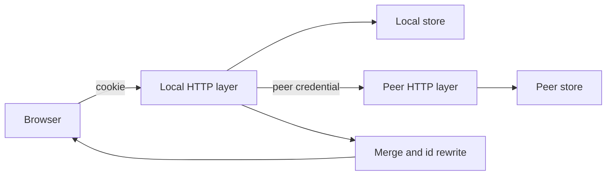
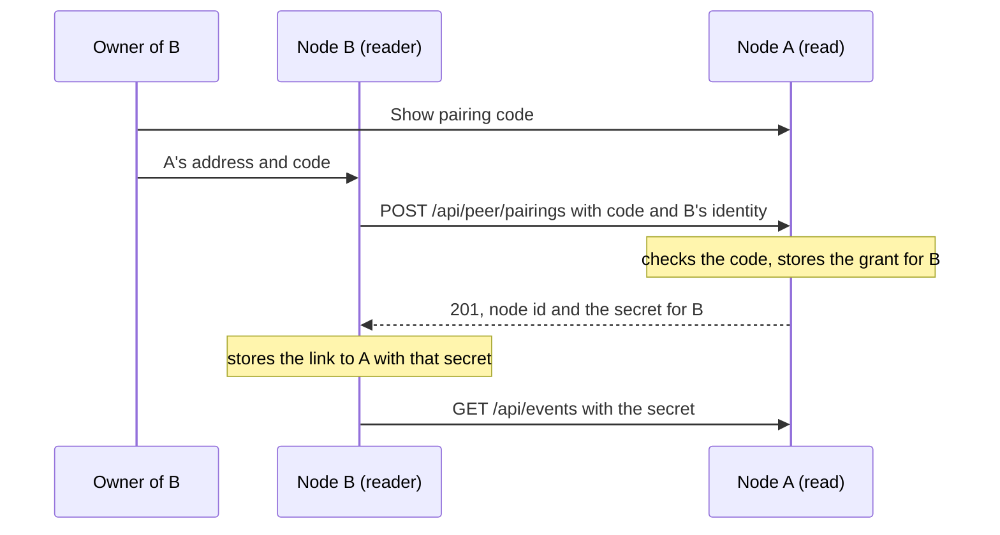
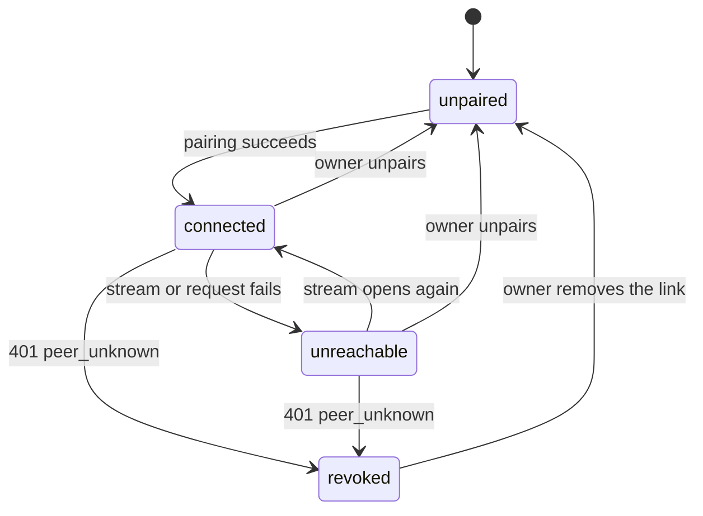
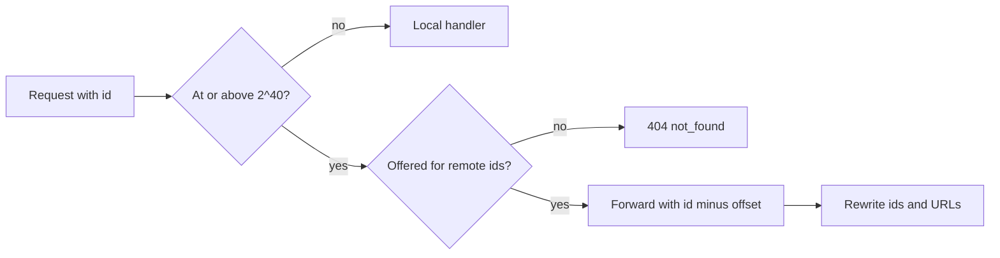
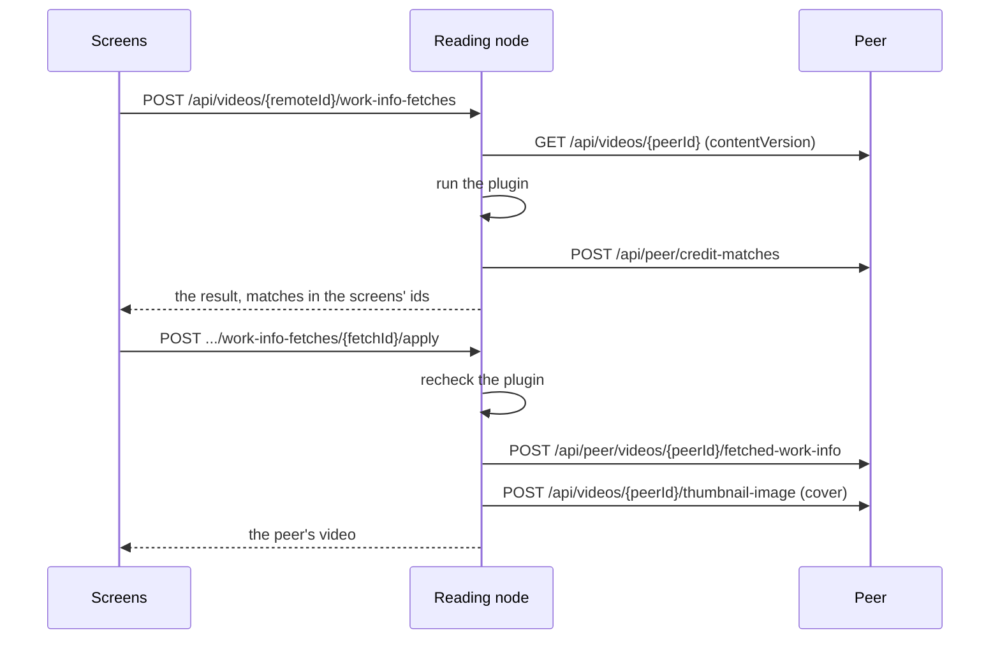
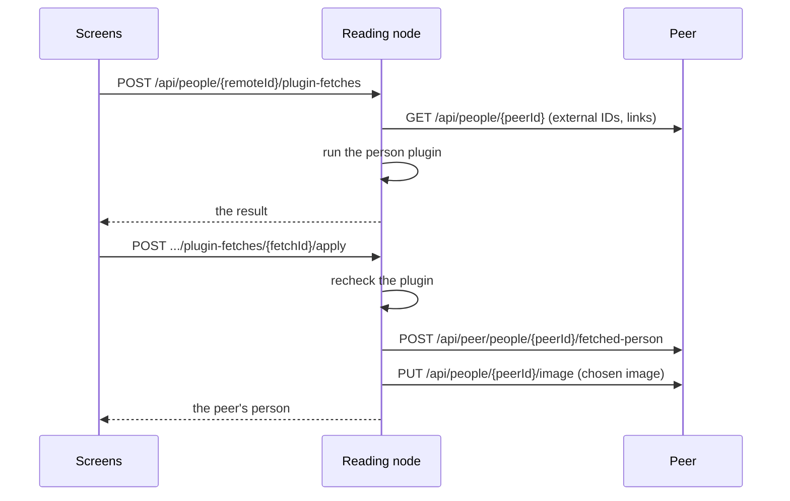

# Paired library: reading another VVMDM

A VVMDM paired with one other VVMDM on the LAN (the **peer**, the node it
reads) answers its own screens with the videos, groups and smart folders of
both, without copying anything: it calls the peer's screen API, merges the
answer with its own and returns it in the shapes the screens already read. The
pairing use case lives in `internal/app` (`Pairing`), the HTTP client to the
peer in [`internal/peer`](../../internal/peer), the merge and forwarding in
`internal/httpapi/peer*.go`, and their pure rules in `internal/domain`.

The diagram shows one screen request answered by both nodes.

## Pairing and the peer credential

Pairing is one-directional: node B sends A's pairing code to A, A stores a
grant that lets B read A and answers with the secret B presents from then on
as `Authorization: VV-Peer <secret>`, and B stores the link. A never connects
to B, so B needs no address of its own and no inbound reachability. Each node
holds at most one **link** (the node it reads) and at most one **grant** (the
node that reads it); the two are independent rows, created and removed on
their own, and may name the same node.

| Decision | Reason |
| --- | --- |
| One pairing grants one direction; a mutual library is two pairings, one from each side | The owner of a node that only reads, such as a laptop running `task dev` on `127.0.0.1`, cannot be reached by the other node; a pairing that needed both directions failed for them with "could not reach this one" |
| A never calls B back, and the request carries no address or secret of B's | The callback existed only to give A credentials for reading B and to prove B's address; with one direction neither is needed, and the reader's own certificate needs no confirmation |
| The link and the grant are separate rows (`peer_link`, `peer_grant`) with their own removal | Removing one direction leaves the other intact, so a node that is both read and reading keeps what the owner did not remove |
| Migration `00083` turns a mutual `peer` row into a link and a grant to the same node | Nobody is silently unpaired by the upgrade; a row the peer had revoked keeps only a revoked link, since its reader no longer holds a valid secret |
| B's owner confirms A's certificate after `certificate_untrusted`, and B pins it | This is the only certificate anyone needs to trust: the reader's own is never presented to anyone |

| Rejected | Why |
| --- | --- |
| Keeping the mutual pairing and letting the owner skip the callback | Both nodes would still hold a link and reconnect to each other, so the unreachable side stayed `unreachable` forever |
| One row with both directions as nullable columns | Removing a direction would leave half rows whose meaning the code had to infer |
| Letting the read node show the reader's library through the grant | The grant is the reader's credential on the read node; the read node holds nothing it could present to the reader |

The reader reads the read node's own `/api/*` operations, so no third contract
drifts from the shapes the screens use. A table in
`internal/httpapi/peer_operations.go` limits the credential to the reads,
media, forwarded edits, operations over a selection, `/api/events` and
`/api/peer/*`; anything else answers `403` with reason `peer_not_allowed`, so
a compromised reader cannot reach media folders, scans, settings, the account
or API tokens. The request's audience is the owner unless
`X-VV-Peer-Audience: guest` lowers it, so the read node filters with the
viewer's audience before paging ([authentication.md](authentication.md)).

| Rule | Reason |
| --- | --- |
| Versions are not compared; pairing, the handshake and every reconnection carry the release `version` only so the Pairing page shows the peer's | `version` is a build label (the commit SHA in the CI image, `dev` in a local or untagged build), so two builds of the same source differ in it, and a gate on it refused them |
| The secret is per grant (`vvp_` plus 32 random bytes), hashed on the read node and kept in `peer_grant`, in plain text in the reader's `peer_link`, not tied to `account_version` | A password change keeps the pairing, while it signs out sessions |
| The pairing code is 8 characters, one per node, valid 10 minutes, cleared by the pairing it completes and kept in memory | A restart ending the code is the wanted behaviour |
| A node reads at most one node and is read by at most one; a second link or grant answers `409 already_paired`, and so does the code of a node that is already read | The owner removes the pairing or the access first |
| HTTPS verifies with the system roots; on failure the owner confirms the certificate's SPKI fingerprint, which pins it, and the Settings page calls an unpinned certificate untrusted rather than changed | A public certificate rotates every 90 days; a self-signed one is pinned once |
| A forwarded answer keeps its type only for media, subtitles, images, JSON and plain text, and always carries `nosniff` and a sandbox CSP; any other type downloads | The answer is served from this node's origin, where a page from the peer would act with the owner's session |

| Rejected | Why |
| --- | --- |
| A separate peer contract with its own generated client | It would restate about 30 screen operations and drift from them |
| Reusing API tokens | A credential change revokes them |
| Refusing a peer whose `version`, or a hash of the API definition, differs | A label refuses identical code, and a hash refuses the whole library over one changed operation; the owner compares the versions the Pairing page shows instead |

### Mixed versions

Each node serves the screen API of its own release, so a request the other
release does not know fails like any other failed peer request: the list or
operation skips or reports the peer's part, and the connection stays up. For
example, peer request bodies reject unknown fields, so a peer older than
`openVideoId` answers `400 invalid_request` to `POST /api/peer/related`, and
the related list leaves out that peer's videos
([related-videos.md](related-videos.md)). A read node that still pairs
mutually answers the one-way pairing request with `400 invalid_request`, which
the reader reports as an older build to update. Owners keep both nodes on the
same release; the Pairing page shows the peer's version next to its name.

## Connection state

`app.Pairing` holds the link's state the Settings page and the notice show,
and publishes a `peer` event on each change of the link's state or of the
grant; one open `/api/events` stream to the peer is the liveness signal. The
read node has no connection of its own: it serves the reader's requests and
shows the grant.

The stream also carries the peer's `video`, `group` and `smartFolder` events,
which arrive here with remote ids so open screens refresh remote items. A
failed stream retries after 5 s, doubling to 60 s, or at once after pairing,
an address change or a certificate confirmation. `unreachable` names a
reason (`network` or `certificate`); an address that answers the handshake
with another node id gives `network`. Moving from `connected` to
`unreachable`, and into `connected`, logs one info line with the reason and
error; each failed retry logs at debug level. While the peer is not
`connected`, reads skip it without a request and answer with the local part,
so a list never waits 10 s per page for a stopped peer. A `401 peer_unknown`
from the peer, which a node that withdrew the access or was wiped answers
alike, marks the link revoked in the store and moves to `revoked`. The state
is in memory: a start begins `unreachable` until the stream opens, or
`revoked` when the link is marked so.

Unpairing on the reader stops the stream, tells the peer best effort
(`DELETE /api/peer/pairings/{nodeId}` with the credential, which drops the
grant) and deletes the link. Withdrawing the access on the read node deletes
the grant and cancels the reader's requests in flight; the reader learns it
from its next request's `401`.

## Remote ids

An entity of the peer is addressed by its id plus `2^40`
([`internal/domain/remote_id.go`](../../internal/domain/remote_id.go)), and a
request whose path id carries the offset is forwarded to the peer with the
ids of the answer rewritten.

Every path parameter and generated type is `int64`, and `2^40` stays below
JavaScript's safe integer, so the screens change no route or type. Answers are
decoded into the operation's generated type and rewritten by one table
(`internal/httpapi/peer_rewrite.go`), because only the type says whether an
`id` names a video or a tag. Media operations are proxied as byte streams
with `Range` and the caching headers passed through, since the browser has no
session on the peer.

| Case | Behaviour |
| --- | --- |
| Videos, groups, smart folders, media-folder roots | Always the offset form |
| Tags, tag kinds, people, organizations | The same-named local entity's id, else the offset form |
| `open`, `progress`, favorites, playlists, history, `auto-tag`, `probe`, activity | `404 not_found`; a remote `Video` carries no `progress` or `favorite` |
| Forwarded write | The peer's status, `code` and `reason` |
| Peer lost during a forwarded request | `503` with reason `peer_unreachable`; the peer's write committed or did not |

## Merged lists

The video, library and folder lists merge the local page and the peer's page
in the request's order, and one composite cursor holds a cursor for each side.

A list answered to a peer carries `peerItems`, the cursor after each item and
its sort value, so the merge never decodes the peer's opaque cursor and a
video added between pages shifts nothing. Items compare by the sort value
both nodes compute with the same rule, then by id. `total` is the sum of both
totals.

| Case | Behaviour |
| --- | --- |
| Filter by a local tag, kind, person or organization | Sent to the peer by name; a name the peer lacks makes its part empty |
| `favorite=true`, `played*` and `favorited*` sorts | Local favorites and history only; remote items follow the local ones |
| Peer skipped while unreachable | That listing keeps skipping it to the end; a reload shows the peer again |
| The same file on both nodes | Two items |

## Vocabulary by name

Tags, tag kinds, people and organizations with the same name are one entity
on the screens; their lists merge both nodes' entries in memory with summed
counts, and a remote-only entry carries the offset.

A rename, merge or deletion of a tag, person or organization on the reader
checks the conflict on both nodes, then writes the peer by name
(`POST /api/peer/vocabulary`), then the local node; while the peer is not
`connected` it answers `409` with reason `peer_unreachable`. Writing the peer
first leaves nothing changed in the common failure. The read node never
writes the reader: the same change made there changes that node alone.
Synonyms, kinds of a tag, tentative state, rejected names, images and links
stay per node.

| Rejected | Why |
| --- | --- |
| A node column or a cache of the peer's vocabulary | Pairing would change local data, and a cache goes stale |
| Applying locally and replaying later | A replay queue needs its own conflict handling |

## Collections

Groups belong to one node: a remote group is listed and opened with the
offset, and a group, `organize` operation or bundle with videos of both nodes
answers `400` with reason `mixed_nodes`. A smart folder of either node lists
its own node's matches plus the other node's videos matching its rule, sent as
name filters and merged by the folder's sort; its card adds the other node's
counts from one `POST /api/peer/rule-counts`. A rule with `favorite` matches
local favorites only. `POST /api/collections/delete` runs one transaction per
node and reports the peer's ids it could not delete.

## Related videos

The related list of any video ranks both nodes' videos with the scorer of
[related-videos.md](related-videos.md): the node holding the open video
supplies its clues, each node scores its own candidates
(`POST /api/peer/related`), and the two score-ordered pages merge by score,
`addedAt` and id. The same-directory clue is 0 across nodes, since two disks
share no directory. When the peer holds the open video, the ranking request
names it by the peer's id (`openVideoId`), and the peer gives its videos in
that video's directory the folder points, as its own related list does.

## Edits of remote videos

An operation over a selection splits its targets by node, applies the local
part in one transaction, then the remote part in one request, and answers
`remote` with the applied count and the ids the peer did not change. Tags,
people and organizations go to the peer by name and are created there when
missing; a provisional person with a remote target answers `400` with reason
`provisional_person_remote`. Two databases have no shared transaction, so
the local part stays applied when the peer fails.

A single edit of a remote video is forwarded by its id. Its details editor
sends a person or organization new to the screen as `{"name": ...}` instead
of creating it here first, and the forwarding finds or creates it on the peer
by that name, so this node gains no row; a local video's save refuses a credit
by name with `400`. Confirming or
rejecting a tentative tag goes to the peer, which ran the auto-tagging, with
the tag id turned into the peer's by name; a tag the peer lacks answers
`404`. A favorites-only read of a remote media folder lists nothing, as a
merged list does.

### Work information fetched for a remote video

A work-info fetch for a remote video runs on the reading node, because the
plugins and their kept results are that node's. Only the parts that belong to
the video are sent to the peer.

| Decision | Reason |
| --- | --- |
| The fetch, the apply and the reads of kept covers and person images for a remote id are answered by the reading node, not forwarded | The plugin and the kept result exist only there |
| The peer matches the fetched credits and returns its own ids, which the reading node joins by name as it joins the video's credits | A match shown as `onVideo` must name the same id as the video's credits |
| The peer applies the chosen values with its own apply, in one transaction: the title, tags as tentative assignments, the detail fields merged into its stored work information with credits rematched, and the same-person merges | The result is the same as an apply of the peer's own fetch, including the fields the owner left unchosen |
| The reading node rechecks its plugin before sending, and the peer skips its plugin check | The peer has no copy of the plugin |
| The peer refuses the apply with `404` when the video's `contentVersion` has changed since the fetch | A reused id must not receive another video's values, as a local apply checks the content key |
| The cover goes to the peer as a thumbnail upload, which is forwarded like the other single edits | The page frames a cover and uploads it the same way for both nodes |
| No person face is sent, and the apply reports no linked people | The people are registered on the peer, whose own face recognition finds their faces; no interface to write a face across nodes is needed |
| The reading node keeps no activity entry for the fetch | Its activity log holds its own videos |

### A person fetched for a remote person

A person page fetch for a remote person, such as one the peer created when it
applied a remote video's fetch, runs on the reading node in the same way. The
peer gives the person and writes the chosen values and the face.

| Decision | Reason |
| --- | --- |
| The fetch, the apply and the reads of kept images for a remote id are answered by the reading node, not forwarded | The plugin and the kept result exist only there |
| The fetch picks its key from the peer's stored external IDs and links | The person page fetches the same person whichever node holds it |
| The peer applies the chosen items with its own person page apply, in one transaction, and skips the plugin check | The result is the same as an apply of the peer's own fetch, and the peer has no copy of the plugin |
| The chosen image goes to the peer as a face upload | The owner picked this face on the person page, unlike the work-info apply's faces, which the peer's face recognition finds |

`Fill info…` over a selection with remote items lists its targets on both
nodes: `POST /api/work-info-fill-targets` resolves this node's part and asks
the peer for its part, which it answers in remote ids after this node's.
The dialog then fetches for and applies to each remote target like a remote
video's page, so a fill writes the peer's empty fields with the peer's own
apply.

## The screens

`web/src/lib/remoteId.ts` decides from the id whether an item is remote, and
cards, rows, collection pages and the video page show the peer's name as the
mark, so no schema gains a `remote` field. The shell shows a notice from
`GET /api/peer` and the `peer` event while a link exists but is not
connected; guests see the state without the name. The Pairing page has two
sections that follow the same state: "Read another VVMDM" holds the pairing
form until a link exists, then the link's state, address, certificate and
removal; "VVMDMs that read this one" shows the pairing code until a grant
exists, then the reader's name, pairing time and "Remove access". Favorite, playlist,
open-in-app, progress and activity actions are hidden for remote items, since
the server does not offer them. The selection bar offers `Fill info…` for any
selection, as
[Work information fetched for a remote video](#work-information-fetched-for-a-remote-video)
explains.
