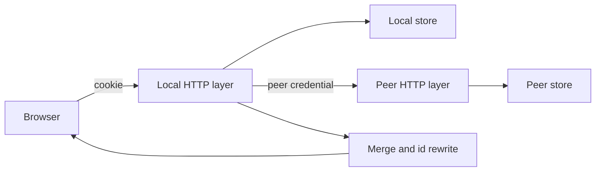
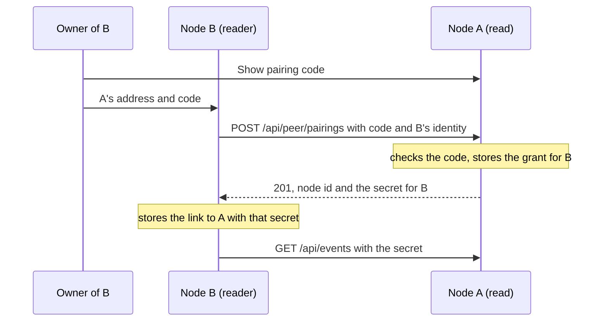
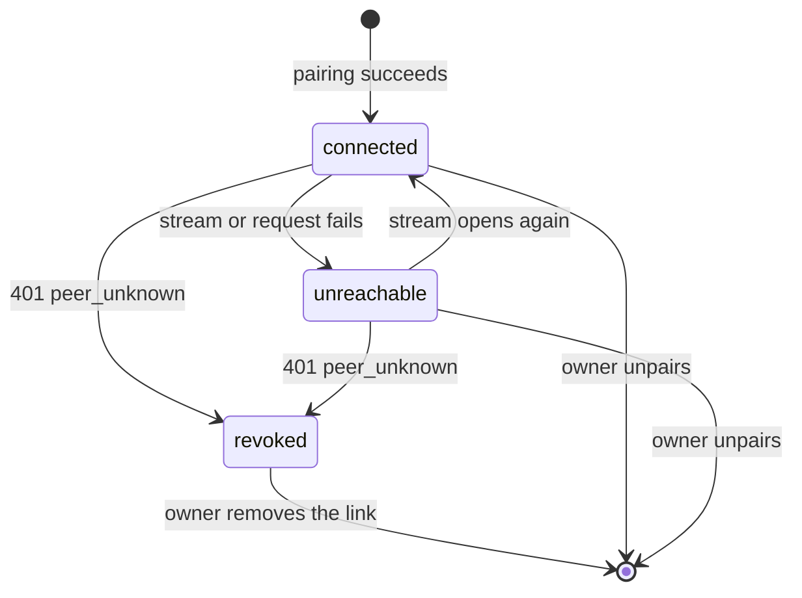
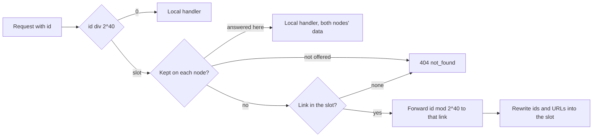
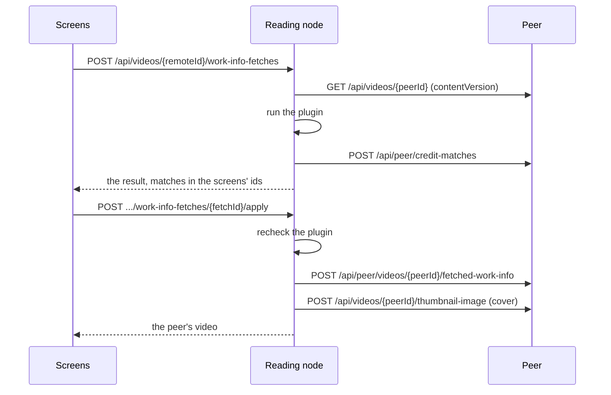
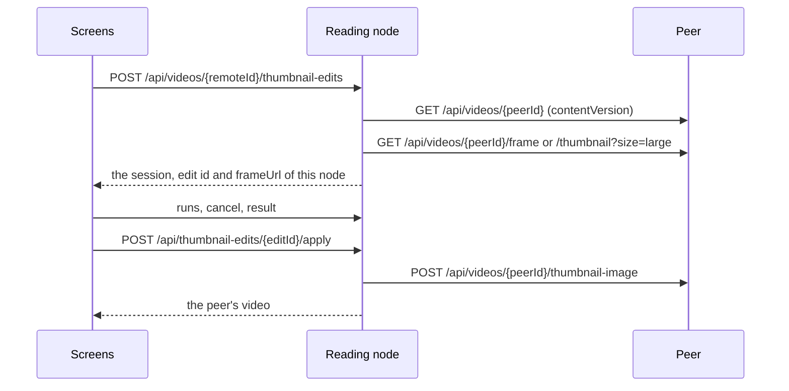
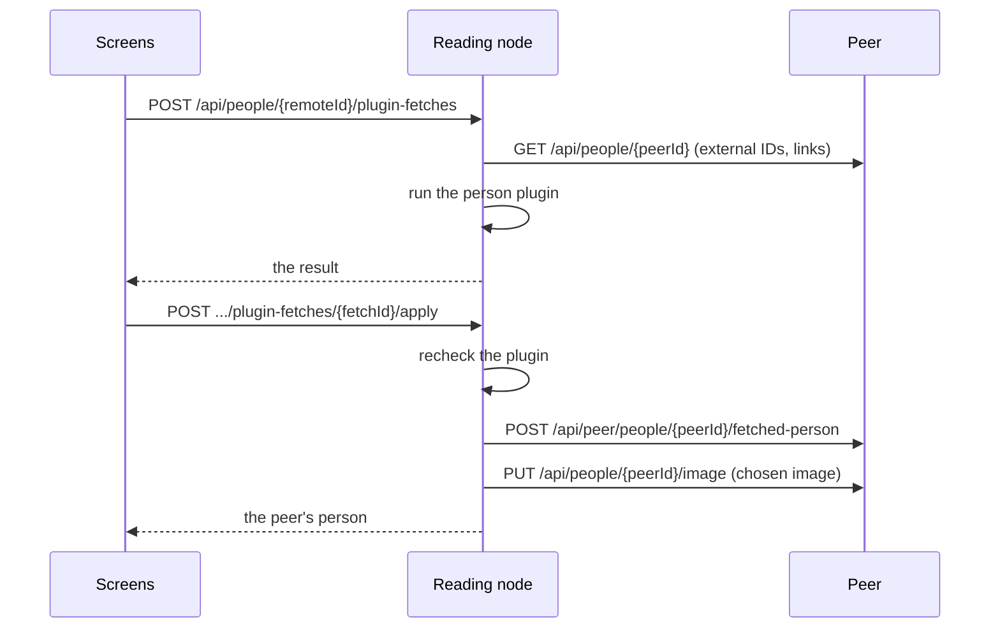

# Paired library: reading another VVMDM

A VVMDM paired with other VVMDMs on the LAN (each a **peer**, a node it
reads through a **link**) answers its own screens with the videos, groups and
smart folders of all of them, without copying anything: it calls each peer's
screen API, merges the answers with its own and returns them in the shapes the
screens already read. The
pairing use case lives in `internal/app` (`Pairing`), the HTTP client to the
peer in [`internal/peer`](../../internal/peer), the merge and forwarding in
`internal/httpapi/peer*.go`, and their pure rules in `internal/domain`.

The diagram shows one screen request answered by both nodes.

## Pairing and the peer credential

Pairing is one-directional: node B sends A's pairing code to A, A stores a
grant that lets B read A and answers with the secret B presents from then on
as `Authorization: VV-Peer <secret>`, and B stores the link. A never connects
to B, so B needs no address of its own and no inbound reachability. Each node
holds up to 8 **links** (the nodes it reads) and at most one **grant** (the
node that reads it); links and the grant are independent rows, created and
removed on their own, and may name the same node.

| Decision | Reason |
| --- | --- |
| One pairing grants one direction; a mutual library is two pairings, one from each side | The owner of a node that only reads, such as a laptop running `task dev` on `127.0.0.1`, cannot be reached by the other node; a pairing that needed both directions failed for them with "could not reach this one" |
| A never calls B back, and the request carries no address or secret of B's | The callback existed only to give A credentials for reading B and to prove B's address; with one direction neither is needed, and the reader's own certificate needs no confirmation |
| The link and the grant are separate rows (`peer_link`, `peer_grant`) with their own removal | Removing one direction leaves the other intact, so a node that is both read and reading keeps what the owner did not remove |
| Migration `00083` turns a mutual `peer` row into a link and a grant to the same node | Nobody is silently unpaired by the upgrade; a row the peer had revoked keeps only a revoked link, since its reader no longer holds a valid secret |
| B's owner confirms A's certificate after `certificate_untrusted`, and B pins it | This is the only certificate anyone needs to trust: the reader's own is never presented to anyone |

| Rejected | Why |
| --- | --- |
| Keeping the mutual pairing and letting the owner skip the callback | Both nodes would still hold a link and reconnect to each other, so the unreachable side stayed `unreachable` forever |
| One row with both directions as nullable columns | Removing a direction would leave half rows whose meaning the code had to infer |
| Letting the read node show the reader's library through the grant | The grant is the reader's credential on the read node; the read node holds nothing it could present to the reader |

The reader reads the read node's own `/api/*` operations, so no third contract
drifts from the shapes the screens use. The credential reaches an allow-list
(`internal/httpapi/peer_operations.go`): the entity operations the
[remote boundary](#remote-ids) forwards or calls on the peer, which it derives
from the same table, plus a short list of lists, creations, operations over a
selection, favorites, watch history, `/api/events` and `/api/peer/*`. Anything else answers `403` with
reason `peer_not_allowed`, so a compromised reader cannot reach media folders,
scans, settings, the account, API tokens, playlists or activity; a test fails
when the list reaches one of them. The request's audience is the owner unless
`X-VV-Peer-Audience: guest` lowers it, so the read node filters with the
viewer's audience before paging ([authentication.md](authentication.md)).

| Rule | Reason |
| --- | --- |
| Versions are not compared; pairing, the handshake and every reconnection carry the release `version` only so the Pairing page shows the peer's | `version` is a build label (the commit SHA in the CI image, `dev` in a local or untagged build), so two builds of the same source differ in it, and a gate on it refused them |
| The secret is per grant (`vvp_` plus 32 random bytes), hashed on the read node and kept in `peer_grant`, in plain text in the reader's `peer_link`, not tied to `account_version` | A password change keeps the pairing, while it signs out sessions |
| The pairing code is 8 characters, one per node, valid 10 minutes, cleared by the pairing it completes and kept in memory | A restart ending the code is the wanted behaviour |
| A node reads up to 8 nodes and is read by at most one. A ninth link answers `409 peer_limit` before the other node is asked; a node already read, a second grant and the code of a node that is already read answer `409 already_paired` | Each merged page asks every link once within one response timeout; the owner removes a pairing or the access first |
| `domain.CheckNewLink` holds the limit and the same-node refusal, and `PeerStore.AddLink` checks it again over the links its transaction reads | Two pairings at once cannot pass the limit or read one node twice |
| A link refused after the other node answered asks that node to drop the grant it gave (`DELETE /api/peer/pairings/{nodeId}`) | The node id is known only from the answer, and a grant nobody holds would block that node's next pairing |
| HTTPS verifies with the system roots; on failure the owner confirms the certificate's SPKI fingerprint, which pins it, and the Settings page calls an unpinned certificate untrusted rather than changed | A public certificate rotates every 90 days; a self-signed one is pinned once |
| A forwarded answer keeps its type only for media, subtitles, images, JSON and plain text, and always carries `nosniff` and a sandbox CSP; any other type downloads | The answer is served from this node's origin, where a page from the peer would act with the owner's session |

| Rejected | Why |
| --- | --- |
| A separate peer contract with its own generated client | It would restate about 30 screen operations and drift from them |
| Reusing API tokens | A credential change revokes them |
| Refusing a peer whose `version`, or a hash of the API definition, differs | A label refuses identical code, and a hash refuses the whole library over one changed operation; the owner compares the versions the Pairing page shows instead |

### Mixed versions

Each node serves the screen API of its own release, so a request the other
release does not know fails like any other failed peer request: the list or
operation skips or reports the peer's part, and the connection stays up. For
example, peer request bodies reject unknown fields, so a peer older than
`openVideoId` answers `400 invalid_request` to `POST /api/peer/related`, and
the related list leaves out that peer's videos
([related-videos.md](related-videos.md)). A read node that still pairs
mutually answers the one-way pairing request with `400 invalid_request`, which
the reader reports as an older build to update. Owners keep both nodes on the
same release; the Pairing page shows the peer's version next to its name.

## Connection state

`app.Pairing` holds each link's state the Settings page and the notice show,
and publishes a `peer` event, which carries the whole `PeerState`, on each
change of any link's state or of the grant. Each link has its own connection
loop, state, generation and stop function, and one open `/api/events` stream
to its node is that link's liveness signal, so one link's failures and retry
delays never reach another. The read node has no connection of its own: it
serves the reader's requests and shows the grant.

`GET /api/peer` lists the links in slot order; a link that is not there is not
listed, so there is no `unpaired` state. The stream also carries the peer's
`video`, `group` and `smartFolder` events, which arrive here with the ids of
that link's slot so open screens refresh its items. A
failed stream retries after 5 s, doubling to 60 s, or at once after pairing,
an address change or a certificate confirmation. `unreachable` names a
reason (`network` or `certificate`); an address that answers the handshake
with another node id gives `network`. Moving from `connected` to
`unreachable`, and into `connected`, logs one info line with the reason and
error; each failed retry logs at debug level. While the peer is not
`connected`, reads skip it without a request and answer with the local part,
so a list never waits 10 s per page for a stopped peer. A `401 peer_unknown`
from the peer, which a node that withdrew the access or was wiped answers
alike, marks the link revoked in the store and moves to `revoked`. The state
is in memory: a start begins `unreachable` until the stream opens, or
`revoked` when the link is marked so.

Unpairing one link on the reader (`DELETE /api/peer/links/{nodeId}`) stops its
stream, tells its node best effort (`DELETE /api/peer/pairings/{nodeId}` with
the credential, which drops the grant) and deletes that link alone; the address
and certificate operations name the link by its node id the same way. Withdrawing the access on the read node deletes
the grant and cancels the reader's requests in flight; the reader learns it
from its next request's `401`.

## Remote ids

An entity of a link is addressed by its id plus the link's slot times `2^40`
([`internal/domain/remote_id.go`](../../internal/domain/remote_id.go)), and a
request whose path id carries an offset is forwarded to the link of that slot
with the ids of the answer rewritten into the same slot.

| Decision | Why |
| --- | --- |
| `PeerStore.AddLink` takes the slot from the `peer.next_slot` counter in the same transaction and never gives a slot twice; the link upgraded from one link keeps slot 1 | A bookmarked remote id cannot open another node's entity after an unpairing and a new pairing; `2^53` admits slots up to 8191 |
| The Forwarder and every call to a link take that link's slot; the slot of a request's path id goes with the request to the translators and the kept handlers | Every call reaches the one link the ids name |
| A body or query naming ids of two links, or of this node and a link, answers `400 mixed_nodes`; ids of another link in a forwarded query are dropped | A write must never send one link's ids to another, where they name other entities |
| The undo token of a link's organize carries its slot (`peer.{slot}.{token}`) | The undo is forwarded to the link that issued it |
| An id a link answers outside `0` to `2^40 - 1` becomes that link's id `0`, which names nothing | A faulty or hostile link cannot answer an id that carries into another slot and address another link's entity |
| A face move from a local person, the undo of a move to it, goes to the link of its appearance ids | The local person's path names no link |

Every operation whose path starts with an entity collection
(`/api/videos/{id}`, `/api/groups/{id}`, `/api/tags/{id}`,
`/api/tag-kinds/{id}`, `/api/people/{id}`, `/api/organizations/{id}`,
`/api/face-appearances/{id}`, `/api/virtual-videos/{id}`) is offered for a
remote id by default. The boundary
(`internal/httpapi/peer_boundary.go`) is built at start from the operation
table that `task generate` emits from `api/openapi.yaml`; one Go table names
the operations kept on each node, with the reason, and whether this node
answers them itself. A new operation under a collection is therefore forwarded
with no change, and a peer on an older release answers one it does not know
with its own `404`, which passes through ([Mixed versions](#mixed-versions)).

Every path parameter and generated type is `int64`, and every slot's ids stay
below JavaScript's safe integer, so the screens change no route or type. Answers are
decoded into the generated type their response schema names and rewritten by
the rewriter registered under that name, because only the type says whether an
`id` names a video or a tag; a schema without ids is registered as kept as it
is. Request bodies are translated by their request schema and path parameters
after the entity id by their name. A test fails when an entity operation is
neither forwarded nor kept, when a forwarded JSON answer has no rewriter, or
when a body's id field or a path parameter has no translator; such an
operation answers `404` until one is added, rather than forwarding wrong ids.
Media operations are proxied as byte streams with `Range` and the caching
headers passed through, since the browser has no session on the peer.

| Case | Behaviour |
| --- | --- |
| Videos, groups, smart folders, group items, media-folder roots | Always the offset form, both ways |
| Tags, tag kinds, people, organizations | The same-named local entity's id, else the offset form; a local id in a request goes to the peer's same-named entity, else `404` |
| A body naming this node's video or item, or another link's, with a remote path id | `400 invalid_request` with reason `mixed_nodes` |
| `open`, `auto-tag`, `probe` | Kept: `404 not_found` |
| Related videos, work-info and person plugin fetches, thumbnail edits, vocabulary deletes and merges | Kept: answered here from both nodes, as the sections below describe |
| A remote video's `progress` and `favorite`, a remote group's or smart folder's watch values and `favorite`, a remote person's `favorite` | The peer's, kept by the rewrite ([Progress, history and favorites](#progress-history-and-favorites)) |
| Playlists, activity | Not entity collections; they stay with each node |
| A remote video's or person's faces | Read and edited on the peer, crops included; people join by name, a face move's target is created on the peer when it lacks the name, and a candidate it lacks is `404` |
| A face move of the peer's appearances from a local person, as the undo of a move to that person sends | Forwarded from the peer's person of that name, `404` when the peer lacks the name |
| A face edit of a remote person naming this node's appearance | `400 invalid_request` with reason `mixed_nodes`; a similar-people read ignores this node's appearances |
| Forwarded write | The peer's status, `code` and `reason` |
| Peer lost during a forwarded request | `503` with reason `peer_unreachable`; the peer's write committed or did not |

## Merged lists

The video, library, folder-root and smart-folder lists, the watch history and
the related videos merge the local part and one part per link, in slot order.
The parts of one page are requested concurrently, so a page waits for its
slowest link within the 10 s response timeout instead of the sum of the links.
One composite cursor (prefix `m2.`) holds a cursor, a done flag and a skipped
flag for each side by slot; a cursor of the one-peer form (`m1.`) is refused as
`invalid_cursor` like any cursor of another list, which restarts the list. A
list filter by a link's entity matches no local video and nothing on the other
links. The vocabulary lists and writes, the group picker and the history clear
reach the first link, and an operation over a selection reaches the one link
its remote ids name, or the first link when they name none.

A list answered to a peer carries `peerItems`, the cursor after each item and
its sort value, so the merge never decodes a link's opaque cursor and a video
added between pages shifts nothing. Items compare by the sort value every node
computes with the same rule; on equal values the local item comes first, then
the links in slot order. `total` is the sum of every part's total.

| Case | Behaviour |
| --- | --- |
| Filter by a local tag, kind, person or organization | Sent to each link by name; a name a link lacks makes its part empty |
| Link not `connected` when a listing starts | Not asked; that listing leaves it out to the end, so the page does not wait for it |
| Link fails during a listing | That listing skips it to the end; a reload shows it again |
| Link paired or connected during a listing | The listing does not hold it and leaves it out; a reload shows it |
| The same file on two nodes | Two items |

| Rejected | Why |
| --- | --- |
| A pairwise merge repeated per link | It needs each intermediate result's full page and loses the per-side cursors |
| Requesting the links one after another | A page would wait up to the response timeout per link |
| Extending `m1.` with optional fields | An `m1.` cursor names a peer without saying which link it was |

## Progress, history and favorites

A remote video's playback position, history and favorite live on the node
holding the video, because they are keyed by its content key there
([ARCHITECTURE.md](../../ARCHITECTURE.md#cross-cutting-invariants)); the
reading node forwards and merges them, and keeps no row of its own for them.

| Operation | Behaviour |
| --- | --- |
| `PUT /api/videos/{remoteId}/progress` | Forwarded; the position and history entry are saved on the peer, whose `Progress` is answered as it is |
| `PUT /api/favorites` | Ids split by node; the peer's part is sent first as one request in the peer's ids, then this node's part is applied in one transaction, and the `applied*` counts are summed |
| `GET /api/watch-history` | The pages of this node and every link merged by `playedAt`, newest first, this node's entry first on equal times and then the links in slot order, with one composite cursor; a link's entry ids carry its offset |
| `GET /api/watch-history/dates` | The union of the days of this node and every connected link |
| `DELETE /api/watch-history` | The peer's history is cleared first, then this node's, since the screens show one history |
| `DELETE /api/watch-history/{remoteId}` | Deleted on the peer |

A peer answer to the history list carries `peerItems`, the cursor after each
entry and its `playedAt` in Unix milliseconds, so the merge reuses the
[Merged lists](#merged-lists) rule and never decodes the peer's cursor. A link
that does not answer the list or the dates is left out, as in a merged list.

Writing the peer first repeats the vocabulary rule: while the peer is not
connected, or when it refuses, the write answers `503` with reason
`peer_unreachable` or the peer's error, and neither node changes. When the
peer gives no answer, this node is unchanged and the peer's write committed or
did not. A change of a remote item never stays on this node alone, so the two
nodes never need reconciling.

| Rejected | Why |
| --- | --- |
| Storing a remote video's position or favorite on the node that played it | Each node would show its own; the screens show one library |
| Storing on both nodes and reconciling | A replay queue needs its own conflict handling, as for vocabulary |

## Vocabulary by name

Tags, tag kinds, people and organizations with the same name are one entity
on the screens; their lists merge both nodes' entries in memory with summed
counts, and a remote-only entry carries the offset.

A rename, merge or deletion of a tag, person or organization on the reader
checks the conflict on both nodes, then writes the peer by name
(`POST /api/peer/vocabulary`), then the local node; while the peer is not
`connected` it answers `409` with reason `peer_unreachable`. Writing the peer
first leaves nothing changed in the common failure. A merge whose destination
and sources are all in the offset form names no entry of the reader, so it
goes to the peer's merge by id; that is how the undo of a face split merges
back the peer's provisional person, which has no name to send. The read node never
writes the reader: the same change made there changes that node alone.
Synonyms, kinds of a tag, tentative state, rejected names, images and links
stay per node.

| Rejected | Why |
| --- | --- |
| A node column or a cache of the peer's vocabulary | Pairing would change local data, and a cache goes stale |
| Applying locally and replaying later | A replay queue needs its own conflict handling |

## Collections

Groups belong to one node: a remote group is listed and opened with the
offset, and a group, `organize` operation or bundle with videos of both nodes
answers `400` with reason `mixed_nodes`. A smart folder of any node lists its
own node's matches plus the videos of this node and every other link matching
its rule, sent as name filters and merged by the folder's sort; its card adds
the other nodes' counts, one `POST /api/peer/rule-counts` per connected link
sent concurrently. `POST /api/collections/delete` runs one transaction per
node and reports the peer's ids it could not delete.

## Related videos

The related list of any video ranks the videos of this node and every
connected link with the scorer of [related-videos.md](related-videos.md): the
node holding the open video supplies its clues, each node scores its own
candidates (`POST /api/peer/related`, sent to the links concurrently), and the
score-ordered pages merge by score, `addedAt` and id. The same-directory clue is 0 across nodes, since two disks
share no directory. When the peer holds the open video, the ranking request
names it by the peer's id (`openVideoId`), and the peer gives its videos in
that video's directory the folder points, as its own related list does.

## Edits of remote videos

An operation over a selection splits its targets by node, applies the local
part in one transaction, then the remote part in one request, and answers
`remote` with the applied count and the ids the peer did not change. Tags,
people and organizations go to the peer by name and are created there when
missing; a provisional person with a remote target answers `400` with reason
`provisional_person_remote`. Two databases have no shared transaction, so
the local part stays applied when the peer fails.

A single edit of a remote video is forwarded by its id. Its details editor
sends a person or organization new to the screen as `{"name": ...}` instead
of creating it here first, and the forwarding finds or creates it on the peer
by that name, so this node gains no row; a local video's save refuses a credit
by name with `400`. Confirming or
rejecting a tentative tag goes to the peer, which ran the auto-tagging, with
the tag id turned into the peer's by name; a tag the peer lacks answers
`404`.

### Work information fetched for a remote video

A work-info fetch for a remote video runs on the reading node, because the
plugins and their kept results are that node's. Only the parts that belong to
the video are sent to the peer.

| Decision | Reason |
| --- | --- |
| The fetch, the apply and the reads of kept covers and person images for a remote id are answered by the reading node, not forwarded | The plugin and the kept result exist only there |
| The peer matches the fetched credits and returns its own ids, which the reading node joins by name as it joins the video's credits | A match shown as `onVideo` must name the same id as the video's credits |
| The peer applies the chosen values with its own apply, in one transaction: the title, tags as tentative assignments, the detail fields merged into its stored work information with credits rematched, and the same-person merges | The result is the same as an apply of the peer's own fetch, including the fields the owner left unchosen |
| The reading node rechecks its plugin before sending, and the peer skips its plugin check | The peer has no copy of the plugin |
| The peer refuses the apply with `404` when the video's `contentVersion` has changed since the fetch | A reused id must not receive another video's values, as a local apply checks the content key |
| The cover goes to the peer as a thumbnail upload, which is forwarded like the other single edits | The page frames a cover and uploads it the same way for both nodes |
| No person face is sent, and the apply reports no linked people | The people are registered on the peer, whose own face recognition finds their faces; no interface to write a face across nodes is needed |
| The reading node keeps no activity entry for the fetch | Its activity log holds its own videos |

### Thumbnail edits of a remote video

A thumbnail edit of a remote video runs on the reading node's ComfyUI, from
the frame or current thumbnail the peer gives, and its apply uploads the
result to the peer.

| Decision | Reason |
| --- | --- |
| Both starts for a remote id are answered by the reading node; the session, its edit id and its images stay there | The ComfyUI connection is that node's setting, and the peer runs no analysis from here |
| The session starts from the peer's frame or its large thumbnail; an image the page sends needs only the peer's video | Frame and thumbnail reads are already forwarded, so the peer learns no new operation |
| The apply is the peer's thumbnail upload with the `contentVersion` read at the start; its `404` or `content_changed` ends the session as a changed local video does | A reused id must not receive another video's thumbnail |
| A failed upload, such as an unreachable peer, keeps the session and its result | The owner can apply again once the peer answers |
| The peer records the image as uploaded, not generated | The upload carries no origin |

### A person fetched for a remote person

A person page fetch for a remote person, such as one the peer created when it
applied a remote video's fetch, runs on the reading node in the same way. The
peer gives the person and writes the chosen values and the face.

| Decision | Reason |
| --- | --- |
| The fetch, the apply and the reads of kept images for a remote id are answered by the reading node, not forwarded | The plugin and the kept result exist only there |
| The fetch picks its key from the peer's stored external IDs and links | The person page fetches the same person whichever node holds it |
| The peer applies the chosen items with its own person page apply, in one transaction, and skips the plugin check | The result is the same as an apply of the peer's own fetch, and the peer has no copy of the plugin |
| The chosen image goes to the peer as a face upload | The owner picked this face on the person page, unlike the work-info apply's faces, which the peer's face recognition finds |

`Fill info…` over a selection with remote items lists its targets on both
nodes: `POST /api/work-info-fill-targets` resolves this node's part and asks
the peer for its part, which it answers in remote ids after this node's.
The dialog then fetches for and applies to each remote target like a remote
video's page, so a fill writes the peer's empty fields with the peer's own
apply.

## The screens

`web/src/lib/remoteId.ts` decides from the id whether an item is remote and,
with `remoteSlot(id)`, which link holds it; `PeerProvider` keeps each link's
name by slot (`usePeerName(slot)`), so cards, rows, collection pages, the
video page and the selection bar show the name of the item's own link, and no
schema gains a `remote` field. The shell shows a notice from `GET /api/peer`
and the `peer` event while a link is not connected: it names that link, or
counts the links when several are down; guests see the state without the
names. The Pairing page has two sections that follow the same state: "Read
another VVMDM" holds the pairing form until a link exists, then each link's
state, address, certificate and removal; "VVMDMs that read this one" shows the pairing code until a grant
exists, then the reader's name, pairing time and "Remove access". The video
page and a list row offer a remote video's favorite, and the video page saves
its progress, with the same controls and failure line as a local video's,
since the peer stores both
([Progress, history and favorites](#progress-history-and-favorites)).
Playlist, open-in-app, rescan, reprobe, auto-tag and activity actions stay
hidden for remote items, since the server does not offer them. Group and
smart-folder rows and the selection bar offer favorites for remote items as
for local ones, and a mixed selection sends one request that the server
splits by node. The selection bar offers `Fill info…` for any
selection, as
[Work information fetched for a remote video](#work-information-fetched-for-a-remote-video)
explains.
