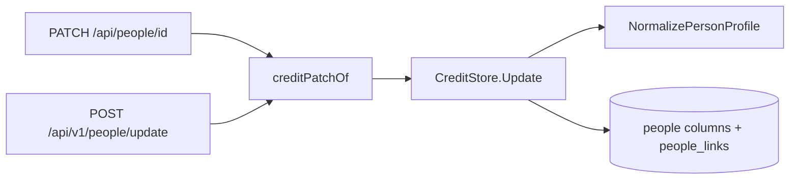

# People: profiles and faces

A person carries a fixed profile and at most one face next to the names,
aliases and external IDs that people and organizations share. The profile
rules live in [`person_profile.go`](../../internal/domain/person_profile.go)
and the storage in
[`person_profiles.go`](../../internal/store/person_profiles.go) and
[`person_images.go`](../../internal/store/person_images.go).

The diagram shows where a profile is checked and written on the way in.

## Profile fields are columns on `people`

Each field is a nullable column on `people`, and links are rows in
`people_links` ordered by position and deleted with their person. The field
set is fixed, so typed columns keep each check in one function and a list or a
person page reads the profile without a join. Organizations have no profile;
`profile` sent for an organization is `400 invalid_request`.

| Rejected | Why |
| --- | --- |
| A `person_profiles` table, one row per person | One more join on every read and a missing-row case for nothing |
| Key-value rows per field | Pivoting on read, and validation spread over the rows |

## What a valid profile is

`NormalizePersonProfile` trims every text field and stores an empty value as
`null`. Errors carry a `work_info_*` reason and the field `profile.<name>`.

| Field | Accepted | Error |
| --- | --- | --- |
| `gender` | `female`, `male`, `other` | `work_info_out_of_range` |
| `birthDate`, `deathDate` | `YYYY`, `YYYY-MM` or `YYYY-MM-DD`, the work-date format | `work_info_invalid_date` |
| `birthDate`, `deathDate` | Not after today in UTC | `work_info_out_of_range` |
| `deathDate` | Not before `birthDate` at the precision both share, so `1990` and `1990-05` fit together | `work_info_out_of_range` |
| `birthplace` | 1–200 code points | `work_info_too_long` |
| `heightCm` | 50–300 | `work_info_out_of_range` |
| `bustCm`, `waistCm`, `hipsCm` | 30–300 each | `work_info_out_of_range` |
| `cup` | 1–3 Latin letters, stored upper case | `work_info_too_long`, `work_info_out_of_range` |
| `bloodType` | `A`, `B`, `O`, `AB`, in any case | `work_info_out_of_range` |
| `careerStartYear`, `careerEndYear` | 1900–9999, the end not before the start | `work_info_out_of_range` |
| `bio` | 1–5,000 code points; line breaks kept | `work_info_too_long` |
| `links` | Up to 20 unique HTTP(S) URLs, as work URLs | `work_info_invalid_url`, `work_info_duplicate`, `work_info_too_many` |

Owners and plugins often know a date only to the year, so a date keeps its own
precision instead of being padded to a full date.

## A patch changes one field at a time

In `PATCH /api/people/{id}` and `POST /api/v1/people/update`, each `profile`
property present replaces its field, `null` clears it, and `links` replaces the
whole list. A patch that leaves the profile as it was writes nothing. Profile
writes skip the smart-folder and collection refresh that name changes trigger,
because no smart rule or collection value reads a profile.

## A merge fills the target's empty fields

The merge target keeps every field it has. Each field it lacks takes the value
of the first source, in `sourceIds` order, that has one; an empty link list
takes the first source's list. Merging a duplicate that a plugin created keeps
the profile that the plugin brought.

Fields filled from different people can contradict each other, such as a
death date from one source before the target's birth date. A source value that
would make the profile invalid is skipped, and the field takes the next
source's value or stays empty, so a merge always stores a valid profile.

| Rejected | Why |
| --- | --- |
| Keep only the target's profile | The duplicate's profile would be lost |
| Reject the merge with `400` | A merge cannot be fixed by editing its request, only by editing the people first |
| Let the owner choose per field | The merge stays one step |

## A face is one fitted JPEG in SQLite

A person has at most one face, a row in `person_images` deleted with its
person. `PUT /api/people/{id}/image` decodes the upload, fits it to 800 px on
its long side without enlarging it, and stores it as JPEG
([`person_images.go`](../../internal/app/person_images.go)). The upload uses the
thumbnail upload's body budget, byte and pixel limits, decode gate and
animated-WebP refusal, described in
[thumbnail-editing.md](thumbnail-editing.md#uploaded-images); the two kinds of
upload share one gate, so they never decode at the same time.

| Problem | Response |
| --- | --- |
| Body over 64 MiB | `413 person_image_too_large` with `limit` |
| Not a readable PNG, JPEG or still WebP, or over 120 megapixels | `400 person_image_invalid` |
| No face on `GET` | `404 person_image_not_found` |

A face is user data, so it is not a file under the rebuildable thumbnails
directory, and an 800 px JPEG of about 200 KiB costs little as a blob.

| Rejected | Why |
| --- | --- |
| A file managed by `internal/artifacts` | The thumbnails directory is rebuildable, and artifacts are removed by video content, not by person |
| Fitting through ffmpeg | Needs the media adapter for a still image, while `x/image/draw` scales without cgo |
| Keeping the original upload | An upload may be 64 MiB, and the screens show at most a portrait card |

## The image revision never repeats

`people.image_revision` increases on every change of the face: an upload, a
removal and a merge that brings a face. `Person` and the video page's
`WorkPerson` carry it as `imageRevision` only while the person has a face, the
browser loads `/api/people/{id}/image?v={imageRevision}`, and `GET` answers
`private, no-cache` with the revision as `ETag`. The counter lives on `people`,
not on the image row, so removing a face does not reset it and a later face
never answers `304` to the removed face's `ETag`.

| Rejected | Why |
| --- | --- |
| A revision on the `person_images` row | Removing the row resets it |
| A boolean `hasImage` | A replaced face would stay cached under the same URL |
| Data URLs in list responses | A page of 100 people would carry 100 faces |

A merge keeps the target's face; a target without one takes the face of the
first source in `sourceIds` order that has one.
