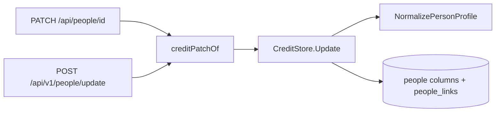

# People: profiles and faces

A person carries a fixed profile and at most one face next to the names,
aliases and external IDs that people and organizations share. The profile
rules live in [`person_profile.go`](../../internal/domain/person_profile.go)
and the storage in
[`person_profiles.go`](../../internal/store/person_profiles.go) and
[`person_images.go`](../../internal/store/person_images.go).

The diagram shows where a profile is checked and written on the way in.

## Profile fields are columns on `people`

Each field is a nullable column on `people`, and links are rows in
`people_links` ordered by position and deleted with their person. The field
set is fixed, so typed columns keep each check in one function and a list or a
person page reads the profile without a join. Organizations have no profile;
`profile` sent for an organization is `400 invalid_request`.

| Rejected                                      | Why                                                            |
| --------------------------------------------- | -------------------------------------------------------------- |
| A `person_profiles` table, one row per person | One more join on every read and a missing-row case for nothing |
| Key-value rows per field                      | Pivoting on read, and validation spread over the rows          |

## What a valid profile is

`NormalizePersonProfile` trims every text field and stores an empty value as
`null`. Errors carry a `work_info_*` reason and the field `profile.<name>`.

| Field                              | Accepted                                                                                 | Error                                                                |
| ---------------------------------- | ---------------------------------------------------------------------------------------- | -------------------------------------------------------------------- |
| `gender`                           | `female`, `male`, `other`                                                                | `work_info_out_of_range`                                             |
| `birthDate`, `deathDate`           | `YYYY`, `YYYY-MM` or `YYYY-MM-DD`, the work-date format                                  | `work_info_invalid_date`                                             |
| `birthDate`, `deathDate`           | Not after today in UTC                                                                   | `work_info_out_of_range`                                             |
| `deathDate`                        | Not before `birthDate` at the precision both share, so `1990` and `1990-05` fit together | `work_info_out_of_range`                                             |
| `birthplace`                       | 1–200 code points                                                                        | `work_info_too_long`                                                 |
| `heightCm`                         | 50–300                                                                                   | `work_info_out_of_range`                                             |
| `bustCm`, `waistCm`, `hipsCm`      | 30–300 each                                                                              | `work_info_out_of_range`                                             |
| `cup`                              | 1–3 Latin letters, stored upper case                                                     | `work_info_too_long`, `work_info_out_of_range`                       |
| `bloodType`                        | `A`, `B`, `O`, `AB`, in any case                                                         | `work_info_out_of_range`                                             |
| `careerStartYear`, `careerEndYear` | 1900–9999, the end not before the start                                                  | `work_info_out_of_range`                                             |
| `bio`                              | 1–5,000 code points; line breaks kept                                                    | `work_info_too_long`                                                 |
| `links`                            | Up to 20 unique HTTP(S) URLs, as work URLs                                               | `work_info_invalid_url`, `work_info_duplicate`, `work_info_too_many` |

Owners and plugins often know a date only to the year, so a date keeps its own
precision instead of being padded to a full date.

## A patch changes one field at a time

In `PATCH /api/people/{id}` and `POST /api/v1/people/update`, each `profile`
property present replaces its field, `null` clears it, and `links` replaces the
whole list. A patch that leaves the profile as it was writes nothing. Profile
writes skip the smart-folder and collection refresh that name changes trigger,
because no smart rule or collection value reads a profile.

## A merge fills the target's empty fields

The merge target keeps every field it has. Each field it lacks takes the value
of the first source, in `sourceIds` order, that has one; an empty link list
takes the first source's list. Merging a duplicate that a plugin created keeps
the profile that the plugin brought.

Fields filled from different people can contradict each other, such as a
death date from one source before the target's birth date. A source value that
would make the profile invalid is skipped, and the field takes the next
source's value or stays empty, so a merge always stores a valid profile.

| Rejected                       | Why                                                                              |
| ------------------------------ | -------------------------------------------------------------------------------- |
| Keep only the target's profile | The duplicate's profile would be lost                                            |
| Reject the merge with `400`    | A merge cannot be fixed by editing its request, only by editing the people first |
| Let the owner choose per field | The merge stays one step                                                         |

## A person without a canonical name is provisional

Face recognition finds people before anyone knows their names, so a person may
have no `people_names` row at all. Such a person is provisional: `Person`,
`CreditRef` and `WorkPerson` carry `provisional: true` and `name` is `""`, so
a client that ignores the flag still parses the response. The flag is read
from the missing canonical row by every person query, never stored, so a
named provisional person cannot exist. Organizations always have a name and
read `provisional: false`.

| Operation                       | Effect on a provisional person                                                                                            |
| ------------------------------- | ------------------------------------------------------------------------------------------------------------------------- |
| `GET /api/people?provisional=…` | `true` keeps only provisional people, `false` only named ones; an organization list answers `400 invalid_request`         |
| Natural-name order              | Provisional people come after every named person, by ID; the other sorts break ties the same way                          |
| `PATCH` with `name`             | The person becomes an ordinary person in the same write                                                                   |
| `PATCH` without `name`          | Profile and external-ID changes keep the person provisional; aliases need a name and answer `work_info_empty` on `name`   |
| Merge into a provisional target | The target takes the canonical name of the first source in `sourceIds` order that has one; the other names become aliases |

The name order keeps one keyset cursor by prefixing each listed sort key with
`0` for a named person and making it `1` for a provisional one, so the cursor
needs no null branch.

| Rejected                                       | Why                                                                                                |
| ---------------------------------------------- | -------------------------------------------------------------------------------------------------- |
| A `provisional` column beside the name         | Two facts that can disagree                                                                        |
| A stored placeholder name such as `Unknown 12` | It cannot follow the screen's language, it matches name searches, and a merge keeps it as an alias |

## People sort by age, unknown birth dates last

People lists take two sorts that tags and organizations do not: `ageAsc`
puts the newest birth date first and `ageDesc` the oldest. An organization
list answers either with `400 invalid_request`.

The store keeps `birth_key` next to `birth_date` as `YYYYMMDD` with missing
parts as `00`, and writes both in the same statement, so a partial date sorts
as its first possible day. Each sort reads an unknown date as the value that
sorts last in its direction, `0` for `ageAsc` and `99999999` for `ageDesc`, so
the keyset cursor keeps an integer value and its comparison has no null
branch. Ties use natural-name order, then ID, as every other sort does.

| Rejected                                  | Why                                                                   |
| ----------------------------------------- | --------------------------------------------------------------------- |
| Add the sorts to `TagSort` for every list | Tags and organizations have no birth date                             |
| Sort the loaded rows in the browser       | The list is paged by keyset, so the browser holds only the first page |

## Favorites join the shared favorites

A favorite person is a row in `person_favorites`, set and cleared through
`personIds` on `PUT /api/favorites` together with videos, groups and smart
folders. The IDs count toward the same 1–20,000 limit, missing people are
ignored, and setting a favorite again keeps its time. `Person.favorite` is
always present, and `GET /api/people?favorite=true` keeps only favorites, with
`total` counting them; an organization list answers `favorite` with
`400 invalid_request`. No smart rule reads a person favorite, so setting one
queues no smart-folder refresh.

A merge makes the target a favorite when any source is one, so merging a
duplicate never drops the mark. Deleting a person deletes its row.

| Rejected                        | Why                                                                                                                     |
| ------------------------------- | ----------------------------------------------------------------------------------------------------------------------- |
| A `favorite` column on `people` | Every other favorite is a table of its own with its time, and the shared endpoint already sets several kinds atomically |
| `PUT /api/people/{id}/favorite` | A second way to set favorites beside the shared endpoint                                                                |

## A face is one fitted JPEG in SQLite

A person has at most one face, a row in `person_images` deleted with its
person. `PUT /api/people/{id}/image` decodes the upload, fits it to 800 px on
its long side without enlarging it, and stores it as JPEG
([`person_images.go`](../../internal/app/person_images.go)). The upload uses the
thumbnail upload's body budget, byte and pixel limits, decode gate and
animated-WebP refusal, described in
[thumbnail-editing.md](thumbnail-editing.md#uploaded-images); the two kinds of
upload share one gate, so they never decode at the same time.

| Problem                                                        | Response                                  |
| -------------------------------------------------------------- | ----------------------------------------- |
| Body over 64 MiB                                               | `413 person_image_too_large` with `limit` |
| Not a readable PNG, JPEG or still WebP, or over 120 megapixels | `400 person_image_invalid`                |
| No usable face, while the face runtime is ready                | `400 person_image_no_face`                |
| More than one usable face, while the face runtime is ready     | `400 person_image_many_faces`             |
| No face on `GET`                                               | `404 person_image_not_found`              |

Face recognition checks the face
([face-recognition.md](face-recognition.md#a-face-image-merges-only-one-provisional-person)).

A face is user data, so it is not a file under the rebuildable thumbnails
directory, and an 800 px JPEG of about 200 KiB costs little as a blob.

| Rejected                               | Why                                                                                                |
| -------------------------------------- | -------------------------------------------------------------------------------------------------- |
| A file managed by `internal/artifacts` | The thumbnails directory is rebuildable, and artifacts are removed by video content, not by person |
| Fitting through ffmpeg                 | Needs the media adapter for a still image, while `x/image/draw` scales without cgo                 |
| Keeping the original upload            | An upload may be 64 MiB, and the screens show at most a portrait card                              |

## The image revision never repeats

`people.image_revision` increases on every change of the face: an upload, a
removal and a merge that brings a face. `Person` and the video page's
`WorkPerson` carry it as `imageRevision` only while the person has a face, a
client loads the face from `/api/people/{id}/image?v={imageRevision}`, and
`GET` answers `private, no-cache` with the revision as `ETag`. The counter lives on `people`,
not on the image row, so removing a face does not reset it and a later face
never answers `304` to the removed face's `ETag`.

| Rejected                              | Why                                                  |
| ------------------------------------- | ---------------------------------------------------- |
| A revision on the `person_images` row | Removing the row resets it                           |
| A boolean `hasImage`                  | A replaced face would stay cached under the same URL |
| Data URLs in list responses           | A page of 100 people would carry 100 faces           |

A merge keeps the target's face; a target without one takes the face of the
first source in `sourceIds` order that has one. Deleting or merging a person
also deletes or moves their face recognition data
([face-recognition.md](face-recognition.md#face-data-follows-its-person)).

## The people grid

`/people` is a `ListPage` of round face cards
([patterns.md, Face grid](../../web/registry/rules/patterns.md#face-grid)),
because people are found by face. A card is one link to the person page with
the face, the name and `34 · 12 videos`, the age computed as on the person
page ([Ages are computed in the browser](#ages-are-computed-in-the-browser)),
and the favorite heart outside the link. Renaming, merging and deleting moved
to the person page, so a card has no other control.

The grid reads `GET /api/people` 100 at a time with the shared paging of the
admin lists ([library-ui.md](library-ui.md)), and asks for the next page when
the end of the grid comes into view. The search, `favorite=true` and the sort,
including `ageAsc` and `ageDesc`, are sent to the server and kept in the URL;
the sort is also remembered per browser. `New person` asks for the name in a
dialog and opens the new person's page. Organizations keep the table.

| Rejected                             | Why                                                                        |
| ------------------------------------ | -------------------------------------------------------------------------- |
| Cards inside `AdminTablePage`        | The design system keeps cards out of that skeleton                         |
| A virtualized grid                   | Library card grids are not virtualized, and the list pages 100 at a time   |
| Row actions on a card                | A card is one link; the person page holds the actions with room to confirm |
| Portrait, square or horizontal cards | A round face shows more people per row and reads as a person, not a video  |

## The person page

`/people/:id` shows one person in a `ProfilePage`
([design-system.md](design-system.md#page-patterns)): the face, the name,
aliases, the filled profile groups, links and external IDs in a column at the
left, and the person's videos beside it, so the videos start at the top while
the face and facts stay in view. The page reads the person with
`GET /api/people/{id}` and the videos with `GET /api/videos?person={id}`, in
the library's default order; the role filter adds `personRole`, so totals and
paging stay the server's ([library-ui.md](library-ui.md)). The page is
owner-only, as the rest of `/people`.

The face, its upload and removal, the favorite heart, merging and deleting
happen on the page. Each request that answers `404 person_not_found` turns the
page into its gone state; a merge opens the target's page and a delete the
people list, each with a toast. The person's own fields are edited on
`/people/:id/edit`.

### The edit page

`/people/:id/edit` is a `FormPage` outside the shell that edits the name,
aliases, external IDs, links and every profile field together, built and left
as the video details editor is
([library-ui.md](library-ui.md#details-editor)): the same band, the same
`Discard changes?` on `Cancel`, the aside's link and the browser's Back, and
the same return along the history when the person page opened it. Organizations
keep the details dialog.

`Save` sends one `PATCH /api/people/{id}` with only the properties that differ
from the person as loaded, so a change made elsewhere to another property
survives; an edited list replaces the whole list, and an emptied field is sent
as `null`. With nothing changed, `Save` returns without a request. The
response goes back to the person page in memory, so it shows the saved person
without reading it again; opened by its URL, the page reads the person first.
A reason with a `field` stays under that input with every other input kept.
Number inputs keep only digits, so a value the server reads is always a whole
number or empty.

| Rejected                         | Why                                                                                |
| -------------------------------- | ---------------------------------------------------------------------------------- |
| A dialog per group of fields     | The owner had to reopen the editor for each change                                 |
| One `FormDialog` for every field | More than a dozen fields break that skeleton's rule of a few fields for one action |

### Ages are computed in the browser

The API returns dates, not ages, because an age changes at midnight in the
viewer's time zone and a cached response would show yesterday's age. The page
computes the age on the viewer's local date, or on the death date when there
is one ([`personFacts.ts`](../../web/src/credits/person/personFacts.ts)). A
partial date stands for every day it allows, so the page shows the youngest
and oldest ages the two dates allow, such as `1990 (age 34–35)`, and one age
when both are equal.

| Rejected                    | Why                                              |
| --------------------------- | ------------------------------------------------ |
| `age` in the response       | Stale after midnight in a cached response        |
| No age at partial precision | A year alone still narrows the age to two values |

### Candidates and faces in videos

A person's face-recognition results sit in the profile column under the face,
not in the main column: the owner judges a candidate by comparing two faces,
and the profile face is the large one, while the main column stays the videos.
`Same person?` comes first in the column, drawn only while
`GET /api/people/{id}/face-candidates` returns a pair, one row per pair with
the other person's `PersonFace judge`, name and similarity, and `Same person`
and `Not the same` under them. A confirm from a provisional person's own page
opens the merged person's page, since the shown person no longer exists; one
that keeps the page reads the candidates and the faces again and reloads the
videos. A pressed row disables only its own buttons.

`Faces in videos` follows the profile groups, drawn only while
`GET /api/people/{id}/appearances` returns an appearance: a `PersonFace scene`
crop beside the video's title and its spans, each a link that plays the video
from that time (`?t=`), and `Show more` for the next page. An appearance whose
video left the library reads `Not in the library` without links.

| Rejected | Why |
| --- | --- |
| Candidates in the main column | They would split the page's one header and one grid, and sit away from the face they are compared with |
| A strip of crops alone | Reaching a scene would take a second press, and a crop does not say which video |
| Confirming on another screen | The owner settles a pair where both faces are in view |

## Faces elsewhere on the screens

On the video page, each person in the work details row is a `PersonFace chip`
and the name inside one link to `/people/:id`, named `Open {name}`, so the
cast opens the person page instead of the filtered library; the chip sits on
the name's line and keeps the row's height. Organizations keep their text links
to the filtered library, and the fold after three names is unchanged.

In the comparison of a work-info fetch
([work-info-plugins.md](work-info-plugins.md#peoples-images-are-fetched-like-the-cover-and-become-faces-after-the-commit)),
a fetched person with a kept image shows `PersonFace compare` before the name,
and each fetched person with a profile adds one muted line `Fills only empty
fields: …` under the chips, because the apply never replaces a stored value.
Three lines show at first and the rest fold behind `+N more`, which shows them
all when expanded, so the chips stay the primary content of the row.

## Provisional people on the screens

A provisional person
([A person without a canonical name is provisional](#a-person-without-a-canonical-name-is-provisional))
is drawn as any person, with `Unnamed person` in `muted-foreground` where the
name goes: the grid card, the person page's `h1` and document title, the video
page's cast chip, the details editor's chips and the library's person filter
chip. The quieter name line alone separates an unnamed card from a named one,
so the faces stay what the eye scans; a badge on every unnamed card was
rejected for competing with them. The screens map the flag to the words in one
place, [`displayName.ts`](../../web/src/credits/displayName.ts), so the empty
`name` never reaches a screen.

The grid's filter adds a `Name` select (`Any`, `Named`, `Unnamed`) that sends
`provisional=false` or `true` and is kept in the URL as `named=1` or `named=0`.
A provisional person's page offers `Name…` in place of `Edit`; the edit page
shows the empty name with the placeholder `Unnamed person`, and `Save` with the
name still empty sends no `name`, so the person stays provisional.

The `Performers` picker of the details editor lists provisional people under
`Unnamed people` (`GET /api/people?provisional=true` with the picker's limit).
Choosing one while a name is typed adds a chip with that name, and `Save`
sends that name by `PATCH /api/people/{id}` before it creates new people or
writes the credits, so a refused name stops the save before the video changes.
