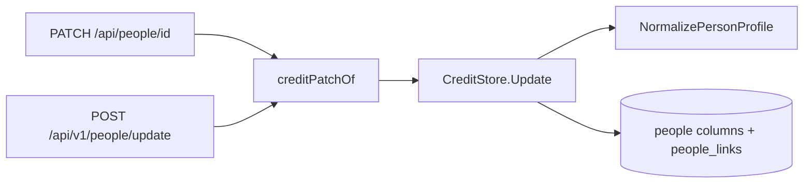

# People: profiles

A person carries a fixed profile next to the names, aliases and external IDs
that people and organizations share. The rules live in
[`person_profile.go`](../../internal/domain/person_profile.go) and the storage
in [`person_profiles.go`](../../internal/store/person_profiles.go).

The diagram shows where a profile is checked and written on the way in.

## Profile fields are columns on `people`

Each field is a nullable column on `people`, and links are rows in
`people_links` ordered by position and deleted with their person. The field
set is fixed, so typed columns keep each check in one function and a list or a
person page reads the profile without a join. Organizations have no profile;
`profile` sent for an organization is `400 invalid_request`.

| Rejected | Why |
| --- | --- |
| A `person_profiles` table, one row per person | One more join on every read and a missing-row case for nothing |
| Key-value rows per field | Pivoting on read, and validation spread over the rows |

## What a valid profile is

`NormalizePersonProfile` trims every text field and stores an empty value as
`null`. Errors carry a `work_info_*` reason and the field `profile.<name>`.

| Field | Accepted | Error |
| --- | --- | --- |
| `gender` | `female`, `male`, `other` | `work_info_out_of_range` |
| `birthDate`, `deathDate` | `YYYY`, `YYYY-MM` or `YYYY-MM-DD`, the work-date format | `work_info_invalid_date` |
| `birthDate`, `deathDate` | Not after today in UTC | `work_info_out_of_range` |
| `deathDate` | Not before `birthDate` at the precision both share, so `1990` and `1990-05` fit together | `work_info_out_of_range` |
| `birthplace` | 1–200 code points | `work_info_too_long` |
| `heightCm` | 50–300 | `work_info_out_of_range` |
| `bustCm`, `waistCm`, `hipsCm` | 30–300 each | `work_info_out_of_range` |
| `cup` | 1–3 Latin letters, stored upper case | `work_info_too_long`, `work_info_out_of_range` |
| `bloodType` | `A`, `B`, `O`, `AB`, in any case | `work_info_out_of_range` |
| `careerStartYear`, `careerEndYear` | 1900–9999, the end not before the start | `work_info_out_of_range` |
| `bio` | 1–5,000 code points; line breaks kept | `work_info_too_long` |
| `links` | Up to 20 unique HTTP(S) URLs, as work URLs | `work_info_invalid_url`, `work_info_duplicate`, `work_info_too_many` |

Owners and plugins often know a date only to the year, so a date keeps its own
precision instead of being padded to a full date.

## A patch changes one field at a time

In `PATCH /api/people/{id}` and `POST /api/v1/people/update`, each `profile`
property present replaces its field, `null` clears it, and `links` replaces the
whole list. A patch that leaves the profile as it was writes nothing. Profile
writes skip the smart-folder and collection refresh that name changes trigger,
because no smart rule or collection value reads a profile.

## A merge fills the target's empty fields

The merge target keeps every field it has. Each field it lacks takes the value
of the first source, in `sourceIds` order, that has one; an empty link list
takes the first source's list. Merging a duplicate that a plugin created keeps
the profile that the plugin brought.

| Rejected | Why |
| --- | --- |
| Keep only the target's profile | The duplicate's profile would be lost |
| Let the owner choose per field | The merge stays one step |
